# 03 — SYSTEM DESIGN

**Dự án:** MATHK  
**Phiên bản:** 0.3  
**Trạng thái:** Đang thảo luận  
**Requirements Baseline:** v1.0 (558b25e2d1789f0ae526a4d1211be2febd0eadd6)

## 1. Architecture Drivers — Cơ sở thiết kế

### 1.1. Mục tiêu kiến trúc

MATHK là AI Mathematical Reasoning Engine, không phải chatbot giải toán đơn thuần. Engine hoạt động độc lập với giao diện, hỗ trợ sử dụng từ Python và tích hợp ứng dụng trong tương lai. Kiến trúc cần đủ linh hoạt để điều chỉnh theo kết quả nghiên cứu sau này.

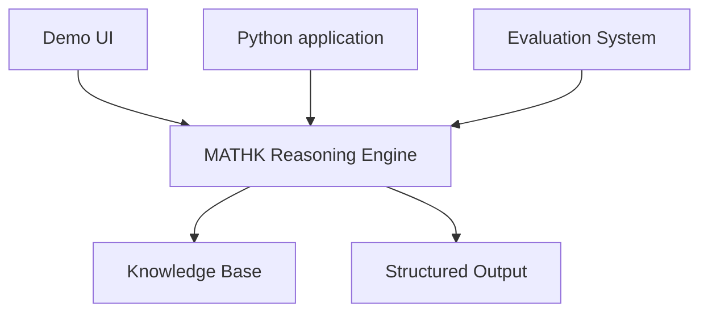

### 1.2. Functional Drivers

| ID | Architecture Driver | Nguồn |
|---|---|---|
| FD01 | Tiếp nhận và chuẩn hóa đầu vào | FR01 |
| FD02 | Biểu diễn dữ kiện đa phương thức | FR02 |
| FD03 | Phân tích và lập kế hoạch | FR03 |
| FD04 | Truy xuất tri thức thích ứng | FR04 |
| FD05 | Suy luận kết hợp công cụ toán học | FR05 |
| FD06 | Kiểm chứng và tự sửa lỗi | FR06 |
| FD07 | Điều phối Agent động | FR07 |
| FD08 | Phát hiện và xử lý bất định | FR08 |
| FD09 | Đầu ra có cấu trúc | FR09 |
| FD10 | Thực nghiệm và đánh giá | FR10 |

Các driver không nhất thiết tương ứng với Agent hoặc service riêng; ưu tiên module thông thường khi phù hợp.

### 1.3. Quality Attribute Drivers

| Nhóm | Thuộc tính |
|---|---|
| A — Chi phối kiến trúc cốt lõi | NFR01 Mathematical Correctness, NFR02 Reliability, NFR03 Performance, NFR04 Cost Efficiency, NFR05 Modifiability, NFR06 Extensibility |
| B — Xuyên suốt | NFR07 Reproducibility, NFR08 Observability, NFR09 Security & Privacy |
| C — Hỗ trợ sử dụng và mở rộng | NFR10 Usability, NFR11 Portability, NFR12 Scalability |

Không thay đổi mức ưu tiên P0/P1 trong Requirements.

### 1.4. Architecture Principles

| ID | Nguyên tắc | Ý nghĩa |
|---|---|---|
| AP01 | Local-first | Ưu tiên chạy trên máy cá nhân. |
| AP02 | Modularity | Module có trách nhiệm rõ ràng. |
| AP03 | Separation of Concerns | Tách suy luận, giao diện, dữ liệu và thực nghiệm. |
| AP04 | Loose Coupling | Hạn chế phụ thuộc trực tiếp. |
| AP05 | Interface-first | Giao tiếp qua interface và schema rõ ràng. |
| AP06 | Deterministic-first | Ưu tiên thuật toán xác định; dùng LLM khi cần. |
| AP07 | State-driven Execution | Điều phối theo trạng thái thực thi có cấu trúc. |
| AP08 | Model Independence | Không phụ thuộc cứng vào một LLM Provider. |
| AP09 | Tool Extensibility | Bổ sung công cụ mà không sửa toàn bộ Agent. |
| AP10 | Bounded Execution | Giới hạn vòng lặp, timeout và tài nguyên. |
| AP11 | Verification-aware | Kết quả kiểm chứng có thể ảnh hưởng điều phối. |
| AP12 | Configuration-driven | Tách prompt, tham số, mô hình và chiến lược khỏi logic nghiệp vụ. |
| AP13 | Research-first Observability | Ghi nhận thông tin thực nghiệm từ đầu. |
| AP14 | Secure by Design | Kiểm soát dữ liệu, API key và quyền thực thi công cụ. |
| AP15 | Incremental Development | Phát triển theo MVP-A đến MVP-D. |
| AP16 | Shared Database by Default | Mặc định dùng database chung; phân chia quyền sở hữu dữ liệu theo trách nhiệm module; truy cập qua Storage/Repository Layer; cho phép lưu trữ riêng hoặc chuyên biệt khi có nhu cầu. |

Deterministic-first: dùng Python cho validation, giới hạn tài nguyên, tính chi phí và metrics; SymPy cho tính toán ký hiệu phù hợp; LLM/VLM cho hiểu đề, lập kế hoạch, suy luận ngữ nghĩa kết hợp quy tắc. Không biến mọi module thành Agent.

State-driven Execution: Agent đọc phần dữ liệu cần thiết từ Shared State, trả về cập nhật có cấu trúc; Orchestrator áp dụng cập nhật hợp lệ và quyết định bước tiếp theo.

Configuration-driven: sử dụng cùng Engine với cấu hình mô hình, Routing, Verification, Tools và Retrieval có thể thay đổi để thực nghiệm. Schema cấu hình chưa chốt.

Shared Database: Shared State là trạng thái logic của phiên suy luận, không đồng nghĩa với database. Có thể phân nhóm dữ liệu Sessions, Problems, Planning, Reasoning, Verification, Knowledge, Execution và Evaluation. Agent không truy cập tùy ý trực tiếp vào database. Có thể sử dụng Vector Store chuyên biệt phục vụ RAG hoặc database riêng khi có nhu cầu; chưa chốt schema và công nghệ lưu trữ.

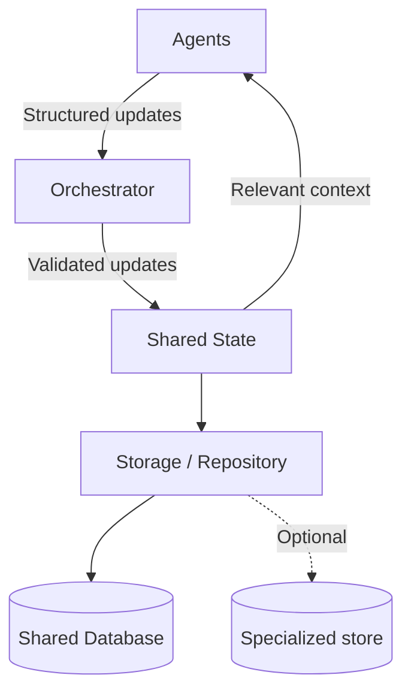

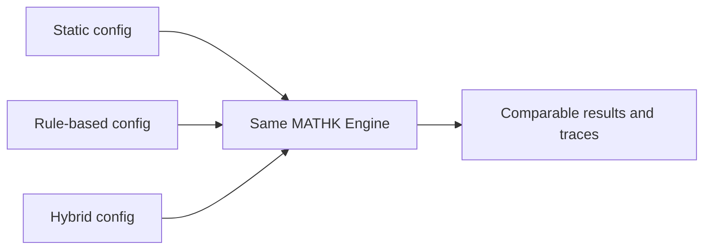

### 1.5. Kiến trúc không ưu tiên trong MVP

Không yêu cầu Microservices phân tán, Kubernetes, Message Broker, GPU Server chuyên dụng, Agent cho mọi tác vụ, frontend phức tạp hoặc huấn luyện LLM từ đầu. Không bắt buộc database riêng cho từng Agent; áp dụng AP16. Đây không phải lệnh cấm mở rộng về sau.

### 1.6. Thứ tự ưu tiên khi đánh đổi thiết kế

1. Mathematical Correctness & Reliability.
2. Research Reproducibility.
3. Performance & Cost Efficiency.
4. Modifiability & Extensibility.
5. Usability & Portability.
6. Large-scale Scalability.

Thứ tự trên không phải trọng số định lượng. Security & Privacy là ràng buộc bắt buộc xuyên suốt, không đánh đổi để giảm chi phí hay tăng hiệu năng.

## 2. Architecture Style — Phong cách kiến trúc

### 2.1. Phân loại kiến trúc

Phân biệt Deployment Architecture (đóng gói và triển khai), Internal Architecture (tổ chức mã nguồn và phụ thuộc), Execution Architecture (phối hợp thực thi Agent) và Data Architecture (tổ chức và chia sẻ dữ liệu). Các lựa chọn thuộc những khía cạnh khác nhau có thể kết hợp.

### 2.2. Deployment Architecture

| Tiêu chí | Traditional Monolith | Modular Monolith | Microservices |
|---|---|---|---|
| Triển khai local | Đơn giản | Đơn giản | Phức tạp hơn |
| Modularity | Tùy thiết kế | Cao | Cao |
| Kiểm thử độc lập | Tùy thiết kế | Tốt | Tốt |
| Giao tiếp nội bộ | Function | Interface/Function | Network |
| Shared State | Dễ | Dễ | Phức tạp hơn |
| Chi phí hạ tầng | Thấp | Thấp | Tùy triển khai |
| Mở rộng độc lập khi chạy | Hạn chế | Hạn chế | Tốt |
| Phù hợp MVP | Khá | Rất tốt | Thấp |

Chọn Modular Monolith: module có trách nhiệm và interface rõ ràng, cùng thuộc một hệ thống triển khai; ưu tiên lời gọi hàm Python thay cho HTTP nội bộ. Multi-Agent không đòi hỏi Microservices; Agent có thể cùng chạy trong một tiến trình.

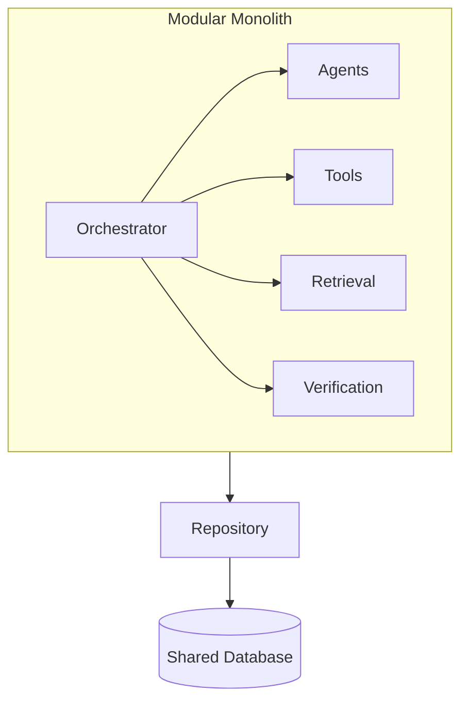

### 2.3. Internal Architecture

Layered Architecture phân chia trách nhiệm theo tầng; Clean Architecture bảo vệ logic nghiệp vụ bằng quan hệ phụ thuộc hướng vào lõi; Hexagonal Architecture sử dụng Ports & Adapters để tách lõi khỏi hạ tầng.

Chọn Lightweight Hexagonal Architecture: áp dụng Ports & Adapters có chọn lọc, tránh trừu tượng hóa quá mức. Core gồm orchestration, Agent Logic, Domain Models và Business Rules. Demo, CLI và Benchmark sử dụng Input Port; LLM, Math Tools, Retrieval và Storage được tích hợp qua interface và adapter phù hợp. Core không phụ thuộc trực tiếp vào SDK của LLM Provider. Interface cụ thể chưa chốt.

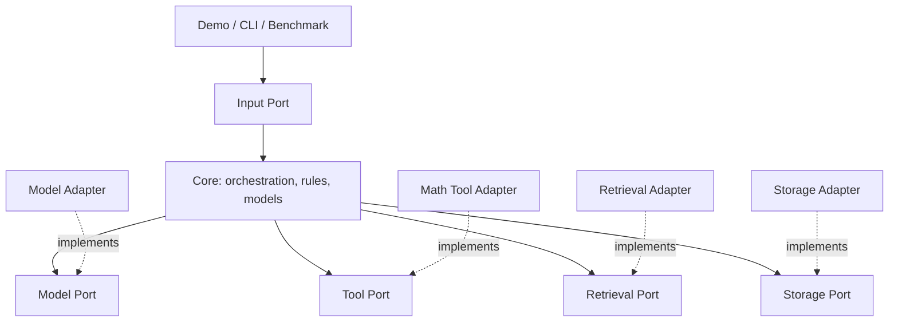

### 2.4. Execution Architecture

| Tiêu chí | Sequential | Supervisor | State Graph |
|---|---|---|---|
| Luồng cố định | Tốt | Có thể | Tốt |
| Điều phối thích ứng | Hạn chế | Tốt | Tốt |
| Vòng lặp sửa lỗi | Cần bổ sung | Tốt | Tốt |
| Kiểm soát chuyển tiếp | Cao | Tùy Supervisor | Cao |
| Truy vết | Dễ | Tùy thiết kế | Tốt |
| Độ phức tạp | Thấp | Trung bình | Trung bình |
| Vai trò trong MATHK | Baseline | Hỗ trợ | Kiến trúc chính |

Chọn State Graph kết hợp Hybrid Orchestration. Node là Agent hoặc tác vụ xác định; Edge là chuyển tiếp; Conditional Edge phụ thuộc điều kiện hoặc Routing; State chứa dữ liệu hiện tại; Termination Condition kiểm soát kết thúc và dừng an toàn.

Orchestrator sử dụng Shared State, quy tắc xác định và LLM khi cần; không bắt buộc Supervisor LLM riêng cho mỗi quyết định. Hỗ trợ tuyến tuần tự, rút gọn, có điều kiện và vòng sửa lỗi giới hạn. Ví dụ khái niệm: Input → Perception → Routing → Lightweight hoặc Structured → Reasoning → Verification → Output hoặc Correction và kiểm chứng lại. Đây chưa phải workflow chính thức. Framework chưa được chọn.

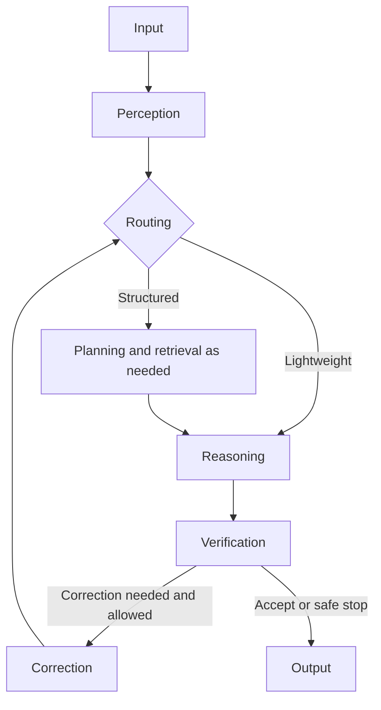

### 2.5. Kiến trúc kết hợp

Graph-orchestrated Modular Monolith with Ports & Adapters:
- Deployment: Modular Monolith.
- Internal: Lightweight Hexagonal Architecture.
- Execution: State Graph & Hybrid Orchestration.
- Data: Shared Database by Default, quyền sở hữu dữ liệu theo module, hỗ trợ lưu trữ chuyên biệt.

Tên gọi mô tả tổ hợp kiến trúc, không tuyên bố Architecture Pattern mới.

### 2.6. Architecture Decision Records

| ID | Quyết định | Lý do chính |
|---|---|---|
| ADR001 | Modular Monolith | Phù hợp Local-first và nguồn lực cá nhân. |
| ADR002 | Lightweight Hexagonal | Giảm phụ thuộc framework và Provider. |
| ADR003 | State Graph & Hybrid Orchestration | Hỗ trợ Adaptive Routing và Verification. |
| ADR004 | Shared Database by Default | Đơn giản hóa quản lý dữ liệu và tính nhất quán. |

ADR lưu trong System Design, chưa cần file riêng.

### 2.7. Đánh đổi

| Hạn chế | Hướng xử lý |
|---|---|
| Module chia sẻ tiến trình | Kiểm soát lỗi và timeout từng tác vụ. |
| Hạn chế scale độc lập từng Agent | Duy trì interface để có thể tách module về sau. |
| State Graph có thể phức tạp | Giới hạn chuyển tiếp và chia subgraph khi cần. |
| Shared Database có nguy cơ phụ thuộc schema | Repository Layer và quyền sở hữu dữ liệu. |
| Ports & Adapters tăng lượng mã | Chỉ tạo interface tại ranh giới cần thiết. |

Kiểm soát timeout không đồng nghĩa với cô lập lỗi tiến trình hoàn toàn.

## 3. High-Level Architecture — Kiến trúc tổng thể

### 3.1. System Context

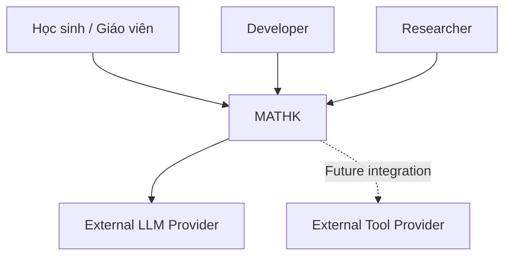

SymPy, Calculator, Knowledge Base và Agents thuộc phạm vi nội bộ. External Tool Provider không bắt buộc trong MVP.

### 3.2. Kiến trúc tổng thể

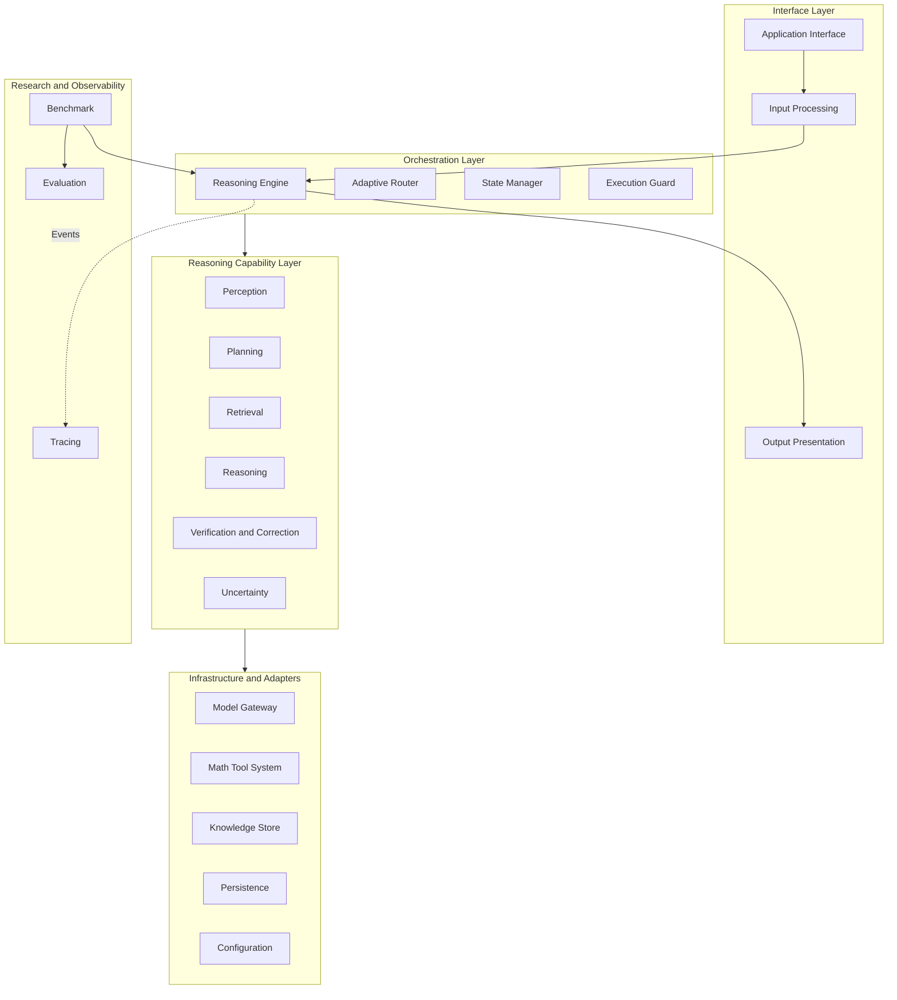

Năm vùng trách nhiệm logic, không phải năm service hoặc thứ tự phụ thuộc mã nguồn bắt buộc. Core định nghĩa interface, Adapter triển khai interface. Research & Observability xuyên suốt hệ thống; mũi tên mô tả tương tác logic.

### 3.3. Danh sách module

| ID | Vùng | Module | Trách nhiệm |
|---|---|---|---|
| M01 | Interface | Input Processing | Tiếp nhận, kiểm tra, chuẩn hóa đầu vào |
| M02 | Interface | Output Presentation | Render Markdown, LaTeX, JSON |
| M03 | Interface | Application Interface | Demo UI, CLI, Python API |
| M04 | Orchestration | Reasoning Engine | Điều phối workflow và giao diện giải toán |
| M05 | Orchestration | Adaptive Router | Chọn tuyến và mức suy luận |
| M06 | Orchestration | State Manager | Quản lý Shared State và cập nhật |
| M07 | Orchestration | Execution Guard | Kiểm soát hành động, timeout, tài nguyên, dừng |
| M08 | Capability | Multimodal Perception | Hiểu đề và dữ kiện trực quan |
| M09 | Capability | Problem Analysis & Planning | Phân tích, phân loại, lập kế hoạch |
| M10 | Capability | Knowledge Retrieval | Truy xuất tri thức toán học |
| M11 | Capability | Mathematical Reasoning | Suy luận và dùng công cụ |
| M12 | Capability | Verification & Correction | Kiểm chứng, phát hiện lỗi, hỗ trợ sửa lỗi |
| M13 | Capability | Uncertainty Management | Tổng hợp tín hiệu và đề xuất xử lý bất định |
| M14 | Adapter | Model Gateway | Interface và adapter LLM/VLM |
| M15 | Adapter | Mathematical Tool System | Registry, validation, thực thi công cụ |
| M16 | Adapter | Knowledge Store | Lưu trữ, indexing, tìm kiếm |
| M17 | Adapter | Persistence | Repository, database, checkpoint |
| M18 | Adapter | Configuration | Cấu hình, prompt, tham số |
| M19 | Research | Benchmark Runner | Thực thi dataset và cấu hình thực nghiệm |
| M20 | Research | Evaluation | Tính metrics, đánh giá |
| M21 | Research | Execution Tracing | Sự kiện, tuyến xử lý, lỗi, chi phí |

21 module logic, không phải 21 service, package hoặc Agent bắt buộc. Python API không đồng nghĩa REST API hoặc SDK riêng. Verification & Correction có thể dùng Verifier và Reasoner thay vì Corrector Agent riêng.

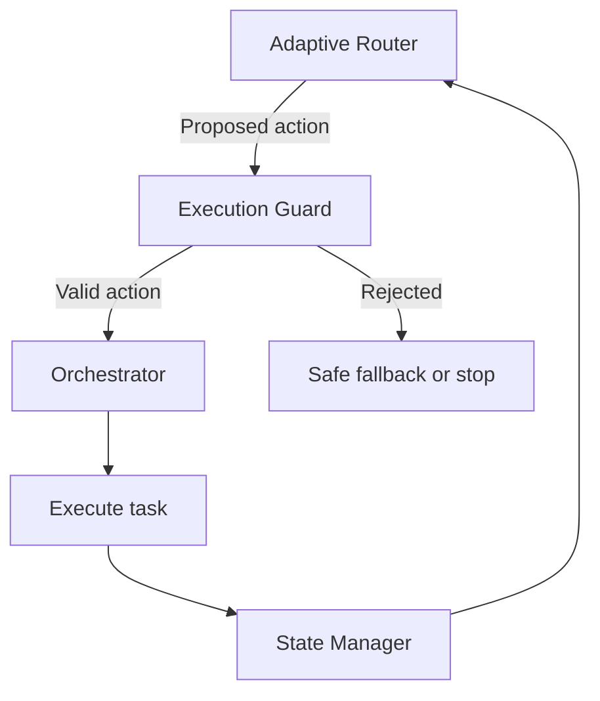

### 3.4. Control Plane và Execution Plane

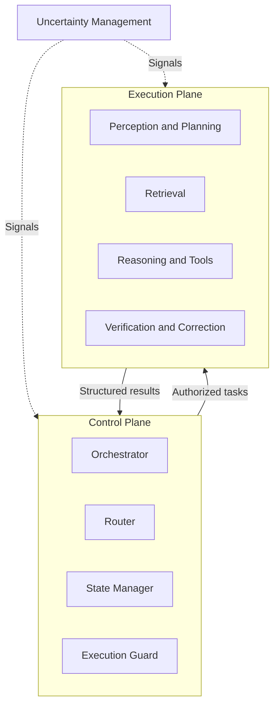

Phân chia logic, không yêu cầu hai hệ thống triển khai riêng.

### 3.5. Luồng xử lý tổng thể

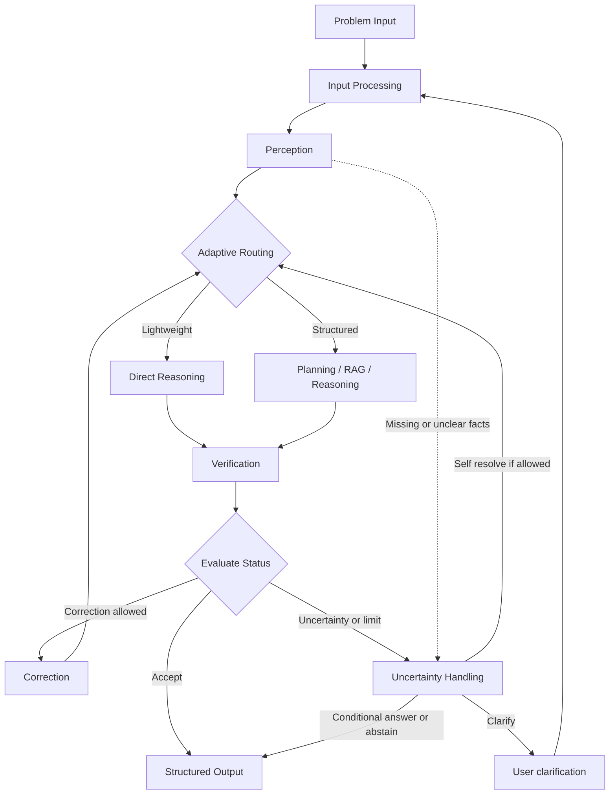

Luồng khái niệm, không phải workflow chính thức. Cả hai tuyến có thể dùng công cụ. Bất định có thể xuất hiện ở mọi giai đoạn. Kết quả Verification có thể tác động Routing, Planning và Retrieval. Mọi vòng lặp chịu giới hạn thực thi; bảo toàn trạng thái liên quan khi tiếp tục sau clarification.

### 3.6. Module Traceability

| Requirement | Module chính |
|---|---|
| FR01 | M01, M03 |
| FR02 | M08 |
| FR03 | M09 |
| FR04 | M10, M16 |
| FR05 | M11, M15 |
| FR06 | M12, M11, M15 |
| FR07 | M04, M05, M06, M07 |
| FR08 | M13, M04 |
| FR09 | M02, M04 |
| FR10 | M19, M20, M21 |

M14, M17, M18 hỗ trợ xuyên suốt. Đây là truy vết cấp module, không thay thế RTM chi tiết.

### 3.7. Ranh giới phụ thuộc

| ID | Quy tắc |
|---|---|
| AR01 | Interface gọi Engine, không tự tổ chức workflow. |
| AR02 | Agent không tự gọi Agent khác tùy ý ngoài điều phối. |
| AR03 | Router đề xuất hành động; Orchestrator kiểm soát thực thi. |
| AR04 | Agent nhận trạng thái cần thiết, trả cập nhật có cấu trúc. |
| AR05 | Kết nối LLM Provider qua Model Gateway. |
| AR06 | Thực thi công cụ qua Tool Registry và validation. |
| AR07 | Truy cập dữ liệu bền vững qua Repository hoặc Storage Interface. |
| AR08 | Evaluation không đưa đáp án tham chiếu vào phiên suy luận. |

### 3.8. Kiến trúc theo MVP

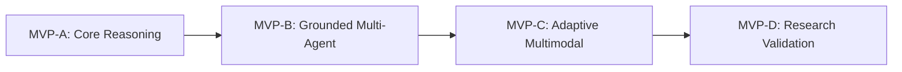

| Giai đoạn | Năng lực |
|---|---|
| MVP-A | Input, Engine, Reasoning, Model Gateway, Math Tools, Output, benchmark và tracing cơ bản |
| MVP-B | Planning, Retrieval, Verification, Correction, Shared State |
| MVP-C | Perception, Adaptive Router, Uncertainty Handling, toàn bộ P0 |
| MVP-D | Đánh giá, baseline, ablation, phân tích lỗi |

Kiểm soát tài nguyên, cấu hình và ghi log ở mức tối thiểu từ MVP-A, mở rộng dần.

## 4. Technology Stack

*Chưa chốt.*

## 5. Agent Design

*Chưa chốt.*

## 6. State Management

*Chưa chốt.*

## 7. Adaptive Routing

*Chưa chốt.*

## 8. Multimodal Processing

*Chưa chốt.*

## 9. Knowledge Base & Agentic RAG

*Chưa chốt.*

## 10. Neuro-Symbolic Tool System

*Chưa chốt.*

## 11. Verification & Self-correction

*Chưa chốt.*

## 12. Uncertainty Handling

*Chưa chốt.*

## 13. Data & Storage Design

*Chưa chốt.*

## 14. Interface & API Design

*Chưa chốt.*

## 15. Evaluation & Observability

*Chưa chốt.*

## 16. Security, Reliability & Resource Management

*Chưa chốt.*
