# 03 — SYSTEM DESIGN

**Dự án:** MATHK  
**Phiên bản:** 0.16.2  
**Trạng thái:** Đang thảo luận  
**Requirements Baseline:** v1.0 (558b25e2d1789f0ae526a4d1211be2febd0eadd6); tài liệu trực quan v1.1 (29cf094b81ae8f81bb69ba6c05e6cd0987183140)

**Đồng bộ Deployment v1.0:** Laptop mục tiêu 8 GB RAM, Full API Inference (LLM/VLM/embedding/reranker nếu dùng); BM25/FAISS, math tools, orchestration và storage chạy local. Không cần local AI model hoặc GPU; cloud thuê tạm chỉ tùy chọn. Xem [Deployment](07_DEPLOYMENT.md).

## 1. Architecture Drivers — Cơ sở thiết kế

### 1.1. Mục tiêu kiến trúc

MATHK là AI Mathematical Reasoning Engine, không phải chatbot giải toán đơn thuần. Engine hoạt động độc lập với giao diện, hỗ trợ sử dụng từ Python và tích hợp ứng dụng trong tương lai. Kiến trúc cần đủ linh hoạt để điều chỉnh theo kết quả nghiên cứu sau này.


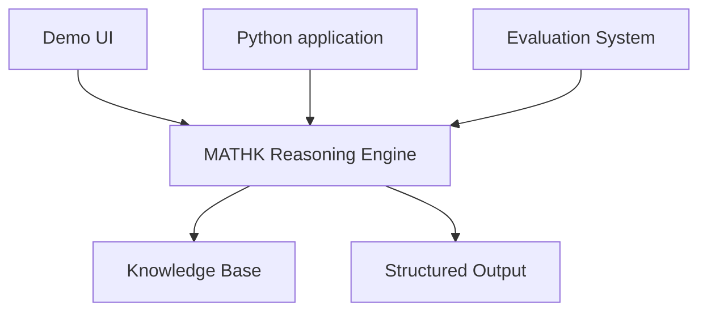

### 1.2. Functional Drivers

| ID | Architecture Driver | Nguồn |
|---|---|---|
| FD01 | Tiếp nhận và chuẩn hóa đầu vào | FR01 |
| FD02 | Biểu diễn dữ kiện đa phương thức | FR02 |
| FD03 | Phân tích và lập kế hoạch | FR03 |
| FD04 | Truy xuất tri thức thích ứng | FR04 |
| FD05 | Suy luận kết hợp công cụ toán học | FR05 |
| FD06 | Kiểm chứng và tự sửa lỗi | FR06 |
| FD07 | Điều phối Agent động | FR07 |
| FD08 | Phát hiện và xử lý bất định | FR08 |
| FD09 | Đầu ra có cấu trúc | FR09 |
| FD10 | Thực nghiệm và đánh giá | FR10 |

Các driver không nhất thiết tương ứng với Agent hoặc service riêng; ưu tiên module thông thường khi phù hợp.

### 1.3. Quality Attribute Drivers

| Nhóm | Thuộc tính |
|---|---|
| A — Chi phối kiến trúc cốt lõi | NFR01 Mathematical Correctness, NFR02 Reliability, NFR03 Performance, NFR04 Cost Efficiency, NFR05 Modifiability, NFR06 Extensibility |
| B — Xuyên suốt | NFR07 Reproducibility, NFR08 Observability, NFR09 Security & Privacy |
| C — Hỗ trợ sử dụng và mở rộng | NFR10 Usability, NFR11 Portability, NFR12 Scalability |

Không thay đổi mức ưu tiên P0/P1 trong Requirements.

### 1.4. Architecture Principles

| ID | Nguyên tắc | Ý nghĩa |
|---|---|---|
| AP01 | Local-first | Ưu tiên chạy trên máy cá nhân. |
| AP02 | Modularity | Module có trách nhiệm rõ ràng. |
| AP03 | Separation of Concerns | Tách suy luận, giao diện, dữ liệu và thực nghiệm. |
| AP04 | Loose Coupling | Hạn chế phụ thuộc trực tiếp. |
| AP05 | Interface-first | Giao tiếp qua interface và schema rõ ràng. |
| AP06 | Deterministic-first | Ưu tiên thuật toán xác định; dùng LLM khi cần. |
| AP07 | State-driven Execution | Điều phối theo trạng thái thực thi có cấu trúc. |
| AP08 | Model Independence | Không phụ thuộc cứng vào một LLM Provider. |
| AP09 | Tool Extensibility | Bổ sung công cụ mà không sửa toàn bộ Agent. |
| AP10 | Bounded Execution | Giới hạn vòng lặp, timeout và tài nguyên. |
| AP11 | Verification-aware | Kết quả kiểm chứng có thể ảnh hưởng điều phối. |
| AP12 | Configuration-driven | Tách prompt, tham số, mô hình và chiến lược khỏi logic nghiệp vụ. |
| AP13 | Research-first Observability | Ghi nhận thông tin thực nghiệm từ đầu. |
| AP14 | Secure by Design | Kiểm soát dữ liệu, API key và quyền thực thi công cụ. |
| AP15 | Incremental Development | Phát triển theo MVP-A đến MVP-D. |
| AP16 | Shared Database by Default | Mặc định dùng database chung; phân chia quyền sở hữu dữ liệu theo trách nhiệm module; truy cập qua Storage/Repository Layer; cho phép lưu trữ riêng hoặc chuyên biệt khi có nhu cầu. |

Deterministic-first: dùng Python cho validation, giới hạn tài nguyên, tính chi phí và metrics; SymPy cho tính toán ký hiệu phù hợp; LLM/VLM cho hiểu đề, lập kế hoạch, suy luận ngữ nghĩa kết hợp quy tắc. Không biến mọi module thành Agent.

State-driven Execution: Agent đọc phần dữ liệu cần thiết từ Shared State, trả về cập nhật có cấu trúc; Orchestrator áp dụng cập nhật hợp lệ và quyết định bước tiếp theo.

Configuration-driven: sử dụng cùng Engine với cấu hình mô hình, Routing, Verification, Tools và Retrieval có thể thay đổi để thực nghiệm. Schema cấu hình chưa chốt.

Shared Database: Shared State là trạng thái logic của phiên suy luận, không đồng nghĩa với database. Có thể phân nhóm dữ liệu Sessions, Problems, Planning, Reasoning, Verification, Knowledge, Execution và Evaluation. Agent không truy cập tùy ý trực tiếp vào database. Có thể sử dụng Vector Store chuyên biệt phục vụ RAG hoặc database riêng khi có nhu cầu; chưa chốt schema và công nghệ lưu trữ.


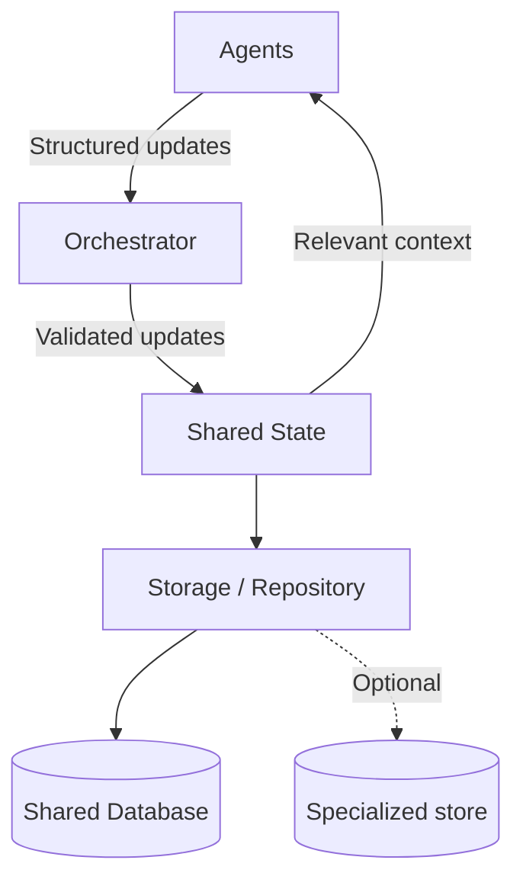


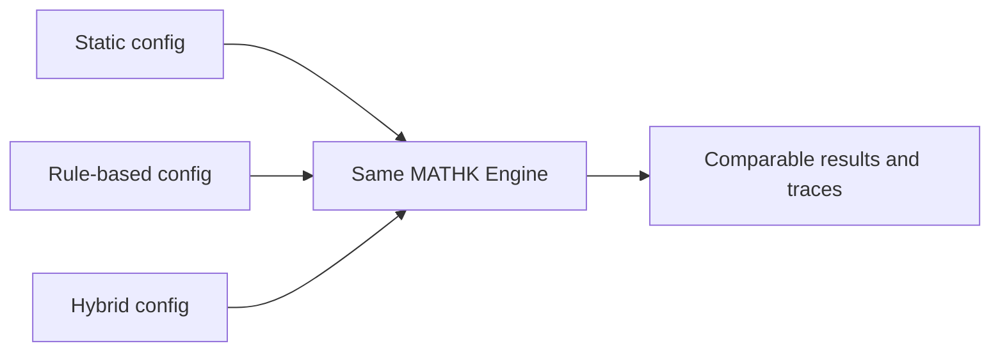

### 1.5. Kiến trúc không ưu tiên trong MVP

Không yêu cầu Microservices phân tán, Kubernetes, Message Broker, GPU Server chuyên dụng, Agent cho mọi tác vụ, frontend phức tạp hoặc huấn luyện LLM từ đầu. Không bắt buộc database riêng cho từng Agent; áp dụng AP16. Đây không phải lệnh cấm mở rộng về sau.

### 1.6. Thứ tự ưu tiên khi đánh đổi thiết kế

1. Mathematical Correctness & Reliability.
2. Research Reproducibility.
3. Performance & Cost Efficiency.
4. Modifiability & Extensibility.
5. Usability & Portability.
6. Large-scale Scalability.

Thứ tự trên không phải trọng số định lượng. Security & Privacy là ràng buộc bắt buộc xuyên suốt, không đánh đổi để giảm chi phí hay tăng hiệu năng.

## 2. Architecture Style — Phong cách kiến trúc

### 2.1. Phân loại kiến trúc

Phân biệt Deployment Architecture (đóng gói và triển khai), Internal Architecture (tổ chức mã nguồn và phụ thuộc), Execution Architecture (phối hợp thực thi Agent) và Data Architecture (tổ chức và chia sẻ dữ liệu). Các lựa chọn thuộc những khía cạnh khác nhau có thể kết hợp.

### 2.2. Deployment Architecture

| Tiêu chí | Traditional Monolith | Modular Monolith | Microservices |
|---|---|---|---|
| Triển khai local | Đơn giản | Đơn giản | Phức tạp hơn |
| Modularity | Tùy thiết kế | Cao | Cao |
| Kiểm thử độc lập | Tùy thiết kế | Tốt | Tốt |
| Giao tiếp nội bộ | Function | Interface/Function | Network |
| Shared State | Dễ | Dễ | Phức tạp hơn |
| Chi phí hạ tầng | Thấp | Thấp | Tùy triển khai |
| Mở rộng độc lập khi chạy | Hạn chế | Hạn chế | Tốt |
| Phù hợp MVP | Khá | Rất tốt | Thấp |

Chọn Modular Monolith: module có trách nhiệm và interface rõ ràng, cùng thuộc một hệ thống triển khai; ưu tiên lời gọi hàm Python thay cho HTTP nội bộ. Multi-Agent không đòi hỏi Microservices; Agent có thể cùng chạy trong một tiến trình.


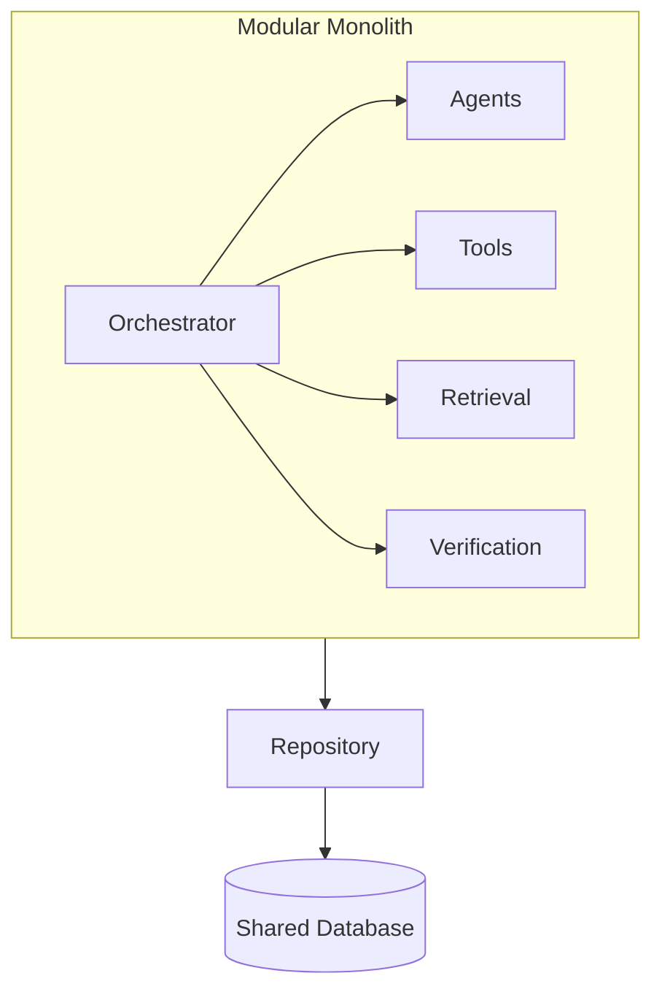

### 2.3. Internal Architecture

Layered Architecture phân chia trách nhiệm theo tầng; Clean Architecture bảo vệ logic nghiệp vụ bằng quan hệ phụ thuộc hướng vào lõi; Hexagonal Architecture sử dụng Ports & Adapters để tách lõi khỏi hạ tầng.

Chọn Lightweight Hexagonal Architecture: áp dụng Ports & Adapters có chọn lọc, tránh trừu tượng hóa quá mức. Core gồm orchestration, Agent Logic, Domain Models và Business Rules. Demo, CLI và Benchmark sử dụng Input Port; LLM, Math Tools, Retrieval và Storage được tích hợp qua interface và adapter phù hợp. Core không phụ thuộc trực tiếp vào SDK của LLM Provider. Interface cụ thể chưa chốt.


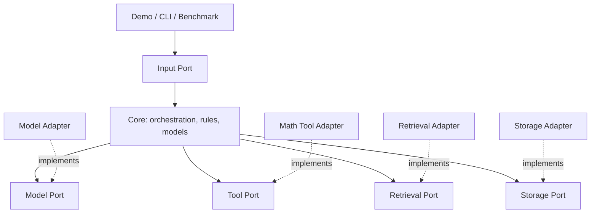

### 2.4. Execution Architecture

| Tiêu chí | Sequential | Supervisor | State Graph |
|---|---|---|---|
| Luồng cố định | Tốt | Có thể | Tốt |
| Điều phối thích ứng | Hạn chế | Tốt | Tốt |
| Vòng lặp sửa lỗi | Cần bổ sung | Tốt | Tốt |
| Kiểm soát chuyển tiếp | Cao | Tùy Supervisor | Cao |
| Truy vết | Dễ | Tùy thiết kế | Tốt |
| Độ phức tạp | Thấp | Trung bình | Trung bình |
| Vai trò trong MATHK | Baseline | Hỗ trợ | Kiến trúc chính |

Chọn State Graph kết hợp Hybrid Orchestration. Node là Agent hoặc tác vụ xác định; Edge là chuyển tiếp; Conditional Edge phụ thuộc điều kiện hoặc Routing; State chứa dữ liệu hiện tại; Termination Condition kiểm soát kết thúc và dừng an toàn.

Orchestrator sử dụng Shared State, quy tắc xác định và LLM khi cần; không bắt buộc Supervisor LLM riêng cho mỗi quyết định. Hỗ trợ tuyến tuần tự, rút gọn, có điều kiện và vòng sửa lỗi giới hạn. Ví dụ khái niệm: Input → Perception → Routing → Lightweight hoặc Structured → Reasoning → Verification → Output hoặc Correction và kiểm chứng lại. Đây chưa phải workflow chính thức. Framework chưa được chọn.


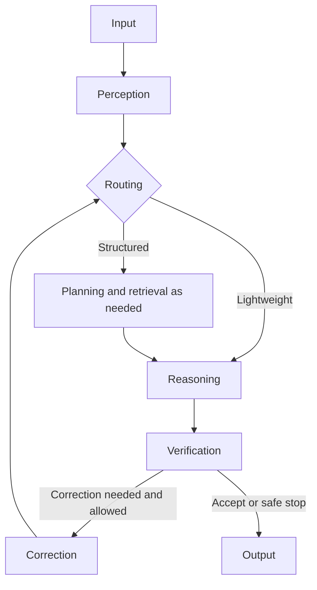

### 2.5. Kiến trúc kết hợp

Graph-orchestrated Modular Monolith with Ports & Adapters:
- Deployment: Modular Monolith.
- Internal: Lightweight Hexagonal Architecture.
- Execution: State Graph & Hybrid Orchestration.
- Data: Shared Database by Default, quyền sở hữu dữ liệu theo module, hỗ trợ lưu trữ chuyên biệt.

Tên gọi mô tả tổ hợp kiến trúc, không tuyên bố Architecture Pattern mới.

### 2.6. Architecture Decision Records

| ID | Quyết định | Lý do chính |
|---|---|---|
| ADR001 | Modular Monolith | Phù hợp Local-first và nguồn lực cá nhân. |
| ADR002 | Lightweight Hexagonal | Giảm phụ thuộc framework và Provider. |
| ADR003 | State Graph & Hybrid Orchestration | Hỗ trợ Adaptive Routing và Verification. |
| ADR004 | Shared Database by Default | Đơn giản hóa quản lý dữ liệu và tính nhất quán. |

ADR lưu trong System Design, chưa cần file riêng.

### 2.7. Đánh đổi

| Hạn chế | Hướng xử lý |
|---|---|
| Module chia sẻ tiến trình | Kiểm soát lỗi và timeout từng tác vụ. |
| Hạn chế scale độc lập từng Agent | Duy trì interface để có thể tách module về sau. |
| State Graph có thể phức tạp | Giới hạn chuyển tiếp và chia subgraph khi cần. |
| Shared Database có nguy cơ phụ thuộc schema | Repository Layer và quyền sở hữu dữ liệu. |
| Ports & Adapters tăng lượng mã | Chỉ tạo interface tại ranh giới cần thiết. |

Kiểm soát timeout không đồng nghĩa với cô lập lỗi tiến trình hoàn toàn.

## 3. High-Level Architecture — Kiến trúc tổng thể

### 3.1. System Context


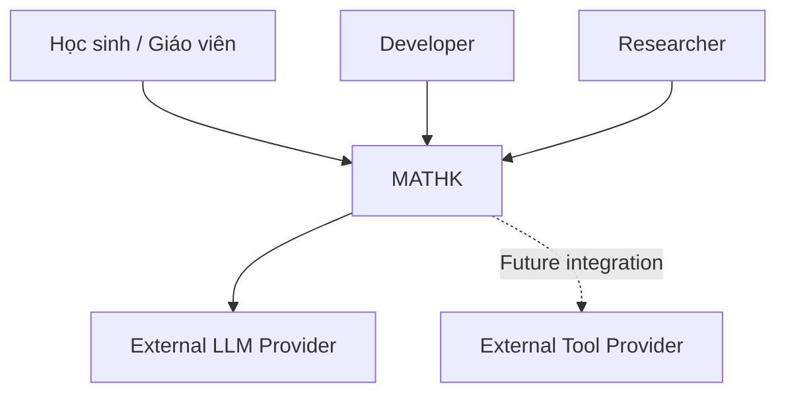


SymPy, Calculator, Knowledge Base và Agents thuộc phạm vi nội bộ. External Tool Provider không bắt buộc trong MVP.

### 3.2. Kiến trúc tổng thể


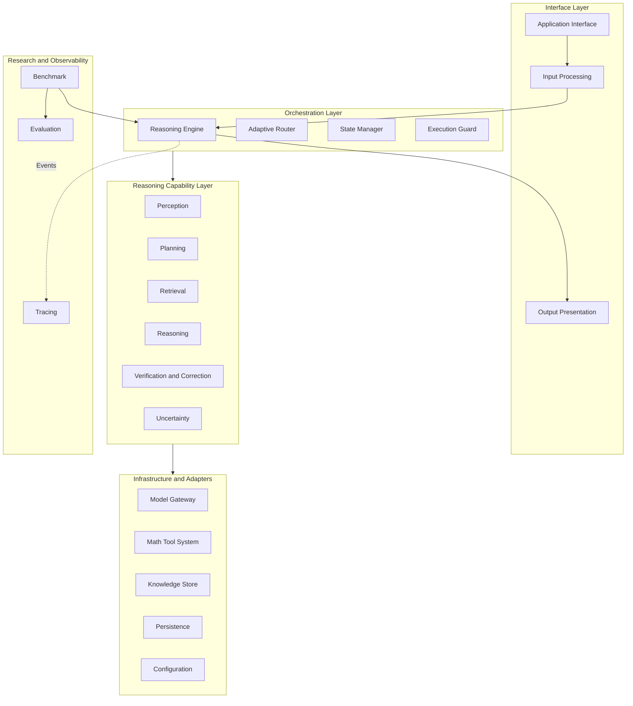


Năm vùng trách nhiệm logic, không phải năm service hoặc thứ tự phụ thuộc mã nguồn bắt buộc. Core định nghĩa interface, Adapter triển khai interface. Research & Observability xuyên suốt hệ thống; mũi tên mô tả tương tác logic.

### 3.3. Danh sách module

| ID | Vùng | Module | Trách nhiệm |
|---|---|---|---|
| M01 | Interface | Input Processing | Tiếp nhận, kiểm tra, chuẩn hóa đầu vào |
| M02 | Interface | Output Presentation | Render Markdown, LaTeX, JSON |
| M03 | Interface | Application Interface | Demo UI, CLI, Python API |
| M04 | Orchestration | Reasoning Engine | Điều phối workflow và giao diện giải toán |
| M05 | Orchestration | Adaptive Router | Chọn tuyến và mức suy luận |
| M06 | Orchestration | State Manager | Quản lý Shared State và cập nhật |
| M07 | Orchestration | Execution Guard | Kiểm soát hành động, timeout, tài nguyên, dừng |
| M08 | Capability | Multimodal Perception | Hiểu đề và dữ kiện trực quan |
| M09 | Capability | Problem Analysis & Planning | Phân tích, phân loại, lập kế hoạch |
| M10 | Capability | Knowledge Retrieval | Truy xuất tri thức toán học |
| M11 | Capability | Mathematical Reasoning | Suy luận và dùng công cụ |
| M12 | Capability | Verification & Correction | Kiểm chứng, phát hiện lỗi, hỗ trợ sửa lỗi |
| M13 | Capability | Uncertainty Management | Tổng hợp tín hiệu và đề xuất xử lý bất định |
| M14 | Adapter | Model Gateway | Interface và adapter LLM/VLM |
| M15 | Adapter | Mathematical Tool System | Registry, validation, thực thi công cụ |
| M16 | Adapter | Knowledge Store | Lưu trữ, indexing, tìm kiếm |
| M17 | Adapter | Persistence | Repository, database, checkpoint |
| M18 | Adapter | Configuration | Cấu hình, prompt, tham số |
| M19 | Research | Benchmark Runner | Thực thi dataset và cấu hình thực nghiệm |
| M20 | Research | Evaluation | Tính metrics, đánh giá |
| M21 | Research | Execution Tracing | Sự kiện, tuyến xử lý, lỗi, chi phí |

21 module logic, không phải 21 service, package hoặc Agent bắt buộc. Python API không đồng nghĩa REST API hoặc SDK riêng. Verification & Correction có thể dùng Verifier và Reasoner thay vì Corrector Agent riêng.


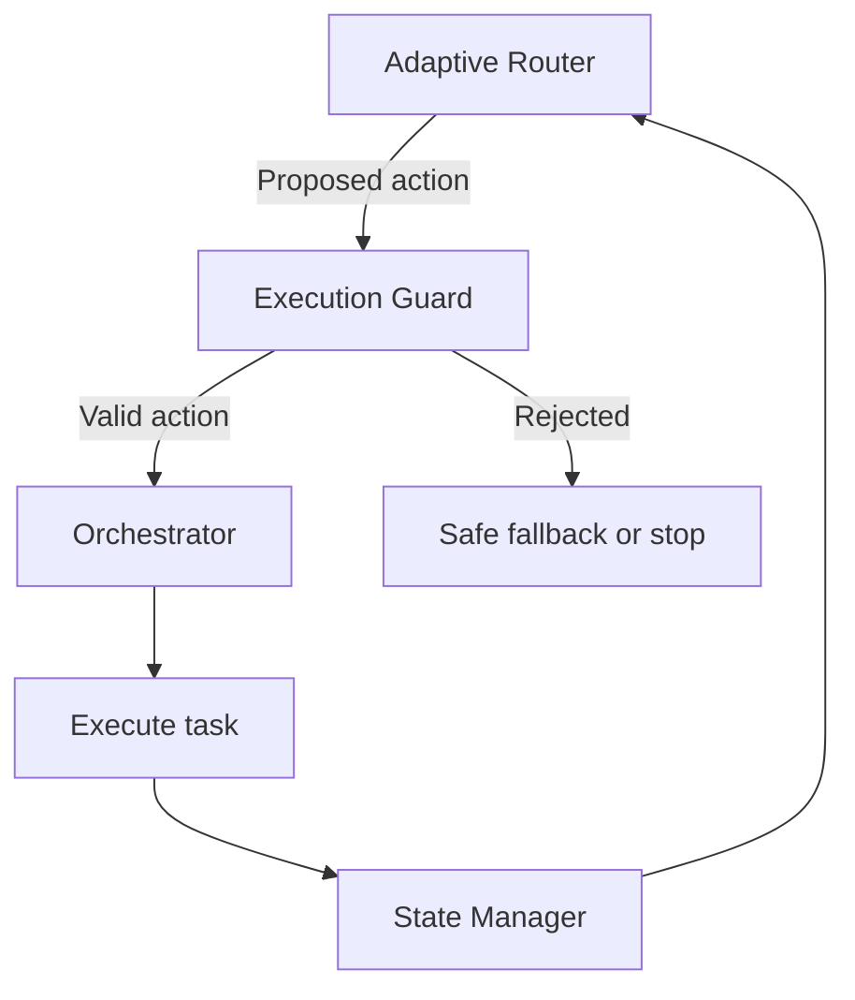


### 3.4. Control Plane và Execution Plane


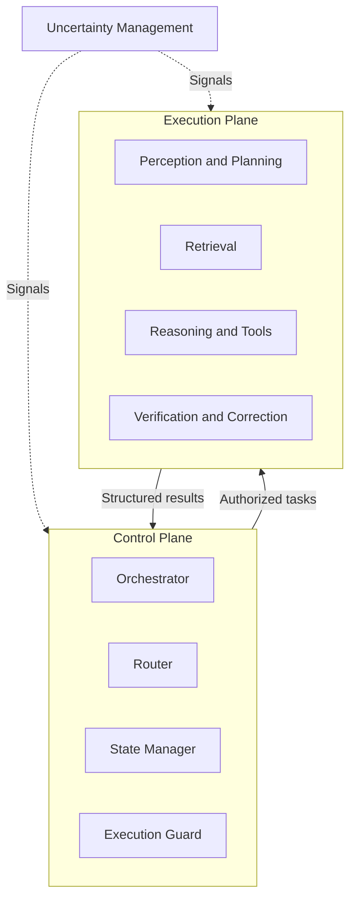


Phân chia logic, không yêu cầu hai hệ thống triển khai riêng.

### 3.5. Luồng xử lý tổng thể


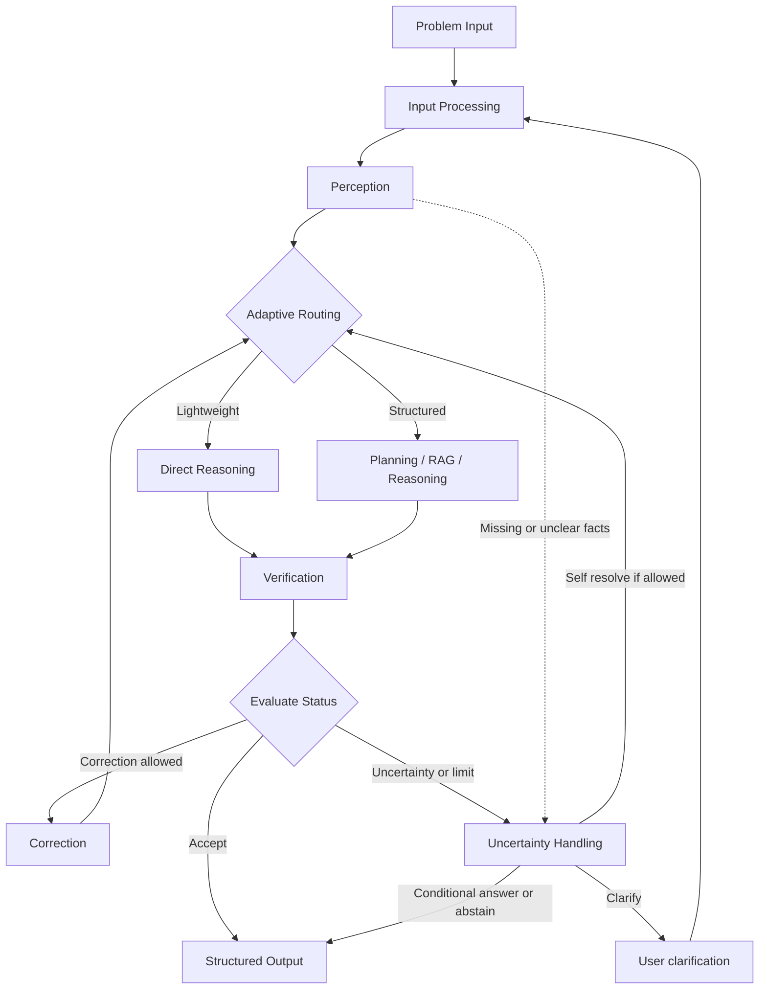


Luồng khái niệm, không phải workflow chính thức. Cả hai tuyến có thể dùng công cụ. Bất định có thể xuất hiện ở mọi giai đoạn. Kết quả Verification có thể tác động Routing, Planning và Retrieval. Mọi vòng lặp chịu giới hạn thực thi; bảo toàn trạng thái liên quan khi tiếp tục sau clarification.

### 3.6. Module Traceability

| Requirement | Module chính |
|---|---|
| FR01 | M01, M03 |
| FR02 | M08 |
| FR03 | M09 |
| FR04 | M10, M16 |
| FR05 | M11, M15 |
| FR06 | M12, M11, M15 |
| FR07 | M04, M05, M06, M07 |
| FR08 | M13, M04 |
| FR09 | M02, M04 |
| FR10 | M19, M20, M21 |

M14, M17, M18 hỗ trợ xuyên suốt. Đây là truy vết cấp module, không thay thế RTM chi tiết.

### 3.7. Ranh giới phụ thuộc

| ID | Quy tắc |
|---|---|
| AR01 | Interface gọi Engine, không tự tổ chức workflow. |
| AR02 | Agent không tự gọi Agent khác tùy ý ngoài điều phối. |
| AR03 | Router đề xuất hành động; Orchestrator kiểm soát thực thi. |
| AR04 | Agent nhận trạng thái cần thiết, trả cập nhật có cấu trúc. |
| AR05 | Kết nối LLM Provider qua Model Gateway. |
| AR06 | Thực thi công cụ qua Tool Registry và validation. |
| AR07 | Truy cập dữ liệu bền vững qua Repository hoặc Storage Interface. |
| AR08 | Evaluation không đưa đáp án tham chiếu vào phiên suy luận. |

### 3.8. Kiến trúc theo MVP


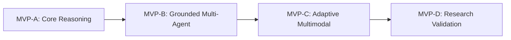


| Giai đoạn | Năng lực |
|---|---|
| MVP-A | Input, Engine, Reasoning, Model Gateway, Math Tools, Output, benchmark và tracing cơ bản |
| MVP-B | Planning, Retrieval, Verification, Correction, Shared State |
| MVP-C | Perception, Adaptive Router, Uncertainty Handling, toàn bộ P0 |
| MVP-D | Đánh giá, baseline, ablation, phân tích lỗi |

Kiểm soát tài nguyên, cấu hình và ghi log ở mức tối thiểu từ MVP-A, mở rộng dần.

## 4. Technology Stack

**Trạng thái: Đã chốt.** Công nghệ phục vụ kiến trúc đã duyệt, Local-first và máy phát triển 8 GB RAM, Full API Inference. Ưu tiên chiều sâu AI, khả năng kiểm soát thực nghiệm và đơn giản hóa hạ tầng. Không cố định phiên bản dependency cụ thể ngoài dòng phiên bản đã chọn trước kiểm thử tương thích.

### 4.1. Tổng hợp công nghệ

| Nhóm | Lựa chọn |
|---|---|
| Language & Environment | Python 3.12, uv, pyproject.toml, uv.lock |
| Agent Orchestration | LangGraph + Custom Agent Logic |
| Model Integration | Custom Model Gateway; 9Router Adapter hoặc LiteLLM Adapter; Native SDK khi cần |
| Validation | Pydantic v2 |
| Symbolic & Numerical Math | SymPy, NumPy, math, decimal, fractions |
| Multimodal | Pillow + VLM qua Model Gateway |
| Retrieval | BM25, Embedding API, FAISS, RRF |
| Embedding | Embedding Gateway; BGE-M3 là ứng viên |
| Persistence | SQLite, SQLAlchemy 2.x, Alembic, sqlite3 |
| Interface | Python API, CLI, Gradio |
| Testing | pytest, Hypothesis, unittest.mock, pytest-cov |
| Evaluation | Custom Python, pandas, NumPy, Matplotlib |
| Observability | Python logging, JSONL, psutil |
| Code Quality | Ruff, mypy |
| CI | GitHub Actions |
| Containerization | Docker tùy chọn |

### 4.2. Programming Language & Environment

Python 3.12 là mục tiêu tương thích. uv quản lý Python, môi trường và dependency; commit pyproject.toml và uv.lock để tái lập môi trường. Ruff phục vụ lint/format, mypy kiểm tra kiểu. Poetry và pip + venv không chọn làm workflow chính. Kiểm tra tương thích Windows và thư viện native trước khi khóa dependency.

### 4.3. Agent Orchestration

LangGraph được chọn thay AutoGen, CrewAI và tự viết toàn bộ runtime vì phù hợp State Graph, conditional edges, bounded loops, checkpoint và interrupt/resume. Không phụ thuộc Agent dựng sẵn để quyết định phương pháp nghiên cứu.

| LangGraph | MATHK |
|---|---|
| Graph execution, nodes, edges | Agent Logic và Adaptive Routing Policy |
| State runtime | Mathematical Representation và quy tắc cập nhật state |
| Checkpoint, interrupt/resume | Resource Guard, Verification và Correction Strategy |
| Conditional transitions | Knowledge Retrieval Strategy |

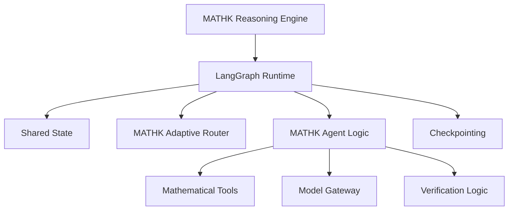

LangGraph là framework thực thi, không phải đóng góp nghiên cứu. Router và guard vẫn tuân thủ AR01–AR08.

### 4.4. LLM Integration

Custom Model Gateway chuẩn hóa request, response, structured output, tool calls, lỗi, token usage và metadata. 9Router Adapter dùng endpoint OpenAI-compatible sau kiểm thử, LiteLLM Adapter cho provider trực tiếp; Native SDK khi cần. Không bắt buộc xếp chồng hai adapter. 9Router là proxy tùy chọn, hỗ trợ kết nối và monitoring LLM, không thay LangGraph. Model/Provider cụ thể chọn sau thử nghiệm.


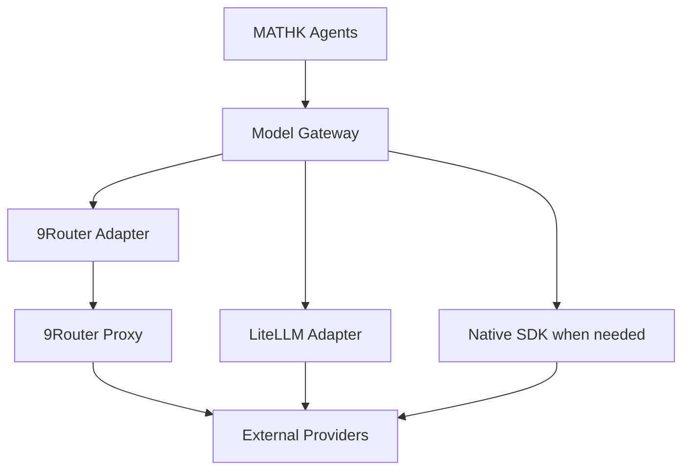


Model Profiles: DEFAULT, MULTIMODAL, ADVANCED, EMBEDDING (qua Embedding Gateway). Có thể dùng chung model. LLM/VLM qua API ngoài trong MVP. Model Policy và kiểm soát retry/fallback xem 5.20.

### 4.5. Data Validation

Pydantic v2 kiểm tra dữ liệu tại ranh giới module và structured output. Schema khái niệm: ProblemInput, ProblemRepresentation, ReasoningPlan, ReasoningStep, ToolRequest, ToolResult, VerificationReport, UncertaintyReport, ReasoningState, SolutionOutput, ExperimentConfig. Thiết kế schema chính thức ở các mục sau.

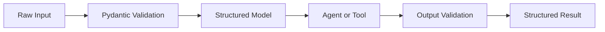

### 4.6. Mathematical Computation

SymPy và Calculator là năng lực P0, dùng NumPy và thư viện chuẩn Python cho tính số khi phù hợp. SciPy là tùy chọn khi cần. Direct Function Calling, Tool Registry, validation và bounded execution. Không thực thi mã Python tùy ý; không dùng eval/exec hoặc parse_expr/sympify trên chuỗi không kiểm soát. Giới hạn biểu thức, độ phức tạp và thời gian tính toán.

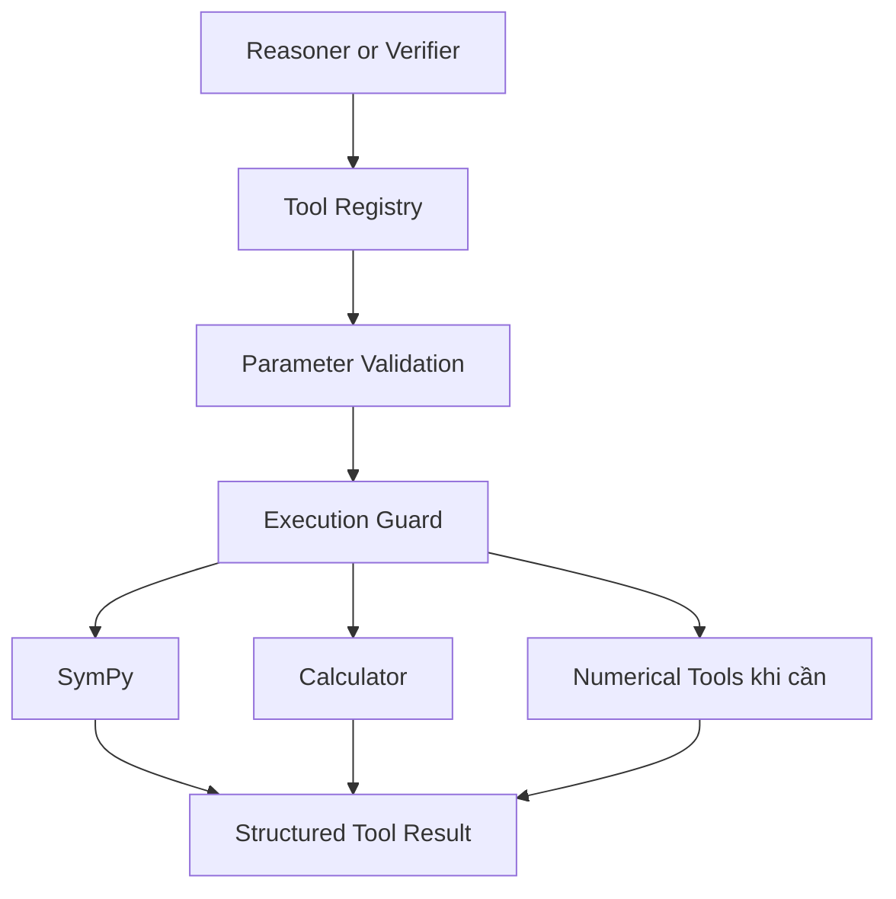

### 4.7. Multimodal Processing

VLM-first, Pillow để đọc, kiểm tra và resize ảnh. OpenCV tùy nhu cầu, PyMuPDF ứng viên P1 cho PDF, OCR engine chọn khi xây baseline. Không bắt buộc huấn luyện detector hình học riêng.

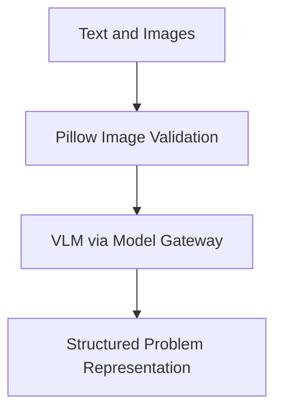

Đầu vào chỉ văn bản không cần qua xử lý ảnh.

### 4.8. Knowledge Retrieval & Agentic RAG

BM25 làm sparse retrieval; Embedding API và FAISS cho dense retrieval; RRF cho fusion. BGE-M3 là ứng viên, không mặc định tối ưu cho toán tiếng Việt. Embedding Gateway sử dụng API trong MVP. Index và query phải dùng embedding tương thích; đổi model cần xây lại index tương ứng. Agentic Retrieval Logic do MATHK xây dựng, quyết định truy xuất và kiểm tra applicability trong giới hạn. Không đồng nhất Hybrid Retrieval với Agentic RAG.

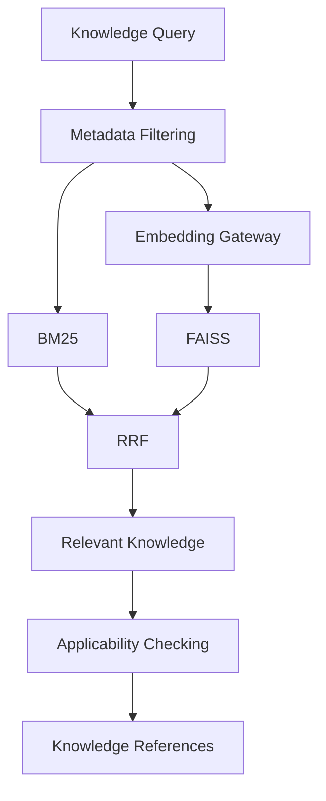

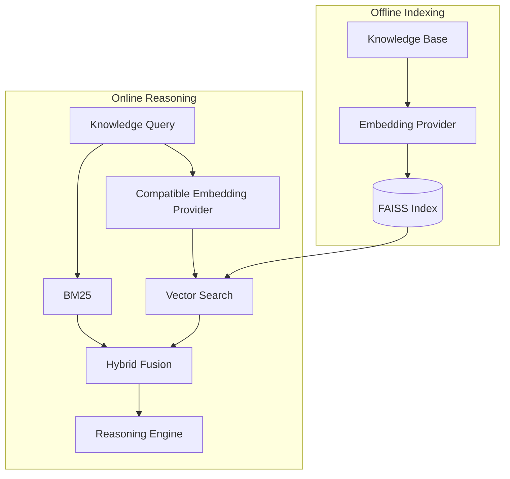

### 4.9. Database & Storage

Chốt SQLite + FAISS thay PostgreSQL + pgvector để giảm quản trị và phù hợp MVP local. SQLAlchemy 2.x quản lý persistence, Alembic quản lý schema migration, sqlite3 là driver. SQLite là nguồn dữ liệu chính cho metadata và dữ liệu nghiệp vụ; FAISS là index có thể xây dựng lại; file lớn, ảnh, dataset, trace/export dùng local file storage. Repository Interface giữ ranh giới module. Không lưu hai trạng thái nghiệp vụ độc lập thiếu đồng bộ. SQLite có giới hạn ghi đồng thời; PostgreSQL là lựa chọn tương lai nếu cần, việc chuyển đổi cần kiểm thử và migration.

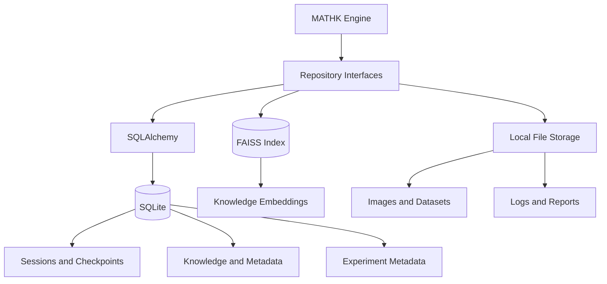

Checkpoint chi tiết và cơ chế phối hợp persistence của LangGraph sẽ chốt ở State Management và Data & Storage Design.

### 4.10. Application Interface

Python API là giao diện cốt lõi, CLI cho chạy bài toán và thực nghiệm, Gradio làm demo văn bản/ảnh và lời giải toán học. FastAPI chỉ thêm khi cần HTTP. Streamlit và Next.js chưa triển khai. UI chỉ gọi Engine qua interface, không chứa logic suy luận.

### 4.11. Testing & Code Quality

pytest cho unit/integration, Hypothesis cho property-based testing, unittest.mock cho mock, pytest-cov cho coverage, Ruff/mypy cho chất lượng mã, GitHub Actions cho CI. Property testing không thay thế chứng minh toán học. Test provider bằng mock khi phù hợp để kiểm soát chi phí.

### 4.12. Evaluation & Observability

Custom Benchmark Runner và Evaluator, SymPy + custom mathematical evaluation, pandas/NumPy, SciPy nếu cần, Matplotlib, logging và JSONL, SQLite metadata, JSON/CSV export. LLM-as-Judge P1, Langfuse/LangSmith tùy chọn. Ground truth không đưa vào Engine.

```mermaid
flowchart TD
 D["Benchmark Dataset"] --> B["Benchmark Runner"]
 C["Experiment Config"] --> B
 B --> E["MATHK Engine"]
 E --> R["Solution and Execution Trace"]
 R --> V["Mathematical Evaluator"]
 G["Ground Truth"] --> V
 V --> M["Metrics"]
 M --> S[("Experiment Storage")]
 R --> S
 S --> O["Reports and Charts"]
```

Benchmark Runner chỉ chuyển dữ liệu đề bài được phép tới Engine, không chuyển nhãn ground truth.

**Monitoring bổ sung:** 9Router hỗ trợ theo dõi API usage, provider, quota và log theo khả năng phiên bản; token/cost/latency cần kiểm chứng. MATHK vẫn tự ghi agent path, tool/RAG, verification/correction, resource và benchmark trace bằng logging, JSONL, SQLite, psutil. Không phụ thuộc 9Router để tái lập thực nghiệm; actual model metadata phải xác minh. Không ghi bí mật vào log.


```mermaid
flowchart TD
 A["MATHK Agents and Tools"] --> T["Execution Tracing"]
 G["Model Gateway"] --> T
 T --> D["SQLite and JSONL"]
 D --> E["Research Evaluation"]
 G --> R["9Router Proxy"]
 R --> P["Providers"]
 R --> U["Usage and Quota Monitor"]
 R --> L["Console Log"]
```


### 4.13. Technology Stack Overview

```mermaid
flowchart TD
 I["Gradio / CLI / Python API"]
 C["Python 3.12 / LangGraph / Pydantic v2"]
 A["Model Gateway / 9Router or LiteLLM / VLM"]
 T["SymPy / NumPy / Calculator"]
 K["BM25 / Embedding API / FAISS / SQLite"]
 R["pytest / pandas / Ruff / uv / GitHub Actions"]
 I --> C
 C --> A
 C --> T
 C --> K
 R -.->|Research and engineering support| C
```

Sơ đồ nhóm trách nhiệm, không phải dependency graph bắt buộc.

### 4.14. Resource Management & Deployment Constraints

Máy phát triển 8 GB RAM. Full API inference cho LLM/VLM/embedding và reranker nếu dùng; các thành phần khác local-first. Lazy loading, bounded state, concurrency 1 cho lightweight, psutil, benchmark tuần tự hoặc giới hạn đồng thời. Docker tùy chọn. Index tính trước; query dùng embedding API tương thích. BGE-M3 chỉ là ứng viên nếu có API phù hợp.

Ước tính trước kiểm thử: Core không RAG khoảng 0,5–1 GB; full stack với embedding API khoảng 0,8–1,8 GB RAM riêng ứng dụng. Chưa gồm OS/IDE/browser/Docker; không phải benchmark hay cam kết. Đo thực tế tại MVP A và khi tích hợp retrieval.

Các dependency, phiên bản model, cấu hình concurrency và ngưỡng tài nguyên cụ thể sẽ khóa sau kiểm thử. Không mở rộng sang PostgreSQL, vector database server, MCP, hạ tầng phân tán hoặc GPU server bắt buộc trong MVP.

**Quyết định:** Chấp thuận toàn bộ stack bảng 4.1 và nguyên tắc quản lý tài nguyên.

## 5. Agent Design

**Trạng thái: Đã chốt.** Schema, prompt và giới hạn thực thi cụ thể sẽ thiết kế ở các mục tương ứng.

### 5.1. Nguyên tắc

Deterministic-first, Agent-assisted. Kiểm tra định dạng, tính toán, truy vấn index, persistence, resource budget và metrics dùng code xác định khi phù hợp; Agent đảm nhiệm hiểu ngữ cảnh, lựa chọn phương pháp, sinh truy vấn, đánh giá lập luận. Không biến mọi chức năng thành Agent.

### 5.2. Số lượng Agent

Chọn phương án Specialized gồm 5 vai trò logic thay vì Minimal 3 hoặc Highly Specialized 8–12. Không phải 5 tiến trình, 5 model hay 5 microservice.

| ID | Agent | Module | Trách nhiệm |
|---|---|---|---|
| AG01 | Perception | M08 | Hiểu đề và dữ kiện |
| AG02 | Planner | M09 | Phân tích, lập kế hoạch |
| AG03 | Retrieval | M10 | Truy xuất và đánh giá tri thức |
| AG04 | Reasoner | M11 | Giải toán và sửa lời giải |
| AG05 | Verifier | M12 | Kiểm chứng và định vị lỗi |


```mermaid
flowchart TD
 O["Orchestrator / Router / Guard"] --> A["AG01 Perception"]
 O --> B["AG02 Planner"]
 O --> C["AG03 Retrieval"]
 O --> D["AG04 Reasoner"]
 O --> E["AG05 Verifier"]
 A --> S["Structured Updates"]
 B --> S
 C --> S
 D --> S
 E --> S
 S --> M["State Manager"]
 M --> T["Shared State"]
 T --> O
```


### 5.3. AG01 — Perception Agent

Input: ProblemInput và bổ sung của người dùng. Output: ProblemRepresentation, uncertainty signals. Profile: MULTIMODAL hoặc DEFAULT. Công cụ đọc ảnh và chuẩn hóa được cấp quyền. FR01, FR02, FR08. Trích xuất văn bản, công thức, đối tượng/quan hệ hình học, bảng, đồ thị; tích hợp dữ kiện và provenance; phân biệt given, observed, inferred, assumption. Không suy ra góc vuông chỉ vì hình trông vuông.


```mermaid
flowchart TD
 I["Text and Images"] --> P["Input Processing"]
 P --> A["Perception"]
 A --> T["Text and Formula Extraction"]
 A --> V["Visual Understanding"]
 T --> F["Fact Integration"]
 V --> F
 F --> U["Uncertainty Signals"]
 F --> R["Problem Representation"]
```


Ví dụ tam giác ABC có ký hiệu vuông tại A, AB=3, AC=4, mục tiêu tính BC. Perception ghi nhận ba dữ kiện và nguồn ký hiệu/nhãn ảnh; không tự kết luận BC=5.

### 5.4. AG02 — Planner Agent

Input: ProblemRepresentation và state liên quan. Output: ReasoningPlan, RoutingRecommendation. Profile DEFAULT/ADVANCED; chưa cần tool tính toán riêng. FR03, FR07. Phân loại miền, mục tiêu, độ phức tạp; lập bước và dependency; đề xuất nhu cầu tri thức/tool, lightweight hoặc structured. Orchestrator và Guard quyết định cuối.


```mermaid
flowchart TD
 I["Problem Representation"] --> A["Planner"]
 A --> D["Domain and Task"]
 A --> C["Complexity"]
 D --> K["Knowledge Requirements"]
 D --> T["Tool Requirements"]
 C --> P["Structured Plan"]
 K --> P
 T --> P
 P --> R["Routing Recommendation"]
```


Ví dụ kế hoạch: kiểm tra góc vuông, xác định Pythagoras, thiết lập BC²=AB²+AC², tính BC, kiểm tra độ dài.

### 5.5. AG03 — Retrieval Agent

Input: ProblemRepresentation, ReasoningPlan khi có, KnowledgeRequest. Output: KnowledgeBundle hoặc tín hiệu bất định. DEFAULT; truy cập dịch vụ BM25, dense retrieval, metadata filtering. FR04, FR08. Sinh query, đánh giá relevance và applicability; truy xuất lại có giới hạn. Không tự tạo nguồn. Pythagoras chỉ áp dụng khi đủ điều kiện tam giác vuông, xác định đúng cạnh huyền.


```mermaid
flowchart TD
 P["Problem and Plan"] --> A["Retrieval"]
 A --> Q["Generate Query"]
 Q --> R["Retrieval Service"]
 R --> K["Knowledge Candidates"]
 K --> V{"Relevant and applicable?"}
 V -->|Yes| O["Knowledge Bundle"]
 V -->|Need evidence and budget| F["Refine Query"]
 F --> R
 V -->|Cannot establish| U["Uncertainty Signal"]
```


### 5.6. AG04 — Reasoner Agent

Input: Problem, Plan/Knowledge nếu có, Previous Steps, Tool Results. Output: ReasoningStep, SolutionCandidate. DEFAULT/ADVANCED; SymPy, Calculator qua registry. FR05, FR06. Solve Mode sinh lời giải; Correction Mode sửa theo feedback và dependency. Không cần Corrector Agent riêng. Không thực thi Python tùy ý.


```mermaid
flowchart TD
 P["Problem"] --> A["Reasoner"]
 K["Knowledge when needed"] --> A
 L["Plan when needed"] --> A
 A --> S["Reasoning Step"]
 S --> T{"Need computation?"}
 T -->|Yes| C["Guard and Tool Registry"]
 C --> M["SymPy or Calculator"]
 M --> R["Tool Result"]
 R --> A
 T -->|No| N["Next Step or Candidate"]
```


Ví dụ BC²=3²+4², tool trả 5 khi tính căn bậc hai; Reasoner xác định BC=5 do độ dài dương.

### 5.7. AG05 — Verifier Agent

Input: đề gốc, Problem, Knowledge, SolutionCandidate, Tool Results. Output: VerificationReport, CorrectionFeedback. DEFAULT/ADVANCED khi cần ngữ nghĩa; SymPy, Calculator, deterministic rules. FR06, FR08. Năm lớp V1 Input, V2 Knowledge, V3 Reasoning, V4 Computational, V5 Answer. Kiểm tra điều kiện, dependency, tính toán, đáp án/đơn vị/độ đầy đủ. Phạm vi và phương pháp kiểm chứng phải rõ; LLM đồng ý không phải chứng minh hình thức.


```mermaid
flowchart TD
 S["Solution Candidate"] --> D["Deterministic Verification"]
 D --> A["Semantic Verification when needed"]
 A --> E["Aggregate Evidence"]
 E --> R{"Verification Status"}
 R --> V["VERIFIED"]
 R --> P["PARTIALLY_VERIFIED"]
 R --> U["UNVERIFIED"]
 R --> F["FAILED"]
```


### 5.8. Verification-guided Correction

Dependency-aware Correction: giữ bước hợp lệ, sửa bước sai và đánh giá lại các bước phụ thuộc; nếu cần thì replan. Luôn bind báo cáo vào phiên bản lời giải và kiểm chứng lại. Ví dụ 3²+4²=23 sai, sửa thành 25 rồi tính lại BC=5. Lợi ích chi phí/chất lượng là giả thuyết cần thực nghiệm.


```mermaid
flowchart TD
 S1["Step 1 valid"] --> S2["Step 2 valid"]
 S2 --> S3["Step 3 incorrect"]
 S3 --> S4["Step 4 affected"]
 S3 --> V["Verifier Feedback"]
 V --> C["Correct Step 3"]
 C --> N["Recompute Step 4"]
 N --> R["Re-verification"]
```


### 5.9. Thành phần không phải Agent

Orchestrator, Adaptive Router, State Manager, Execution Guard, Tool Registry, Uncertainty Manager, Output Formatter, Benchmark Runner, Evaluator là thành phần điều phối hoặc dịch vụ. Router có thể dùng LLM hỗ trợ mà không cần Supervisor Agent riêng. Không có Uncertainty hoặc Synthesis Agent riêng trong MVP.

### 5.10. Capability Matrix

| Năng lực | AG01 | AG02 | AG03 | AG04 | AG05 |
|---|---|---|---|---|---|
| Hiểu ảnh và trích xuất | X | | | | |
| Lập kế hoạch, đề xuất routing | | X | | | |
| Truy xuất tri thức | | | X | | |
| Đánh giá kiến thức | | | X | X | X |
| SymPy, Calculator | | | | X | X |
| Giải toán, sửa lời giải | | | | X | |
| Kiểm chứng | | | | | X |
| Báo cáo bất định | X | X | X | X | X |

Verifier được đọc đề gốc, kể cả ảnh khi cần để kiểm tra perception; không thay thế vai trò trích xuất chính AG01.

### 5.11. Agent Lifecycle


```mermaid
flowchart TD
 A["Task Assignment"] --> B["Build Relevant Context"]
 B --> C["Validate Input"]
 C --> D["Execute Agent Logic"]
 D --> E["Validate Output"]
 E --> F{"Valid result?"}
 F -->|Yes| G["Structured Update"]
 F -->|No| H["Bounded Retry or Failure"]
 H --> I["Orchestrator"]
 G --> I
 I --> J["State Manager"]
 J --> K["Route Next Action"]
```


Agent không tự sửa state; Orchestrator kiểm tra update hợp lệ trước khi State Manager áp dụng. Failure được ghi nhận, không coi là kết quả hợp lệ.

### 5.12. Agent Relationships

Không gọi trực tiếp Agent khác; trao đổi thông qua Orchestrator và Shared State theo sơ đồ 5.2. Các tool call riêng cũng chịu quyền hạn và ngân sách chung.

### 5.13. Agent Configuration

Configuration-driven: agent_id, name, enabled, model_profile, prompt_version, allowed_tools, execution_modes. Ví dụ AG04 có solve/correction, calculate, simplify, solve_equation, check_equivalence. Đây là cấu hình minh họa, chưa phải schema chính thức. Ablation chỉ vô hiệu hóa thành phần theo cấu hình thực nghiệm hợp lệ, không bỏ ràng buộc an toàn.

### 5.14. Quyết định cơ sở

5 Agent, cùng tiến trình mặc định, LangGraph, Shared Structured State, Model Gateway dùng chung, quyền tool theo Agent, cấu hình hóa. Reasoner correction mode, một Verifier năm lớp.

### 5.15. Agent Autonomy

Chọn Controlled Autonomy. Fixed Pipeline giữ làm baseline; Autonomous Multi-Agent tự do không triển khai MVP.


```mermaid
flowchart LR
 A["Perception"] --> B["Planner"]
 B --> C["Retrieval"]
 C --> D["Reasoner"]
 D --> E["Verifier"]
```


```mermaid
flowchart TD
 O["Orchestrator"] --> R["Adaptive Router"]
 R --> G["Execution Guard"]
 G --> A["Selected Agent"]
 A --> T["Allowed Tools"]
 T --> A
 A --> U["Structured Update"]
 U --> S["State Manager"]
 S --> O
```


### 5.16. Decision Authority

Agent hiểu dữ kiện, chọn phương pháp trong nhiệm vụ, sinh query và đề xuất tool, truy xuất lại, sửa lỗi, route/model/stop. Orchestrator/Guard kiểm tra thực thi tool, chọn node/model theo policy, áp dụng state update và kết thúc. Không bên nào được vượt budget. Ví dụ AG04 trả status needs_knowledge và request type knowledge_retrieval, topic Định lý Thales, reason cần điều kiện áp dụng; Orchestrator kiểm tra trước khi gọi AG03.

### 5.17. Communication Protocol

Structured Message + Shared State thay hội thoại Agent tự do. Pydantic validation, traceable updates, giới hạn context.


```mermaid
sequenceDiagram
 participant R as Reasoner
 participant O as Orchestrator
 participant S as Shared State
 participant V as Verifier
 R->>O: SolutionCandidate
 O->>S: Validate and update
 O->>V: VerificationTask
 V->>O: VerificationReport
 O->>S: Save error evidence
 O->>R: CorrectionTask
 R->>O: CorrectedSolution
 O->>S: Update solution version
 O->>V: Re-verification
```


### 5.18. Context Isolation

Context Builder chỉ cấp phần state cần thiết, không gửi toàn bộ state mặc định.


```mermaid
flowchart TD
 S["Shared State"] --> B["Context Builder"]
 B --> A["AG01 Original Input and supplements"]
 B --> P["AG02 Problem and objectives"]
 B --> K["AG03 Knowledge Request and relevant facts"]
 B --> R["AG04 Problem / Plan / Knowledge / Steps / Tools"]
 B --> V["AG05 Original Input / Candidate / Evidence"]
```


Giảm token, nhiễu và quyền truy cập thừa; Verifier đọc đề gốc khi thích hợp.

### 5.19. Independent Verification

Không truyền mức tự tin của Reasoner mặc định; cung cấp đề gốc, representation, candidate, bước giải, căn cứ và tool results để kiểm tra lại. Không đưa ground truth vào bất kỳ Agent nào. Dùng model khác cho Verifier là lựa chọn thực nghiệm, không bắt buộc; cùng model có nguy cơ lỗi tương quan. Không đồng nhất việc tách vai trò với độc lập thống kê.

### 5.20. Agent Model Policy

Free-first cho development, model cụ thể chọn qua benchmark nhỏ và capability test (vision, JSON/schema, tool calling, latency, quota). Gemma, Nemotron, Qwen là ứng viên, không cam kết chất lượng hay tính miễn phí lâu dài. 9Router là proxy tùy chọn và monitoring hạ tầng; LiteLLM adapter gọi trực tiếp provider khi cần. MATHK sở hữu Agent Routing, Reasoning Level, Model Profile, correction, budget. 9Router sở hữu provider routing theo cấu hình đã kiểm chứng. Retry/fallback nhiều tầng phải tuân thủ ngân sách tổng.


```mermaid
flowchart TD
 A["Agent Task"] --> M["MATHK Model Policy"]
 M --> G["Model Gateway"]
 G --> R["9Router Adapter"]
 G --> L["LiteLLM Adapter"]
 R --> P["External Providers"]
 L --> P
 R --> U["Infrastructure Monitoring"]
 G --> T["MATHK Execution Tracing"]
```


| Chính sách | Development | Research |
|---|---|---|
| Free-first | Có | Theo config |
| Model cố định | Tùy chọn | Theo experiment config |
| Fallback | Có giới hạn | Mặc định tắt |
| Adaptive Model Routing | Cho phép | Bật/tắt có kiểm soát |
| Token Saver | Tùy chọn | Mặc định tắt |
| Trace | Có | Bắt buộc |
| Actual model tracking | Khi có metadata | Xác minh bắt buộc |

Nếu không xác minh model thực tế qua proxy, gọi trực tiếp provider cho thực nghiệm cần kiểm soát. Không nhầm Adaptive Agent Routing với Adaptive Model Routing. Không tự chuyển sang API trả phí ngoài ngân sách được phép.

### 5.21. Agent Registry

Registry quản lý ID, capability, version, model profile, tool permissions, input/output schemas, execution modes. Agent mới cần tích hợp graph và kiểm tra routing; đăng ký không đồng nghĩa tự chạy.


```mermaid
flowchart TD
 O["Orchestrator"] --> R["Agent Registry"]
 R --> A["AG01 Perception"]
 R --> B["AG02 Planner"]
 R --> C["AG03 Retrieval"]
 R --> D["AG04 Reasoner"]
 R --> E["AG05 Verifier"]
 R -.-> F["Future Agents"]
```

## 6. State Management

**Trạng thái: Đã chốt.** Các schema bên dưới mang tính thiết kế logic; field và kiểu dữ liệu cụ thể sẽ hoàn thiện khi triển khai.

### 6.1. State, Context, Memory và Storage

State là trạng thái phiên giải hiện tại; Context là tập thông tin cấp cho một lần thực thi Agent; Memory là thông tin duy trì qua tương tác; Storage là lưu trữ lâu dài; Checkpoint là bản ghi tại ranh giới thực thi để phục hồi. Không yêu cầu Long-term Personal Memory trong MVP.

### 6.2. State Architecture

So sánh Independent Agent State (khó đồng bộ), Global Mutable State (khó bảo đảm toàn vẹn) và Controlled Shared State (chọn). Agent đọc snapshot cần thiết, trả structured update; State Manager kiểm soát thay đổi.


```mermaid
flowchart LR
 A["Agent A"] --> S1["State A"]
 B["Agent B"] --> S2["State B"]
 C["Agent C"] --> S3["State C"]
 A <--> B
 B <--> C
```


```mermaid
flowchart TD
 A["Agent A"] <--> S["Global Mutable State"]
 B["Agent B"] <--> S
 C["Agent C"] <--> S
```


```mermaid
flowchart TD
 S["Shared State"] --> C["Context Builder"]
 C --> A["Selected Agent"]
 A --> U["Structured Update"]
 U --> V["State Validation"]
 V --> M["State Manager"]
 M --> S
```


### 6.3. Shared State Structure

10 nhóm logic, không phải 10 database hoặc tiến trình.

| ID | Group | Dữ liệu dự kiến |
|---|---|---|
| ST01 | Session | session_id, run_id, status, timestamps, config |
| ST02 | Input | Văn bản gốc, tham chiếu ảnh, bổ sung |
| ST03 | Problem | Facts, objects, relations, objectives, assumptions |
| ST04 | Planning | Domain, complexity, plan, dependencies |
| ST05 | Knowledge | Query, references, applicability, retrieval status |
| ST06 | Reasoning | Steps, dependencies, candidate answer, version |
| ST07 | Tool | Request, arguments, result, error |
| ST08 | Verification | Reports, errors, affected steps, scope |
| ST09 | Uncertainty | Signals, severity, evidence, clarification |
| ST10 | Execution | Current node, routes, budgets, counters, failures |


```mermaid
flowchart TD
 S["MATHK Shared State"] --> A["ST01 Session"]
 S --> B["ST02 Input"]
 S --> C["ST03 Problem"]
 S --> D["ST04 Planning"]
 S --> E["ST05 Knowledge"]
 S --> F["ST06 Reasoning"]
 S --> G["ST07 Tool"]
 S --> H["ST08 Verification"]
 S --> I["ST09 Uncertainty"]
 S --> J["ST10 Execution"]
```


### 6.4. State Ownership

| State | Thành phần tạo hoặc đề xuất cập nhật |
|---|---|
| ST01 | Orchestrator |
| ST02 | Input Processing |
| ST03 | AG01 |
| ST04 | AG02 |
| ST05 | AG03 |
| ST06 | AG04 |
| ST07 | Tool Execution System |
| ST08 | AG05 |
| ST09 | Tất cả Agent và Uncertainty Manager |
| ST10 | Router, Orchestrator, Execution Guard |

Ownership không cấp quyền ghi trực tiếp. Reasoner không tự nâng trạng thái kiểm chứng. State Manager áp dụng cập nhật hợp lệ.

### 6.5. State Access Matrix

| State | AG01 | AG02 | AG03 | AG04 | AG05 |
|---|---|---|---|---|---|
| Input | R / W* | — | — | R* | R |
| Problem | W | R | R | R | R |
| Planning | — | W | R | R | R* |
| Knowledge | — | R* | W | R | R |
| Reasoning | — | R* | R* | W | R |
| Tool | — | — | — | R | R |
| Verification | R* | R* | R* | R | W |
| Uncertainty | A | A | A | A | A |
| Execution | R* | R* | R* | R* | R* |

R đọc, W đề xuất cập nhật, A bổ sung tín hiệu, * khi cần cho nhiệm vụ. W bao gồm đọc dữ liệu liên quan thuộc phạm vi sở hữu. AG01 chỉ đề xuất xử lý đầu vào, không sửa bản gốc; Input Processing sở hữu ST02. Session/Execution thuộc tầng điều phối; Tool State do Tool Execution System quản lý.

### 6.6. State Lifecycle


```mermaid
stateDiagram-v2
 [*] --> CREATED
 CREATED --> RUNNING
 RUNNING --> WAITING_USER
 WAITING_USER --> RUNNING
 RUNNING --> PAUSED
 PAUSED --> RUNNING
 RUNNING --> COMPLETED
 RUNNING --> FAILED
 RUNNING --> ABSTAINED
 RUNNING --> CANCELLED
 WAITING_USER --> CANCELLED
 PAUSED --> CANCELLED
 COMPLETED --> [*]
 FAILED --> [*]
 ABSTAINED --> [*]
 CANCELLED --> [*]
```


CREATED: tạo phiên; RUNNING: thực thi; WAITING_USER: chờ bổ sung; PAUSED: tạm dừng có thể tiếp tục; COMPLETED: hoàn tất đầu ra; FAILED: lỗi không hoàn tất; ABSTAINED: không kết luận vì thiếu căn cứ; CANCELLED: hủy. Execution Status độc lập Verification Status; COMPLETED có thể PARTIALLY_VERIFIED.

### 6.7. State Update Protocol


```mermaid
sequenceDiagram
 participant O as Orchestrator
 participant C as Context Builder
 participant A as Agent
 participant V as State Validator
 participant S as State Manager
 O->>C: Build agent context
 C->>A: Relevant state snapshot
 A->>O: Structured update
 O->>V: Validate update
 alt Valid update
 V->>S: Apply update
 S-->>O: New state version
 else Invalid update
 V-->>O: Validation error
 O->>O: Retry or safe stop
 end
```


Ví dụ envelope minh họa:

```json
{
  "update_id": "UPD-001",
  "agent_id": "AG04",
  "base_state_version": 7,
  "status": "success",
  "changes": {"reasoning": {"new_steps": ["STEP-003"]}},
  "uncertainty_signals": [],
  "requested_action": "verification"
}
```

Kiểm tra schema, quyền, base version, Business Rules và tham chiếu. Không chấp nhận ghi đè toàn state bằng JSON tùy ý. ID bước trong ví dụ đại diện cho dữ liệu bước hợp lệ phải được cung cấp hoặc tham chiếu tới bản ghi tồn tại.

### 6.8. Mathematical Fact Representation

Fact có ID, type, expression, origin, source/evidence, status, dependencies. GIVEN (đề cung cấp), OBSERVED (ảnh/biểu đồ), INFERRED (suy ra), ASSUMPTION (giả định công khai). Lưu nguồn và lịch sử bổ sung/đính chính, không âm thầm sửa bản gốc.

Ví dụ tam giác ABC vuông tại A, AB=3, AC=4; objective tính BC.

```json
{
  "fact_id": "F03",
  "type": "geometric_relation",
  "expression": "perpendicular(AB, AC)",
  "origin": "observed",
  "source": {
    "type": "image",
    "asset_id": "IMG-001",
    "evidence": "right_angle_marker"
  },
  "status": "active",
  "dependencies": []
}
```

### 6.9. Dependency Graph

Mỗi bước có ID và tham chiếu facts, knowledge hoặc steps mà nó phụ thuộc. Directed Acyclic Graph cho một phiên bản lời giải, khác Execution Graph có vòng lặp. Khi có lỗi, đánh giá lại bước lỗi và các hậu duệ phụ thuộc; giữ bước khác nếu vẫn hợp lệ.


```mermaid
flowchart TD
 F1["F01 AB = 3"] --> S1["S01 Apply Pythagoras"]
 F2["F02 AC = 4"] --> S1
 F3["F03 Right angle at A"] --> S1
 K["Theorem reference"] --> S1
 S1 --> S2["S02 BC squared = 3 squared + 4 squared"]
 S2 --> S3["S03 BC squared = 23 - Incorrect"]
 S3 --> S4["S04 BC = sqrt 23 - Affected"]
 S3 --> V["Verifier detects error"]
 V --> C["Correct S03 to 25"]
 C --> N["Recompute S04 to 5"]
 N --> R["Re-verify"]
```


Trong chuỗi 4 bước minh họa, lỗi S03 yêu cầu xử lý lại S03/S04, có thể giữ S01/S02 sau kiểm tra tính hợp lệ. DAG thực tế có thể phân nhánh; không vô hiệu hóa mọi bước đứng sau theo thứ tự một cách máy móc.

### 6.10. State Versioning

State Version tăng mỗi cập nhật thành công; Problem Version thay đổi khi dữ kiện/mục tiêu đổi; Solution Version thay đổi khi tạo lại hoặc sửa lời giải. Verification Report gắn đúng Problem Version và Solution Version; không tái dùng VERIFIED cho lời giải mới. Lưu history/checkpoint xuống disk thay giữ mọi bản sao RAM.


```mermaid
flowchart TD
 P["Problem v1"] --> S1["Solution v1"]
 S1 --> V1["Verification v1 FAILED"]
 V1 --> C["Correction"]
 C --> S2["Solution v2"]
 S2 --> V2["Verification v2"]
 P --> P2["Problem v2 after clarification"]
 P2 --> S3["New or updated solution"]
```


### 6.11. In-memory and Persistent State

Current State và Agent Context tạm thời trong RAM, checkpoint SQLite, version history persistent storage, ảnh local files, trace JSONL, KB SQLite, FAISS vector index. State lưu asset ID, đường dẫn nội bộ và metadata thay Base64 ảnh; Context Builder tải ảnh khi cần.


```mermaid
flowchart TD
 subgraph RAM ["In-memory"]
 G["LangGraph Runtime"] --> S["Current Shared State"]
 S --> C["Context Builder"]
 end
 S --> P["Checkpoint and Persistence"]
 subgraph DISK ["Persistent Storage"]
 P --> D[("SQLite")]
 P --> F["Local File Storage"]
 P --> L["JSONL Trace"]
 end
 D --> R["Resume or Recovery"]
 R --> S
```


### 6.12. Checkpoint and Resume

Reasoning Checkpoint phục hồi phiên giải; Experiment Checkpoint tiếp tục benchmark từ bài chưa hoàn thành. Lưu tại ranh giới Agent hoặc bước quan trọng đã commit state. Resume kiểm tra workflow/schema/config/version và tình trạng tác vụ, không mặc định gọi lại API cũ. Thiết kế consistency và recovery chi tiết ở mục 13 và 16.


```mermaid
flowchart TD
 A["Start Session"] --> B["Perception"]
 B --> C["Checkpoint 1"]
 C --> D["Planning and Retrieval"]
 D --> E["Checkpoint 2"]
 E --> F["Reasoning"]
 F --> G["Checkpoint 3"]
 G --> H["Verification"]
 H --> I["Final Checkpoint"]
 F -.->|Interrupted| R["Recovery"]
 R --> E
```


### 6.13. Context Budget Management

Chọn field theo Agent/nhiệm vụ, ưu tiên dữ kiện gốc và mục tiêu, điều kiện/ràng buộc/giả định, bước liên quan, kết quả tool và căn cứ, feedback sửa lỗi, cuối cùng lịch sử ít liên quan. Không cắt mất giả thiết cần thiết. Nếu context không đủ ngân sách sau lọc, đổi chiến lược hoặc báo bất định.


```mermaid
flowchart TD
 S["Shared State"] --> F["Required Field Selection"]
 F --> P["Priority and Relevance Filtering"]
 P --> B["Token Budget Check"]
 B --> D{"Fits budget?"}
 D -->|Yes| C["Agent Context"]
 D -->|No| T{"Can remove irrelevant data?"}
 T -->|Yes| P
 T -->|No| A["Alternative strategy or uncertainty"]
```


### 6.14. Technology

| Thành phần | Công nghệ |
|---|---|
| Graph State | LangGraph |
| Domain Schemas | Pydantic v2 |
| Graph State Container | TypedDict |
| State Manager / Context Builder | Custom Python |
| Validation | Pydantic + Business Rules |
| Dependency Traversal | Python |
| Checkpoint | LangGraph Checkpointer + SQLite |
| Persistence | SQLAlchemy |
| History / Trace | SQLite + JSONL |

TypedDict làm container graph, Pydantic cho dữ liệu nghiệp vụ. Không cần Redis, Kafka, Graph Database. Cơ chế phối hợp checkpointer và repository sẽ xác định ở mục 13.

### 6.15. Quyết định

Controlled Shared State, 10 nhóm logic, validated structured updates, ownership theo module, agent-specific context, structured facts và provenance, DAG, State/Problem/Solution versioning, active state RAM, SQLite/local files, Reasoning và Experiment Checkpoint, configurable context budget, không Long-term Personal Memory trong MVP. Mathematical Fact Representation và Dependency-aware State Management tạo nền tảng cho Verification-guided Correction; hiệu quả cần kiểm chứng, không khẳng định novelty trước nghiên cứu.

## 7. Adaptive Routing

**Trạng thái: Đã chốt.** Ánh xạ FR07.01–14; parallel execution thuộc P1. Hiệu quả và novelty cần thực nghiệm xác minh.

### 7.1. Động cơ
Routing thay đổi theo bài toán, state, verification và tài nguyên. Ví dụ 2x+6=14 có thể giải trực tiếp; chứng minh đường trung bình tam giác cần kế hoạch/tri thức; tam giác chỉ biết AB=3, AC=4 không đủ xác định BC. Không giả định vuông.


```mermaid
flowchart TD
 I["Normalized Problem"] --> D{"Problem characteristics"}
 D -->|Simple equation| R["Reasoner and SymPy"]
 R --> V["Verifier"]
 D -->|Geometry proof| P["Perception when needed"]
 P --> L["Planner"]
 L --> K["Retrieval"]
 K --> Q["Reasoner"]
 Q --> V
 D -->|Missing data| U["Uncertainty Manager"]
 U --> C["Clarification"]
```


### 7.2. Routing Types

| ID | Type | Quyết định |
|---|---|---|
| RT01 | Agent Routing | Agent tiếp theo |
| RT02 | Reasoning Level | L1/L2/L3 |
| RT03 | Capability Routing | Retrieval hoặc tool |
| RT04 | Model Routing | Model phù hợp |

Nâng mức suy luận không bắt buộc đổi LLM.

### 7.3. Routing Architecture


```mermaid
flowchart TD
 S["Shared State"] --> F["Routing Feature Extractor"]
 F --> R["Adaptive Router"]
 C["Routing Configuration"] --> R
 A["Agent Registry"] --> R
 R --> P["Routing Decision"]
 P --> G["Execution Guard"]
 G --> V{"Valid and within budget?"}
 V -->|Yes| O["LangGraph Orchestrator"]
 V -->|No| B["Fallback or Safe Stop"]
 O --> E["Agent or Deterministic Task"]
 E --> U["Structured Update"]
 U --> M["State Manager"]
 M --> S
```


Feature Extractor lấy đặc trưng; Router đề xuất; Registry cung cấp năng lực; Guard kiểm tra; Orchestrator thực thi; State Manager cập nhật; Execution Tracing ghi quyết định và căn cứ. Không cần Supervisor Agent riêng.

### 7.4. Routing Features


```mermaid
flowchart TD
 P["Problem Features"] --> R["Adaptive Router"]
 E["Execution Features"] --> R
 K["Knowledge and Tool Features"] --> R
 V["Verification Features"] --> R
 B["Resource Features"] --> R
```


Problem: domain, task, complexity, modality, completeness. Execution: Agent đã gọi, bước hiện tại, tiến độ. Knowledge/tool: nhu cầu, applicability, capability. Verification: loại/vị trí lỗi, affected steps, status. Resource: calls, tokens, thời gian, cost, loops. Ưu tiên Python và dữ liệu Perception/Planner đã có; tránh gọi LLM trùng lặp.

### 7.5. Reasoning Levels


```mermaid
flowchart TD
 A["Normalized Problem"] --> L1["L1 Lightweight"]
 A --> L2["L2 Structured"]
 L1 --> R["Reasoner and tools when needed"]
 L2 --> P["Planner"]
 P --> K["Retrieval when needed"]
 K --> R
 R --> V["Verifier"]
 V -->|Correction needed| L3["L3 Corrective"]
 L3 --> C["Error analysis / replan / retrieve"]
 C --> N["Reasoner Correction"]
 N --> V
 V -->|Accept or safe stop| F["Output"]
```


L1 trực tiếp; L2 phân rã/kế hoạch/năng lực cần thiết; L3 sửa lỗi dựa trên feedback. Có thể bắt đầu L2 hoặc L1 chuyển thẳng L3. L3 không bắt buộc giải lại toàn bài. Perception khi cần hiểu ảnh hoặc trích xuất ngữ nghĩa. L1/L2 đều kiểm chứng phù hợp.

### 7.6. Routing Strategies

| ID | Strategy | Cơ chế |
|---|---|---|
| RS01 | Static | Pipeline cố định |
| RS02 | Rule-based | Đặc điểm đề, lựa chọn tuyến ban đầu |
| RS03 | State-aware | Quy tắc theo trạng thái động |
| RS04 | Hybrid Adaptive | State-aware và LLM hỗ trợ khi cần |


```mermaid
flowchart LR
 A["RS01 Static"] --> B["RS02 Rule-based"]
 B --> C["RS03 State-aware"]
 C --> D["RS04 Hybrid"]
```


Đây là lộ trình triển khai, không phải kết quả đo chất lượng.

### 7.7. Hybrid Routing Algorithm


```mermaid
flowchart TD
 A["Read Shared State"] --> B{"Execution allowed?"}
 B -->|No| Z["Safe Stop"]
 B -->|Yes| C["Extract Routing Features"]
 C --> D{"Mandatory action?"}
 D -->|Yes| R["Rule-based Decision"]
 D -->|No| E{"Rules sufficient?"}
 E -->|Yes| R
 E -->|No| F{"Existing Agent recommendation?"}
 F -->|Yes| H["Evaluate Recommendation"]
 F -->|No| G["LLM-assisted Decision within budget"]
 G --> H
 H --> V["Validate Routing Decision"]
 R --> V
 V --> J{"Valid?"}
 J -->|Yes| O["Execute Action"]
 J -->|No| K["Bounded Fallback"]
 K --> L{"Fallback available?"}
 L -->|Yes| V
 L -->|No| Z
 O --> U["Update Shared State"]
 U --> A
```


Ưu tiên: hard constraints, mandatory business rules, deterministic rules, Agent recommendation, LLM-assisted, safe fallback/stop. Mọi fallback và LLM routing call chịu Guard/budget; không được bỏ qua kiểm chứng hoặc quyền tool. Tận dụng recommendation hợp lệ của Planner thay gọi LLM trùng lặp.

### 7.8. Initial Routing Rules

| ID | Điều kiện | Hành động |
|---|---|---|
| RR01 | Ảnh cần hiểu | Perception |
| RR02 | Thiếu hoặc mâu thuẫn dữ kiện | Uncertainty Handling |
| RR03 | Đơn giản, dữ kiện đủ | L1 |
| RR04 | Nhiều bước hoặc cần kế hoạch | L2 |
| RR05 | Thiếu tri thức cần thiết | Retrieval |
| RR06 | Tính toán phù hợp tool | Tool Execution |
| RR07 | Solution Candidate mới | Verification |
| RR08 | Lỗi có thể sửa | L3 Correction |
| RR09 | Plan không còn phù hợp | Replanning |
| RR10 | Không đủ ngân sách | Safe Stop |
| RR11 | Đáp án đủ căn cứ, đạt verification policy | Finalize |
| RR12 | Người dùng bổ sung | Problem Version mới, đánh giá lại |

Giải xung đột quy tắc bằng thứ tự ưu tiên và dependency; đây là bộ khởi đầu, chưa phải luật đầy đủ.

### 7.9. Difficulty Assessment

Feature-based: task type, step complexity, knowledge requirement, tool requirement, modality complexity, data sufficiency, reasoning feedback. LOW/MEDIUM/HIGH/UNKNOWN; không dùng điểm tự tin LLM tùy ý. Trọng số/ngưỡng hiệu chỉnh trên development dataset sau baseline.

### 7.10. Routing Examples

Minh họa giả định một call cho mỗi Agent task, tool local không tốn LLM call; không phải benchmark. Equation: Reasoner → SymPy → Verifier (2 calls); Geometry có ảnh: Perception → Planner → Retrieval → Reasoner → Verifier (5 calls); Missing: analysis → uncertainty clarification (1 call giả định). Nếu lỗi, correction và re-verification thêm 2 calls trong minh họa. Nếu budget không đủ thì dừng an toàn, không coi lời giải chưa kiểm chứng là VERIFIED.


```mermaid
flowchart TD
 A["Select route by task"] --> B["Base route"]
 B --> V{"Verification error?"}
 V -->|No| F["Finalize if policy satisfied"]
 V -->|Yes| G{"Correction budget available?"}
 G -->|Yes| C["Correction and re-verification"]
 C --> V
 G -->|No| S["Safe Stop"]
```


### 7.11. Verification-guided Routing

| Lỗi | Hành động |
|---|---|
| Hiểu sai ảnh | Perception lại phần liên quan |
| Sai phương pháp | Planner/Replanning |
| Thiếu điều kiện định lý | Retrieval + Reasoner |
| Sai phép tính | Tool-assisted correction |
| Sai lập luận | Reasoner Correction |
| Thiếu/mâu thuẫn dữ kiện | Uncertainty |
| Tool failure | Bounded retry hoặc tool thay thế |
| Không xác minh được | Kiểm chứng bổ sung hoặc báo bất định |


```mermaid
flowchart TD
 V["Verification Report"] --> E{"Error Type"}
 E -->|Input| A["Perception"]
 E -->|Knowledge| B["Retrieval"]
 E -->|Planning| D["Planner"]
 E -->|Reasoning| F["Reasoner Correction"]
 E -->|Computation| T["Mathematical Tools"]
 E -->|Uncertainty| H["Uncertainty Manager"]
 A --> S["Update State and Dependencies"]
 B --> S
 D --> S
 F --> S
 T --> S
 H --> S
 S --> N["Adaptive Router"]
```


Verifier định vị lỗi, State Manager xác định phạm vi ảnh hưởng, Router chọn năng lực và kiểm chứng lại phiên bản mới.

### 7.12. Adaptive Model Routing and 9Router

Operational fallback do kết nối, rate limit hoặc provider unavailable thuộc gateway/9Router; reasoning escalation thuộc MATHK Model Policy. Free-first, capability-aware, configurable; model mạnh hơn có thể miễn phí. Không chuyển sang trả phí ngoài ngân sách được cho phép. Research mode kiểm soát fallback và actual model metadata theo 5.20.


```mermaid
flowchart TD
 A["Agent Task"] --> P["Required Capability"]
 P --> M["Model Policy"]
 M --> F["Free Model Candidate"]
 F --> G["Gateway and budget guard"]
 G --> R["9Router or Direct Provider"]
 R --> V["Validate Result"]
 V --> D{"Result sufficient?"}
 D -->|Yes| O["Structured Result"]
 D -->|Operational failure| B["Bounded Fallback"]
 B --> G
 D -->|Reasoning failure| E["MATHK Escalation Decision"]
 E --> H{"Allowed by budget?"}
 H -->|Yes| S["Stronger Model Profile"]
 S --> G
 H -->|No| U["Uncertainty or Safe Stop"]
```


### 7.13. Routing Decision Schema

Ví dụ minh họa, chưa chốt schema Python:

```json
{
  "decision_id": "RD-012",
  "state_version": 18,
  "strategy": "hybrid",
  "reasoning_level": "L3",
  "next_action": {"type": "execute_agent", "agent_id": "AG04", "mode": "correction"},
  "target_steps": ["STEP-003", "STEP-004"],
  "trigger": "verification_failure",
  "reason_code": "COMPUTATION_ERROR",
  "evidence_refs": ["VER-002"],
  "model_profile": "DEFAULT"
}
```

Trace quyết định, phiên bản state, strategy, nguyên nhân, bằng chứng và phạm vi; không yêu cầu lưu suy nghĩ nội bộ LLM.

### 7.14. Execution Guard and Resource Budget

Ngân sách chung cấu hình hóa: max_llm_calls, max_tool_calls, max_correction_loops, max_retrieval_rounds, max_replanning_rounds, max_tokens, max_execution_time, max_cost, max_node_visits. Chưa chốt số cụ thể; xác định sau baseline. Tính cả retry/fallback thực tế nếu quan sát được; không tuyên bố kiểm soát chặt metadata mà proxy không cung cấp.


```mermaid
flowchart TD
 A["Requested Action"] --> B["Validate Agent and Permissions"]
 B --> C["Validate State and Dependencies"]
 C --> D["Check Resource Budget"]
 D --> F{"All checks passed?"}
 F -->|Yes| E["Reserve Budget and Execute"]
 E --> M["Record Actual Usage"]
 F -->|No| G["Reject Action"]
 G --> H["Fallback or Safe Stop"]
```


### 7.15. Termination Policy

COMPLETED khi đủ căn cứ/đạt verification policy; WAITING_USER khi cần bổ sung; PAUSED khi có thể resume; ABSTAINED khi không đủ căn cứ; FAILED khi lỗi không khắc phục; CANCELLED khi hủy. Khi ngân sách hết, chỉ trả kết quả hiện có nếu đủ căn cứ với phạm vi verification và uncertainty tương ứng; không che lỗi hay gắn VERIFIED sai.

### 7.16. Evaluation

| Đặc điểm | RS01 | RS02 | RS03 | RS04 |
|---|---|---|---|---|
| Static pipeline | X | | | |
| Problem-based rules | | X | X | X |
| State-aware decisions | | | X | X |
| Verification feedback for adaptive routing | | | X | X |
| LLM-assisted routing | | | | X |

Giữ model, dataset, tool capabilities, verification conditions tương đương khi cô lập routing strategy. Đo answer accuracy, solution correctness, calls/tokens/latency/cost, correction success, unnecessary agent calls (cần rubric), stop/skip rates. Adaptive Model Routing đánh giá riêng. Không dùng held-out test để hiệu chỉnh.

### 7.17. Implementation Roadmap

Static baseline → Rule-based → State-aware → Hybrid → Evaluation & Optimization. Không cần RL, learned router hoặc distributed Agents trong MVP.

### 7.18. Quyết định

Centralized Adaptive Router, deterministic-first hybrid, 5 nhóm feature, 4 routing types/strategies, 3 reasoning levels, RR01–12, feature-based difficulty, verification-guided recovery, free-first model policy, Execution Guard, shared resource budget, structured decisions, LangGraph + custom Python. Không learned Router trong MVP. Điều phối dựa trên evidence, không chỉ đánh giá chủ quan của Supervisor LLM.

## 8. Multimodal Processing

**Trạng thái: Đã chốt.** Hiện thực FR01/FR02; schema minh họa chưa phải hợp đồng triển khai cuối cùng.

### 8.1. Phạm vi

Toán THCS: văn bản/công thức, đối tượng và quan hệ hình học, đồ thị hàm số, bảng/biểu đồ, nhãn và giá trị. Chữ viết tay, PDF, phân tách nhiều bài và liên kết phức tạp giữa ảnh/trang thuộc P1. Không mở rộng nhận thức hình ảnh tổng quát.

### 8.2. Multimodal Architecture

So sánh OCR-first (mất thông tin trực quan), VLM-only (khó truy vết), VLM-first + Structured Representation (chọn). OCR-first giữ làm baseline. Original Context được bảo toàn.


```mermaid
flowchart LR
 A["Image"] --> B["OCR"]
 B --> C["Extracted Text"]
 C --> D["Text LLM"]
```


```mermaid
flowchart LR
 A["Image"] --> V["VLM"]
 V --> R["Answer"]
```


```mermaid
flowchart TD
 A["Original Image"] --> B["Image Preprocessing"]
 B --> C["Perception Agent with VLM"]
 C --> D["Structured Facts"]
 A --> E["Original Context"]
 D --> F["Hybrid Representation"]
 E --> F
 F --> G["Reasoning Engine"]
 F --> H["Verifier"]
```


### 8.3. Multimodal Processing Pipeline

| ID | Giai đoạn | Chức năng |
|---|---|---|
| MP01 | Input Validation | Kiểm tra đầu vào |
| MP02 | Preprocessing | Chuẩn hóa văn bản/ảnh |
| MP03 | Perception | Hiểu đa phương thức |
| MP04 | Extraction | Đối tượng, dữ kiện, quan hệ |
| MP05 | Integration | Liên kết dữ liệu |
| MP06 | Validation | Kiểm tra nhất quán |
| MP07 | Representation | Biểu diễn toán học |

Các giai đoạn logic, không phải Agent mới.


```mermaid
flowchart TD
 I["User Input"] --> V["Input Validation"]
 V --> M{"Input Modality"}
 M -->|Text| T["Text Normalization"]
 M -->|Image| P["Image Preprocessing"]
 M -->|Mixed| X["Text and Image Processing"]
 T --> A["Perception when needed"]
 P --> A
 X --> A
 A --> E["Extract Objects and Facts"]
 E --> R["Recognize Relations"]
 R --> F["Fact Integration"]
 F --> C["Consistency Validation"]
 C --> S["Problem Representation"]
 C --> U["Uncertainty Signals"]
 S --> O["Adaptive Router"]
 U --> O
```


### 8.4. Input Processing

Single-problem Reasoning, cho phép câu hỏi nhỏ liên quan. Plain text, biểu thức, LaTeX, một/nhiều ảnh, mixed input P0; handwriting, PDF, multiple problem segmentation P1.

```json
{
  "problem_id": "PROB-001",
  "text": "Cho hình vẽ. Tính độ dài BC.",
  "assets": [{"asset_id": "IMG-001", "type": "image", "mime_type": "image/png"}],
  "modality": "mixed"
}
```

### 8.5. Image Preprocessing

Pillow-first. File validation, EXIF orientation, resize theo giới hạn provider bắt buộc; format conversion khi cần; quality assessment cơ bản; contrast, deskew, noise removal tùy chọn; region cropping khi cần. OpenCV nếu có bằng chứng cần thiết. Không mặc định grayscale/binarization vì màu có thể chứa thông tin toán học. Bảo toàn ảnh gốc; chưa cần object detection riêng.


```mermaid
flowchart TD
 A["Original Image"] --> V["Validate File"]
 V --> O["Normalize Orientation"]
 O --> Q["Quality Assessment"]
 Q --> R["Resize or Convert when needed"]
 R --> P["Optional Enhancement or Crop"]
 P --> M["VLM Input"]
 A --> S["Original Asset Storage"]
```


### 8.6. Visual Mathematical Understanding

**Geometry:** nhận diện điểm, đoạn, đường, góc, tam giác, đường tròn; incidence, parallelism, perpendicularity, equality, midpoint, intersection, collinearity, circle relations, triangle relations khi đủ căn cứ. Không suy luận vuông/song song/bằng nhau chỉ vì tỷ lệ hình. Ví dụ tam giác ABC có ký hiệu vuông tại A, nhãn AB=3, AC=4, objective BC; Perception trích xuất, không chứng minh hoặc giải thay Reasoner.


```mermaid
flowchart TD
 I["Geometry Diagram"] --> E["Entities A B C and segments"]
 I --> L["Labels AB = 3 and AC = 4"]
 I --> R["Right-angle marker at A"]
 E --> F["Structured Geometry Facts"]
 L --> F
 R --> F
```


**Graph:** hệ trục, thang đo, nhãn, đường biểu diễn, điểm đánh dấu/giao điểm. Giá trị đọc gần đúng phải ghi rõ, không biến thành giá trị chính xác.

**Table and Chart:** nhãn, đơn vị, hàng/cột, giá trị. Ví dụ điểm 5–10 với tần số lần lượt 2,4,8,10,6,2; Perception trích xuất bảng, Reasoner/Calculator tính toán.


```mermaid
flowchart LR
 G["Graph or Chart or Table"] --> E["Axes / Labels / Units"]
 G --> V["Marked or Approximate Values"]
 E --> F["Structured Data"]
 V --> F
 F --> R["Reasoner and Calculator"]
```


### 8.7. Hybrid Problem Representation


```mermaid
flowchart TD
 A["Problem Representation"] --> O["Original Context"]
 A --> S["Structured Context"]
 O --> T["Original Text"]
 O --> I["Original Images"]
 S --> E["Mathematical Entities"]
 S --> F["Mathematical Facts"]
 S --> R["Mathematical Relations"]
 S --> G["Objectives"]
 S --> C["Constraints and Assumptions"]
 S --> U["Uncertainty Signals"]
```


Original context giữ nguồn; structured context biểu diễn entities, facts, relations, objectives, constraints, assumptions, uncertainty. Ví dụ entities A/B/C, facts length(AB)=3, length(AC)=4, perpendicular(AB,AC) origin observed; objective calculate length(BC). Mỗi fact schema đầy đủ có provenance theo 6.8.

### 8.8. Visual Evidence and Provenance

Mỗi dữ kiện quan sát có Asset ID, loại evidence, mô tả, ROI khi xác định được. E01 nhãn AB=3, E02 nhãn AC=4, E03 ký hiệu góc vuông. Bounding box tùy chọn, provenance bắt buộc. Không tạo tọa độ giả khi VLM không định vị đáng tin cậy.


```mermaid
flowchart TD
 A["IMG-001"] --> E1["E01 Length label AB"]
 A --> E2["E02 Length label AC"]
 A --> E3["E03 Right-angle marker"]
 E1 --> F1["F01 AB = 3"]
 E2 --> F2["F02 AC = 4"]
 E3 --> F3["F03 AB perpendicular AC"]
```


### 8.9. Text–Image Fusion


```mermaid
flowchart TD
 T["Text Facts"] --> F["Fact Fusion"]
 I["Image Facts"] --> F
 F --> E["Entity Alignment"]
 E --> D["Duplicate Detection"]
 D --> C["Conflict Detection"]
 C --> S["Unified Problem Representation"]
 C --> U["Uncertainty Signals"]
```


| Văn bản | Ảnh | Xử lý |
|---|---|---|
| AB=3 | AB=3 | Hợp nhất, giữ hai nguồn |
| AB=3 | AC=4 | Bổ sung |
| AB=3 | AB=5 | Báo mâu thuẫn |
| AB=3 | Không nhãn AB | Giữ văn bản |
| Không nói góc vuông | Ký hiệu góc vuông | Bổ sung fact |

Không mặc định ưu tiên văn bản/ảnh nếu hai nguồn rõ ràng mâu thuẫn.

### 8.10. Multiple-image Processing


```mermaid
flowchart TD
 A["IMG-001 Problem Statement"] --> P["Per-image Representation"]
 B["IMG-002 Diagram"] --> Q["Per-image Representation"]
 P --> E["Entity Alignment and Fact Fusion"]
 Q --> E
 E --> U["Unified Problem"]
```


P0 tiếp nhận và dùng nhiều ảnh trong cùng bài; liên kết phức tạp giữa ảnh/trang P1. Không tự đồng nhất hai đối tượng cùng nhãn ở hai ảnh.

### 8.11. Visual Uncertainty Handling

| ID | Loại |
|---|---|
| VU01 | Ảnh mờ/độ phân giải thấp |
| VU02 | Ký hiệu toán không rõ |
| VU03 | Nhãn mơ hồ |
| VU04 | Quan hệ chưa xác định |
| VU05 | Giá trị đồ thị gần đúng |
| VU06 | Mâu thuẫn text–image |
| VU07 | Đề bị cắt |
| VU08 | Thiếu liên kết giữa ảnh |

Các mã nhóm con của Uncertainty Handling, không thay phân loại Requirements. Ví dụ 3/8, dấu cộng/trừ, số mũ 2/3, song song/vuông góc.

### 8.12. Targeted Re-perception


```mermaid
flowchart TD
 V["Verifier detects visual inconsistency"] --> R["Adaptive Router"]
 R --> C["Select affected evidence"]
 C --> P["Targeted Re-perception"]
 P --> F["Updated or uncertain fact"]
 F --> S["State Manager"]
 S --> D["Dependency Invalidation"]
 D --> N["Affected Solution Steps"]
 N --> Q["Correction and Re-verification"]
```


Ví dụ F01 đọc nhầm AB=8 thay AB=3, AC=4, góc A vuông; lời giải ban đầu sqrt(80) xấp xỉ 8,94. Nếu đối chiếu ảnh xác nhận AB=3, tăng Problem Version, sửa fact, vô hiệu hóa bước phụ thuộc, tạo Solution Version mới BC=5 và kiểm chứng lại. Nếu không xác minh được thì báo bất định. So sánh full-image với targeted re-perception là hướng thực nghiệm, chưa có kết quả.

### 8.13. VLM Integration and 9Router


```mermaid
flowchart TD
 A["Perception Agent"] --> M["MULTIMODAL Profile"]
 M --> G["Model Gateway"]
 G --> R["9Router Adapter"]
 G --> L["Direct Provider Adapter"]
 R --> V["Vision Language Model"]
 L --> V
 V --> S["Structured Extraction"]
 S --> C["Schema and Evidence Validation"]
```


| ID | Capability Test |
|---|---|
| CT01 | Ảnh thực tế qua endpoint |
| CT02 | Văn bản và công thức |
| CT03 | Quan hệ hình học |
| CT04 | Đồ thị/biểu đồ/bảng |
| CT05 | Structured schema |
| CT06 | Nhiều ảnh |
| CT07 | Phát hiện thông tin không rõ |
| CT08 | Token, latency, quota |

Chọn model qua benchmark/capability test, không dựa tên Vision hoặc Multimodal.

### 8.14. Custom Computer Vision Training

Không yêu cầu trong MVP. VLM API chính, OCR baseline/hỗ trợ; object detection, segmentation tạm hoãn; fine-tuning VLM ngoài MVP; nhận diện tổng quát ngoài phạm vi; geometry symbolic parser có thể mở rộng.

### 8.15. Multimodal Evaluation

| ID | Configuration | Input |
|---|---|---|
| MM01 | Text-only | Phần văn bản |
| MM02 | OCR-assisted | Văn bản OCR từ ảnh |
| MM03 | Direct VLM | Ảnh trực tiếp |
| MM04 | MATHK Hybrid | Ảnh gốc + structured facts |

Cùng tập bài phù hợp, không rò rỉ mô tả quan hệ ảnh vào text-only. MM03/MM04 cùng VLM và kiểm soát thành phần khác khi cô lập structured representation. Metrics: Mathematical Fact Accuracy, Entity Extraction F1, Relation Extraction F1, Formula Exact Match, Visual Hallucination Rate, Uncertainty Detection F1, Answer Accuracy, Re-perception Success Rate, Token Usage, Latency. Không chỉ đo đáp án cuối.

### 8.16. Technology Stack

Pillow, OpenCV optional, PyMuPDF P1, VLM API, Model Gateway 9Router/LiteLLM, Pydantic, custom Python schemas, fact fusion Python + VLM khi cần, structured provenance, local file storage, OCR baseline chọn sau thử nghiệm. Không cần GPU server.

### 8.17. Quyết định

VLM-first + Hybrid Representation; single-problem; Pillow-first; geometry objects/relations/facts; structured graph/table extraction; text-image fusion; multiple images; provenance bắt buộc/ROI tùy chọn; uncertainty; targeted re-perception; capability benchmark; không custom CV training MVP; MM01–04. Nhận thức trực quan phải kiểm tra, truy vết và sửa được, không chỉ gửi ảnh nhận đáp án.

## 9. Knowledge Base & Agentic RAG

**Trạng thái: Đã chốt.** Ánh xạ FR04.01–12; original context retrieval và conflict detection thuộc P1. Hiệu quả và novelty cần thực nghiệm.

### 9.1. Mathematical RAG
Phân biệt relevance (liên quan) và applicability (đủ điều kiện áp dụng). Ví dụ Pythagoras liên quan đến bài tính cạnh tam giác nhưng không được áp dụng cho cạnh đối diện góc A nếu chưa xác lập góc A vuông. Đơn vị tri thức có điều kiện, kết luận, nguồn; không chỉ context văn bản.
### 9.2. Architecture
So sánh document-based chunks, structured knowledge, hybrid. Chọn Hybrid Mathematical Knowledge, ưu tiên structured units P0, trực tiếp truy xuất đoạn gốc P1.


```mermaid
flowchart LR
 D["Documents"] --> C["Chunks"]
 C --> I["Vector Index"]
 I --> R["Retrieved Context"]
```


```mermaid
flowchart LR
 D["Mathematical Sources"] --> K["Knowledge Units"]
 K --> I["Retrieval Index"]
 I --> R["Structured Knowledge"]
```


```mermaid
flowchart TD
 D["Original Sources"] --> K["Structured Knowledge Units"]
 D --> C["Original Context"]
 K --> I["Hybrid Retrieval"]
 I --> B["Knowledge Bundle"]
 C -->|P1 direct retrieval| B
 B --> R["Reasoner"]
 B --> V["Verifier"]
```


### 9.3. Knowledge Units
| ID | Type | Ví dụ |
|---|---|---|
| KT01 | Definition | Trung điểm |
| KT02 | Formula | Diện tích tam giác |
| KT03 | Theorem | Pythagoras |
| KT04 | Property | Góc đối đỉnh |
| KT05 | Mathematical Rule | Biến đổi phương trình |
| KT06 | Solution Method | Phương pháp thế |

Mỗi unit là khái niệm/mệnh đề tương đối hoàn chỉnh, không mặc định chunk 256/512 token.
### 9.4. Schema
Identity, classification (domain/grade/topic), statement, conditions, conclusions, representation (LaTeX/structured), provenance (nguồn/mục/trang/version), relationships. Ví dụ minh họa chưa publish:
```json
{
 "knowledge_id":"GEO-THM-001",
 "name":"Định lý Pythagoras",
 "type":"theorem",
 "domain":"geometry",
 "topic":"right_triangle",
 "statement":"Trong tam giác vuông, bình phương cạnh huyền bằng tổng bình phương hai cạnh góc vuông.",
 "conditions":[{"predicate":"triangle","arguments":["A","B","C"]},{"predicate":"perpendicular","arguments":["AB","AC"]}],
 "conclusions":[{"expression":"BC^2 = AB^2 + AC^2"}],
 "keywords":["tam giác vuông","cạnh huyền","Pythagoras","Pitago"],
 "source_refs":[],
 "status":"draft",
 "version":1
}
```
A/B/C là biến mẫu cần binding với đối tượng thực tế; chưa chốt schema cuối. Không publish thiếu nguồn xác minh.
### 9.5. Condition–Conclusion
Điều kiện P1 AND ... AND Pn suy ra Q. Ví dụ ABC tam giác, M/N trung điểm AB/AC suy ra MN song song BC và MN=BC/2. Structured predicates, Python rules, SymPy cho đại số, LLM-assisted matching khi cần, uncertainty nếu chưa rõ. Không cần formal logic engine hoàn chỉnh; LLM không phải bằng chứng hình thức.


```mermaid
flowchart TD
 K["Knowledge Unit"] --> P["Required Conditions"]
 K --> Q["Mathematical Conclusion"]
 F["Problem Facts"] --> M["Condition Matching"]
 P --> M
 M --> V{"Conditions satisfied?"}
 V -->|Yes| A["Applicable Knowledge"]
 V -->|Contradicted| N["Not Applicable"]
 V -->|Unknown| U["Need Additional Evidence"]
 A --> Q
```


### 9.6. Taxonomy


```mermaid
flowchart TD
 K["THCS Mathematical Knowledge"] --> A["Arithmetic"]
 K --> B["Algebra"]
 K --> C["Equations and Systems"]
 K --> D["Inequalities"]
 K --> E["Functions and Graphs"]
 K --> F["Plane Geometry"]
 K --> G["Statistics and Probability"]
 K --> H["Word Problems"]
 F --> F1["Triangles"]
 F --> F2["Parallel Lines"]
 F --> F3["Quadrilaterals"]
 F --> F4["Circles"]
 C --> C1["Linear Equations"]
 C --> C2["Quadratic Equations"]
 C --> C3["Equation Systems"]
```


Metadata domain/topic/subtopic/grade_levels/knowledge_type/language/curriculum/status/version. Đối chiếu chương trình khi xây corpus. Relationships bằng ID trong SQLite, không cần graph DB.
### 9.7. Ingestion


```mermaid
flowchart TD
 S["Mathematical Sources"] --> E["Extract Knowledge"]
 E --> N["Normalize Text and LaTeX"]
 N --> C["Create Knowledge Units"]
 C --> M["Metadata and Conditions"]
 M --> D["Deduplication"]
 D --> V["Schema and Mathematical Review"]
 V --> Q{"Approved?"}
 Q -->|No| R["Revise or Reject"]
 R --> C
 Q -->|Yes| P["Publish to SQLite"]
 P --> B["Build BM25 Index"]
 P --> F["Build FAISS Index"]
```


Semi-automatic: người thu thập nguồn; LLM hỗ trợ trích xuất/điều kiện; Python+LLM chuẩn hóa; Python validate schema; người+tools kiểm duyệt toán học; publish và indexing tự động sau approval. Kiểm tra quyền sử dụng/trích dẫn/phân phối. 200–500 units dự kiến, không phải tiêu chí nghiệm thu.
### 9.8. Hybrid Retrieval


```mermaid
flowchart TD
 Q["Knowledge Query"] --> N["Query Normalization"]
 N --> A["BM25 Retrieval"]
 N --> B["Embedding Gateway"]
 B --> C["FAISS Dense Retrieval"]
 A --> F["Reciprocal Rank Fusion"]
 C --> F
 F --> M["Metadata Filtering"]
 M --> R["Candidate Knowledge Units"]
 R --> E["Relevance and Applicability Evaluation"]
 E --> K["Knowledge Bundle"]
```


Hard filters published/language/corpus trước sử dụng; topic filters có thể nới rộng trong budget để tránh mất tri thức liên ngành. BM25 có lợi thế tiềm năng từ khóa chính xác, dense cho diễn đạt ngữ nghĩa; hybrid cần benchmark.
### 9.9. RRF
RRF(d) = sum over r of 1/(k + rank_r(d)); rank bắt đầu từ 1, tài liệu không có trong danh sách đóng góp 0. k/top_k_bm25/top_k_dense/top_k_fusion configurable. Ví dụ minh họa k=60, Pythagoras rank (1,4), cosine (2,1), Thales (3,2), đường trung bình (4,3); không phải kết quả thực tế.
### 9.10. Query Construction


```mermaid
flowchart TD
 P["Problem Representation"] --> Q["Query Builder"]
 L["Reasoning Plan"] --> Q
 N["Current Knowledge Need"] --> Q
 Q --> B["Keyword Query"]
 Q --> D["Semantic Query"]
 Q --> M["Metadata Filters"]
 B --> R["Hybrid Retrieval"]
 D --> R
 M --> R
```


KnowledgeRequest ví dụ request_id KR-001, domain geometry, objective calculate_hypotenuse, required_knowledge theorem/formula, query "Tính cạnh huyền biết hai cạnh góc vuông", fact_refs F01–03. Truy vấn theo từng nhiệm vụ, không chỉ nguyên đề.
### 9.11. Agentic RAG Loop


```mermaid
flowchart TD
 A["Knowledge Request"] --> Q["Construct Query"]
 Q --> R["Hybrid Retrieval"]
 R --> E["Evaluate Relevance"]
 E --> C["Check Applicability"]
 C --> D{"Sufficient evidence?"}
 D -->|Yes| K["Knowledge Bundle"]
 D -->|No| B{"Retrieval budget available?"}
 B -->|Yes| F["Refine Query or Filters"]
 F --> R
 B -->|No| U["Insufficient Knowledge Signal"]
 K --> N["Reasoner"]
 U --> O["Adaptive Router"]
```


Planner/Reasoner/Verifier có thể đề xuất truy xuất; Orchestrator quyết định. Cho phép skip; bounded query refinement.
### 9.12. Relevance and Applicability
Hai lớp độc lập. Liên quan cao và áp dụng được ưu tiên; liên quan cao nhưng chưa áp dụng giữ như candidate cần chứng minh điều kiện, không sử dụng như kết luận; ít liên quan không ưu tiên dù đủ điều kiện.
| Status | Ý nghĩa |
|---|---|
| APPLICABLE | Điều kiện đã xác lập |
| CONDITIONAL | Điều kiện còn thiếu đã nhận diện |
| NOT_APPLICABLE | Điều kiện bị phủ định |
| UNKNOWN | Chưa đủ căn cứ đánh giá |

Không dùng confidence tùy ý như xác suất.
### 9.13. Condition Matching
Ví dụ Pythagoras: ABC là tam giác và A=90 thì áp dụng BC^2=AB^2+AC^2; A=60 thì không áp dụng với BC là cạnh huyền đối diện A; chưa biết A hoặc chưa xác lập tam giác thì conditional nếu xác định được điều kiện thiếu. Kiểm tra có căn cứ, không coi LLM là proof.


```mermaid
flowchart TD
 A["Bind theorem variables to facts"] --> B{"Any contradicted condition?"}
 B -->|Yes| N["NOT_APPLICABLE"]
 B -->|No| C{"All necessary conditions established?"}
 C -->|Yes| Y["APPLICABLE"]
 C -->|No| D{"Missing conditions identified?"}
 D -->|Yes| E["CONDITIONAL"]
 D -->|No| U["UNKNOWN"]
```


### 9.14. Knowledge Bundle


```mermaid
flowchart TD
 B["Knowledge Bundle"] --> K["Selected Knowledge Units"]
 B --> R["Relevance Assessment"]
 B --> A["Applicability Assessment"]
 B --> E["Supporting Fact References"]
 B --> M["Missing Conditions"]
 B --> S["Source References"]
```


Ví dụ bundle_id KB-001, request_id KR-001, problem_version 1, items gồm knowledge_id GEO-THM-001, knowledge_version 1, relevance high, applicability APPLICABLE, supporting_facts F01–03, missing_conditions []. Tham chiếu chính xác version/source; không chỉ nối text top-k.
### 9.15. Knowledge-guided Verification


```mermaid
flowchart TD
 S["Reasoning Step"] --> K["Knowledge Reference"]
 K --> D["Load Knowledge Version"]
 D --> C["Required Conditions"]
 F["Problem Facts"] --> V["Verifier"]
 C --> V
 S --> V
 V --> R{"Valid application?"}
 R -->|Yes| P["Verification Evidence"]
 R -->|No| E["Knowledge Application Error"]
 E --> A["Adaptive Router"]
```


Đúng định lý đủ điều kiện: chấp nhận phạm vi kiểm tra; thiếu điều kiện: bổ sung/chứng minh; sai định lý: retrieval/replan. Reasoning step tham chiếu unit/version nếu dùng KB.
### 9.16. Storage and Index Management


```mermaid
flowchart TD
 M["Knowledge Management"] --> S["SQLite Source of Truth"]
 S --> B["Rebuildable BM25 Index"]
 S --> F["Rebuildable FAISS Index"]
 S --> O["Original File References"]
```


SQLite lưu units/conditions/conclusions/versions/sources/relationships; FAISS vectors; BM25 local index; tài liệu gốc local files; index manifest SQLite hoặc JSON. Schema DB mục 13.
### 9.17. Versioning


```mermaid
flowchart TD
 K1["Knowledge Base v1"] --> I1["Indexes v1"]
 I1 --> E1["Experiment Run 001"]
 K1 --> U["Knowledge Update"]
 U --> K2["Knowledge Base v2"]
 K2 --> I2["Indexes v2"]
 I2 --> E2["Experiment Run 002"]
```


Manifest corpus_version, embedding_model, embedding_dimension, normalization_config, index_version, build_timestamp, content_hash. Đổi model cần kiểm tra tương thích/rebuild; cùng số chiều không đồng nghĩa cùng embedding space.
### 9.18. Vietnamese Retrieval
Chuẩn hóa/mở rộng Pitago/Pytago/Pythagoras, tam giác vuông/right triangle, AB vuông góc AC, x²/x^2, căn bậc hai/sqrt, ký hiệu tam giác. Không làm mất ý nghĩa dấu, số mũ, bất đẳng thức. BGE-M3 ứng viên chưa chốt. Với 200–500 units ưu tiên FAISS exact search IndexFlatIP + normalization cho cosine; chưa cần ANN.
### 9.19. Evaluation
| ID | Retrieval |
|---|---|
| RET01 | BM25 |
| RET02 | Dense |
| RET03 | Hybrid RRF |
| RET04 | Hybrid + Applicability Filtering |

Recall@K, Precision@K, MRR, nDCG, applicability accuracy; nhãn relevance và applicability riêng.
| ID | End-to-end |
|---|---|
| RAG01 | No RAG |
| RAG02 | Static RAG |
| RAG03 | Agentic RAG |
| RAG04 | Agentic RAG + Applicability Checking |

Kiểm soát model/tools/other components khi cô lập biến. Answer Accuracy, Solution Correctness, Theorem Application Accuracy, Knowledge Citation Accuracy, tokens/calls/latency. Không chứa lời giải/đáp án benchmark trong KB; chống leakage. Ablation chỉ thay thành phần thử nghiệm, không tắt yêu cầu an toàn bắt buộc.
### 9.20. Stack
Pydantic v2, custom Python, SQLite, SQLAlchemy, BM25, FAISS, Embedding API, BGE-M3 candidate, RRF, Python/SymPy/LLM condition matching, AG03+LangGraph, local files, custom evaluation. Không Elasticsearch/Qdrant/Milvus/Neo4j/fine-tuning embedding trong MVP.
### 9.21. Quyết định
Hybrid Mathematical Knowledge; Structured Knowledge Units KT01–06, semi-automatic human-reviewed construction, condition–conclusion, BM25+dense+RRF, bounded Agentic RAG, relevance/applicability và 4 statuses, Knowledge Bundle, condition matching, SQLite/FAISS, corpus/unit/index versioning, tiếng Việt, dự kiến 200–500 units; không bắt buộc KG hay Web Search Agent; retrieval/end-to-end evaluation. Applicability-aware Agentic RAG là hướng thiết kế cần kiểm chứng, không tuyên bố novelty.

## 10. Neuro-Symbolic Tool System

**Trạng thái: Đã chốt.** FR05; schema minh họa.

### 10.1. Neuro-Symbolic Architecture

LLM hiểu đề, lập kế hoạch, xây dựng biểu thức, diễn giải; SymPy/Calculator tính toán; Verifier kiểm tra cả mô hình hóa đề và kết quả. Ví dụ (x+2)/3+(x-1)/2=5 có nghiệm 29/5 (nhân hai vế với 6: 5x+1=30).

### 10.2. Integration

Direct Function Calling MVP; không arbitrary Python; MCP mở rộng. Code execution không chọn.

```mermaid
flowchart TD
 A[Agent] --> B[Tool Request]
 B --> C[Execution Guard]
 C --> D[Tool Registry]
 D --> E[Python Function]
 E --> F[SymPy or Calculator]
```

### 10.3. Tool Architecture

M15 gồm Registry, Guard, Validator, Restricted Parser, Executor, Calculator/SymPy adapters, Result Normalizer, tracing; không thêm Agent.

```mermaid
flowchart TD
 A[Request] --> G[Guard and Registry]
 G --> V[Parameter Validator]
 V --> P[Restricted Parser]
 P --> E[Executor]
 E --> C[Calculator]
 E --> S[SymPy]
 C --> N[Result Normalizer]
 S --> N
 N --> M[State Manager]
 E --> T[Tracing]
```

### 10.4. Registry

MT01 calculate; MT02 simplify; MT03 expand; MT04 factor; MT05 solve_equation; MT06 solve_system; MT07 solve_inequality; MT08 check_equivalence; MT09 substitute (P0). MT10 compute_statistics, MT11 geometry_compute (P1).

### 10.5. Capabilities

Số học, biến đổi đại số, phương trình/hệ, bất phương trình, tương đương và phép thế. Agent chọn thao tác; tool không tự chọn toàn bộ chiến lược.

### 10.6. Definition Schema

Tool ID/name/version/description/backend/allowed_agents/input_schema/output_schema/enabled/timeout_profile. Pydantic v2 sinh JSON schema; schema cuối ở implementation.

### 10.7. Request and Response

ToolRequest: call_id, agent_id, tool_name, arguments, problem_version, step_ref. Ví dụ solve_equation left=x^2-5*x+6 right=0 variable=x domain=real. ToolResult: call_id, tool_name, status, typed result finite_set values 2,3 exact=true domain=real, warnings, execution_time_ms. Thành công với tập rỗng khác không tìm được kết quả.

### 10.8. Typed Results

Integer, Rational, Decimal, Symbolic Expression, Finite Set, Interval, Union, Empty Set, Infinite Set, Conditional Set, Boolean, Undetermined; serialize có cấu trúc, không chỉ str(result).

### 10.9. Exact-first

Giữ integer/rational/căn/pi; chỉ xấp xỉ theo yêu cầu, ghi precision và sai số khi phù hợp; không mặc định float.

### 10.10. Domain-aware Computation

Bảo toàn domain, assumptions, constraints, excluded_values, result_conditions. (x^2-1)/(x-1) rút gọn x+1 với x khác 1. Trích điều kiện trước khi simplify; không khẳng định tương đương nếu chưa xác định được miền.

```mermaid
flowchart TD
 A[Original Expression] --> B[Extract Constraints]
 A --> C[Symbolic Operation]
 B --> D[Preserve Domain]
 C --> D
 D --> E[Typed Result]
```

### 10.11. Safe Parser

Restricted grammar + allowlist ký hiệu/toán tử/hàm; kiểm tra độ dài và độ phức tạp, tạo SymPy objects từ AST đã xác thực. Không eval/exec hoặc sympify/parse_expr trực tiếp với dữ liệu không tin cậy.

```mermaid
flowchart TD
 A[Untrusted Expression] --> B[Complexity Limits]
 B --> C[Restricted Parser]
 C --> D{Allowed Syntax}
 D -->|No| E[Reject]
 D -->|Yes| F[Validated Structure]
 F --> G[Construct SymPy Objects]
```

### 10.12. Execution Lifecycle

Validate schema, permission, budget, mathematical arguments; execute bounded; normalize/validate output; trace call_id và dependencies; State Manager cập nhật.

```mermaid
flowchart TD
 A[Request] --> B[Schema Permission Budget Checks]
 B --> C[Validate Arguments]
 C --> D[Bounded Execution]
 D --> E{Status}
 E -->|Success| F[Normalize and Validate]
 E -->|Failure| G[Structured Error]
 F --> H[Trace]
 G --> H
 H --> I[State Manager]
```

### 10.13. LLM Compatibility

Native Function Calling nếu endpoint được kiểm thử; structured JSON fallback; cùng canonical ToolRequest; bounded retry nếu sai schema.

```mermaid
flowchart TD
 A[Native Call] --> C[Normalizer]
 B[JSON Response] --> C
 C --> D[Canonical Tool Request]
 D --> E[Guard]
 E --> F[Executor]
```

### 10.14. Access Control

AG04/AG05 dùng math tools; AG03 retrieval; AG01/AG02 không có quyền math tools mặc định. Orchestrator điều phối yêu cầu retrieval, Registry/Guard enforce quyền.

### 10.15. Multi-tool Reasoning

Ví dụ (x^2-9)/(x-3)=8: x khác 3, factor, simplify x+3=8, solve x=5, substitute vào đề gốc, verify S={5}. Có thể chọn tuyến ngắn hơn.

### 10.16. Tool-aware Verification

Numerical equality, expression equivalence, equation equivalence, solution membership, constraint satisfaction, implication. x=2 suy ra x^2=4 nhưng không tương đương trên R. UNKNOWN/UNDETERMINED nếu không đủ khả năng.

### 10.17. Verification Examples

Phân thức và x+1 không cùng miền toàn R, tương đương trên R loại 1; x=2 và x^2=4 tương đương trên x>=0, không trên R; khai triển (x+1)^2 tương đương đa thức trên R.

### 10.18. Error Handling

TE01 TOOL_NOT_FOUND; TE02 PERMISSION_DENIED; TE03 INVALID_ARGUMENTS; TE04 UNSUPPORTED_EXPRESSION; TE05 DOMAIN_ERROR; TE06 EXECUTION_TIMEOUT; TE07 RESOURCE_LIMIT; TE08 EXECUTION_ERROR; TE09 INVALID_OUTPUT; TE10 UNDETERMINED_RESULT (hạn chế toán học, không nhất thiết lỗi kỹ thuật). Retry có giới hạn; sửa tham số, đổi phương pháp hoặc uncertainty; không retry để vượt quyền.

### 10.19. Resource Isolation

Input limits: length, variable count, nesting, exponent, complexity. Execution limits: timeout, calls, CPU/RAM; local worker multiprocessing có thể dừng cho symbolic tốn tài nguyên. Output limits. Worker không phải sandbox để chạy mã tùy ý. Benchmark giới hạn; calculator đơn giản có thể chạy trực tiếp sau validation.

### 10.20. Caching

P1 in-memory, không Redis. Key tool/backend version, normalized arguments, domain, assumptions, precision, relevant dependencies. Cache hit vẫn qua guard và trace; kiểm soát warm/cold cache khi benchmark.

```mermaid
flowchart TD
 A[Validated Request] --> B[Cache Key]
 B --> C{Cache Hit}
 C -->|Yes| D[Result]
 C -->|No| E[Execute and Validate]
 E --> F[Store]
 F --> D
 D --> G[Trace]
```

### 10.21. Extensibility

MathematicalTool Protocol name/version/execute(ToolRequest)->ToolResult; schemas, permissions/limits, unit/security tests, register. Không trực tiếp mutate Shared State.

```mermaid
flowchart TD
 A[New Tool] --> B[Interface and Schemas]
 B --> C[Permissions and Limits]
 C --> D[Tests]
 D --> E[Register]
```

### 10.22. Evaluation

Tool-level: accuracy, domain preservation, success, invalid rejection, timeout, latency; pytest/Hypothesis, expand(factor(P)) tương đương P trong phạm vi đa thức. Agent-tool: selection, arguments, schema compliance, utilization, recovery, unnecessary calls. End-to-end NS01 LLM-only, NS02 Calculator, NS03 SymPy, NS04 cả hai; kiểm soát biến, accuracy/computational error/solution correctness/tokens/latency.

### 10.23. Stack

SymPy, Python math/Fraction/Decimal, NumPy, SciPy tùy chọn, restricted parser, Pydantic v2, custom registry, multiprocessing khi cần, LangGraph/Model Gateway, pytest/Hypothesis, psutil, in-memory cache P1, MCP mở rộng.

### 10.24. Decisions

Direct functions, 9 P0 + 2 P1, exact-first/domain-aware typed results, native/JSON adapters, safe parser, permission, bounded execution, trace, multi-tool, local worker khi cần, cache P1; đánh giá 3 cấp.

## 11. Verification & Self-correction

**Trạng thái: Đã chốt.** FR06; hiệu quả cần thực nghiệm.

### 11.1. Architecture
So sánh không kiểm chứng, kiểm chứng rồi giải lại toàn bộ, và Verification-guided Dependency-aware Self-correction (chọn). Xác định nguyên nhân, vị trí và phạm vi ảnh hưởng trước khi sửa.
```mermaid
flowchart TD
 A["Reasoner"] --> B["Verifier"]
 B --> C{"Verification outcome"}
 C -->|Sufficient| D["Output"]
 C -->|Error| E["Localize error"]
 E --> F["Affected dependencies"]
 F --> G["Correction"]
 G --> B
 C -->|Insufficient evidence| H["Uncertainty Handling"]
```
### 11.2. Verification Layers
V1 Input: đối chiếu đề và ảnh; V2 Knowledge: định lý và điều kiện; V3 Reasoning: lập luận, tương đương và suy ra; V4 Computational: tính toán; V5 Answer: tính đúng, đầy đủ, điều kiện. Một AG05, không bắt buộc năm lời gọi LLM.
### 11.3. Hybrid Verification
Deterministic-first, Symbolic Verification trong phạm vi tool hỗ trợ, LLM-based Verification khi cần ngữ nghĩa. Không coi đánh giá LLM là chứng minh hình thức.
```mermaid
flowchart TD
 S["Solution Candidate"] --> P["Verification Planner"]
 P --> D["Deterministic Checks"]
 D --> M["Symbolic Checks"]
 M --> C{"Semantic evaluation needed?"}
 C -->|Yes| L["LLM Verification"]
 C -->|No| A["Aggregate Evidence"]
 L --> A
 A --> R["Verification Report"]
```
### 11.4. Error Classification
| ID | Type | Action |
|---|---|---|
| VE01 | Input Error | Đối chiếu đầu vào |
| VE02 | Knowledge Error | Truy xuất lại |
| VE03 | Logical Error | Sửa suy luận |
| VE04 | Computational Error | Tính lại |
| VE05 | Domain Error | Khôi phục điều kiện |
| VE06 | Answer Error | Sửa hoặc bổ sung đáp án |
| VE07 | Planning Error | Replanning |
| VE08 | Insufficient Evidence | Làm rõ hoặc báo bất định |

VE08 không chứng minh lời giải sai. Có thể nhiều nhãn; ghi nguyên nhân chính và ảnh hưởng.
### 11.5. Dependency-aware Error Localization
Tam giác ABC vuông A, AB=3, AC=4. S01 Pythagoras; S02 tính BC² sai thành 23; S03 BC=sqrt(23); S04 chu vi 7+sqrt(23); S05 diện tích 6 độc lập với S02. Sửa S02=25, S03=5, S04=12; giữ S01/S05 nếu hợp lệ và kiểm chứng lại.
```mermaid
flowchart TD
 F["Given facts"] --> S1["S01 Pythagoras"]
 F --> S5["S05 Area = 6"]
 S1 --> S2["S02 BC squared = 23 - Error"]
 S2 --> S3["S03 BC = sqrt 23 - Affected"]
 S3 --> S4["S04 Perimeter - Affected"]
 S2 --> C["Correct S02 to 25"]
 C --> N["Recompute S03 and S04"]
 N --> V["Re-verify"]
 S5 --> V
```
DAG theo mục 6; giữ bước không phụ thuộc nếu vẫn hợp lệ. Hiệu quả giảm chi phí là giả thuyết.
### 11.6. Verification Report
Schema minh họa:
```json
{
 "report_id":"VR-001",
 "problem_version":1,
 "solution_version":1,
 "status":"FAILED",
 "errors":[{"type":"COMPUTATIONAL_ERROR","step_id":"S02","expected":"25","actual":"23","affected_steps":["S03","S04"],"method":"symbolic","recommended_action":"LOCAL_CORRECTION"}]
}
```
Schema cuối thêm phạm vi, evidence refs, tool results, severity và phần chưa xác minh.
### 11.7. Status
VERIFIED: toàn bộ nội dung cần kiểm tra vượt qua kiểm tra phù hợp; PARTIALLY_VERIFIED: chỉ một phần; UNVERIFIED: chưa đủ căn cứ; FAILED: lỗi xác lập chưa sửa. Gắn phương pháp/phạm vi. Không coi VERIFIED là đảm bảo tuyệt đối. Không nâng VERIFIED nếu còn lỗi.
### 11.8. Adaptive Correction
| ID | Scope |
|---|---|
| CR01 | Recompute |
| CR02 | Local Correction |
| CR03 | Knowledge Correction |
| CR04 | Replanning |
| CR05 | Full Regeneration |

Ưu tiên phạm vi nhỏ nhất đủ xử lý nguyên nhân; full regeneration khi DAG thiếu hoặc hướng giải sai căn bản. Router đề xuất, Guard/Orchestrator kiểm soát. Sai đầu vào re-perception; thiếu dữ kiện uncertainty. Cập nhật qua State Manager.
```mermaid
flowchart TD
 V["Verification Report"] --> R["Adaptive Router"]
 R --> E{"Error cause"}
 E -->|Input| P["Targeted Re-perception"]
 E -->|Knowledge| K["Retrieval"]
 E -->|Computation| T["Tool"]
 E -->|Logic| C["Local Correction"]
 E -->|Planning| L["Replanning"]
 E -->|Missing data| U["Uncertainty Handling"]
 P --> S["Validated State Update"]
 K --> S
 T --> S
 C --> S
 L --> S
 S --> N["Updated Solution"]
 N --> W["Re-verification"]
```
### 11.9. Bounded Loop
Development candidates: max_correction_rounds=2, max_replanning_rounds=1, max_targeted_reperception=1, stop_on_repeated_error=true, stop_on_budget_exceeded=true, require_reverification=true. Không phải giới hạn chính thức; tuân ngân sách tổng, bắt buộc reverify.
```mermaid
flowchart TD
 S["Solution"] --> V["Verify"]
 V --> C{"Sufficient evidence?"}
 C -->|Yes| O["Output"]
 C -->|No| B{"Correctable within budget?"}
 B -->|Yes| R["Correction"]
 R --> N["New Solution Version"]
 N --> V
 B -->|No| U["Safe Stop"]
```
### 11.10. Versioning
Lưu lời giải cũ và report theo Problem/Solution Version; không ghi đè hoặc dùng pass cũ cho bản mới. Persistent history thay giữ toàn bộ RAM.
```mermaid
flowchart LR
 A["Solution v1"] --> B["Report v1 FAILED"]
 B --> C["Solution v2"]
 C --> D["Report v2"]
```
### 11.11. Independent Verification
P1: giải độc lập bằng phương pháp khác, ví dụ factor và công thức nghiệm cho x²-5x+6=0. Trùng đáp án không loại trừ lỗi dữ kiện chung. External user solution verification P1 theo FR06.14. Không bắt buộc formal proof engine, debate hay train verifier riêng.
### 11.12. Evaluation
| ID | Configuration |
|---|---|
| VC01 | No verification |
| VC02 | LLM-based Verification |
| VC03 | Hybrid Verification |
| VC04 | Hybrid + Full Regeneration |
| VC05 | Hybrid + Dependency-aware Correction |
| VC06 | Hybrid + Adaptive Correction |

Cùng initial solution, model, dataset và điều kiện thích hợp; no-verification chỉ baseline nghiên cứu. VC02/03 cô lập symbolic; VC04/05 phạm vi sửa; VC05/06 adaptive. Metrics: Detection F1, Localization Accuracy, Correction Success Rate (sai sang đúng trên số ban đầu sai), Error Introduction Rate (đúng sang sai trên số ban đầu đúng), Accuracy Gain, tokens, correction latency. Ví dụ giả lập 100 bài, 60 đúng ban đầu, sửa 50% bài sai và làm hỏng 10% bài đúng: 74 đúng, tăng 14 điểm phần trăm; không phải kết quả thực nghiệm.
### 11.13. Stack
AG05, Python/SymPy, LLM qua Model Gateway, Python DAG, Pydantic v2, LangGraph/Adaptive Router, State Manager, SQLite, JSONL, custom evaluation.
### 11.14. Learning by Building
Phase 5: mini lab kiểm tra nghiệm bằng SymPy; biểu diễn step IDs; DAG traversal; bounded correction loop; hybrid checks; tích hợp LangGraph/Router/State; đánh giá. Học từng phần, tự thực hành, review và test trước tích hợp.
### 11.15. Decisions
Một Verifier, Hybrid Verification V1–V5, VE01–08, structured report, dependency-aware localization, CR01–05, adaptive correction, bốn trạng thái, bounded loop, versioning, independent verification P1, VC01–06. Không khẳng định novelty hoặc hiệu quả trước thực nghiệm.


## 12. Uncertainty Handling

**Trạng thái: Đã chốt.** FR08.

### 12.1. Mục đích
Không tự bổ sung dữ kiện. Tam giác AB=3, AC=4 chưa xác định duy nhất BC nếu thiếu góc A hoặc điều kiện tương đương. BC=sqrt(25-24*cos(A)); nếu A=90 độ thì BC=5, chỉ là kết luận có điều kiện.

### 12.2. Classification
| ID | Type |
|---|---|
| UC01 | Input Uncertainty |
| UC02 | Semantic Ambiguity |
| UC03 | Insufficient Data |
| UC04 | Contradictory Data |
| UC05 | Reasoning Uncertainty |
| UC06 | Verification Uncertainty |

Phân biệt vấn đề đầu vào/bài toán (UC01–04) và giới hạn hệ thống (UC05–06). Vô nghiệm đã xác lập khác thiếu dữ kiện, mâu thuẫn hoặc solver không tìm được nghiệm.
```mermaid
flowchart TD
 U["Uncertainty"] --> P["Input and problem"]
 U --> S["System limitations"]
 P --> A["UC01 Input"]
 P --> B["UC02 Semantic"]
 P --> C["UC03 Insufficient"]
 P --> D["UC04 Contradictory"]
 S --> E["UC05 Reasoning"]
 S --> F["UC06 Verification"]
```

### 12.3. Architecture
Chọn Centralized Uncertainty Manager M13 thay vì mỗi Agent tự quyết hoặc Agent độc lập thứ sáu. Nhận tín hiệu thông qua cập nhật state được kiểm soát, tổng hợp ST09, Router đề xuất, Guard kiểm tra, Orchestrator thực thi.
```mermaid
flowchart TD
 A["AG01 Perception"] --> U["Uncertainty Manager"]
 B["AG02 Planner"] --> U
 C["AG03 Retrieval"] --> U
 D["AG04 Reasoner"] --> U
 E["AG05 Verifier"] --> U
 T["Tools"] --> U
 U --> S["ST09 via State Manager"]
 S --> R["Adaptive Router"]
 R --> G["Execution Guard"]
 G --> O["Orchestrator"]
```

### 12.4. Evidence-based Hybrid Detection
Deterministic rules (dữ kiện, điều kiện, trạng thái tool), LLM semantic assessment, component evidence. Không diễn giải confidence tự sinh là xác suất đúng. Calibration P1.

### 12.5. Severity
LOW: không ảnh hưởng mục tiêu; MEDIUM: ảnh hưởng một phần; HIGH: có thể thay đổi đáp án; BLOCKING: không đủ căn cứ tiếp tục phần cần giải. Đánh giá theo mục tiêu và DAG, không dựa trên tự tin chủ quan.

### 12.6. Signal Schema
Schema minh họa, không phải contract cuối.
```json
{
 "signal_id":"US-001",
 "source":"AG02",
 "type":"INSUFFICIENT_DATA",
 "severity":"BLOCKING",
 "description":"Chưa xác định được góc A",
 "affected_objectives":["calculate_BC"],
 "missing_information":["angle_A"],
 "evidence_refs":["F01","F02"],
 "status":"OPEN",
 "recommended_action":"CLARIFY"
}
```
Lưu nguồn, loại, ảnh hưởng, evidence, phạm vi và hướng xử lý.

### 12.7. Signal Lifecycle
```mermaid
stateDiagram-v2
 [*] --> OPEN
 OPEN --> RESOLVING
 RESOLVING --> RESOLVED
 RESOLVING --> OPEN
 OPEN --> WAITING_USER
 WAITING_USER --> RESOLVING
 OPEN --> UNRESOLVED
 RESOLVING --> UNRESOLVED
 WAITING_USER --> UNRESOLVED
 OPEN --> SUPERSEDED
 RESOLVED --> [*]
 UNRESOLVED --> [*]
 SUPERSEDED --> [*]
```
OPEN mới phát hiện; RESOLVING đang xử lý; WAITING_USER chờ xác nhận; RESOLVED có căn cứ giải quyết; UNRESOLVED chưa giải quyết trong phiên; SUPERSEDED được thay thế. Giữ lịch sử.

### 12.8. Resolution Policy
UA01 CONTINUE nếu không ảnh hưởng; UA02 SELF_RESOLVE bằng đối chiếu, retrieval, tool, replan trong ngân sách; UA03 CLARIFY; UA04 CONDITIONAL_ANSWER; UA05 ABSTAIN.
```mermaid
flowchart TD
 A["Signal"] --> B{"Affects objective?"}
 B -->|No| C["CONTINUE"]
 B -->|Yes| D{"Resolvable within budget?"}
 D -->|Yes| E["SELF_RESOLVE"]
 E --> F["Re-evaluate evidence"]
 F --> B
 D -->|No| G{"User can clarify?"}
 G -->|Yes| H["CLARIFY"]
 G -->|No| I{"Useful conditional answer?"}
 I -->|Yes| J["CONDITIONAL_ANSWER"]
 I -->|No| K["ABSTAIN"]
```
Không lặp vô hạn; chờ người dùng hoặc chọn kết luận điều kiện/abstain khi thích hợp.

### 12.9. Examples
Tam giác vuông đủ dữ kiện: CONTINUE, BC=5. Thiếu góc: CLARIFY. Cạnh 2,3,8: CLARIFY vì vi phạm bất đẳng thức tam giác. 9+16=23: SELF_RESOLVE bằng Calculator, cập nhật và kiểm chứng lại (lỗi xác lập VE04, không chỉ bất định). Lập luận quan trọng chưa kiểm chứng, hết ngân sách và thiếu căn cứ kết luận: ABSTAIN, có thể trình bày phần đã kiểm chứng.

### 12.10. Human-in-the-loop
Hỏi đúng dữ kiện chưa rõ, ví dụ AB=3 hay 8. LangGraph interrupt/resume, checkpoint; validate bổ sung, cập nhật Problem Version và invalidate phần phụ thuộc. Không cần tài khoản hay long-term memory.
```mermaid
flowchart TD
 A["Processing"] --> B["Missing information"]
 B --> C["Clarification request"]
 C --> D["Save checkpoint"]
 D --> E["WAITING_USER"]
 E --> F["User response"]
 F --> G["Validate information"]
 G --> H{"Valid and sufficient?"}
 H -->|No| C
 H -->|Yes| I["Update Problem Version"]
 I --> J["Invalidate affected steps"]
 J --> K["Resume reasoning"]
```

### 12.11. Conditional Answer
Explicit Assumption, provenance ASSUMPTION, kết luận gắn điều kiện, verification scope theo giả thiết, không silent assumption hay biến giả thiết thành dữ kiện gốc.

### 12.12. Module Responsibilities
Perception phát hiện ảnh không rõ; Planner thiếu điều kiện/mơ hồ mục tiêu; Retrieval thiếu tri thức; Reasoner khó suy luận; Verifier lỗi/thiếu căn cứ; Tools giới hạn toán học; M13 tổng hợp và đánh giá ảnh hưởng; Router đề xuất; Orchestrator thực thi. Cross-cutting concern.

### 12.13. Evaluation
UH01 không có module chuyên biệt; UH02 LLM-based assessment; UH03 Evidence-based Hybrid. Giữ yêu cầu an toàn bắt buộc, không ép bịa đáp án. Dataset đầy đủ, thiếu, mâu thuẫn, mơ hồ và vượt khả năng hệ thống. Metrics: Detection F1, Action Selection Accuracy, Clarification Success Rate, False Abstention Rate, Unsupported Answer Rate, Coverage, Selective Accuracy. Chốt rubric và mẫu số tại Evaluation.

### 12.14. Stack
Python M13, Pydantic v2, Python/SymPy rules, LLM qua Gateway, DAG impact analysis, rules+Router, LangGraph interrupt/resume, SQLite checkpoint, JSONL tracing. Calibration P1.

### 12.15. Learning by Building
Phase 5/6: mini lab phát hiện thiếu/mâu thuẫn, Pydantic signal, năm hành động, interrupt/resume, tổng hợp tín hiệu, integration và evaluation.

### 12.16. Decisions
Centralized M13; hybrid evidence; UC01–06; bốn severity; structured signals và lifecycle; UA01–05; dependency-aware impact; human-in-the-loop; conditional answer với giả thiết công khai; calibration P1; không Agent thứ sáu; UH01–03.


## 13. Data & Storage Design

**Trạng thái: Đã chốt.**

### 13.1. Storage Strategy
SQLite là nguồn dữ liệu nghiệp vụ; FAISS là index xây dựng lại được; local files lưu ảnh, nguồn, dataset, trace và export; RAM chỉ giữ working state/context cần thiết.

### 13.2. Architecture
```mermaid
flowchart TD
 A["MATHK Core"] --> R["Repository Interfaces"]
 A --> M["Active State in RAM"]
 R --> D["Persistence Adapter"]
 D --> O["SQLAlchemy"]
 O --> DB[("SQLite")]
 D --> F["Local Files"]
 D --> V["FAISS Index"]
 F --> I["Assets and Documents"]
 F --> L["JSONL Traces"]
 F --> E["Datasets and Exports"]
```
Agent không trực tiếp SQL; thay adapter tương lai vẫn cần migration/test.

### 13.3. Data Groups
| ID | Group |
|---|---|
| DG01 | Session Data |
| DG02 | Problem Data |
| DG03 | Solution Data |
| DG04 | Verification Data |
| DG05 | Knowledge Data |
| DG06 | Execution Data (calls, routing, uncertainty, checkpoint) |
| DG07 | Experiment Data |
| DG08 | Configuration Data |
Nhóm logic không đồng nghĩa bảng hay database riêng.

### 13.4. Conceptual ERD
```mermaid
erDiagram
 SESSION ||--o{ REASONING_RUN : contains
 SESSION ||--o{ PROBLEM_VERSION : maintains
 PROBLEM_VERSION ||--o{ SOLUTION_VERSION : has
 SOLUTION_VERSION ||--o{ REASONING_STEP : contains
 SOLUTION_VERSION ||--o{ VERIFICATION_REPORT : receives
 PROBLEM_VERSION ||--o{ FACT : contains
 REASONING_RUN ||--o{ TOOL_CALL : executes
 REASONING_RUN ||--o{ UNCERTAINTY_SIGNAL : detects
 REASONING_RUN ||--o{ CHECKPOINT : creates
 KNOWLEDGE_UNIT ||--o{ KNOWLEDGE_VERSION : maintains
 KNOWLEDGE_VERSION ||--o{ KNOWLEDGE_REFERENCE : supports
 REASONING_STEP ||--o{ KNOWLEDGE_REFERENCE : uses
```
Conceptual model, chưa chốt physical schema/PK/FK/index.

### 13.5. Identity and Version
session_id: phiên tương tác; run_id: một lần chạy workflow; state_version: shared state; problem_version: dữ kiện/mục tiêu; solution_version: lời giải; attempt_id: lần thử tác vụ. Resume cùng run; chủ động chạy lại tạo run mới.
```mermaid
flowchart TD
 S["Session"] --> R["Run 1"]
 R --> P["Problem v1"]
 P --> L["Solution v1 if available"]
 L --> W["WAITING_USER"]
 W --> U["Problem v2 after clarification"]
 U --> V["Solution v2"]
 S --> N["Run 2 - explicit rerun"]
```

### 13.6. Hybrid Relational–JSON
Cột SQL cho identity, quan hệ, trạng thái, version, timestamp; JSON cho nội dung toán học phức tạp, validate bằng Pydantic. Không nhét toàn bộ dữ liệu vào một JSON. Verification status chỉ có hiệu lực với report đúng version.

### 13.7. Table Candidates
| Group | Candidate tables |
|---|---|
| Session & Problem | sessions, reasoning_runs, problem_versions, assets, facts |
| Reasoning & Verification | solution_versions, reasoning_steps, step_dependencies, verification_reports, verification_errors, uncertainty_signals, clarification_requests |
| Knowledge | knowledge_units, knowledge_versions, knowledge_sources, knowledge_relationships, knowledge_references, index_manifests |
| Execution | model_calls, tool_calls, routing_decisions |
| Experiment | datasets, dataset_versions, experiments, experiment_runs, experiment_results, evaluation_metrics |

27 ứng viên; tạo theo nhu cầu từng phase, có thể gộp. LangGraph quản lý bảng checkpoint nội bộ.

### 13.8. Repository Pattern
Core phụ thuộc interface (Python Protocol), adapter SQLAlchemy triển khai save/get; không tạo repository chưa có nhu cầu.
```mermaid
flowchart LR
 C["Core"] --> R["Repository Interface"]
 R --> A["SQLAlchemy Adapter"]
 A --> D[("SQLite")]
```

### 13.9. Checkpoint
Reasoning checkpoint phục hồi workflow tại ranh giới đã lưu; experiment checkpoint tiếp tục bài chưa hoàn thành. Hai tệp SQLite: application database và LangGraph checkpointer; JSONL là event trace. Không phải database riêng mỗi Agent.
```mermaid
flowchart LR
 A["Perception"] --> B["CP1"]
 B --> C["Planning"]
 C --> D["CP2"]
 D --> E["Reasoning"]
 E --> F["CP3"]
 F --> G["Verification"]
```

### 13.10. Consistency and Recovery
Transaction cho cập nhật nghiệp vụ liên quan; operation ID/idempotency chống trùng nghiệp vụ; kiểm tra committed records khi resume; validate schema/config/version. Không có transaction chung giữa API, application DB và checkpoint, không đảm bảo exactly-once API calls. Reconcile hoặc bounded retry, ghi nhận gọi lại và chi phí.
```mermaid
flowchart TD
 A["Operation ID"] --> B["Execute"]
 B --> C["Validate"]
 C --> D["Persist result"]
 D --> E["Commit state boundary"]
 E --> F["Mark completed"]
 H["Restart"] --> I["Inspect persisted records"]
 I --> J{"Committed result compatible?"}
 J -->|Yes| K["Reuse"]
 J -->|No| L["Reconcile or bounded retry"]
```

### 13.11. KB Index Consistency
SQLite nguồn gốc; build temporary index, validate rồi publish version. Manifest corpus version, embedding identity, vector dimension, index type, normalization, count, index version, content hash. BGE-M3/1024/IndexFlatIP/L2/300 units chỉ ví dụ; model chưa chốt. Kiểm tra tương thích query/index, rebuild khi cần.
```mermaid
flowchart TD
 S[("SQLite KB")] --> E["Embedding"]
 E --> T["Temporary index"]
 T --> V["Validate"]
 V --> P["Publish version"]
 P --> F[("FAISS")]
 F --> R["Retrieval"]
 S --> R
```

### 13.12. Local Files
Cấu trúc vùng dữ liệu đề xuất:
```text
data/
  runtime/
    mathk.sqlite
    checkpoints.sqlite
    assets/
    indexes/
    traces/
  knowledge/
    sources/
    processed/
  datasets/
    raw/
    processed/
  experiments/
    configs/
    results/
    exports/
```
SQLite lưu asset ID, internal path, MIME, size, hash khi cần. Repo structure chốt ở tài liệu 04.

### 13.13. Versioning
Schema, problem, solution, knowledge, index, dataset, prompt, config, git commit; lưu actual model/settings và snapshot liên quan đến experiment. Không đảm bảo LLM deterministic.
```mermaid
flowchart TD
 E["Experiment Run"] --> D["Dataset Version"]
 E --> K["Knowledge Version"]
 E --> I["Index Version"]
 E --> P["Prompt Version"]
 E --> M["Actual Model and Settings"]
 E --> C["Config Snapshot"]
 E --> G["Git Commit"]
```

### 13.14. Ground Truth Isolation
Benchmark Runner cấp problem input only cho engine; ground truth chỉ Runner/Evaluator, không Agent/Verifier/Shared State/Context hay KB dưới dạng đáp án test. Cách ly kiến trúc và luồng dữ liệu, không phải OS security boundary.
```mermaid
flowchart TD
 D["Dataset"] --> B["Benchmark Runner"]
 B --> Q["Problem Input Only"]
 Q --> E["MATHK Engine"]
 E --> P["Prediction"]
 D --> T["Ground Truth"]
 T --> V["Evaluator"]
 P --> V
 V --> R["Metrics"]
```

### 13.15. Migration
Alembic, không xóa DB mỗi lần đổi schema. Ví dụ tiến hóa: session/solution, steps/DAG, KB, verification/correction/uncertainty. Không phải migration plan chính thức.

### 13.16. Retention and Resources
RAM active only; history disk; images on-demand; KB queries; FAISS load needed index; dataset từng bài/batch; JSONL tuần tự; export on demand. Giới hạn log, dọn temp, backup SQLite nhất quán, xóa runtime theo yêu cầu; bảo toàn kết quả nghiên cứu. Chưa chốt retention time.

### 13.17. Git and Data
Commit code/docs/migrations/prompts/sample configs, dataset mẫu có quyền sử dụng, kết quả tổng hợp đã kiểm tra. Không commit secrets/.env, runtime/checkpoint DB, generated index, private images, raw logs, dataset lớn/hạn chế bản quyền. Manifest/version/checksum/provenance; Git LFS/DVC tùy nhu cầu sau MVP.

### 13.18. Stack
SQLite, SQLAlchemy 2.x, Alembic, Pydantic v2, LangGraph SQLite checkpointer, FAISS, BM25, pathlib, JSONL, hashlib SHA-256, JSON/CSV export, Python repositories.

### 13.19. Learning by Building
Phase 0–1 file/JSON/Pydantic/logging; Phase 2 SQLite/SQLAlchemy/repository; Phase 3 state/checkpoint/transaction/recovery; Phase 4 KB/index/version; Phase 5–6 history/uncertainty/DAG/assets; Phase 7 dataset versions/experiment checkpoint/ground truth isolation. Không học hết storage trước khi bắt đầu.

### 13.20. Decisions
Hybrid storage, relational–JSON, DG01–08, repository, separate SQLite checkpoint file, two checkpoint types, rebuildable FAISS, local files, transaction/idempotency/recovery, versioning, ground truth isolation, Alembic, lazy/on-demand loading. Redis/MongoDB/PostgreSQL/Neo4j không yêu cầu MVP.


## 14. Interface & API Design

**Trạng thái: Đã chốt.** FR01, FR09, FR10, UC09.

### 14.1. Interface Architecture
Gradio, CLI và Benchmark Runner dùng cùng Python Application API; tách UI khỏi AI Core.
```mermaid
flowchart TD
 U["Student - Gradio"] --> A["Python Application API"]
 D["Developer - CLI"] --> A
 R["Researcher - Benchmark Runner"] --> A
 A --> E["MATHK Reasoning Engine"]
```

### 14.2. UI Choice
Gradio Blocks phù hợp AI demo, hỗ trợ ảnh và LaTeX, chi phí phát triển thấp. Streamlit phù hợp dashboard nhưng không chọn; Next.js + FastAPI cần thêm công sức. Ưu tiên AI Core.

### 14.3. Mathematical Workspace
Nhập text/LaTeX, nhiều ảnh, chọn chế độ trình bày, giải, bổ sung dữ kiện, xem lời giải, nguồn, kiểm chứng và trace. Không sao chép toàn bộ ChatGPT.

### 14.4. Usage Modes
Student: nhập đề, ảnh, lời giải, định lý, clarification, verification. Research: cấu hình model/routing, trace, tool calls, retrieval, tokens/latency/cost. Hai chế độ trình bày, không phải hai engine hay phân quyền tài khoản. Không bypass safety.

### 14.5. Python Application API
Facade che giấu orchestration, agents, tools và state.
```python
from mathk import MathEngine, ProblemInput

engine = MathEngine.from_config("config.yaml")
result = engine.solve(ProblemInput(text="Giải phương trình 2x + 6 = 14"))
print(result.final_answer)
```
Ví dụ API chưa triển khai.
```mermaid
flowchart LR
 A["Application"] --> F["MathEngine Facade"]
 F --> O["Orchestrator"]
 O --> R["Router"]
 O --> G["Agents"]
 O --> S["State Manager"]
 O --> T["Tool System"]
```

### 14.6. API Methods
solve(), resume(), get_result(), get_status(), get_trace(), cancel(). Config/request options thay nhiều tham số. Synchronous-first; streaming/async nâng cao tùy nhu cầu. Cancel tại ranh giới an toàn, không bảo đảm thu hồi API đã gửi; trace chỉ nội dung được phép.

### 14.7. Input Contract
ProblemInput thống nhất, Pydantic v2; text, LaTeX, một/nhiều ảnh, mixed P0; PDF/handwriting/multi-problem P1. Ví dụ:
```json
{"text":"Cho hình vẽ. Tính BC.","assets":[{"asset_id":"IMG-001","type":"image","mime_type":"image/png"}],"options":{"output_mode":"detailed","language":"vi"}}
```
```mermaid
flowchart TD
 T["Text"] --> V["Input Validation"]
 I["Images"] --> V
 M["Mixed Input"] --> V
 V --> P["ProblemInput"]
 P --> E["Engine"]
```

### 14.8. Canonical Output Contract
SolveResult: session_id, run_id, execution_status, problem_summary, given_facts, objectives, assumptions, solution_steps, final_answer, knowledge_references, verification, uncertainties, clarification_request, execution_summary, trace_id. Trường không áp dụng có thể vắng/null; thiếu dữ kiện có thể không có đáp án. Schema cuối ở implementation. Renderer không sửa toán, giả thiết hay verification.
```mermaid
flowchart TD
 E["Engine"] --> R["Canonical SolveResult"]
 R --> G["Gradio Renderer"]
 R --> C["CLI Renderer"]
 R --> J["JSON Serializer"]
 R --> B["Benchmark Evaluator"]
```

### 14.9. Presentation Modes
Quick: đáp án và cảnh báo/kiểm chứng thiết yếu; Detailed: lời giải từng bước, LaTeX, nguồn; Technical: bổ sung facts, tool/agent metadata và phạm vi kiểm chứng. Cùng canonical result; Quick không bỏ verification; không ẩn giả thiết/cảnh báo quan trọng.

### 14.10. Clarification Interface
```mermaid
sequenceDiagram
 participant U as User
 participant I as Interface
 participant E as Engine
 participant S as Checkpoint
 U->>I: Submit problem
 I->>E: solve
 E->>S: Save state
 E-->>I: WAITING_USER and question
 I-->>U: Clarification request
 U->>I: Additional information
 I->>E: resume
 E->>S: Restore state
 E-->>I: Updated result
 I-->>U: Display solution
```
Core quản lý version, invalidation, resume; UI chỉ nhận và hiển thị.

### 14.11. Execution Trace Interface
Agent events, routing, retrieval, tool calls, verification, token, latency, chi phí; chỉ sự kiện quan sát được, không private chain-of-thought. Trace viewer hỗ trợ research.

### 14.12. CLI
argparse khởi điểm; lệnh dự kiến: mathk solve, resume, demo, kb build, benchmark run, benchmark resume, benchmark export, trace. Ví dụ mathk solve --text "2x + 6 = 14"; mathk benchmark run --config experiments/baseline.yaml. Chưa triển khai.

### 14.13. REST API
Không mặc định MVP; FastAPI sau nếu cần tích hợp HTTP, gọi cùng Python API.
```mermaid
flowchart LR
 A["Gradio or CLI"] --> P["Python API"]
 P --> C["Core"]
```
```mermaid
flowchart LR
 W["Future Web or Mobile"] --> F["FastAPI"]
 F --> P["Python API"]
 P --> C["Core"]
```

### 14.14. Errors and Feedback
Sai ảnh: tải lại; thiếu dữ kiện: clarify; rate limit: bounded retry/fallback; mất kết nối: báo và checkpoint nếu có thể; tool unsupported: giới hạn và route; budget: safe stop; chưa verify: đúng status; checkpoint incompatible: từ chối resume. Thông báo dễ hiểu, trace đã redaction; minh bạch gửi dữ liệu tới LLM bên ngoài.

### 14.15. Stack
Gradio Blocks, Python API, Pydantic v2, Markdown/LaTeX, argparse, Python renderer, Gradio/JSONL trace viewer, YAML/Pydantic config, JSON/CSV export. FastAPI tương lai. Không React/Next.js/login/WebSocket riêng MVP.

### 14.16. Learning by Building
Phase 0–1 CLI cơ bản; Phase 2 API/contracts; Phase 3 status/checkpoint/trace; Phase 4–5 grounded output/verification/clarification; Phase 6 Gradio multimodal; Phase 7 benchmark CLI/metrics/export. Demo nhỏ có thể sớm hơn, không trì hoãn core.

### 14.17. Decisions
Interface separation; Gradio Blocks; Python Facade; CLI/Benchmark Runner; Student/Research; ProblemInput/SolveResult; Quick/Detailed/Technical; interrupt/resume; observable trace; synchronous-first; optional REST.


## 15. Evaluation & Observability

**Trạng thái: Đã chốt.** FR10, NFR07–08, RAC01–15. Dataset, hypothesis và thống kê chi tiết chốt ở tài liệu Research/Evaluation.

### 15.1. Objectives
Evaluation đo chất lượng, correction, chi phí; Observability truy vết nguyên nhân và tài nguyên.

### 15.2. Architecture
M19 Benchmark Runner, M20 Evaluator, M21 Tracer. Ground Truth không vào Engine.
```mermaid
flowchart TD
 D["Dataset"] --> B["Benchmark Runner"]
 C["Config"] --> B
 B --> E["Engine"]
 E --> S["SolveResult"]
 E --> T["Tracer"]
 S --> V["Evaluator"]
 D -->|"Ground Truth"| V
 V --> A["Aggregator"]
 T --> A
 A --> R["Reports and JSON CSV"]
```

### 15.3. Levels
EL01 Component; EL02 Pipeline; EL03 End-to-End; EL04 Research comparisons.

### 15.4. Dataset
Grade 6–9, domain, difficulty, modality text/image/mixed, answer type, sufficiency complete/insufficient/contradictory/ambiguous, requirements knowledge/tools/multi-step/visual. Multi-label; chưa chốt nguồn, số lượng, phân bố.
```mermaid
flowchart TD
 D["Benchmark"] --> A["Domain and Grade"]
 D --> B["Modality"]
 D --> C["Difficulty"]
 D --> E["Sufficiency"]
 D --> F["Reasoning Requirements"]
```

### 15.5. Split
Development dùng điều chỉnh prompt/routing/retrieval/tools/budget; freeze trước held-out test. Group near-duplicates/templates trước split khi phù hợp; chưa chốt tỷ lệ.
```mermaid
flowchart LR
 D["Development"] --> F["Freeze Config"]
 F --> T["Held-out Test"]
```

### 15.6. Config
Experiment ID/name, agent/routing strategy, tool/retrieval/verification/correction/uncertainty toggles, pinned model and fallback policy, dataset version/split, checkpoint/trace, prompt/KB/index/version/budget/git commit. YAML/Pydantic; chưa chốt schema.

### 15.7. Baseline and Ablation
Baseline đối chứng; ablation thay hoặc bỏ thành phần để đo đóng góp. Direct LLM, single agent, static multi-agent, adaptive; full vs without tools/RAG/correction là ví dụ. Không giả định cải thiện; safety không bị bypass.

### 15.8. Groups
| ID | Comparison |
|---|---|
| EG01 | Single vs Multi-Agent |
| EG02 | Symbolic tools on/off; NS variants |
| EG03 | No/static/agentic RAG |
| EG04 | VC01–06 verification/correction |
| EG05 | RS01–04 routing |
| EG06 | MM01–04 multimodal |
| EG07 | UH01–03 uncertainty |
Ưu tiên phân tích EG04/05; novelty chưa xác minh. Shared engine, registry và config.
```mermaid
flowchart TD
 C["Experiment Config"] --> R["Registry"]
 R --> A["Agent and Routing"]
 R --> B["Retrieval and Tools"]
 R --> V["Verification and Uncertainty"]
 A --> E["Shared Engine"]
 B --> E
 V --> E
```

### 15.9. Fair Comparison
EP01 same suitable problems; EP02 same model unless variable; EP03 same tools unless variable; EP04 same KB for retrieval strategy; EP05 comparable budget where relevant; EP06 actual model/retries/fallback; EP07 no ground truth leakage; EP08 no arbitrary exclusion; EP09 no test tuning; EP10 report limitations/cost. Routing: quality under common budget and actual usage; missing proxy metadata explicit.

### 15.10. Metrics
| Group | Candidates |
|---|---|
| MG01 Mathematical | Answer Accuracy, Solution/Step Correctness, Completeness |
| MG02 Multimodal | Fact Accuracy, Entity/Relation F1, Visual Hallucination Rate, Formula Exact Match, Re-perception Success |
| MG03 Retrieval | Recall/Precision@K, MRR, nDCG, Applicability/Theorem/Citation Accuracy |
| MG04 Tools | Selection Accuracy, Execution Success, Parameter Validity, computational accuracy/domain preservation |
| MG05 Verification | Detection F1, Localization, Correction Success, Error Introduction, Accuracy Gain |
| MG06 Routing | Agent/LLM calls, unnecessary calls by rubric, quality-cost |
| MG07 Uncertainty | Detection F1, Action Accuracy, Clarification Success, False Abstention, Unsupported Answer, Coverage/Selective Accuracy |
| MG08 Efficiency | Latency, tokens, estimated cost, sampled peak RAM, technical failure |
Chọn metric theo experiment, định nghĩa mẫu số ở Evaluation.

### 15.11. Answer Evaluation
Normalize numeric, expression, set, units; compare exact/symbolic or tolerance phù hợp đề; preserve domain (x/x=1 only x!=0); incomplete set không đúng đầy đủ. Proof/rationale rubric. Undetermined chuyển review, không tự đánh sai.
```mermaid
flowchart TD
 P["Prediction and Ground Truth"] --> N["Normalize"]
 N --> A{"Answer Type"}
 A --> B["Numeric"]
 A --> C["Domain-aware Symbolic"]
 A --> D["Set Comparison"]
 A --> E["Proof Rubric"]
 B --> R["Evaluation Record"]
 C --> R
 D --> R
 E --> R
```

### 15.12. Solution Rubric
Ứng viên 5 tiêu chí 0–2: dữ kiện, kiến thức, lập luận, tính toán, đầy đủ; tổng 10. Đáp án đúng không đủ chứng minh lời giải đúng. Critical errors riêng, không bù bằng trình bày; rubric/NA/threshold chốt trước test.

### 15.13. Methods
Deterministic/symbolic/human rubric P0; LLM judge P1, audit và agreement với human, version model/rubric, cost judge riêng.
```mermaid
flowchart TD
 A["Evaluation Task"] --> B{"Deterministic Applicable?"}
 B -->|Yes| C["Deterministic or Symbolic"]
 B -->|No| D{"Judge Enabled?"}
 D -->|Yes| E["LLM-assisted Rubric"]
 D -->|No| F["Human Evaluation"]
 E --> G["Audit"]
 C --> R["Record"]
 F --> R
 G --> R
```

### 15.14. Quality-Cost
Accuracy vs calls/tokens/latency/cost, Pareto frontier (không bị cấu hình khác dominate trên các objective đã chọn). Không cần accuracy cao nhất nếu chất lượng tương đương và tài nguyên thấp hơn; không kết luận trước đo.

### 15.15. Correction
Correction Success = wrong-to-right / initially wrong; Error Introduction = right-to-wrong / initially right; gain điểm phần trăm. Ví dụ giả lập 60/100 đúng, sửa 50% số sai, hỏng 10% số đúng => 74/100, +14 pp. Undefined nếu mẫu số 0; cùng initial candidates khi so sánh.

### 15.16. Benchmark Lifecycle
```mermaid
flowchart TD
 A["Load Config"] --> B["Validate Versions"]
 B --> C["Load Dataset and Checkpoint"]
 C --> D["Pending Problem"]
 D --> E["Execute Engine"]
 E --> F["Persist Raw Result"]
 F --> G["Evaluate"]
 G --> H["Save Metrics and Checkpoint"]
 H --> I{"More Pending?"}
 I -->|Yes| D
 I -->|No| J["Aggregate and Export"]
```
PENDING/RUNNING/COMPLETED/FAILED/SKIPPED with reason; execution status khác evaluation status. Sai toán không đồng nghĩa technical failure; clarify đúng với đề thiếu dữ kiện không phải failure. Resume theo version/operation ID; giữ raw result để đánh giá lại.

### 15.17. Observability
Logs, metrics, traces; Python logging/JSONL/SQLite, không distributed monitoring mặc định.
```mermaid
flowchart TD
 A["Agents and Router"] --> T["Tracer"]
 M["Model Gateway and Tools"] --> T
 K["Retrieval and Verification"] --> T
 U["Uncertainty"] --> T
 T --> J["JSONL Events"]
 T --> S["SQLite Summary"]
 J --> E["Error Analysis"]
 S --> R["Reports"]
```

### 15.18. Structured Event
event_id, run_id, trace_id, type, component, status, duration_ms, state_version, timestamp, sequence, parent/span, attempt ID, metadata theo event. Tool completion ví dụ solve_equation 18ms chỉ minh họa. Observable events, không private CoT; redaction.

### 15.19. Trace Visualization
Timeline agent/tool/retrieval/router, correction và reverification; latency, lỗi và kết quả theo dependency.
```mermaid
sequenceDiagram
 participant R as Reasoner
 participant V as Verifier
 participant O as Orchestrator
 R-->>O: Candidate
 O->>V: Verify
 V-->>O: Error feedback
 O->>R: Correct affected steps
 R-->>O: Updated candidate
 O->>V: Reverify
```

### 15.20. Resource Measurement
Gateway calls and actual provider identity/usage metadata; estimated cost theo pricing version; monotonic clock E2E/agent/tool latency; psutil sampled RAM/CPU; retry/fallback counts. Proxy requests khác upstream calls. Unknown/estimated explicit; free cost không đồng nghĩa không token/quota.

### 15.21. Error Analysis
Primary root cause + secondary labels/evidence/trace: perception, planning, knowledge, reasoning, computation, uncertainty, technical. AB3 đọc thành AB8 là lỗi perception gốc dù công thức/tính toán sau đúng.

### 15.22. Reproducibility
Git commit, dependency/environment, dataset/KB/index/prompt versions, actual model, config, seed nếu supported, time, raw results, evaluator version, provider limitations. Không đảm bảo deterministic; giữ raw records và version evaluation mới khi sửa evaluator.
```mermaid
flowchart TD
 E["Experiment Run"] --> C["Git and Environment"]
 E --> D["Dataset and KB Index"]
 E --> P["Prompt and Model"]
 E --> S["Config and Seed"]
 E --> R["Raw Results"]
 E --> V["Evaluator Version"]
```

### 15.23. Stack
Python, SymPy, pandas/NumPy, SciPy optional, Matplotlib, logging, JSONL, SQLite, psutil, YAML/Pydantic, JSON/CSV. Judge P1; LangSmith/Langfuse optional later.

### 15.24. Learning by Building
Phase 0–1 pytest/logging/tools; Phase 2 small single-agent baseline; Phase 3 agent/state/routing traces; Phase 4 retrieval metrics; Phase 5 verification/correction; Phase 6 visual/uncertainty/E2E; Phase 7 freeze, benchmark/ablation/statistics/error analysis. Evaluate từ đầu.

### 15.25. Decisions
Separate evaluation; EL01–04, development/held-out, config-driven EG01–07, EP01–10, MG01–08, deterministic/symbolic/human, judge P1, quality-cost, resumable benchmark, structured observability, root cause analysis, versioned records. Không external monitoring bắt buộc.


## 16. Security, Reliability & Resource Management

**Trạng thái: Đã chốt.** NFR02–04, NFR09, NFR11–12, BR11, TAC04–08, TAC10.

### 16.1. Objectives
Security, reliability, resource management; local-first trên laptop RAM 8 GB, ưu tiên API miễn phí, không bắt buộc GPU server.

### 16.2. Security Architecture
M07 kiểm soát quyền và ngân sách; không Security Agent riêng.
```mermaid
flowchart TD
 U["User Input"] --> V["Input Validation"]
 V --> C["Core"]
 C --> G["Execution Guard"]
 G --> M["Model Gateway"]
 G --> T["Tool Registry"]
 M --> P["External Provider"]
 T --> L["Validated Local Tools"]
 C --> O["Output Validation"]
 O --> I["Interface"]
 C --> R["Log Redaction"]
 R --> S["Trace"]
```

### 16.3. Threat Model
| ID | Risk | Control |
|---|---|---|
| TH01 | Secret leakage | Secret management |
| TH02 | Prompt injection | Trust boundary |
| TH03 | Arbitrary Python | Restricted parser |
| TH04 | Unauthorized tool | Allowlist |
| TH05 | Oversized input | Input limits |
| TH06 | Infinite loops | Budget |
| TH07 | Unexpected cost | Cost guard |
| TH08 | Personal data leakage | Minimization |
| TH09 | Corrupt checkpoint | Validation/recovery |
| TH10 | Ground truth leakage | Evaluation isolation |
Local MVP, không tuyên bố chống mọi tấn công.

### 16.4. Trust Boundary
Trusted: validated system configuration, policies, budget, permissions, registry. Untrusted: user input, images, retrieved contents, model outputs, tool results. Không cho dữ liệu ghi đè policy, kể cả KB.
```mermaid
flowchart LR
 D["Untrusted Data"] --> V["Validation"]
 P["Trusted Policies"] --> G["Guard"]
 V --> G
 G --> E["Authorized Execution"]
```

### 16.5. Prompt Injection
Tách system instructions và dữ liệu; structured extraction/output, schema validation; không secret trong context, guard mọi tool call; không tự cấp quyền/budget. Prompt không bảo đảm chống injection hoàn toàn.
```mermaid
flowchart TD
 A["Untrusted Input"] --> B["Structured Problem"]
 B --> C["Agent Proposal"]
 C --> D{"Authorized?"}
 D -->|Yes| E["Execute"]
 D -->|No| F["Reject and Record"]
```

### 16.6. Secret Management
Environment variables; .env không commit, .env.example chỉ placeholder, .gitignore và config.yaml không secret. Chỉ gateway/adapters cần xác thực truy cập; không secret trong prompt/log/dataset. Key lộ phải revoke/rotate, không chỉ xóa commit mới.

### 16.7. Input Validation
Text length/encoding/nonempty; LaTeX syntax/support; ảnh actual format/bytes/pixels, số lượng/tổng dung lượng; expression symbols/complexity/depth; config schema/ranges; resume session/status/version. Limits đo và hiệu chỉnh khi triển khai.

### 16.8. Mathematical Tool Security
Allowlist và restricted mathematical parser tạo SymPy objects hợp lệ; không eval/exec hay untrusted sympify/parse_expr trực tiếp. Bounded worker cho symbolic phức tạp, không coi worker là arbitrary-code sandbox.

### 16.9. Agent Permissions
Tất cả đọc context được cấp và đề xuất state update. AG03 retrieval; AG04/05 Calculator/SymPy, có thể đề xuất retrieval qua orchestrator. Không agent nào đổi budget, đọc key, shell, gọi agent khác trực tiếp. Registry + guard enforce bằng code.

### 16.10. Privacy
Chỉ gửi dữ liệu cần thiết; không toàn bộ history/KB/local data. Thông báo rõ input/image có thể gửi provider; local-first không đồng nghĩa offline.
```mermaid
flowchart TD
 A["Original Input"] --> B["Local Validation"]
 B --> C["Required Data Selection"]
 C --> D["Context Builder"]
 D --> E["External Gateway"]
 A --> F["Controlled Local Storage"]
```

### 16.11. Reliability
```mermaid
flowchart TD
 A["Operation"] --> B{"Success?"}
 B -->|Yes| C["Validate and Commit"]
 B -->|No| D["Classify Failure"]
 D --> E{"Recoverable and Budget Available?"}
 E -->|Yes| F["Bounded Retry or Fallback"]
 F --> A
 E -->|No| G["Safe Stop"]
 G --> H["Preserve Valid Results"]
 H --> I["Status and Error"]
```

### 16.12. Failure Taxonomy
FT01 network bounded retry; FT02 rate limit backoff/allowed fallback; FT03 auth stop/config error; FT04 invalid model output validate/bounded retry; FT05 tool error classify/correct params; FT06 timeout terminate/alternative; FT07 storage preserve committed data; FT08 incompatible checkpoint reject resume; FT09 exhausted resources safe stop; FT10 internal error trace/status. Technical failure không đồng nghĩa mathematical impossibility.

### 16.13. Retry and Fallback
Bounded exponential backoff + jitter khi phù hợp, Retry-After trong deadline/budget. Development free fallback theo policy; benchmark default off, ghi actual model nếu bật. Kiểm soát nested SDK/proxy/MATHK retries.
```mermaid
flowchart TD
 A["Primary Model"] --> B{"Operational Failure?"}
 B -->|No| C["Validate Output"]
 B -->|Yes| D{"Allowed and Within Budget?"}
 D -->|Yes| E["Alternative Model"]
 D -->|No| F["Safe Stop"]
```

### 16.14. Unified Execution Budget
max_llm_calls, max_tool_calls, max_tokens, max_node_visits, max_correction_loops, max_retrieval_rounds, max_replanning_rounds, max_execution_time, max_cost. Shared across agents; numerical defaults after development baseline.

### 16.15. Reservation and Accounting
Reserve estimate before call, reconcile actual metadata after; unknown upstream usage explicit, no absolute cost guarantee.
```mermaid
sequenceDiagram
 participant A as Agent
 participant G as Guard
 participant S as State Manager
 participant M as Gateway
 A->>G: Propose call
 G->>S: Check and reserve
 alt Available
 G->>M: Authorized call
 M-->>G: Result and usage
 G->>S: Reconcile
 G-->>A: Validated result
 else Insufficient
 G-->>A: Denied
 end
```

### 16.16. Safe Termination
COMPLETED, WAITING_USER, PAUSED, ABSTAINED, FAILED, CANCELLED. Separate verification state; budget exhaustion không cấp VERIFIED. Bảo toàn phần hợp lệ và cảnh báo.

### 16.17. Memory
Lazy loading, batch reads, shared embedding API client, bounded context, release resources. API agents là logical roles không phải 5 local LLM.
```mermaid
flowchart TD
 R["RAM - Active State Context Embedding"] <--> D["Disk - SQLite Assets Index Logs Dataset"]
```

### 16.18. Resource Profiles
RP01 Lightweight: API LLM, API embedding hoặc BM25, concurrency 1, basic trace/checkpoint khi cần. RP02 Standard: API LLM, API embedding, bounded concurrency, structured trace/checkpoint. RP03 Research: pinned models/config, fixed concurrency, required metadata/checkpoint. Không bỏ safety/mandatory verification hoặc thay experiment conditions.

### 16.19. Concurrency
Sequential-first dependency flow; inter-agent parallel P1. Benchmark 1 worker trước, configurable bounded concurrency sau đo RAM/quota/SQLite writes. Không Celery/RabbitMQ/Kafka.
```mermaid
flowchart TD
 D["Dataset"] --> Q["Bounded Worker Pool"]
 Q --> A["Problem A"]
 Q --> B["Problem B"]
 A --> S["Persistent Results"]
 B --> S
```

### 16.20. Cache
Tool P1 input/domain/version; retrieval optional KB/index/query version; embeddings reuse compatible model/data; LLM responses not default; experiment resume valid records. Cache không bypass permissions/domain/version; trace hits và consistent benchmark policy.

### 16.21. Fault Injection
| ID | Fault | Expected |
|---|---|---|
| FI01 | HTTP 429 | Bounded retry/backoff |
| FI02 | Network outage | Preserve committed data |
| FI03 | Invalid JSON | Reject/bounded retry |
| FI04 | Slow SymPy | Timeout/terminate worker |
| FI05 | Unauthorized tool | Deny |
| FI06 | Token exhaustion | Safe stop |
| FI07 | Incompatible checkpoint | Reject resume |
| FI08 | Oversized image | Reject before model |
| FI09 | Secret extraction prompt | No secret access |
| FI10 | Interrupted benchmark | Recover valid records |
pytest/mock, chưa chạy test.

### 16.22. Local Deployment Security
uv.lock, validated config, parameterized queries/ORM, safe paths, redacted logs, Gradio localhost default/public share off, secret scanning/review. Public deployment cần threat reassessment, auth/authorization/HTTPS/per-user limits.

### 16.23. Stack
Pydantic v2/Pillow, env vars, custom guard/parser, Python retry or optional Tenacity, provider timeout/worker process, psutil, uv, pytest/mock/Hypothesis, redaction, SQLite/LangGraph checkpointer.

### 16.24. Learning by Building
Phase 0 secrets/config/dependencies; Phase 1 safe tools/parser/timeout; Phase 2 API errors/schema/retries; Phase 3 guard/permissions/shared budget; Phase 4–5 untrusted retrieval/verification/correction/recovery; Phase 6 image/privacy/memory/local UI; Phase 7 fault injection/repro/quota/benchmark recovery.

### 16.25. Decisions
Guard-based security, TH01–10, trust boundaries, env secrets, restricted tools, registry permissions, minimization, FT01–10, bounded backoff/fallback, unified budget and safe stop, lazy loading, RP01–03, sequential-first, controlled cache, fault injection, local-first deployment.

### Learning workflow
System Design là tài liệu tra cứu, không phải nội dung phải học thuộc. Mỗi phase: lý thuyết cần dùng, Mini Lab, code MATHK, kiểm thử, giải thích lại, commit.
```mermaid
flowchart LR
 A["Learn"] --> B["Mini Lab"]
 B --> C["Implement"]
 C --> D["Test"]
 D --> E["Explain"]
 E --> F["Commit"]
 F --> A
```

