# 03 — SYSTEM DESIGN

**Dự án:** MATHK  
**Phiên bản:** 0.7  
**Trạng thái:** Đang thảo luận  
**Requirements Baseline:** v1.0 (558b25e2d1789f0ae526a4d1211be2febd0eadd6); tài liệu trực quan v1.1 (29cf094b81ae8f81bb69ba6c05e6cd0987183140)

## 1. Architecture Drivers — Cơ sở thiết kế

### 1.1. Mục tiêu kiến trúc

MATHK là AI Mathematical Reasoning Engine, không phải chatbot giải toán đơn thuần. Engine hoạt động độc lập với giao diện, hỗ trợ sử dụng từ Python và tích hợp ứng dụng trong tương lai. Kiến trúc cần đủ linh hoạt để điều chỉnh theo kết quả nghiên cứu sau này.


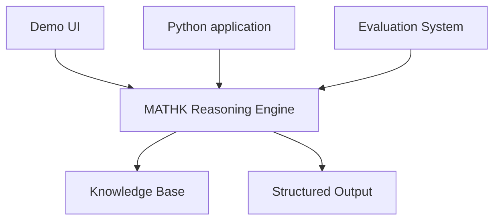

### 1.2. Functional Drivers

| ID | Architecture Driver | Nguồn |
|---|---|---|
| FD01 | Tiếp nhận và chuẩn hóa đầu vào | FR01 |
| FD02 | Biểu diễn dữ kiện đa phương thức | FR02 |
| FD03 | Phân tích và lập kế hoạch | FR03 |
| FD04 | Truy xuất tri thức thích ứng | FR04 |
| FD05 | Suy luận kết hợp công cụ toán học | FR05 |
| FD06 | Kiểm chứng và tự sửa lỗi | FR06 |
| FD07 | Điều phối Agent động | FR07 |
| FD08 | Phát hiện và xử lý bất định | FR08 |
| FD09 | Đầu ra có cấu trúc | FR09 |
| FD10 | Thực nghiệm và đánh giá | FR10 |

Các driver không nhất thiết tương ứng với Agent hoặc service riêng; ưu tiên module thông thường khi phù hợp.

### 1.3. Quality Attribute Drivers

| Nhóm | Thuộc tính |
|---|---|
| A — Chi phối kiến trúc cốt lõi | NFR01 Mathematical Correctness, NFR02 Reliability, NFR03 Performance, NFR04 Cost Efficiency, NFR05 Modifiability, NFR06 Extensibility |
| B — Xuyên suốt | NFR07 Reproducibility, NFR08 Observability, NFR09 Security & Privacy |
| C — Hỗ trợ sử dụng và mở rộng | NFR10 Usability, NFR11 Portability, NFR12 Scalability |

Không thay đổi mức ưu tiên P0/P1 trong Requirements.

### 1.4. Architecture Principles

| ID | Nguyên tắc | Ý nghĩa |
|---|---|---|
| AP01 | Local-first | Ưu tiên chạy trên máy cá nhân. |
| AP02 | Modularity | Module có trách nhiệm rõ ràng. |
| AP03 | Separation of Concerns | Tách suy luận, giao diện, dữ liệu và thực nghiệm. |
| AP04 | Loose Coupling | Hạn chế phụ thuộc trực tiếp. |
| AP05 | Interface-first | Giao tiếp qua interface và schema rõ ràng. |
| AP06 | Deterministic-first | Ưu tiên thuật toán xác định; dùng LLM khi cần. |
| AP07 | State-driven Execution | Điều phối theo trạng thái thực thi có cấu trúc. |
| AP08 | Model Independence | Không phụ thuộc cứng vào một LLM Provider. |
| AP09 | Tool Extensibility | Bổ sung công cụ mà không sửa toàn bộ Agent. |
| AP10 | Bounded Execution | Giới hạn vòng lặp, timeout và tài nguyên. |
| AP11 | Verification-aware | Kết quả kiểm chứng có thể ảnh hưởng điều phối. |
| AP12 | Configuration-driven | Tách prompt, tham số, mô hình và chiến lược khỏi logic nghiệp vụ. |
| AP13 | Research-first Observability | Ghi nhận thông tin thực nghiệm từ đầu. |
| AP14 | Secure by Design | Kiểm soát dữ liệu, API key và quyền thực thi công cụ. |
| AP15 | Incremental Development | Phát triển theo MVP-A đến MVP-D. |
| AP16 | Shared Database by Default | Mặc định dùng database chung; phân chia quyền sở hữu dữ liệu theo trách nhiệm module; truy cập qua Storage/Repository Layer; cho phép lưu trữ riêng hoặc chuyên biệt khi có nhu cầu. |

Deterministic-first: dùng Python cho validation, giới hạn tài nguyên, tính chi phí và metrics; SymPy cho tính toán ký hiệu phù hợp; LLM/VLM cho hiểu đề, lập kế hoạch, suy luận ngữ nghĩa kết hợp quy tắc. Không biến mọi module thành Agent.

State-driven Execution: Agent đọc phần dữ liệu cần thiết từ Shared State, trả về cập nhật có cấu trúc; Orchestrator áp dụng cập nhật hợp lệ và quyết định bước tiếp theo.

Configuration-driven: sử dụng cùng Engine với cấu hình mô hình, Routing, Verification, Tools và Retrieval có thể thay đổi để thực nghiệm. Schema cấu hình chưa chốt.

Shared Database: Shared State là trạng thái logic của phiên suy luận, không đồng nghĩa với database. Có thể phân nhóm dữ liệu Sessions, Problems, Planning, Reasoning, Verification, Knowledge, Execution và Evaluation. Agent không truy cập tùy ý trực tiếp vào database. Có thể sử dụng Vector Store chuyên biệt phục vụ RAG hoặc database riêng khi có nhu cầu; chưa chốt schema và công nghệ lưu trữ.


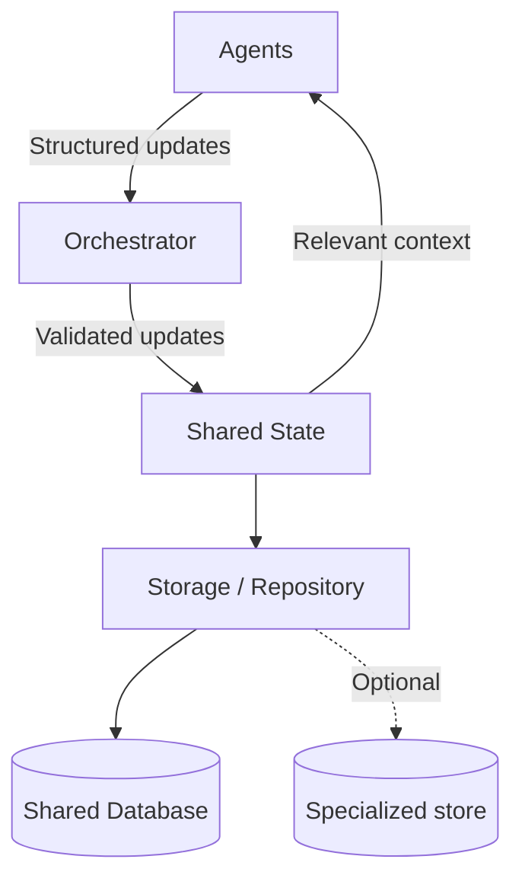


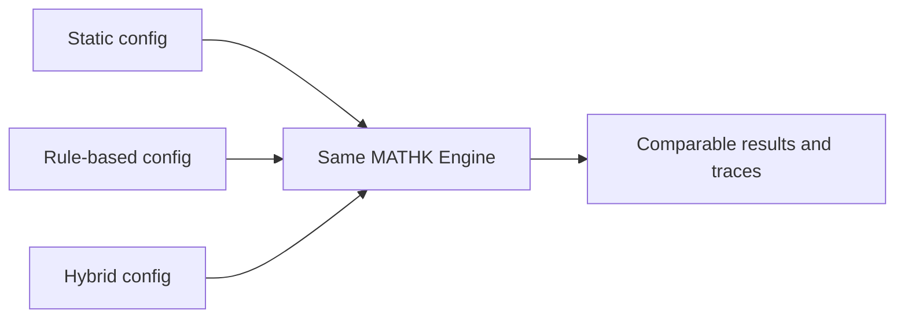

### 1.5. Kiến trúc không ưu tiên trong MVP

Không yêu cầu Microservices phân tán, Kubernetes, Message Broker, GPU Server chuyên dụng, Agent cho mọi tác vụ, frontend phức tạp hoặc huấn luyện LLM từ đầu. Không bắt buộc database riêng cho từng Agent; áp dụng AP16. Đây không phải lệnh cấm mở rộng về sau.

### 1.6. Thứ tự ưu tiên khi đánh đổi thiết kế

1. Mathematical Correctness & Reliability.
2. Research Reproducibility.
3. Performance & Cost Efficiency.
4. Modifiability & Extensibility.
5. Usability & Portability.
6. Large-scale Scalability.

Thứ tự trên không phải trọng số định lượng. Security & Privacy là ràng buộc bắt buộc xuyên suốt, không đánh đổi để giảm chi phí hay tăng hiệu năng.

## 2. Architecture Style — Phong cách kiến trúc

### 2.1. Phân loại kiến trúc

Phân biệt Deployment Architecture (đóng gói và triển khai), Internal Architecture (tổ chức mã nguồn và phụ thuộc), Execution Architecture (phối hợp thực thi Agent) và Data Architecture (tổ chức và chia sẻ dữ liệu). Các lựa chọn thuộc những khía cạnh khác nhau có thể kết hợp.

### 2.2. Deployment Architecture

| Tiêu chí | Traditional Monolith | Modular Monolith | Microservices |
|---|---|---|---|
| Triển khai local | Đơn giản | Đơn giản | Phức tạp hơn |
| Modularity | Tùy thiết kế | Cao | Cao |
| Kiểm thử độc lập | Tùy thiết kế | Tốt | Tốt |
| Giao tiếp nội bộ | Function | Interface/Function | Network |
| Shared State | Dễ | Dễ | Phức tạp hơn |
| Chi phí hạ tầng | Thấp | Thấp | Tùy triển khai |
| Mở rộng độc lập khi chạy | Hạn chế | Hạn chế | Tốt |
| Phù hợp MVP | Khá | Rất tốt | Thấp |

Chọn Modular Monolith: module có trách nhiệm và interface rõ ràng, cùng thuộc một hệ thống triển khai; ưu tiên lời gọi hàm Python thay cho HTTP nội bộ. Multi-Agent không đòi hỏi Microservices; Agent có thể cùng chạy trong một tiến trình.


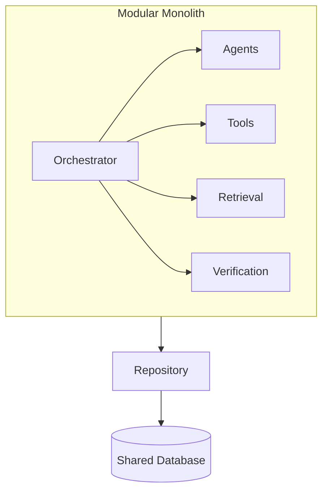

### 2.3. Internal Architecture

Layered Architecture phân chia trách nhiệm theo tầng; Clean Architecture bảo vệ logic nghiệp vụ bằng quan hệ phụ thuộc hướng vào lõi; Hexagonal Architecture sử dụng Ports & Adapters để tách lõi khỏi hạ tầng.

Chọn Lightweight Hexagonal Architecture: áp dụng Ports & Adapters có chọn lọc, tránh trừu tượng hóa quá mức. Core gồm orchestration, Agent Logic, Domain Models và Business Rules. Demo, CLI và Benchmark sử dụng Input Port; LLM, Math Tools, Retrieval và Storage được tích hợp qua interface và adapter phù hợp. Core không phụ thuộc trực tiếp vào SDK của LLM Provider. Interface cụ thể chưa chốt.


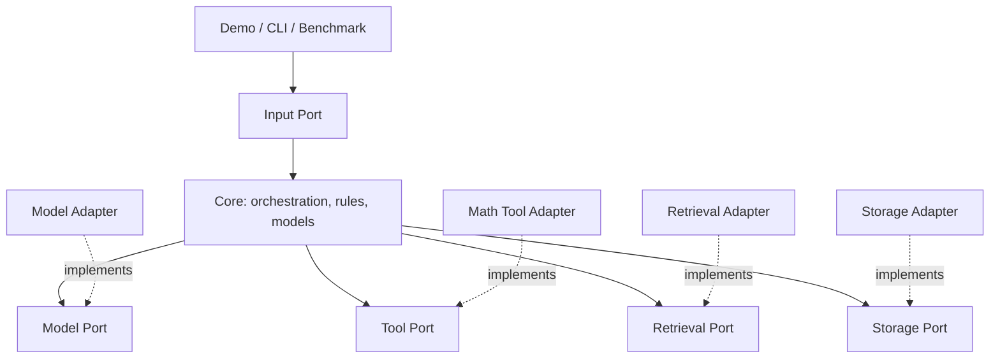

### 2.4. Execution Architecture

| Tiêu chí | Sequential | Supervisor | State Graph |
|---|---|---|---|
| Luồng cố định | Tốt | Có thể | Tốt |
| Điều phối thích ứng | Hạn chế | Tốt | Tốt |
| Vòng lặp sửa lỗi | Cần bổ sung | Tốt | Tốt |
| Kiểm soát chuyển tiếp | Cao | Tùy Supervisor | Cao |
| Truy vết | Dễ | Tùy thiết kế | Tốt |
| Độ phức tạp | Thấp | Trung bình | Trung bình |
| Vai trò trong MATHK | Baseline | Hỗ trợ | Kiến trúc chính |

Chọn State Graph kết hợp Hybrid Orchestration. Node là Agent hoặc tác vụ xác định; Edge là chuyển tiếp; Conditional Edge phụ thuộc điều kiện hoặc Routing; State chứa dữ liệu hiện tại; Termination Condition kiểm soát kết thúc và dừng an toàn.

Orchestrator sử dụng Shared State, quy tắc xác định và LLM khi cần; không bắt buộc Supervisor LLM riêng cho mỗi quyết định. Hỗ trợ tuyến tuần tự, rút gọn, có điều kiện và vòng sửa lỗi giới hạn. Ví dụ khái niệm: Input → Perception → Routing → Lightweight hoặc Structured → Reasoning → Verification → Output hoặc Correction và kiểm chứng lại. Đây chưa phải workflow chính thức. Framework chưa được chọn.


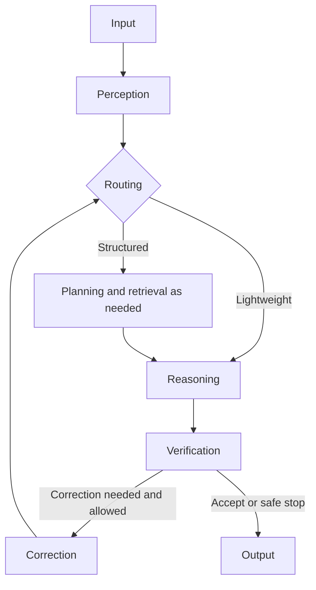

### 2.5. Kiến trúc kết hợp

Graph-orchestrated Modular Monolith with Ports & Adapters:
- Deployment: Modular Monolith.
- Internal: Lightweight Hexagonal Architecture.
- Execution: State Graph & Hybrid Orchestration.
- Data: Shared Database by Default, quyền sở hữu dữ liệu theo module, hỗ trợ lưu trữ chuyên biệt.

Tên gọi mô tả tổ hợp kiến trúc, không tuyên bố Architecture Pattern mới.

### 2.6. Architecture Decision Records

| ID | Quyết định | Lý do chính |
|---|---|---|
| ADR001 | Modular Monolith | Phù hợp Local-first và nguồn lực cá nhân. |
| ADR002 | Lightweight Hexagonal | Giảm phụ thuộc framework và Provider. |
| ADR003 | State Graph & Hybrid Orchestration | Hỗ trợ Adaptive Routing và Verification. |
| ADR004 | Shared Database by Default | Đơn giản hóa quản lý dữ liệu và tính nhất quán. |

ADR lưu trong System Design, chưa cần file riêng.

### 2.7. Đánh đổi

| Hạn chế | Hướng xử lý |
|---|---|
| Module chia sẻ tiến trình | Kiểm soát lỗi và timeout từng tác vụ. |
| Hạn chế scale độc lập từng Agent | Duy trì interface để có thể tách module về sau. |
| State Graph có thể phức tạp | Giới hạn chuyển tiếp và chia subgraph khi cần. |
| Shared Database có nguy cơ phụ thuộc schema | Repository Layer và quyền sở hữu dữ liệu. |
| Ports & Adapters tăng lượng mã | Chỉ tạo interface tại ranh giới cần thiết. |

Kiểm soát timeout không đồng nghĩa với cô lập lỗi tiến trình hoàn toàn.

## 3. High-Level Architecture — Kiến trúc tổng thể

### 3.1. System Context


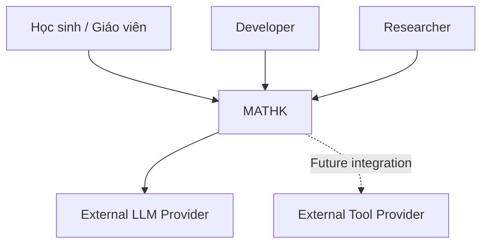


SymPy, Calculator, Knowledge Base và Agents thuộc phạm vi nội bộ. External Tool Provider không bắt buộc trong MVP.

### 3.2. Kiến trúc tổng thể


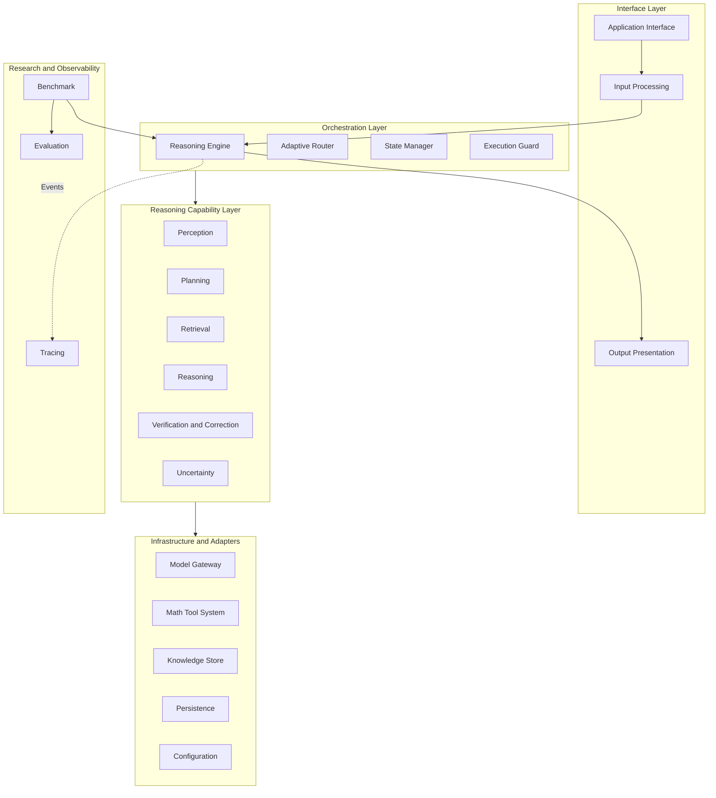


Năm vùng trách nhiệm logic, không phải năm service hoặc thứ tự phụ thuộc mã nguồn bắt buộc. Core định nghĩa interface, Adapter triển khai interface. Research & Observability xuyên suốt hệ thống; mũi tên mô tả tương tác logic.

### 3.3. Danh sách module

| ID | Vùng | Module | Trách nhiệm |
|---|---|---|---|
| M01 | Interface | Input Processing | Tiếp nhận, kiểm tra, chuẩn hóa đầu vào |
| M02 | Interface | Output Presentation | Render Markdown, LaTeX, JSON |
| M03 | Interface | Application Interface | Demo UI, CLI, Python API |
| M04 | Orchestration | Reasoning Engine | Điều phối workflow và giao diện giải toán |
| M05 | Orchestration | Adaptive Router | Chọn tuyến và mức suy luận |
| M06 | Orchestration | State Manager | Quản lý Shared State và cập nhật |
| M07 | Orchestration | Execution Guard | Kiểm soát hành động, timeout, tài nguyên, dừng |
| M08 | Capability | Multimodal Perception | Hiểu đề và dữ kiện trực quan |
| M09 | Capability | Problem Analysis & Planning | Phân tích, phân loại, lập kế hoạch |
| M10 | Capability | Knowledge Retrieval | Truy xuất tri thức toán học |
| M11 | Capability | Mathematical Reasoning | Suy luận và dùng công cụ |
| M12 | Capability | Verification & Correction | Kiểm chứng, phát hiện lỗi, hỗ trợ sửa lỗi |
| M13 | Capability | Uncertainty Management | Tổng hợp tín hiệu và đề xuất xử lý bất định |
| M14 | Adapter | Model Gateway | Interface và adapter LLM/VLM |
| M15 | Adapter | Mathematical Tool System | Registry, validation, thực thi công cụ |
| M16 | Adapter | Knowledge Store | Lưu trữ, indexing, tìm kiếm |
| M17 | Adapter | Persistence | Repository, database, checkpoint |
| M18 | Adapter | Configuration | Cấu hình, prompt, tham số |
| M19 | Research | Benchmark Runner | Thực thi dataset và cấu hình thực nghiệm |
| M20 | Research | Evaluation | Tính metrics, đánh giá |
| M21 | Research | Execution Tracing | Sự kiện, tuyến xử lý, lỗi, chi phí |

21 module logic, không phải 21 service, package hoặc Agent bắt buộc. Python API không đồng nghĩa REST API hoặc SDK riêng. Verification & Correction có thể dùng Verifier và Reasoner thay vì Corrector Agent riêng.


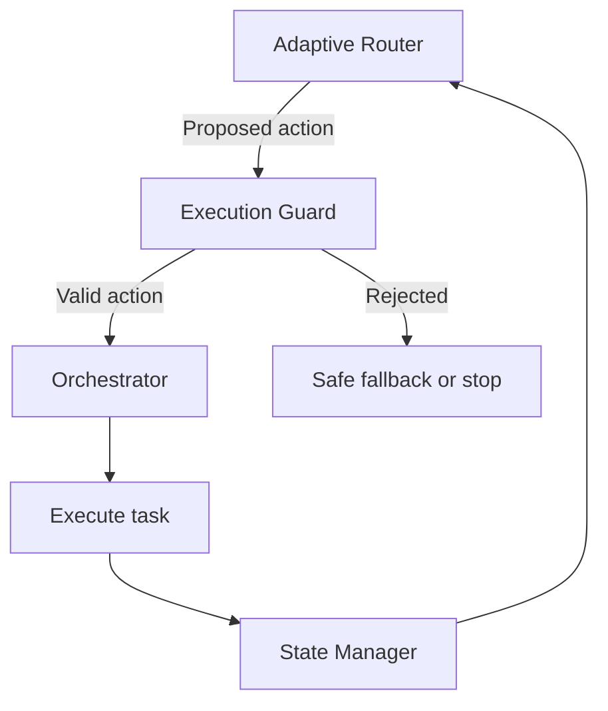


### 3.4. Control Plane và Execution Plane


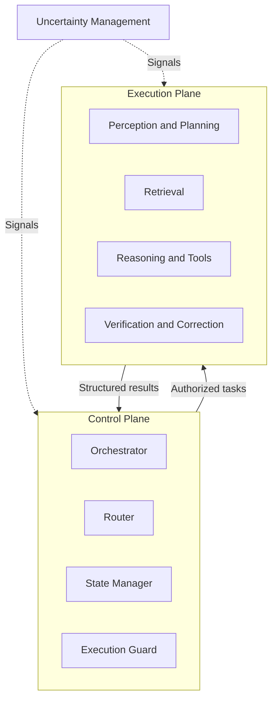


Phân chia logic, không yêu cầu hai hệ thống triển khai riêng.

### 3.5. Luồng xử lý tổng thể


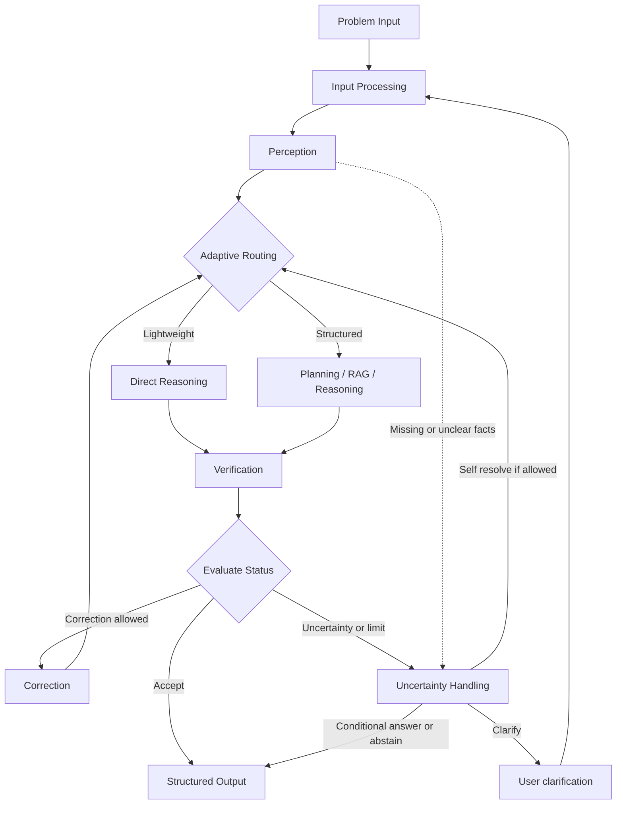


Luồng khái niệm, không phải workflow chính thức. Cả hai tuyến có thể dùng công cụ. Bất định có thể xuất hiện ở mọi giai đoạn. Kết quả Verification có thể tác động Routing, Planning và Retrieval. Mọi vòng lặp chịu giới hạn thực thi; bảo toàn trạng thái liên quan khi tiếp tục sau clarification.

### 3.6. Module Traceability

| Requirement | Module chính |
|---|---|
| FR01 | M01, M03 |
| FR02 | M08 |
| FR03 | M09 |
| FR04 | M10, M16 |
| FR05 | M11, M15 |
| FR06 | M12, M11, M15 |
| FR07 | M04, M05, M06, M07 |
| FR08 | M13, M04 |
| FR09 | M02, M04 |
| FR10 | M19, M20, M21 |

M14, M17, M18 hỗ trợ xuyên suốt. Đây là truy vết cấp module, không thay thế RTM chi tiết.

### 3.7. Ranh giới phụ thuộc

| ID | Quy tắc |
|---|---|
| AR01 | Interface gọi Engine, không tự tổ chức workflow. |
| AR02 | Agent không tự gọi Agent khác tùy ý ngoài điều phối. |
| AR03 | Router đề xuất hành động; Orchestrator kiểm soát thực thi. |
| AR04 | Agent nhận trạng thái cần thiết, trả cập nhật có cấu trúc. |
| AR05 | Kết nối LLM Provider qua Model Gateway. |
| AR06 | Thực thi công cụ qua Tool Registry và validation. |
| AR07 | Truy cập dữ liệu bền vững qua Repository hoặc Storage Interface. |
| AR08 | Evaluation không đưa đáp án tham chiếu vào phiên suy luận. |

### 3.8. Kiến trúc theo MVP


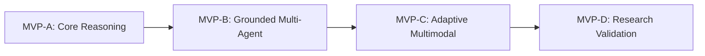


| Giai đoạn | Năng lực |
|---|---|
| MVP-A | Input, Engine, Reasoning, Model Gateway, Math Tools, Output, benchmark và tracing cơ bản |
| MVP-B | Planning, Retrieval, Verification, Correction, Shared State |
| MVP-C | Perception, Adaptive Router, Uncertainty Handling, toàn bộ P0 |
| MVP-D | Đánh giá, baseline, ablation, phân tích lỗi |

Kiểm soát tài nguyên, cấu hình và ghi log ở mức tối thiểu từ MVP-A, mở rộng dần.

## 4. Technology Stack

**Trạng thái: Đã chốt.** Công nghệ phục vụ kiến trúc đã duyệt, Local-first và máy phát triển 16 GB RAM. Ưu tiên chiều sâu AI, khả năng kiểm soát thực nghiệm và đơn giản hóa hạ tầng. Không cố định phiên bản dependency cụ thể ngoài dòng phiên bản đã chọn trước kiểm thử tương thích.

### 4.1. Tổng hợp công nghệ

| Nhóm | Lựa chọn |
|---|---|
| Language & Environment | Python 3.12, uv, pyproject.toml, uv.lock |
| Agent Orchestration | LangGraph + Custom Agent Logic |
| Model Integration | Custom Model Gateway; 9Router Adapter hoặc LiteLLM Adapter; Native SDK khi cần |
| Validation | Pydantic v2 |
| Symbolic & Numerical Math | SymPy, NumPy, math, decimal, fractions |
| Multimodal | Pillow + VLM qua Model Gateway |
| Retrieval | BM25, Sentence Transformers, FAISS, RRF |
| Embedding | Embedding Gateway; BGE-M3 là ứng viên |
| Persistence | SQLite, SQLAlchemy 2.x, Alembic, sqlite3 |
| Interface | Python API, CLI, Gradio |
| Testing | pytest, Hypothesis, unittest.mock, pytest-cov |
| Evaluation | Custom Python, pandas, NumPy, Matplotlib |
| Observability | Python logging, JSONL, psutil |
| Code Quality | Ruff, mypy |
| CI | GitHub Actions |
| Containerization | Docker tùy chọn |

### 4.2. Programming Language & Environment

Python 3.12 là mục tiêu tương thích. uv quản lý Python, môi trường và dependency; commit pyproject.toml và uv.lock để tái lập môi trường. Ruff phục vụ lint/format, mypy kiểm tra kiểu. Poetry và pip + venv không chọn làm workflow chính. Kiểm tra tương thích Windows và thư viện native trước khi khóa dependency.

### 4.3. Agent Orchestration

LangGraph được chọn thay AutoGen, CrewAI và tự viết toàn bộ runtime vì phù hợp State Graph, conditional edges, bounded loops, checkpoint và interrupt/resume. Không phụ thuộc Agent dựng sẵn để quyết định phương pháp nghiên cứu.

| LangGraph | MATHK |
|---|---|
| Graph execution, nodes, edges | Agent Logic và Adaptive Routing Policy |
| State runtime | Mathematical Representation và quy tắc cập nhật state |
| Checkpoint, interrupt/resume | Resource Guard, Verification và Correction Strategy |
| Conditional transitions | Knowledge Retrieval Strategy |

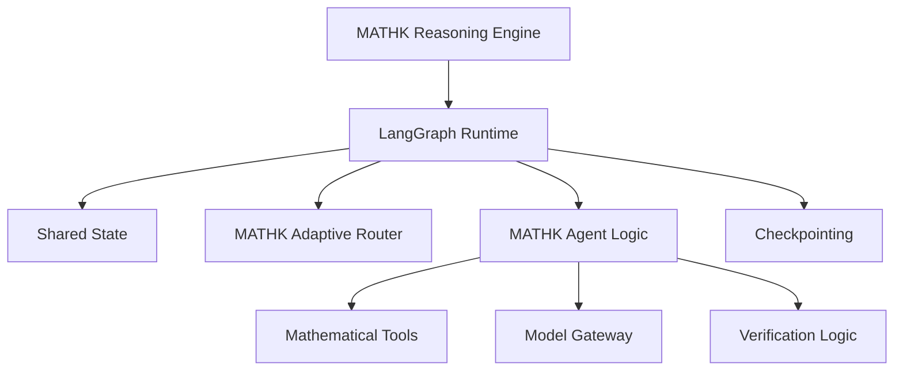

LangGraph là framework thực thi, không phải đóng góp nghiên cứu. Router và guard vẫn tuân thủ AR01–AR08.

### 4.4. LLM Integration

Custom Model Gateway chuẩn hóa request, response, structured output, tool calls, lỗi, token usage và metadata. 9Router Adapter dùng endpoint OpenAI-compatible sau kiểm thử, LiteLLM Adapter cho provider trực tiếp; Native SDK khi cần. Không bắt buộc xếp chồng hai adapter. 9Router là proxy tùy chọn, hỗ trợ kết nối và monitoring LLM, không thay LangGraph. Model/Provider cụ thể chọn sau thử nghiệm.


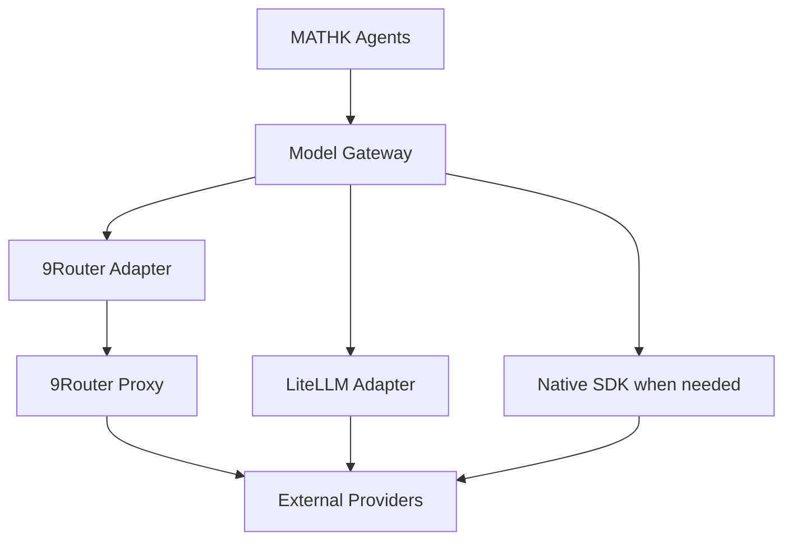


Model Profiles: DEFAULT, MULTIMODAL, ADVANCED, EMBEDDING (qua Embedding Gateway). Có thể dùng chung model. LLM/VLM qua API ngoài trong MVP. Model Policy và kiểm soát retry/fallback xem 5.20.

### 4.5. Data Validation

Pydantic v2 kiểm tra dữ liệu tại ranh giới module và structured output. Schema khái niệm: ProblemInput, ProblemRepresentation, ReasoningPlan, ReasoningStep, ToolRequest, ToolResult, VerificationReport, UncertaintyReport, ReasoningState, SolutionOutput, ExperimentConfig. Thiết kế schema chính thức ở các mục sau.

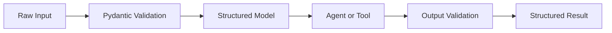

### 4.6. Mathematical Computation

SymPy và Calculator là năng lực P0, dùng NumPy và thư viện chuẩn Python cho tính số khi phù hợp. SciPy là tùy chọn khi cần. Direct Function Calling, Tool Registry, validation và bounded execution. Không thực thi mã Python tùy ý; không dùng eval/exec hoặc parse_expr/sympify trên chuỗi không kiểm soát. Giới hạn biểu thức, độ phức tạp và thời gian tính toán.

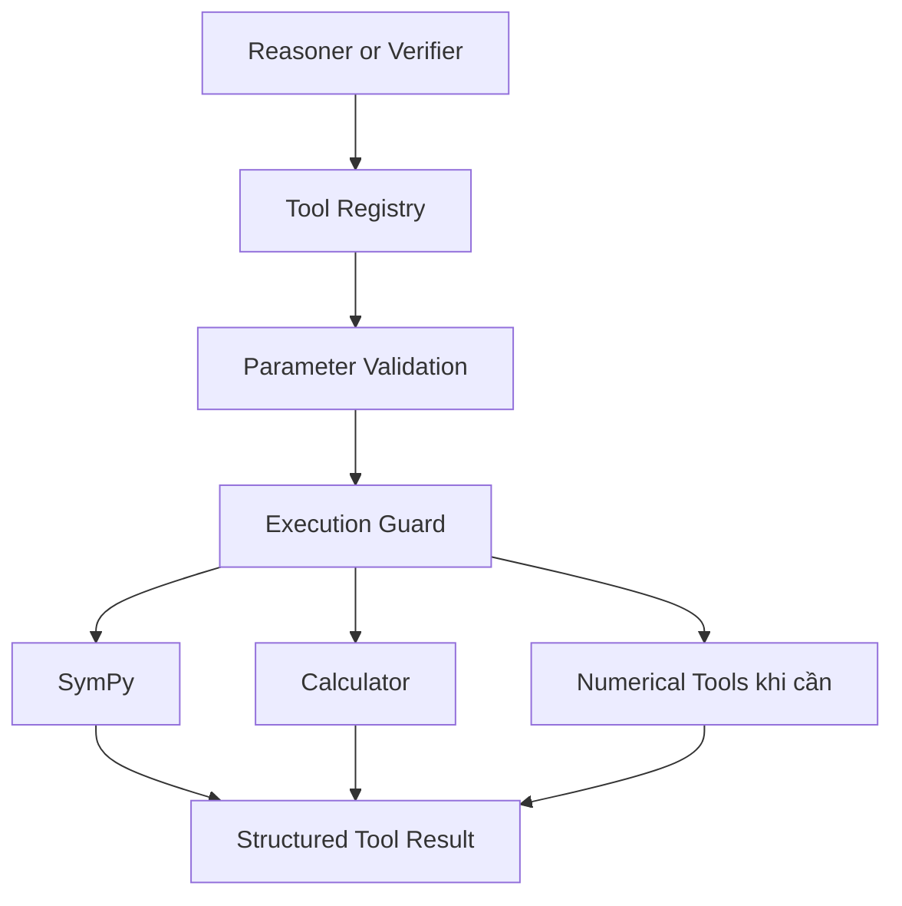

### 4.7. Multimodal Processing

VLM-first, Pillow để đọc, kiểm tra và resize ảnh. OpenCV tùy nhu cầu, PyMuPDF ứng viên P1 cho PDF, OCR engine chọn khi xây baseline. Không bắt buộc huấn luyện detector hình học riêng.

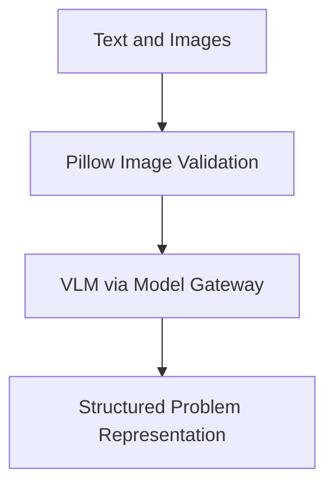

Đầu vào chỉ văn bản không cần qua xử lý ảnh.

### 4.8. Knowledge Retrieval & Agentic RAG

BM25 làm sparse retrieval; Sentence Transformers và FAISS cho dense retrieval; RRF cho fusion. BGE-M3 là ứng viên, không mặc định tối ưu cho toán tiếng Việt. Embedding Gateway hỗ trợ chạy local hoặc API. Index và query phải dùng embedding tương thích; đổi model cần xây lại index tương ứng. Agentic Retrieval Logic do MATHK xây dựng, quyết định truy xuất và kiểm tra applicability trong giới hạn. Không đồng nhất Hybrid Retrieval với Agentic RAG.

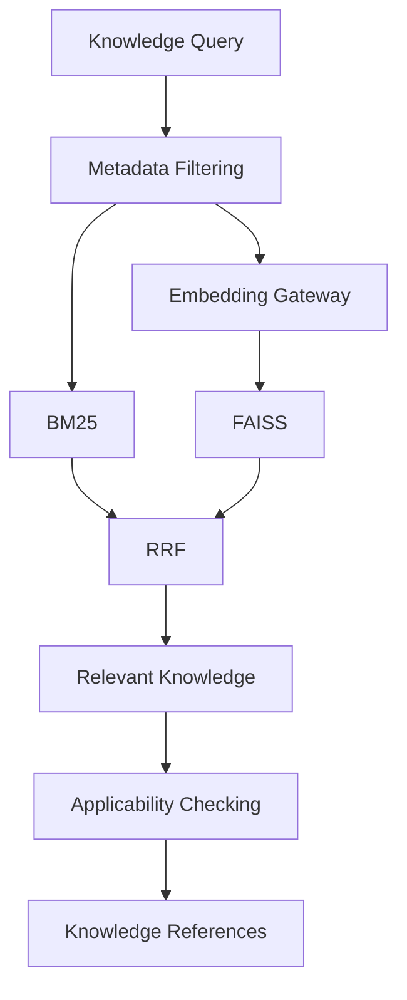

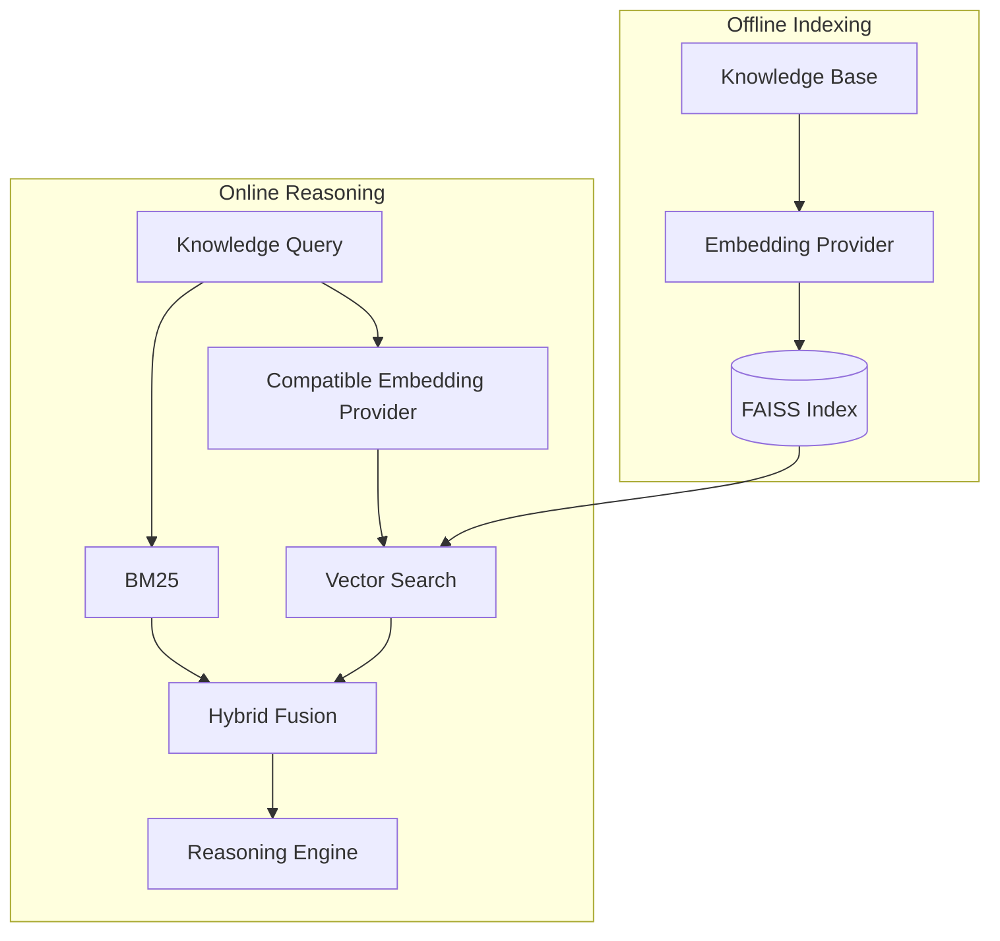

### 4.9. Database & Storage

Chốt SQLite + FAISS thay PostgreSQL + pgvector để giảm quản trị và phù hợp MVP local. SQLAlchemy 2.x quản lý persistence, Alembic quản lý schema migration, sqlite3 là driver. SQLite là nguồn dữ liệu chính cho metadata và dữ liệu nghiệp vụ; FAISS là index có thể xây dựng lại; file lớn, ảnh, dataset, trace/export dùng local file storage. Repository Interface giữ ranh giới module. Không lưu hai trạng thái nghiệp vụ độc lập thiếu đồng bộ. SQLite có giới hạn ghi đồng thời; PostgreSQL là lựa chọn tương lai nếu cần, việc chuyển đổi cần kiểm thử và migration.

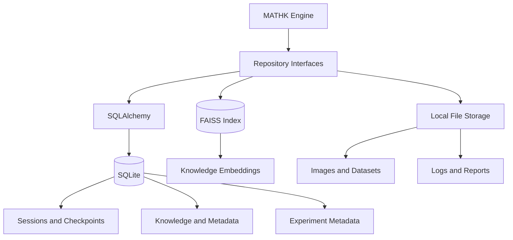

Checkpoint chi tiết và cơ chế phối hợp persistence của LangGraph sẽ chốt ở State Management và Data & Storage Design.

### 4.10. Application Interface

Python API là giao diện cốt lõi, CLI cho chạy bài toán và thực nghiệm, Gradio làm demo văn bản/ảnh và lời giải toán học. FastAPI chỉ thêm khi cần HTTP. Streamlit và Next.js chưa triển khai. UI chỉ gọi Engine qua interface, không chứa logic suy luận.

### 4.11. Testing & Code Quality

pytest cho unit/integration, Hypothesis cho property-based testing, unittest.mock cho mock, pytest-cov cho coverage, Ruff/mypy cho chất lượng mã, GitHub Actions cho CI. Property testing không thay thế chứng minh toán học. Test provider bằng mock khi phù hợp để kiểm soát chi phí.

### 4.12. Evaluation & Observability

Custom Benchmark Runner và Evaluator, SymPy + custom mathematical evaluation, pandas/NumPy, SciPy nếu cần, Matplotlib, logging và JSONL, SQLite metadata, JSON/CSV export. LLM-as-Judge P1, Langfuse/LangSmith tùy chọn. Ground truth không đưa vào Engine.

```mermaid
flowchart TD
 D["Benchmark Dataset"] --> B["Benchmark Runner"]
 C["Experiment Config"] --> B
 B --> E["MATHK Engine"]
 E --> R["Solution and Execution Trace"]
 R --> V["Mathematical Evaluator"]
 G["Ground Truth"] --> V
 V --> M["Metrics"]
 M --> S[("Experiment Storage")]
 R --> S
 S --> O["Reports and Charts"]
```

Benchmark Runner chỉ chuyển dữ liệu đề bài được phép tới Engine, không chuyển nhãn ground truth.

**Monitoring bổ sung:** 9Router hỗ trợ theo dõi API usage, provider, quota và log theo khả năng phiên bản; token/cost/latency cần kiểm chứng. MATHK vẫn tự ghi agent path, tool/RAG, verification/correction, resource và benchmark trace bằng logging, JSONL, SQLite, psutil. Không phụ thuộc 9Router để tái lập thực nghiệm; actual model metadata phải xác minh. Không ghi bí mật vào log.


```mermaid
flowchart TD
 A["MATHK Agents and Tools"] --> T["Execution Tracing"]
 G["Model Gateway"] --> T
 T --> D["SQLite and JSONL"]
 D --> E["Research Evaluation"]
 G --> R["9Router Proxy"]
 R --> P["Providers"]
 R --> U["Usage and Quota Monitor"]
 R --> L["Console Log"]
```


### 4.13. Technology Stack Overview

```mermaid
flowchart TD
 I["Gradio / CLI / Python API"]
 C["Python 3.12 / LangGraph / Pydantic v2"]
 A["Model Gateway / 9Router or LiteLLM / VLM"]
 T["SymPy / NumPy / Calculator"]
 K["BM25 / Sentence Transformers / FAISS / SQLite"]
 R["pytest / pandas / Ruff / uv / GitHub Actions"]
 I --> C
 C --> A
 C --> T
 C --> K
 R -.->|Research and engineering support| C
```

Sơ đồ nhóm trách nhiệm, không phải dependency graph bắt buộc.

### 4.14. Resource Management & Deployment Constraints

Máy phát triển 16 GB RAM. LLM qua API, local-first cho các thành phần khác. Lazy Loading, Shared Model Instance trong một tiến trình, Embedding Gateway, Configurable Concurrency, Bounded State và Resource Monitoring bằng psutil. Benchmark tuần tự hoặc giới hạn đồng thời; Docker tùy chọn, không bắt buộc chạy Docker Desktop trong phát triển. Embedding index tính trước và lưu; embedding truy vấn dùng model tương thích. Giữ BGE-M3 là ứng viên, cân nhắc embedding nhẹ hoặc API nếu RAM/latency không phù hợp.

Ước tính trước kiểm thử: Core không RAG khoảng 0,5–1 GB; full stack với embedding API khoảng 0,8–1,8 GB; BGE-M3 local khoảng 3–5,5 GB RAM riêng ứng dụng, benchmark có thể cao hơn. Đây không phải benchmark hoặc giới hạn cam kết, chưa gồm hệ điều hành/IDE/browser/Docker. Kiểm tra tiêu thụ thực tế ở MVP-A và khi tích hợp Retrieval; không cộng cơ học RAM các thư viện cùng tiến trình.

Các dependency, phiên bản model, cấu hình concurrency và ngưỡng tài nguyên cụ thể sẽ khóa sau kiểm thử. Không mở rộng sang PostgreSQL, vector database server, MCP, hạ tầng phân tán hoặc GPU server bắt buộc trong MVP.

**Quyết định:** Chấp thuận toàn bộ stack bảng 4.1 và nguyên tắc quản lý tài nguyên.

## 5. Agent Design

**Trạng thái: Đã chốt.** Schema, prompt và giới hạn thực thi cụ thể sẽ thiết kế ở các mục tương ứng.

### 5.1. Nguyên tắc

Deterministic-first, Agent-assisted. Kiểm tra định dạng, tính toán, truy vấn index, persistence, resource budget và metrics dùng code xác định khi phù hợp; Agent đảm nhiệm hiểu ngữ cảnh, lựa chọn phương pháp, sinh truy vấn, đánh giá lập luận. Không biến mọi chức năng thành Agent.

### 5.2. Số lượng Agent

Chọn phương án Specialized gồm 5 vai trò logic thay vì Minimal 3 hoặc Highly Specialized 8–12. Không phải 5 tiến trình, 5 model hay 5 microservice.

| ID | Agent | Module | Trách nhiệm |
|---|---|---|---|
| AG01 | Perception | M08 | Hiểu đề và dữ kiện |
| AG02 | Planner | M09 | Phân tích, lập kế hoạch |
| AG03 | Retrieval | M10 | Truy xuất và đánh giá tri thức |
| AG04 | Reasoner | M11 | Giải toán và sửa lời giải |
| AG05 | Verifier | M12 | Kiểm chứng và định vị lỗi |


```mermaid
flowchart TD
 O["Orchestrator / Router / Guard"] --> A["AG01 Perception"]
 O --> B["AG02 Planner"]
 O --> C["AG03 Retrieval"]
 O --> D["AG04 Reasoner"]
 O --> E["AG05 Verifier"]
 A --> S["Structured Updates"]
 B --> S
 C --> S
 D --> S
 E --> S
 S --> M["State Manager"]
 M --> T["Shared State"]
 T --> O
```


### 5.3. AG01 — Perception Agent

Input: ProblemInput và bổ sung của người dùng. Output: ProblemRepresentation, uncertainty signals. Profile: MULTIMODAL hoặc DEFAULT. Công cụ đọc ảnh và chuẩn hóa được cấp quyền. FR01, FR02, FR08. Trích xuất văn bản, công thức, đối tượng/quan hệ hình học, bảng, đồ thị; tích hợp dữ kiện và provenance; phân biệt given, observed, inferred, assumption. Không suy ra góc vuông chỉ vì hình trông vuông.


```mermaid
flowchart TD
 I["Text and Images"] --> P["Input Processing"]
 P --> A["Perception"]
 A --> T["Text and Formula Extraction"]
 A --> V["Visual Understanding"]
 T --> F["Fact Integration"]
 V --> F
 F --> U["Uncertainty Signals"]
 F --> R["Problem Representation"]
```


Ví dụ tam giác ABC có ký hiệu vuông tại A, AB=3, AC=4, mục tiêu tính BC. Perception ghi nhận ba dữ kiện và nguồn ký hiệu/nhãn ảnh; không tự kết luận BC=5.

### 5.4. AG02 — Planner Agent

Input: ProblemRepresentation và state liên quan. Output: ReasoningPlan, RoutingRecommendation. Profile DEFAULT/ADVANCED; chưa cần tool tính toán riêng. FR03, FR07. Phân loại miền, mục tiêu, độ phức tạp; lập bước và dependency; đề xuất nhu cầu tri thức/tool, lightweight hoặc structured. Orchestrator và Guard quyết định cuối.


```mermaid
flowchart TD
 I["Problem Representation"] --> A["Planner"]
 A --> D["Domain and Task"]
 A --> C["Complexity"]
 D --> K["Knowledge Requirements"]
 D --> T["Tool Requirements"]
 C --> P["Structured Plan"]
 K --> P
 T --> P
 P --> R["Routing Recommendation"]
```


Ví dụ kế hoạch: kiểm tra góc vuông, xác định Pythagoras, thiết lập BC²=AB²+AC², tính BC, kiểm tra độ dài.

### 5.5. AG03 — Retrieval Agent

Input: ProblemRepresentation, ReasoningPlan khi có, KnowledgeRequest. Output: KnowledgeBundle hoặc tín hiệu bất định. DEFAULT; truy cập dịch vụ BM25, dense retrieval, metadata filtering. FR04, FR08. Sinh query, đánh giá relevance và applicability; truy xuất lại có giới hạn. Không tự tạo nguồn. Pythagoras chỉ áp dụng khi đủ điều kiện tam giác vuông, xác định đúng cạnh huyền.


```mermaid
flowchart TD
 P["Problem and Plan"] --> A["Retrieval"]
 A --> Q["Generate Query"]
 Q --> R["Retrieval Service"]
 R --> K["Knowledge Candidates"]
 K --> V{"Relevant and applicable?"}
 V -->|Yes| O["Knowledge Bundle"]
 V -->|Need evidence and budget| F["Refine Query"]
 F --> R
 V -->|Cannot establish| U["Uncertainty Signal"]
```


### 5.6. AG04 — Reasoner Agent

Input: Problem, Plan/Knowledge nếu có, Previous Steps, Tool Results. Output: ReasoningStep, SolutionCandidate. DEFAULT/ADVANCED; SymPy, Calculator qua registry. FR05, FR06. Solve Mode sinh lời giải; Correction Mode sửa theo feedback và dependency. Không cần Corrector Agent riêng. Không thực thi Python tùy ý.


```mermaid
flowchart TD
 P["Problem"] --> A["Reasoner"]
 K["Knowledge when needed"] --> A
 L["Plan when needed"] --> A
 A --> S["Reasoning Step"]
 S --> T{"Need computation?"}
 T -->|Yes| C["Guard and Tool Registry"]
 C --> M["SymPy or Calculator"]
 M --> R["Tool Result"]
 R --> A
 T -->|No| N["Next Step or Candidate"]
```


Ví dụ BC²=3²+4², tool trả 5 khi tính căn bậc hai; Reasoner xác định BC=5 do độ dài dương.

### 5.7. AG05 — Verifier Agent

Input: đề gốc, Problem, Knowledge, SolutionCandidate, Tool Results. Output: VerificationReport, CorrectionFeedback. DEFAULT/ADVANCED khi cần ngữ nghĩa; SymPy, Calculator, deterministic rules. FR06, FR08. Năm lớp V1 Input, V2 Knowledge, V3 Reasoning, V4 Computational, V5 Answer. Kiểm tra điều kiện, dependency, tính toán, đáp án/đơn vị/độ đầy đủ. Phạm vi và phương pháp kiểm chứng phải rõ; LLM đồng ý không phải chứng minh hình thức.


```mermaid
flowchart TD
 S["Solution Candidate"] --> D["Deterministic Verification"]
 D --> A["Semantic Verification when needed"]
 A --> E["Aggregate Evidence"]
 E --> R{"Verification Status"}
 R --> V["VERIFIED"]
 R --> P["PARTIALLY_VERIFIED"]
 R --> U["UNVERIFIED"]
 R --> F["FAILED"]
```


### 5.8. Verification-guided Correction

Dependency-aware Correction: giữ bước hợp lệ, sửa bước sai và đánh giá lại các bước phụ thuộc; nếu cần thì replan. Luôn bind báo cáo vào phiên bản lời giải và kiểm chứng lại. Ví dụ 3²+4²=23 sai, sửa thành 25 rồi tính lại BC=5. Lợi ích chi phí/chất lượng là giả thuyết cần thực nghiệm.


```mermaid
flowchart TD
 S1["Step 1 valid"] --> S2["Step 2 valid"]
 S2 --> S3["Step 3 incorrect"]
 S3 --> S4["Step 4 affected"]
 S3 --> V["Verifier Feedback"]
 V --> C["Correct Step 3"]
 C --> N["Recompute Step 4"]
 N --> R["Re-verification"]
```


### 5.9. Thành phần không phải Agent

Orchestrator, Adaptive Router, State Manager, Execution Guard, Tool Registry, Uncertainty Manager, Output Formatter, Benchmark Runner, Evaluator là thành phần điều phối hoặc dịch vụ. Router có thể dùng LLM hỗ trợ mà không cần Supervisor Agent riêng. Không có Uncertainty hoặc Synthesis Agent riêng trong MVP.

### 5.10. Capability Matrix

| Năng lực | AG01 | AG02 | AG03 | AG04 | AG05 |
|---|---|---|---|---|---|
| Hiểu ảnh và trích xuất | X | | | | |
| Lập kế hoạch, đề xuất routing | | X | | | |
| Truy xuất tri thức | | | X | | |
| Đánh giá kiến thức | | | X | X | X |
| SymPy, Calculator | | | | X | X |
| Giải toán, sửa lời giải | | | | X | |
| Kiểm chứng | | | | | X |
| Báo cáo bất định | X | X | X | X | X |

Verifier được đọc đề gốc, kể cả ảnh khi cần để kiểm tra perception; không thay thế vai trò trích xuất chính AG01.

### 5.11. Agent Lifecycle


```mermaid
flowchart TD
 A["Task Assignment"] --> B["Build Relevant Context"]
 B --> C["Validate Input"]
 C --> D["Execute Agent Logic"]
 D --> E["Validate Output"]
 E --> F{"Valid result?"}
 F -->|Yes| G["Structured Update"]
 F -->|No| H["Bounded Retry or Failure"]
 H --> I["Orchestrator"]
 G --> I
 I --> J["State Manager"]
 J --> K["Route Next Action"]
```


Agent không tự sửa state; Orchestrator kiểm tra update hợp lệ trước khi State Manager áp dụng. Failure được ghi nhận, không coi là kết quả hợp lệ.

### 5.12. Agent Relationships

Không gọi trực tiếp Agent khác; trao đổi thông qua Orchestrator và Shared State theo sơ đồ 5.2. Các tool call riêng cũng chịu quyền hạn và ngân sách chung.

### 5.13. Agent Configuration

Configuration-driven: agent_id, name, enabled, model_profile, prompt_version, allowed_tools, execution_modes. Ví dụ AG04 có solve/correction, calculate, simplify, solve_equation, check_equivalence. Đây là cấu hình minh họa, chưa phải schema chính thức. Ablation chỉ vô hiệu hóa thành phần theo cấu hình thực nghiệm hợp lệ, không bỏ ràng buộc an toàn.

### 5.14. Quyết định cơ sở

5 Agent, cùng tiến trình mặc định, LangGraph, Shared Structured State, Model Gateway dùng chung, quyền tool theo Agent, cấu hình hóa. Reasoner correction mode, một Verifier năm lớp.

### 5.15. Agent Autonomy

Chọn Controlled Autonomy. Fixed Pipeline giữ làm baseline; Autonomous Multi-Agent tự do không triển khai MVP.


```mermaid
flowchart LR
 A["Perception"] --> B["Planner"]
 B --> C["Retrieval"]
 C --> D["Reasoner"]
 D --> E["Verifier"]
```


```mermaid
flowchart TD
 O["Orchestrator"] --> R["Adaptive Router"]
 R --> G["Execution Guard"]
 G --> A["Selected Agent"]
 A --> T["Allowed Tools"]
 T --> A
 A --> U["Structured Update"]
 U --> S["State Manager"]
 S --> O
```


### 5.16. Decision Authority

Agent hiểu dữ kiện, chọn phương pháp trong nhiệm vụ, sinh query và đề xuất tool, truy xuất lại, sửa lỗi, route/model/stop. Orchestrator/Guard kiểm tra thực thi tool, chọn node/model theo policy, áp dụng state update và kết thúc. Không bên nào được vượt budget. Ví dụ AG04 trả status needs_knowledge và request type knowledge_retrieval, topic Định lý Thales, reason cần điều kiện áp dụng; Orchestrator kiểm tra trước khi gọi AG03.

### 5.17. Communication Protocol

Structured Message + Shared State thay hội thoại Agent tự do. Pydantic validation, traceable updates, giới hạn context.


```mermaid
sequenceDiagram
 participant R as Reasoner
 participant O as Orchestrator
 participant S as Shared State
 participant V as Verifier
 R->>O: SolutionCandidate
 O->>S: Validate and update
 O->>V: VerificationTask
 V->>O: VerificationReport
 O->>S: Save error evidence
 O->>R: CorrectionTask
 R->>O: CorrectedSolution
 O->>S: Update solution version
 O->>V: Re-verification
```


### 5.18. Context Isolation

Context Builder chỉ cấp phần state cần thiết, không gửi toàn bộ state mặc định.


```mermaid
flowchart TD
 S["Shared State"] --> B["Context Builder"]
 B --> A["AG01 Original Input and supplements"]
 B --> P["AG02 Problem and objectives"]
 B --> K["AG03 Knowledge Request and relevant facts"]
 B --> R["AG04 Problem / Plan / Knowledge / Steps / Tools"]
 B --> V["AG05 Original Input / Candidate / Evidence"]
```


Giảm token, nhiễu và quyền truy cập thừa; Verifier đọc đề gốc khi thích hợp.

### 5.19. Independent Verification

Không truyền mức tự tin của Reasoner mặc định; cung cấp đề gốc, representation, candidate, bước giải, căn cứ và tool results để kiểm tra lại. Không đưa ground truth vào bất kỳ Agent nào. Dùng model khác cho Verifier là lựa chọn thực nghiệm, không bắt buộc; cùng model có nguy cơ lỗi tương quan. Không đồng nhất việc tách vai trò với độc lập thống kê.

### 5.20. Agent Model Policy

Free-first cho development, model cụ thể chọn qua benchmark nhỏ và capability test (vision, JSON/schema, tool calling, latency, quota). Gemma, Nemotron, Qwen là ứng viên, không cam kết chất lượng hay tính miễn phí lâu dài. 9Router là proxy tùy chọn và monitoring hạ tầng; LiteLLM adapter gọi trực tiếp provider khi cần. MATHK sở hữu Agent Routing, Reasoning Level, Model Profile, correction, budget. 9Router sở hữu provider routing theo cấu hình đã kiểm chứng. Retry/fallback nhiều tầng phải tuân thủ ngân sách tổng.


```mermaid
flowchart TD
 A["Agent Task"] --> M["MATHK Model Policy"]
 M --> G["Model Gateway"]
 G --> R["9Router Adapter"]
 G --> L["LiteLLM Adapter"]
 R --> P["External Providers"]
 L --> P
 R --> U["Infrastructure Monitoring"]
 G --> T["MATHK Execution Tracing"]
```


| Chính sách | Development | Research |
|---|---|---|
| Free-first | Có | Theo config |
| Model cố định | Tùy chọn | Theo experiment config |
| Fallback | Có giới hạn | Mặc định tắt |
| Adaptive Model Routing | Cho phép | Bật/tắt có kiểm soát |
| Token Saver | Tùy chọn | Mặc định tắt |
| Trace | Có | Bắt buộc |
| Actual model tracking | Khi có metadata | Xác minh bắt buộc |

Nếu không xác minh model thực tế qua proxy, gọi trực tiếp provider cho thực nghiệm cần kiểm soát. Không nhầm Adaptive Agent Routing với Adaptive Model Routing. Không tự chuyển sang API trả phí ngoài ngân sách được phép.

### 5.21. Agent Registry

Registry quản lý ID, capability, version, model profile, tool permissions, input/output schemas, execution modes. Agent mới cần tích hợp graph và kiểm tra routing; đăng ký không đồng nghĩa tự chạy.


```mermaid
flowchart TD
 O["Orchestrator"] --> R["Agent Registry"]
 R --> A["AG01 Perception"]
 R --> B["AG02 Planner"]
 R --> C["AG03 Retrieval"]
 R --> D["AG04 Reasoner"]
 R --> E["AG05 Verifier"]
 R -.-> F["Future Agents"]
```

## 6. State Management

**Trạng thái: Đã chốt.** Các schema bên dưới mang tính thiết kế logic; field và kiểu dữ liệu cụ thể sẽ hoàn thiện khi triển khai.

### 6.1. State, Context, Memory và Storage

State là trạng thái phiên giải hiện tại; Context là tập thông tin cấp cho một lần thực thi Agent; Memory là thông tin duy trì qua tương tác; Storage là lưu trữ lâu dài; Checkpoint là bản ghi tại ranh giới thực thi để phục hồi. Không yêu cầu Long-term Personal Memory trong MVP.

### 6.2. State Architecture

So sánh Independent Agent State (khó đồng bộ), Global Mutable State (khó bảo đảm toàn vẹn) và Controlled Shared State (chọn). Agent đọc snapshot cần thiết, trả structured update; State Manager kiểm soát thay đổi.


```mermaid
flowchart LR
 A["Agent A"] --> S1["State A"]
 B["Agent B"] --> S2["State B"]
 C["Agent C"] --> S3["State C"]
 A <--> B
 B <--> C
```


```mermaid
flowchart TD
 A["Agent A"] <--> S["Global Mutable State"]
 B["Agent B"] <--> S
 C["Agent C"] <--> S
```


```mermaid
flowchart TD
 S["Shared State"] --> C["Context Builder"]
 C --> A["Selected Agent"]
 A --> U["Structured Update"]
 U --> V["State Validation"]
 V --> M["State Manager"]
 M --> S
```


### 6.3. Shared State Structure

10 nhóm logic, không phải 10 database hoặc tiến trình.

| ID | Group | Dữ liệu dự kiến |
|---|---|---|
| ST01 | Session | session_id, run_id, status, timestamps, config |
| ST02 | Input | Văn bản gốc, tham chiếu ảnh, bổ sung |
| ST03 | Problem | Facts, objects, relations, objectives, assumptions |
| ST04 | Planning | Domain, complexity, plan, dependencies |
| ST05 | Knowledge | Query, references, applicability, retrieval status |
| ST06 | Reasoning | Steps, dependencies, candidate answer, version |
| ST07 | Tool | Request, arguments, result, error |
| ST08 | Verification | Reports, errors, affected steps, scope |
| ST09 | Uncertainty | Signals, severity, evidence, clarification |
| ST10 | Execution | Current node, routes, budgets, counters, failures |


```mermaid
flowchart TD
 S["MATHK Shared State"] --> A["ST01 Session"]
 S --> B["ST02 Input"]
 S --> C["ST03 Problem"]
 S --> D["ST04 Planning"]
 S --> E["ST05 Knowledge"]
 S --> F["ST06 Reasoning"]
 S --> G["ST07 Tool"]
 S --> H["ST08 Verification"]
 S --> I["ST09 Uncertainty"]
 S --> J["ST10 Execution"]
```


### 6.4. State Ownership

| State | Thành phần tạo hoặc đề xuất cập nhật |
|---|---|
| ST01 | Orchestrator |
| ST02 | Input Processing |
| ST03 | AG01 |
| ST04 | AG02 |
| ST05 | AG03 |
| ST06 | AG04 |
| ST07 | Tool Execution System |
| ST08 | AG05 |
| ST09 | Tất cả Agent và Uncertainty Manager |
| ST10 | Router, Orchestrator, Execution Guard |

Ownership không cấp quyền ghi trực tiếp. Reasoner không tự nâng trạng thái kiểm chứng. State Manager áp dụng cập nhật hợp lệ.

### 6.5. State Access Matrix

| State | AG01 | AG02 | AG03 | AG04 | AG05 |
|---|---|---|---|---|---|
| Input | R / W* | — | — | R* | R |
| Problem | W | R | R | R | R |
| Planning | — | W | R | R | R* |
| Knowledge | — | R* | W | R | R |
| Reasoning | — | R* | R* | W | R |
| Tool | — | — | — | R | R |
| Verification | R* | R* | R* | R | W |
| Uncertainty | A | A | A | A | A |
| Execution | R* | R* | R* | R* | R* |

R đọc, W đề xuất cập nhật, A bổ sung tín hiệu, * khi cần cho nhiệm vụ. W bao gồm đọc dữ liệu liên quan thuộc phạm vi sở hữu. AG01 chỉ đề xuất xử lý đầu vào, không sửa bản gốc; Input Processing sở hữu ST02. Session/Execution thuộc tầng điều phối; Tool State do Tool Execution System quản lý.

### 6.6. State Lifecycle


```mermaid
stateDiagram-v2
 [*] --> CREATED
 CREATED --> RUNNING
 RUNNING --> WAITING_USER
 WAITING_USER --> RUNNING
 RUNNING --> PAUSED
 PAUSED --> RUNNING
 RUNNING --> COMPLETED
 RUNNING --> FAILED
 RUNNING --> ABSTAINED
 RUNNING --> CANCELLED
 WAITING_USER --> CANCELLED
 PAUSED --> CANCELLED
 COMPLETED --> [*]
 FAILED --> [*]
 ABSTAINED --> [*]
 CANCELLED --> [*]
```


CREATED: tạo phiên; RUNNING: thực thi; WAITING_USER: chờ bổ sung; PAUSED: tạm dừng có thể tiếp tục; COMPLETED: hoàn tất đầu ra; FAILED: lỗi không hoàn tất; ABSTAINED: không kết luận vì thiếu căn cứ; CANCELLED: hủy. Execution Status độc lập Verification Status; COMPLETED có thể PARTIALLY_VERIFIED.

### 6.7. State Update Protocol


```mermaid
sequenceDiagram
 participant O as Orchestrator
 participant C as Context Builder
 participant A as Agent
 participant V as State Validator
 participant S as State Manager
 O->>C: Build agent context
 C->>A: Relevant state snapshot
 A->>O: Structured update
 O->>V: Validate update
 alt Valid update
 V->>S: Apply update
 S-->>O: New state version
 else Invalid update
 V-->>O: Validation error
 O->>O: Retry or safe stop
 end
```


Ví dụ envelope minh họa:

```json
{
  "update_id": "UPD-001",
  "agent_id": "AG04",
  "base_state_version": 7,
  "status": "success",
  "changes": {"reasoning": {"new_steps": ["STEP-003"]}},
  "uncertainty_signals": [],
  "requested_action": "verification"
}
```

Kiểm tra schema, quyền, base version, Business Rules và tham chiếu. Không chấp nhận ghi đè toàn state bằng JSON tùy ý. ID bước trong ví dụ đại diện cho dữ liệu bước hợp lệ phải được cung cấp hoặc tham chiếu tới bản ghi tồn tại.

### 6.8. Mathematical Fact Representation

Fact có ID, type, expression, origin, source/evidence, status, dependencies. GIVEN (đề cung cấp), OBSERVED (ảnh/biểu đồ), INFERRED (suy ra), ASSUMPTION (giả định công khai). Lưu nguồn và lịch sử bổ sung/đính chính, không âm thầm sửa bản gốc.

Ví dụ tam giác ABC vuông tại A, AB=3, AC=4; objective tính BC.

```json
{
  "fact_id": "F03",
  "type": "geometric_relation",
  "expression": "perpendicular(AB, AC)",
  "origin": "observed",
  "source": {
    "type": "image",
    "asset_id": "IMG-001",
    "evidence": "right_angle_marker"
  },
  "status": "active",
  "dependencies": []
}
```

### 6.9. Dependency Graph

Mỗi bước có ID và tham chiếu facts, knowledge hoặc steps mà nó phụ thuộc. Directed Acyclic Graph cho một phiên bản lời giải, khác Execution Graph có vòng lặp. Khi có lỗi, đánh giá lại bước lỗi và các hậu duệ phụ thuộc; giữ bước khác nếu vẫn hợp lệ.


```mermaid
flowchart TD
 F1["F01 AB = 3"] --> S1["S01 Apply Pythagoras"]
 F2["F02 AC = 4"] --> S1
 F3["F03 Right angle at A"] --> S1
 K["Theorem reference"] --> S1
 S1 --> S2["S02 BC squared = 3 squared + 4 squared"]
 S2 --> S3["S03 BC squared = 23 - Incorrect"]
 S3 --> S4["S04 BC = sqrt 23 - Affected"]
 S3 --> V["Verifier detects error"]
 V --> C["Correct S03 to 25"]
 C --> N["Recompute S04 to 5"]
 N --> R["Re-verify"]
```


Trong chuỗi 4 bước minh họa, lỗi S03 yêu cầu xử lý lại S03/S04, có thể giữ S01/S02 sau kiểm tra tính hợp lệ. DAG thực tế có thể phân nhánh; không vô hiệu hóa mọi bước đứng sau theo thứ tự một cách máy móc.

### 6.10. State Versioning

State Version tăng mỗi cập nhật thành công; Problem Version thay đổi khi dữ kiện/mục tiêu đổi; Solution Version thay đổi khi tạo lại hoặc sửa lời giải. Verification Report gắn đúng Problem Version và Solution Version; không tái dùng VERIFIED cho lời giải mới. Lưu history/checkpoint xuống disk thay giữ mọi bản sao RAM.


```mermaid
flowchart TD
 P["Problem v1"] --> S1["Solution v1"]
 S1 --> V1["Verification v1 FAILED"]
 V1 --> C["Correction"]
 C --> S2["Solution v2"]
 S2 --> V2["Verification v2"]
 P --> P2["Problem v2 after clarification"]
 P2 --> S3["New or updated solution"]
```


### 6.11. In-memory and Persistent State

Current State và Agent Context tạm thời trong RAM, checkpoint SQLite, version history persistent storage, ảnh local files, trace JSONL, KB SQLite, FAISS vector index. State lưu asset ID, đường dẫn nội bộ và metadata thay Base64 ảnh; Context Builder tải ảnh khi cần.


```mermaid
flowchart TD
 subgraph RAM ["In-memory"]
 G["LangGraph Runtime"] --> S["Current Shared State"]
 S --> C["Context Builder"]
 end
 S --> P["Checkpoint and Persistence"]
 subgraph DISK ["Persistent Storage"]
 P --> D[("SQLite")]
 P --> F["Local File Storage"]
 P --> L["JSONL Trace"]
 end
 D --> R["Resume or Recovery"]
 R --> S
```


### 6.12. Checkpoint and Resume

Reasoning Checkpoint phục hồi phiên giải; Experiment Checkpoint tiếp tục benchmark từ bài chưa hoàn thành. Lưu tại ranh giới Agent hoặc bước quan trọng đã commit state. Resume kiểm tra workflow/schema/config/version và tình trạng tác vụ, không mặc định gọi lại API cũ. Thiết kế consistency và recovery chi tiết ở mục 13 và 16.


```mermaid
flowchart TD
 A["Start Session"] --> B["Perception"]
 B --> C["Checkpoint 1"]
 C --> D["Planning and Retrieval"]
 D --> E["Checkpoint 2"]
 E --> F["Reasoning"]
 F --> G["Checkpoint 3"]
 G --> H["Verification"]
 H --> I["Final Checkpoint"]
 F -.->|Interrupted| R["Recovery"]
 R --> E
```


### 6.13. Context Budget Management

Chọn field theo Agent/nhiệm vụ, ưu tiên dữ kiện gốc và mục tiêu, điều kiện/ràng buộc/giả định, bước liên quan, kết quả tool và căn cứ, feedback sửa lỗi, cuối cùng lịch sử ít liên quan. Không cắt mất giả thiết cần thiết. Nếu context không đủ ngân sách sau lọc, đổi chiến lược hoặc báo bất định.


```mermaid
flowchart TD
 S["Shared State"] --> F["Required Field Selection"]
 F --> P["Priority and Relevance Filtering"]
 P --> B["Token Budget Check"]
 B --> D{"Fits budget?"}
 D -->|Yes| C["Agent Context"]
 D -->|No| T{"Can remove irrelevant data?"}
 T -->|Yes| P
 T -->|No| A["Alternative strategy or uncertainty"]
```


### 6.14. Technology

| Thành phần | Công nghệ |
|---|---|
| Graph State | LangGraph |
| Domain Schemas | Pydantic v2 |
| Graph State Container | TypedDict |
| State Manager / Context Builder | Custom Python |
| Validation | Pydantic + Business Rules |
| Dependency Traversal | Python |
| Checkpoint | LangGraph Checkpointer + SQLite |
| Persistence | SQLAlchemy |
| History / Trace | SQLite + JSONL |

TypedDict làm container graph, Pydantic cho dữ liệu nghiệp vụ. Không cần Redis, Kafka, Graph Database. Cơ chế phối hợp checkpointer và repository sẽ xác định ở mục 13.

### 6.15. Quyết định

Controlled Shared State, 10 nhóm logic, validated structured updates, ownership theo module, agent-specific context, structured facts và provenance, DAG, State/Problem/Solution versioning, active state RAM, SQLite/local files, Reasoning và Experiment Checkpoint, configurable context budget, không Long-term Personal Memory trong MVP. Mathematical Fact Representation và Dependency-aware State Management tạo nền tảng cho Verification-guided Correction; hiệu quả cần kiểm chứng, không khẳng định novelty trước nghiên cứu.

## 7. Adaptive Routing

**Trạng thái: Đã chốt.** Ánh xạ FR07.01–14; parallel execution thuộc P1. Hiệu quả và novelty cần thực nghiệm xác minh.

### 7.1. Động cơ
Routing thay đổi theo bài toán, state, verification và tài nguyên. Ví dụ 2x+6=14 có thể giải trực tiếp; chứng minh đường trung bình tam giác cần kế hoạch/tri thức; tam giác chỉ biết AB=3, AC=4 không đủ xác định BC. Không giả định vuông.


```mermaid
flowchart TD
 I["Normalized Problem"] --> D{"Problem characteristics"}
 D -->|Simple equation| R["Reasoner and SymPy"]
 R --> V["Verifier"]
 D -->|Geometry proof| P["Perception when needed"]
 P --> L["Planner"]
 L --> K["Retrieval"]
 K --> Q["Reasoner"]
 Q --> V
 D -->|Missing data| U["Uncertainty Manager"]
 U --> C["Clarification"]
```


### 7.2. Routing Types

| ID | Type | Quyết định |
|---|---|---|
| RT01 | Agent Routing | Agent tiếp theo |
| RT02 | Reasoning Level | L1/L2/L3 |
| RT03 | Capability Routing | Retrieval hoặc tool |
| RT04 | Model Routing | Model phù hợp |

Nâng mức suy luận không bắt buộc đổi LLM.

### 7.3. Routing Architecture


```mermaid
flowchart TD
 S["Shared State"] --> F["Routing Feature Extractor"]
 F --> R["Adaptive Router"]
 C["Routing Configuration"] --> R
 A["Agent Registry"] --> R
 R --> P["Routing Decision"]
 P --> G["Execution Guard"]
 G --> V{"Valid and within budget?"}
 V -->|Yes| O["LangGraph Orchestrator"]
 V -->|No| B["Fallback or Safe Stop"]
 O --> E["Agent or Deterministic Task"]
 E --> U["Structured Update"]
 U --> M["State Manager"]
 M --> S
```


Feature Extractor lấy đặc trưng; Router đề xuất; Registry cung cấp năng lực; Guard kiểm tra; Orchestrator thực thi; State Manager cập nhật; Execution Tracing ghi quyết định và căn cứ. Không cần Supervisor Agent riêng.

### 7.4. Routing Features


```mermaid
flowchart TD
 P["Problem Features"] --> R["Adaptive Router"]
 E["Execution Features"] --> R
 K["Knowledge and Tool Features"] --> R
 V["Verification Features"] --> R
 B["Resource Features"] --> R
```


Problem: domain, task, complexity, modality, completeness. Execution: Agent đã gọi, bước hiện tại, tiến độ. Knowledge/tool: nhu cầu, applicability, capability. Verification: loại/vị trí lỗi, affected steps, status. Resource: calls, tokens, thời gian, cost, loops. Ưu tiên Python và dữ liệu Perception/Planner đã có; tránh gọi LLM trùng lặp.

### 7.5. Reasoning Levels


```mermaid
flowchart TD
 A["Normalized Problem"] --> L1["L1 Lightweight"]
 A --> L2["L2 Structured"]
 L1 --> R["Reasoner and tools when needed"]
 L2 --> P["Planner"]
 P --> K["Retrieval when needed"]
 K --> R
 R --> V["Verifier"]
 V -->|Correction needed| L3["L3 Corrective"]
 L3 --> C["Error analysis / replan / retrieve"]
 C --> N["Reasoner Correction"]
 N --> V
 V -->|Accept or safe stop| F["Output"]
```


L1 trực tiếp; L2 phân rã/kế hoạch/năng lực cần thiết; L3 sửa lỗi dựa trên feedback. Có thể bắt đầu L2 hoặc L1 chuyển thẳng L3. L3 không bắt buộc giải lại toàn bài. Perception khi cần hiểu ảnh hoặc trích xuất ngữ nghĩa. L1/L2 đều kiểm chứng phù hợp.

### 7.6. Routing Strategies

| ID | Strategy | Cơ chế |
|---|---|---|
| RS01 | Static | Pipeline cố định |
| RS02 | Rule-based | Đặc điểm đề, lựa chọn tuyến ban đầu |
| RS03 | State-aware | Quy tắc theo trạng thái động |
| RS04 | Hybrid Adaptive | State-aware và LLM hỗ trợ khi cần |


```mermaid
flowchart LR
 A["RS01 Static"] --> B["RS02 Rule-based"]
 B --> C["RS03 State-aware"]
 C --> D["RS04 Hybrid"]
```


Đây là lộ trình triển khai, không phải kết quả đo chất lượng.

### 7.7. Hybrid Routing Algorithm


```mermaid
flowchart TD
 A["Read Shared State"] --> B{"Execution allowed?"}
 B -->|No| Z["Safe Stop"]
 B -->|Yes| C["Extract Routing Features"]
 C --> D{"Mandatory action?"}
 D -->|Yes| R["Rule-based Decision"]
 D -->|No| E{"Rules sufficient?"}
 E -->|Yes| R
 E -->|No| F{"Existing Agent recommendation?"}
 F -->|Yes| H["Evaluate Recommendation"]
 F -->|No| G["LLM-assisted Decision within budget"]
 G --> H
 H --> V["Validate Routing Decision"]
 R --> V
 V --> J{"Valid?"}
 J -->|Yes| O["Execute Action"]
 J -->|No| K["Bounded Fallback"]
 K --> L{"Fallback available?"}
 L -->|Yes| V
 L -->|No| Z
 O --> U["Update Shared State"]
 U --> A
```


Ưu tiên: hard constraints, mandatory business rules, deterministic rules, Agent recommendation, LLM-assisted, safe fallback/stop. Mọi fallback và LLM routing call chịu Guard/budget; không được bỏ qua kiểm chứng hoặc quyền tool. Tận dụng recommendation hợp lệ của Planner thay gọi LLM trùng lặp.

### 7.8. Initial Routing Rules

| ID | Điều kiện | Hành động |
|---|---|---|
| RR01 | Ảnh cần hiểu | Perception |
| RR02 | Thiếu hoặc mâu thuẫn dữ kiện | Uncertainty Handling |
| RR03 | Đơn giản, dữ kiện đủ | L1 |
| RR04 | Nhiều bước hoặc cần kế hoạch | L2 |
| RR05 | Thiếu tri thức cần thiết | Retrieval |
| RR06 | Tính toán phù hợp tool | Tool Execution |
| RR07 | Solution Candidate mới | Verification |
| RR08 | Lỗi có thể sửa | L3 Correction |
| RR09 | Plan không còn phù hợp | Replanning |
| RR10 | Không đủ ngân sách | Safe Stop |
| RR11 | Đáp án đủ căn cứ, đạt verification policy | Finalize |
| RR12 | Người dùng bổ sung | Problem Version mới, đánh giá lại |

Giải xung đột quy tắc bằng thứ tự ưu tiên và dependency; đây là bộ khởi đầu, chưa phải luật đầy đủ.

### 7.9. Difficulty Assessment

Feature-based: task type, step complexity, knowledge requirement, tool requirement, modality complexity, data sufficiency, reasoning feedback. LOW/MEDIUM/HIGH/UNKNOWN; không dùng điểm tự tin LLM tùy ý. Trọng số/ngưỡng hiệu chỉnh trên development dataset sau baseline.

### 7.10. Routing Examples

Minh họa giả định một call cho mỗi Agent task, tool local không tốn LLM call; không phải benchmark. Equation: Reasoner → SymPy → Verifier (2 calls); Geometry có ảnh: Perception → Planner → Retrieval → Reasoner → Verifier (5 calls); Missing: analysis → uncertainty clarification (1 call giả định). Nếu lỗi, correction và re-verification thêm 2 calls trong minh họa. Nếu budget không đủ thì dừng an toàn, không coi lời giải chưa kiểm chứng là VERIFIED.


```mermaid
flowchart TD
 A["Select route by task"] --> B["Base route"]
 B --> V{"Verification error?"}
 V -->|No| F["Finalize if policy satisfied"]
 V -->|Yes| G{"Correction budget available?"}
 G -->|Yes| C["Correction and re-verification"]
 C --> V
 G -->|No| S["Safe Stop"]
```


### 7.11. Verification-guided Routing

| Lỗi | Hành động |
|---|---|
| Hiểu sai ảnh | Perception lại phần liên quan |
| Sai phương pháp | Planner/Replanning |
| Thiếu điều kiện định lý | Retrieval + Reasoner |
| Sai phép tính | Tool-assisted correction |
| Sai lập luận | Reasoner Correction |
| Thiếu/mâu thuẫn dữ kiện | Uncertainty |
| Tool failure | Bounded retry hoặc tool thay thế |
| Không xác minh được | Kiểm chứng bổ sung hoặc báo bất định |


```mermaid
flowchart TD
 V["Verification Report"] --> E{"Error Type"}
 E -->|Input| A["Perception"]
 E -->|Knowledge| B["Retrieval"]
 E -->|Planning| D["Planner"]
 E -->|Reasoning| F["Reasoner Correction"]
 E -->|Computation| T["Mathematical Tools"]
 E -->|Uncertainty| H["Uncertainty Manager"]
 A --> S["Update State and Dependencies"]
 B --> S
 D --> S
 F --> S
 T --> S
 H --> S
 S --> N["Adaptive Router"]
```


Verifier định vị lỗi, State Manager xác định phạm vi ảnh hưởng, Router chọn năng lực và kiểm chứng lại phiên bản mới.

### 7.12. Adaptive Model Routing and 9Router

Operational fallback do kết nối, rate limit hoặc provider unavailable thuộc gateway/9Router; reasoning escalation thuộc MATHK Model Policy. Free-first, capability-aware, configurable; model mạnh hơn có thể miễn phí. Không chuyển sang trả phí ngoài ngân sách được cho phép. Research mode kiểm soát fallback và actual model metadata theo 5.20.


```mermaid
flowchart TD
 A["Agent Task"] --> P["Required Capability"]
 P --> M["Model Policy"]
 M --> F["Free Model Candidate"]
 F --> G["Gateway and budget guard"]
 G --> R["9Router or Direct Provider"]
 R --> V["Validate Result"]
 V --> D{"Result sufficient?"}
 D -->|Yes| O["Structured Result"]
 D -->|Operational failure| B["Bounded Fallback"]
 B --> G
 D -->|Reasoning failure| E["MATHK Escalation Decision"]
 E --> H{"Allowed by budget?"}
 H -->|Yes| S["Stronger Model Profile"]
 S --> G
 H -->|No| U["Uncertainty or Safe Stop"]
```


### 7.13. Routing Decision Schema

Ví dụ minh họa, chưa chốt schema Python:

```json
{
  "decision_id": "RD-012",
  "state_version": 18,
  "strategy": "hybrid",
  "reasoning_level": "L3",
  "next_action": {"type": "execute_agent", "agent_id": "AG04", "mode": "correction"},
  "target_steps": ["STEP-003", "STEP-004"],
  "trigger": "verification_failure",
  "reason_code": "COMPUTATION_ERROR",
  "evidence_refs": ["VER-002"],
  "model_profile": "DEFAULT"
}
```

Trace quyết định, phiên bản state, strategy, nguyên nhân, bằng chứng và phạm vi; không yêu cầu lưu suy nghĩ nội bộ LLM.

### 7.14. Execution Guard and Resource Budget

Ngân sách chung cấu hình hóa: max_llm_calls, max_tool_calls, max_correction_loops, max_retrieval_rounds, max_replanning_rounds, max_tokens, max_execution_time, max_cost, max_node_visits. Chưa chốt số cụ thể; xác định sau baseline. Tính cả retry/fallback thực tế nếu quan sát được; không tuyên bố kiểm soát chặt metadata mà proxy không cung cấp.


```mermaid
flowchart TD
 A["Requested Action"] --> B["Validate Agent and Permissions"]
 B --> C["Validate State and Dependencies"]
 C --> D["Check Resource Budget"]
 D --> F{"All checks passed?"}
 F -->|Yes| E["Reserve Budget and Execute"]
 E --> M["Record Actual Usage"]
 F -->|No| G["Reject Action"]
 G --> H["Fallback or Safe Stop"]
```


### 7.15. Termination Policy

COMPLETED khi đủ căn cứ/đạt verification policy; WAITING_USER khi cần bổ sung; PAUSED khi có thể resume; ABSTAINED khi không đủ căn cứ; FAILED khi lỗi không khắc phục; CANCELLED khi hủy. Khi ngân sách hết, chỉ trả kết quả hiện có nếu đủ căn cứ với phạm vi verification và uncertainty tương ứng; không che lỗi hay gắn VERIFIED sai.

### 7.16. Evaluation

| Đặc điểm | RS01 | RS02 | RS03 | RS04 |
|---|---|---|---|---|
| Static pipeline | X | | | |
| Problem-based rules | | X | X | X |
| State-aware decisions | | | X | X |
| Verification feedback for adaptive routing | | | X | X |
| LLM-assisted routing | | | | X |

Giữ model, dataset, tool capabilities, verification conditions tương đương khi cô lập routing strategy. Đo answer accuracy, solution correctness, calls/tokens/latency/cost, correction success, unnecessary agent calls (cần rubric), stop/skip rates. Adaptive Model Routing đánh giá riêng. Không dùng held-out test để hiệu chỉnh.

### 7.17. Implementation Roadmap

Static baseline → Rule-based → State-aware → Hybrid → Evaluation & Optimization. Không cần RL, learned router hoặc distributed Agents trong MVP.

### 7.18. Quyết định

Centralized Adaptive Router, deterministic-first hybrid, 5 nhóm feature, 4 routing types/strategies, 3 reasoning levels, RR01–12, feature-based difficulty, verification-guided recovery, free-first model policy, Execution Guard, shared resource budget, structured decisions, LangGraph + custom Python. Không learned Router trong MVP. Điều phối dựa trên evidence, không chỉ đánh giá chủ quan của Supervisor LLM.

## 8. Multimodal Processing

*Chưa chốt.*

## 9. Knowledge Base & Agentic RAG

*Chưa chốt.*

## 10. Neuro-Symbolic Tool System

*Chưa chốt.*

## 11. Verification & Self-correction

*Chưa chốt.*

## 12. Uncertainty Handling

*Chưa chốt.*

## 13. Data & Storage Design

*Chưa chốt.*

## 14. Interface & API Design

*Chưa chốt.*

## 15. Evaluation & Observability

*Chưa chốt.*

## 16. Security, Reliability & Resource Management

*Chưa chốt.*
