# MATHK — Project Structure

**Phiên bản:** 1.0

**Trạng thái:** Đã chốt

Tham chiếu: [Requirements](01_REQUIREMENTS.md), [System Design v0.16.1](03_SYSTEM_DESIGN.md).

## 1. Nguyên tắc tổ chức mã nguồn

**Trạng thái: Đã chốt.**

- Một repository, Modular Monolith, Python src-layout (`src/mathk/`).
- Tổ chức theo module chức năng, mở rộng dần theo Phase; không tạo hàng loạt abstraction hoặc thư mục rỗng từ đầu.
- Mini Lab độc lập trong `labs/`; AI Core không phụ thuộc vào labs.
- Tích hợp kiểm thử ngay từ đầu.
- Learning by Building: nguyên lý trước framework, mini lab, tự triển khai, kiểm thử, giải thích, commit. Ma trận năng lực chi tiết sẽ thuộc 05_IMPLEMENTATION.md.

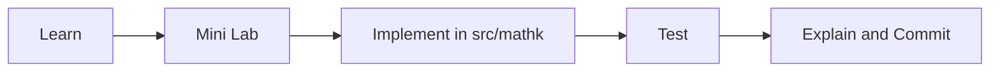

## 2. Repository Structure

**Trạng thái: Đã chốt.**

### 2.1. Phase 0
```text
MathAgents_MATHK/
├── .github/workflows/ci.yml
├── configs/default.yaml
├── docs/
├── labs/phase_00/
├── src/mathk/
│   ├── __init__.py
│   ├── __main__.py
│   └── config.py
├── tests/
│   ├── __init__.py
│   └── test_config.py
├── .env.example
├── .gitignore
├── .python-version
├── pyproject.toml
├── uv.lock
└── README.md
```
Chỉ tạo khi triển khai; chưa cần LangGraph, SymPy, FAISS hay agents.

### 2.2. Python src-layout
Tách package khỏi repository root, hỗ trợ packaging/import/testing nhất quán. AI Core dùng chung cho CLI, Gradio, Benchmark Runner. Public API dự kiến MathEngine.

### 2.3. Foundation
__init__.py: package/public API; __main__.py: entry point; config.py: configuration; pyproject.toml: packaging/dependencies; uv.lock: lock; .python-version: Python version; .env.example: mẫu env; ci.yml: CI; test_config.py: unit test. Dùng uv.

### 2.4. Incremental structure
| Phase | Thư mục giới thiệu hoặc mở rộng |
|---|---|
| 0 Foundation | configs, docs, labs/phase_00, src/mathk, tests, .github |
| 1 Tools | tools, domain, labs/phase_01, tests/unit |
| 2 Single-Agent | agents, application, infrastructure, evaluation, labs/phase_02 |
| 3 Multi-Agent | orchestration, infrastructure/persistence, tests/integration, labs/phase_03 |
| 4 RAG | knowledge, data/knowledge, data/runtime/indexes, labs/phase_04 |
| 5 Verification | verification, uncertainty, labs/phase_05 |
| 6 Multimodal | multimodal, interfaces, data/runtime/assets, labs/phase_06 |
| 7 Research | experiments, data/datasets, tests/system, labs/phase_07 |
Các package chức năng nằm trong src/mathk.

### 2.5. Mini Labs
Theo phase và năng lực. Ví dụ labs/phase_03/README.md và 01_agent_loop, 02_shared_state, 03_orchestration, 04_langgraph, 05_routing, 06_guardrails, 07_checkpointing. Mỗi lab có lý thuyết, yêu cầu thực hành, test, câu hỏi kiểm tra; người học tự thử trước khi xem lời giải. Chi tiết Competency Matrix ở 05_IMPLEMENTATION.md.


## 3. Package & Module Structure

**Trạng thái: Đã chốt.**

### 3.1. Package đích
Tên file định hướng, tạo theo nhu cầu từng Phase.

| Package | File/thư mục dự kiến |
|---|---|
| domain | problem.py, solution.py, knowledge.py, verification.py, execution.py |
| application | engine.py, requests.py, results.py |
| tools | calculator.py, symbolic.py, parser.py, registry.py, executor.py |
| agents | base.py (khi cần), perception.py, planner.py, retrieval.py, reasoner.py, verifier.py |
| orchestration | graph.py, router.py, state.py, guard.py, context.py |
| knowledge | store.py, indexing.py, retrieval.py, applicability.py |
| verification | checks.py, dependency.py, correction.py |
| uncertainty | signals.py, manager.py, policy.py |
| multimodal | images.py, preprocessing.py, fusion.py |
| infrastructure | models/, persistence/, tracing/ |
| interfaces | cli.py, gradio_app.py, input.py, renderer.py |
| evaluation | runner.py, evaluator.py, metrics.py, datasets.py, reporting.py |

Root: config.py, __init__.py, __main__.py.

### 3.2. Trách nhiệm
Presentation/Application: interfaces, application. Control Plane: orchestration, uncertainty. Execution Plane: agents, tools, knowledge, verification, multimodal. Infrastructure: models, persistence, tracing. Domain cung cấp data contracts; evaluation độc lập với suy luận. Sơ đồ trách nhiệm không phải chiều import.
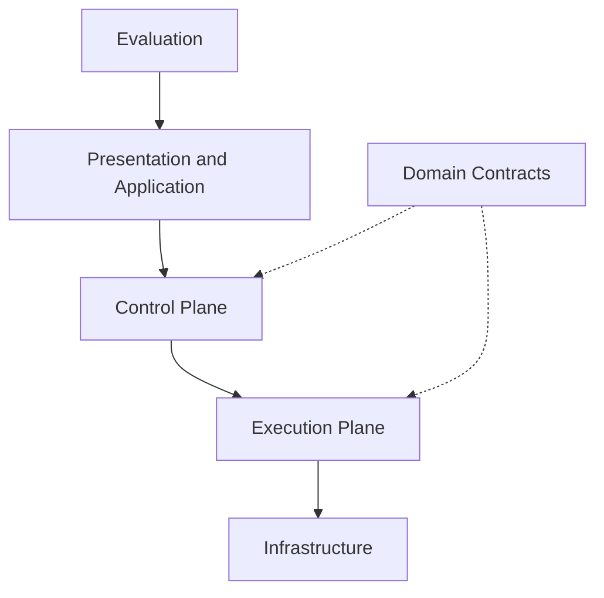

### 3.3. Module Traceability
| Module | Package |
|---|---|
| M01 Input Processing | interfaces |
| M02 Output Presentation | interfaces |
| M03 Application Interface | application, interfaces |
| M04 Reasoning Engine | orchestration |
| M05 Adaptive Router | orchestration |
| M06 State Manager | orchestration, domain |
| M07 Execution Guard | orchestration |
| M08 Multimodal Perception | agents, multimodal |
| M09 Problem Analysis and Planning | agents |
| M10 Knowledge Retrieval | agents, knowledge |
| M11 Mathematical Reasoning | agents |
| M12 Verification and Correction | agents, verification |
| M13 Uncertainty Management | uncertainty |
| M14 Model Gateway | infrastructure/models |
| M15 Mathematical Tool System | tools |
| M16 Knowledge Store | knowledge |
| M17 Persistence | infrastructure/persistence |
| M18 Configuration | config.py, configs/ |
| M19 Benchmark Runner | evaluation |
| M20 Evaluation | evaluation |
| M21 Execution Tracing | infrastructure/tracing |

### 3.4. Agent vs Capability
Agent suy luận/đề xuất; Orchestrator điều phối; Capability/Tool thực hiện tác vụ chuyên môn. Verifier Agent không chứa toàn bộ thuật toán kiểm chứng. verification/checks.py, tools/symbolic.py, domain/verification.py tách biệt để test không cần LLM. Tool execution vẫn qua registry/guard.
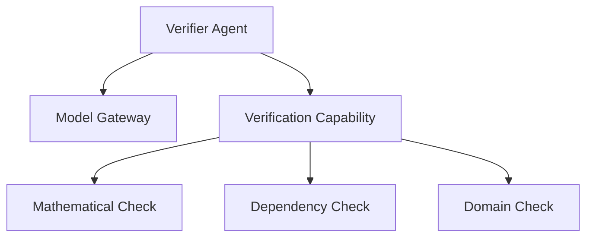

### 3.5. Ví dụ
2x+6=14: interfaces nhận đề, application tạo request, orchestration chọn tuyến và guard budget, reasoner đề xuất tool, tools tính x=4, verifier kiểm chứng qua verification và dữ kiện gốc, interfaces render. Infrastructure hỗ trợ model/storage/trace; domain cung cấp contracts. Không bắt buộc gọi đủ năm agent.

### 3.6. Tránh Overengineering
Chỉ tạo BaseAgent khi có hành vi chung cần tái sử dụng; không tách file nhỏ cùng trách nhiệm; không biến mọi chức năng thành agent/tool; tránh utils tổng hợp; abstraction khi cần tái sử dụng, kiểm thử hoặc thay thế. Phase 2 có thể chỉ cần reasoner.py, Phase 3 mới trích xuất interface chung.


## 4. Dependency Rules

**Trạng thái: Đã chốt.**

### 4.1. Loose Coupling
Agent phụ thuộc contract Model Gateway, Tool và Capability, không phụ thuộc SDK/provider/SQLite trực tiếp.

### 4.2. Dependency Inversion
Lightweight Hexagonal; ưu tiên typing.Protocol khi thực sự cần abstraction.
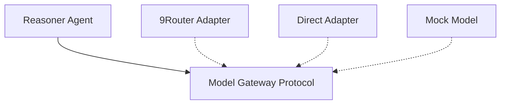

### 4.3. Dependency Injection
Constructor Injection bằng Python; truyền implementation từ ngoài, hỗ trợ fake/mock không gọi API. Không DI framework MVP.

### 4.4. Composition Root
bootstrap.py tạo khi cần lắp ráp nhiều dependency. Đọc config, khởi tạo gateway, registry, repositories, agents, engine; CLI/Gradio/benchmark dùng engine.
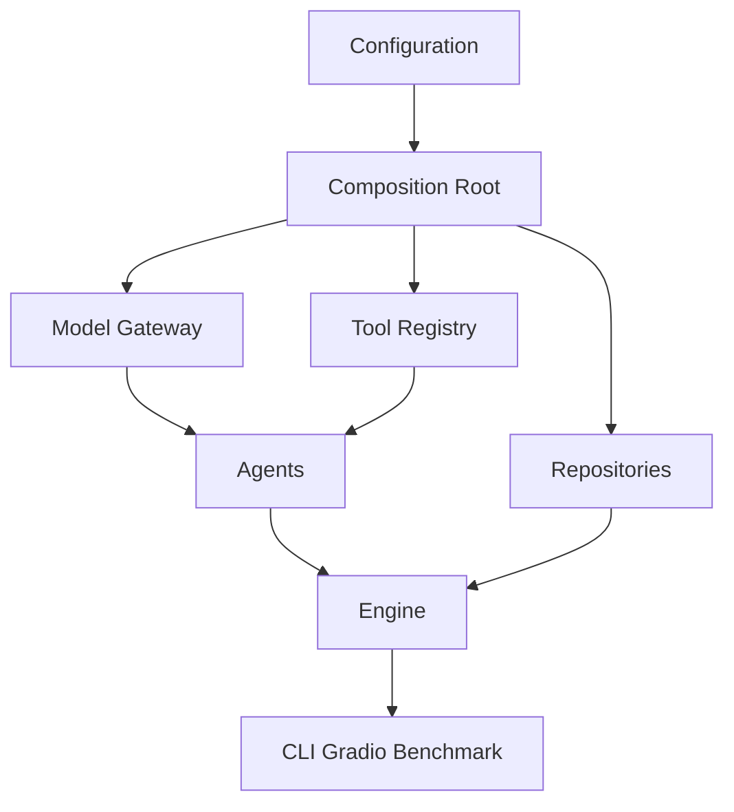

### 4.5. Dependency Rules
| Package | Allowed dependencies |
|---|---|
| domain | Python, Pydantic, necessary data types |
| application | domain, engine contracts |
| orchestration | domain, agent/capability/service contracts |
| agents | domain, model/tool/capability contracts |
| tools | domain, math libraries |
| knowledge | domain, retrieval/index/storage contracts |
| verification | domain, mathematical tool contracts |
| uncertainty | domain |
| multimodal | domain, image libraries |
| infrastructure | implemented contracts, external libraries |
| interfaces | Application API, public contracts |
| evaluation | Application API, domain, evaluation contracts |
Contracts gần consumer hoặc package có trách nhiệm phù hợp. Composition root kết nối concrete implementations.

### 4.6. Forbidden dependencies
Domain không phụ thuộc UI; agent không gọi agent khác trực tiếp, không SDK/SQLite trực tiếp, không arbitrary tool execution; engine không ground truth; core không labs. Tuân thủ AR01–08 và guard/registry.

### 4.7. Circular Dependency
Agent trả AgentResult/ActionRequest có cấu trúc; orchestration quyết định bước tiếp theo. Không import ngược orchestration từ agent.
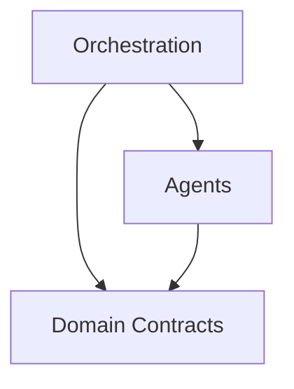

### 4.8. Testing
Unit fake/mock; routing fake agents; guardrail simulated requests; integration fake hoặc controlled API; E2E integrated system; research pinned model. Không cần API thật trong mọi test.

### 4.9. Mini Labs
Phase 0 imports/package/circular dependency; Phase 1 Protocol/tool contracts; Phase 2 constructor injection thật/fake; Phase 3 composition/orchestration/router/guard tests.


## 5. Configuration & Data Organization

**Trạng thái: Đã chốt.**

### 5.1. Configuration-driven Architecture
Thay đổi hành vi qua config đã validate, không hard-code; hỗ trợ ablation cùng codebase.

### 5.2. Configuration Structure
```text
configs/
  default.yaml
  models/{free,research}.yaml
  routing/{static,adaptive}.yaml
  profiles/{lightweight,standard,research}.yaml
```
Phase 0 chỉ default.yaml; bổ sung dần, không Hydra MVP.

### 5.3. Loading
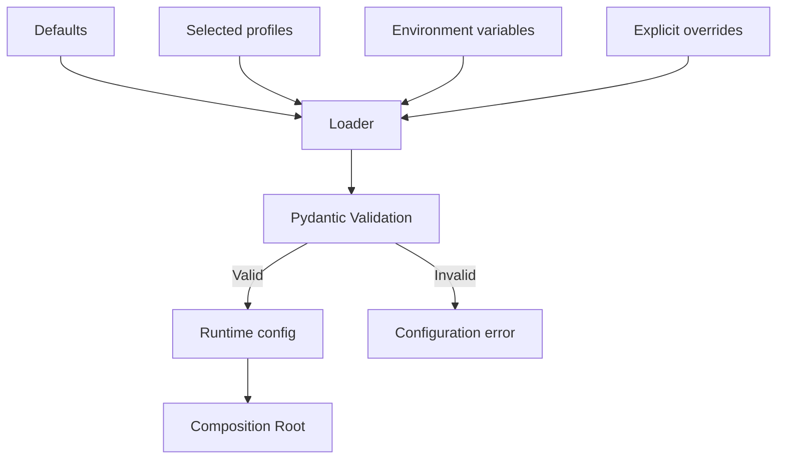
Ưu tiên tăng dần defaults, profiles, environment, explicit overrides; chỉ cho phép override hợp lệ, không vượt guard bắt buộc.

### 5.4. Typed Configuration
Pydantic kiểm tra kiểu/range, ví dụ max_llm_calls nguyên dương, timeout_seconds dương, allow_fallback boolean. Giá trị budget thực tế chưa chốt.

### 5.5. Prompt Management
src/mathk/prompts/{perception,planner,retrieval,reasoner,verifier}/system_v1.md; version Git, template variables rõ ràng, package data khi đóng gói; không secrets/ground truth.
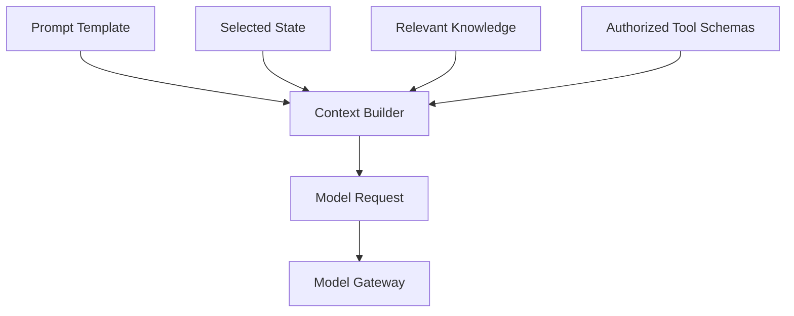

### 5.6. Secrets
.env local, .env.example placeholders; environment variables cho credentials; redact snapshot/trace, không dump env.

### 5.7. Data Organization
```text
data/
  knowledge/{sources,processed}/
  datasets/{raw,processed}/
  runtime/
    mathk.sqlite
    checkpoints.sqlite
    assets/
    indexes/
    traces/
```
SQLite nghiệp vụ, checkpoint riêng, FAISS rebuildable, local assets/logs. Không DB server MVP.

### 5.8. Experiment Organization
Duy nhất experiments/ tại root, thay thế đề xuất data/experiments/ (bao gồm cấu trúc dự kiến tại mục 13.12 System Design v0.16.1; tài liệu 04 chốt vị trí cuối cùng).
```text
experiments/
  configs/
    baseline_direct.yaml
    baseline_single_agent.yaml
    static_multi_agent.yaml
    adaptive_multi_agent.yaml
  results/
  exports/
```
Config thí nghiệm, raw results và export tách biệt; ablation RAG/tools/correction theo config, guard bắt buộc luôn duy trì.

### 5.9. Git Policy
Commit code/docs/labs/tests/prompts/sample configs/lock/manifests/kết quả tổng hợp đã kiểm tra; dataset mẫu chỉ khi nhỏ và có quyền sử dụng. Không commit secrets, .env, .venv, runtime DB/checkpoint, generated indexes, private images, raw logs, temp, dataset lớn/hạn chế, model weights lớn. DVC/Git LFS chưa cần MVP.

### 5.10. Versioning
Ghi git commit, config/prompt/dataset/KB version, actual model identity, evaluator version; manifest/checksum/metadata; không gộp cấu hình khác nhau thành cùng thí nghiệm.
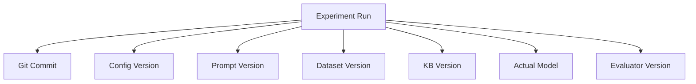


## 6. Testing & Mini Lab Structure

**Trạng thái: Đã chốt.**

### 6.1. Testing Strategy
Testing Pyramid: nhiều unit test nhanh, integration test và ít system/E2E test hơn. Regression, fault injection và property-based testing áp dụng tại các cấp thích hợp.
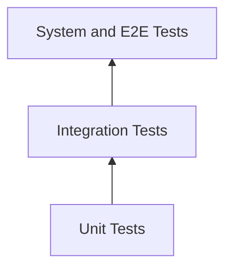

### 6.2. Testing vs Evaluation
Software testing kiểm tra hành vi theo thiết kế, pass/fail, chạy thường xuyên; AI evaluation đo chất lượng, metrics và phân phối kết quả qua benchmark. Tách tests/ khỏi evaluation/ và experiments/. Pass toàn bộ test không đảm bảo chất lượng AI.

### 6.3. Testing Directory Structure
```text
tests/
  unit/
    test_config.py
    test_calculator.py
    test_symbolic.py
    test_registry.py
    test_router.py
    test_guard.py
    test_verification.py
  integration/
    test_agent_tool.py
    test_workflow.py
    test_retrieval.py
    test_checkpoint.py
  system/
    test_text_solving.py
    test_multimodal_solving.py
    test_clarification.py
  fixtures/{problems,images}/
  fakes/{fake_model.py,fake_agent.py}
  conftest.py
```
Phase 0 chỉ cần tests/test_config.py; mở rộng khi cần.

### 6.4. Agent Tests
Structured output: thiếu trường/sai kiểu; tool: sai tên/tham số; guard: permission/schema/budget; orchestration: thứ tự, termination; routing: state-based decisions; shared state: version; context: facts/budget; RAG: bounded retrieval; verification: lỗi tính; correction: bảo toàn bước đúng; checkpoint: resume; uncertainty: không bịa dữ kiện; gateway: timeout/429/invalid output. Fake/mock không cần API thật.

### 6.5. Stack
pytest (0), unittest.mock (1–2), Hypothesis (1), pytest-cov (1–2), Ruff (0), mypy (0–2), GitHub Actions (0). Không ép coverage 100%; ưu tiên nghiệp vụ, quyền hạn, budget và lỗi quan trọng.

### 6.6. CI
Push/PR: setup Python/uv, install locked dependencies, Ruff, type check, tests. Không gọi API thật, không yêu cầu secrets, không chạy toàn bộ benchmark mặc định. External tests opt-in.
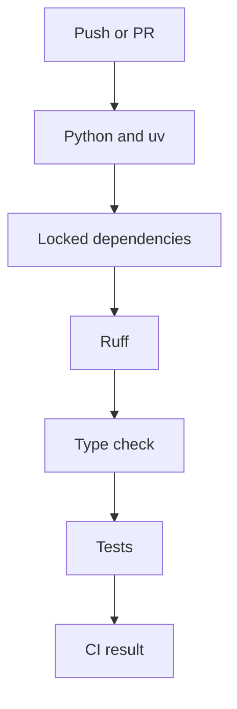

### 6.7. Mini Labs
labs/phase_03/README.md và 03_orchestration/{README.md,exercise.py,test_exercise.py,notes.md}. README lý thuyết/ví dụ/yêu cầu, exercise do người học viết, test kiểm chứng, notes tự giải thích. Không bắt buộc đủ mọi file.

### 6.8. Learning Workflow
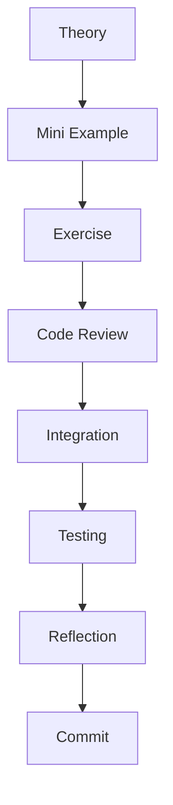
Có thể quay lại bước trước khi chưa hiểu; mentor gợi ý trước lời giải.

### 6.9. Competency Matrix
L0 chưa học; L1 hiểu/giải thích; L2 tự làm lab; L3 tích hợp/test; L4 thiết kế, trade-off, chuyển giao sang dự án khác. Năng lực cốt lõi mục tiêu L3 hướng L4. Ví dụ prompt engineering, structured output, tool calling, agent loop, orchestration, state, guardrails, context, agentic RAG, routing, checkpoint, evaluation. Ma trận đầy đủ tại 05_IMPLEMENTATION.md; đánh giá bằng minh chứng, không chỉ đánh dấu.

### 6.10. Vai trò
Người học đọc, tự code lab/module, debug/test, giải thích; mentor giảng, thiết kế bài, hướng dẫn kiến trúc, review, gợi ý lỗi, câu hỏi phỏng vấn. AI coding hỗ trợ nhưng ưu tiên tự triển khai năng lực cốt lõi.


## 7. Naming & Coding Conventions

**Trạng thái: Đã chốt.**

### 7.1. Naming
PEP 8: package lowercase; file/function/variable/config key snake_case; class/Protocol PascalCase; constant UPPER_SNAKE_CASE; exception PascalCase + Error; test_ + hành vi; lab số thứ tự + tên. Tên rõ nghĩa nghiệp vụ.

### 7.2. Ngôn ngữ
Tên code, commit, error code, structured logs bằng tiếng Anh. Comment, docstring, tài liệu, mini lab và UI mặc định bằng tiếng Việt. Paper tiếng Anh. Thuật ngữ kỹ thuật giữ tiếng Anh kèm giải thích tiếng Việt.
**Toàn bộ prompt bằng tiếng Việt**: system prompt, agent instructions, user prompt templates, few-shot examples, tool descriptions, verification và routing prompts. Tên Tool, JSON Schema, Enum bằng tiếng Anh; công thức LaTeX. Giữ ngôn ngữ prompt nhất quán giữa baseline để hạn chế biến gây nhiễu.

### 7.3. Comment và Docstring
Giải thích lý do, ràng buộc, quyết định thay vì lặp lại code. Docstring ưu tiên public API, class/interface quan trọng, thuật toán phức tạp.

### 7.4. Type Hints
Ưu tiên function signatures và contracts. Type hints và mypy kiểm tra tĩnh; Pydantic validate runtime tại ranh giới. Schema hợp lệ không đảm bảo toán đúng.

### 7.5. Error Handling
Technical error: exception, bounded retry hoặc safe stop; execution rejection: structured result (permission/schema/budget); mathematical uncertainty: uncertainty handling, không coi là lỗi phần mềm. Không except Exception: pass; xử lý tại ranh giới phù hợp.
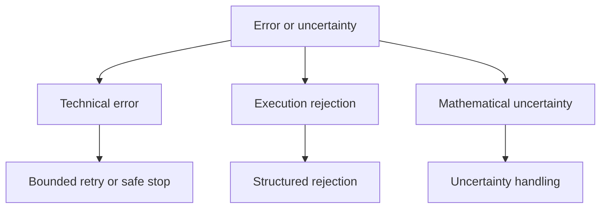

### 7.6. Logging
Python logging + structured trace; DEBUG chi tiết, INFO bình thường, WARNING có thể phục hồi, ERROR thao tác thất bại, CRITICAL nghiêm trọng. Không secrets/private data/full context mặc định. Trace sự kiện quan sát được, không giả lập private reasoning.

### 7.7. Code Quality
Python 3.12, 4 spaces, 88 ký tự, Ruff lint/format/import sorting, mypy tăng nghiêm ngặt dần, pytest, uv; config tại pyproject.toml.
Lệnh: uv sync; uv run ruff check .; uv run ruff format .; uv run mypy src/mathk; uv run pytest. Học và cấu hình tại Phase 0.

### 7.8. Commits
Conventional Commits: feat, fix, docs, test, refactor, chore, ci, perf; scope khi phù hợp. Commit theo thay đổi có ý nghĩa, không đợi hết phase.

### 7.9. Pre-commit Checklist
- [ ] Code đúng trách nhiệm module.
- [ ] Naming rõ nghĩa.
- [ ] Type hints interface quan trọng.
- [ ] Ruff và type check pass.
- [ ] Test liên quan pass.
- [ ] Không secrets/private data.
- [ ] Cập nhật docs nếu thiết kế thay đổi.


## 8. Cấu trúc mở rộng theo Phase

**Trạng thái: Đã chốt.**

### 8.1. Phase 0–7
Foundation → Mathematical Tools → Single-Agent → Multi-Agent Orchestration → Agentic RAG → Verification & Adaptive Routing → Multimodal → Research & Evaluation.

### 8.2. Repository Evolution
| Phase | Mở rộng chính | Đầu ra |
|---|---|---|
| 0 | configs, src/mathk root, tests, CI | CLI tối thiểu, config, môi trường |
| 1 | domain, tools, tests/unit | Công cụ toán học có schema, validation và test |
| 2 | agents, application, infrastructure/models, prompts, evaluation, bootstrap khi cần | Single-Agent solver |
| 3 | orchestration, infrastructure/persistence, tracing, tests/integration | Shared State, guard, checkpoint, multi-agent |
| 4 | knowledge, data/knowledge, data/runtime/indexes | Grounded retrieval và applicability |
| 5 | verification, uncertainty | Correction và adaptive routing |
| 6 | multimodal, interfaces, data/runtime/assets | Multimodal solver và demo |
| 7 | data/datasets, experiments/{configs,results,exports}, tests/system | Reproducible benchmark và ablation |
Mỗi phase có labs/phase_0N. Đây là thời điểm phát triển chính, không cấm CLI, gateway, logging, evaluation cơ bản sớm hơn. Tên file theo mục 2–3, tạo theo nhu cầu.

### 8.3. MVP
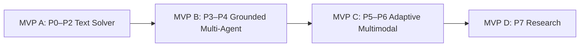
Mỗi MVP có bản chạy/demo được.

### 8.4. Nguyên tắc
Không cài dependency/tạo folder/class rỗng trước nhu cầu; nền tảng ổn định trước phase tiếp; test/log/eval xuyên suốt; refactor khi cần; cập nhật docs và commit.

### 8.5. Completion Gates
Engineering: chức năng chạy, test/CI đạt, docs cập nhật, commit. Learning: hiểu nguyên lý, tự làm lab, debug/test, giải thích thiết kế, trả lời câu hỏi củng cố. Cả hai đều cần đạt.

### 8.6. Checkpoints
docs/progress/CURRENT_STATUS.md và phase_00.md, phase_01.md... tạo theo nhu cầu; lưu phase hiện tại, việc đang làm, next step, kiến thức, bài tập, kết quả, vấn đề. Cập nhật sau nhóm công việc hoặc trước kết thúc phiên dài. GitHub là Single Source of Truth.

