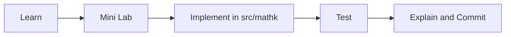
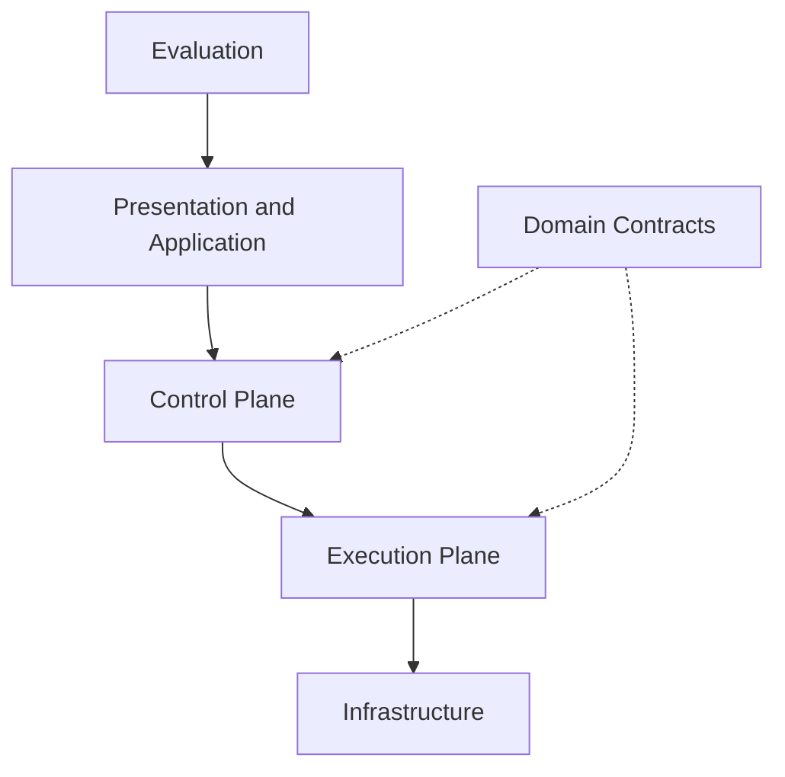
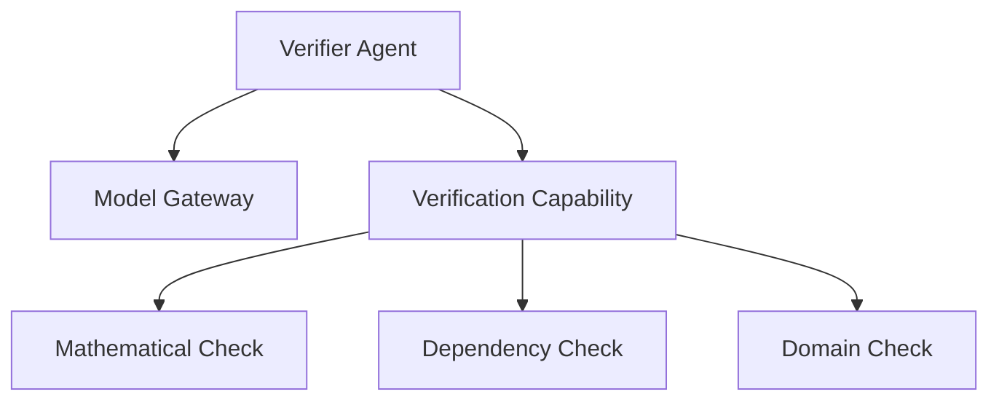

# MATHK — Project Structure

**Phiên bản:** 0.3

**Trạng thái:** Đang thảo luận

Tham chiếu: [Requirements](01_REQUIREMENTS.md), [System Design v0.16.1](03_SYSTEM_DESIGN.md).

## 1. Nguyên tắc tổ chức mã nguồn

**Trạng thái: Đã chốt.**

- Một repository, Modular Monolith, Python src-layout (`src/mathk/`).
- Tổ chức theo module chức năng, mở rộng dần theo Phase; không tạo hàng loạt abstraction hoặc thư mục rỗng từ đầu.
- Mini Lab độc lập trong `labs/`; AI Core không phụ thuộc vào labs.
- Tích hợp kiểm thử ngay từ đầu.
- Learning by Building: nguyên lý trước framework, mini lab, tự triển khai, kiểm thử, giải thích, commit. Ma trận năng lực chi tiết sẽ thuộc 05_IMPLEMENTATION.md.



## 2. Repository Structure

**Trạng thái: Đã chốt.**

### 2.1. Phase 0
```text
MathAgents_MATHK/
├── .github/workflows/ci.yml
├── configs/default.yaml
├── docs/
├── labs/phase_00/
├── src/mathk/
│   ├── __init__.py
│   ├── __main__.py
│   └── config.py
├── tests/
│   ├── __init__.py
│   └── test_config.py
├── .env.example
├── .gitignore
├── .python-version
├── pyproject.toml
├── uv.lock
└── README.md
```
Chỉ tạo khi triển khai; chưa cần LangGraph, SymPy, FAISS hay agents.

### 2.2. Python src-layout
Tách package khỏi repository root, hỗ trợ packaging/import/testing nhất quán. AI Core dùng chung cho CLI, Gradio, Benchmark Runner. Public API dự kiến MathEngine.

### 2.3. Foundation
__init__.py: package/public API; __main__.py: entry point; config.py: configuration; pyproject.toml: packaging/dependencies; uv.lock: lock; .python-version: Python version; .env.example: mẫu env; ci.yml: CI; test_config.py: unit test. Dùng uv.

### 2.4. Incremental structure
| Phase | Thư mục giới thiệu hoặc mở rộng |
|---|---|
| 0 Foundation | configs, docs, labs/phase_00, src/mathk, tests, .github |
| 1 Tools | tools, domain, labs/phase_01, tests/unit |
| 2 Single-Agent | agents, application, infrastructure, evaluation, labs/phase_02 |
| 3 Multi-Agent | orchestration, infrastructure/persistence, tests/integration, labs/phase_03 |
| 4 RAG | knowledge, data/knowledge, data/runtime/indexes, labs/phase_04 |
| 5 Verification | verification, uncertainty, labs/phase_05 |
| 6 Multimodal | multimodal, interfaces, data/runtime/assets, labs/phase_06 |
| 7 Research | experiments, data/datasets, data/experiments, tests/system, labs/phase_07 |
Các package chức năng nằm trong src/mathk.

### 2.5. Mini Labs
Theo phase và năng lực. Ví dụ labs/phase_03/README.md và 01_agent_loop, 02_shared_state, 03_orchestration, 04_langgraph, 05_routing, 06_guardrails, 07_checkpointing. Mỗi lab có lý thuyết, yêu cầu thực hành, test, câu hỏi kiểm tra; người học tự thử trước khi xem lời giải. Chi tiết Competency Matrix ở 05_IMPLEMENTATION.md.


## 3. Package & Module Structure

**Trạng thái: Đã chốt.**

### 3.1. Package đích
Tên file định hướng, tạo theo nhu cầu từng Phase.

| Package | File/thư mục dự kiến |
|---|---|
| domain | problem.py, solution.py, knowledge.py, verification.py, execution.py |
| application | engine.py, requests.py, results.py |
| tools | calculator.py, symbolic.py, parser.py, registry.py, executor.py |
| agents | base.py (khi cần), perception.py, planner.py, retrieval.py, reasoner.py, verifier.py |
| orchestration | graph.py, router.py, state.py, guard.py, context.py |
| knowledge | store.py, indexing.py, retrieval.py, applicability.py |
| verification | checks.py, dependency.py, correction.py |
| uncertainty | signals.py, manager.py, policy.py |
| multimodal | images.py, preprocessing.py, fusion.py |
| infrastructure | models/, persistence/, tracing/ |
| interfaces | cli.py, gradio_app.py, input.py, renderer.py |
| evaluation | runner.py, evaluator.py, metrics.py, datasets.py, reporting.py |

Root: config.py, __init__.py, __main__.py.

### 3.2. Trách nhiệm
Presentation/Application: interfaces, application. Control Plane: orchestration, uncertainty. Execution Plane: agents, tools, knowledge, verification, multimodal. Infrastructure: models, persistence, tracing. Domain cung cấp data contracts; evaluation độc lập với suy luận. Sơ đồ trách nhiệm không phải chiều import.


### 3.3. Module Traceability
| Module | Package |
|---|---|
| M01 Input Processing | interfaces |
| M02 Output Presentation | interfaces |
| M03 Application Interface | application, interfaces |
| M04 Reasoning Engine | orchestration |
| M05 Adaptive Router | orchestration |
| M06 State Manager | orchestration, domain |
| M07 Execution Guard | orchestration |
| M08 Multimodal Perception | agents, multimodal |
| M09 Problem Analysis and Planning | agents |
| M10 Knowledge Retrieval | agents, knowledge |
| M11 Mathematical Reasoning | agents |
| M12 Verification and Correction | agents, verification |
| M13 Uncertainty Management | uncertainty |
| M14 Model Gateway | infrastructure/models |
| M15 Mathematical Tool System | tools |
| M16 Knowledge Store | knowledge |
| M17 Persistence | infrastructure/persistence |
| M18 Configuration | config.py, configs/ |
| M19 Benchmark Runner | evaluation |
| M20 Evaluation | evaluation |
| M21 Execution Tracing | infrastructure/tracing |

### 3.4. Agent vs Capability
Agent suy luận/đề xuất; Orchestrator điều phối; Capability/Tool thực hiện tác vụ chuyên môn. Verifier Agent không chứa toàn bộ thuật toán kiểm chứng. verification/checks.py, tools/symbolic.py, domain/verification.py tách biệt để test không cần LLM. Tool execution vẫn qua registry/guard.


### 3.5. Ví dụ
2x+6=14: interfaces nhận đề, application tạo request, orchestration chọn tuyến và guard budget, reasoner đề xuất tool, tools tính x=4, verifier kiểm chứng qua verification và dữ kiện gốc, interfaces render. Infrastructure hỗ trợ model/storage/trace; domain cung cấp contracts. Không bắt buộc gọi đủ năm agent.

### 3.6. Tránh Overengineering
Chỉ tạo BaseAgent khi có hành vi chung cần tái sử dụng; không tách file nhỏ cùng trách nhiệm; không biến mọi chức năng thành agent/tool; tránh utils tổng hợp; abstraction khi cần tái sử dụng, kiểm thử hoặc thay thế. Phase 2 có thể chỉ cần reasoner.py, Phase 3 mới trích xuất interface chung.


## 4. Dependency Rules

*Chưa chốt.*

## 5. Configuration & Data Organization

*Chưa chốt.*

## 6. Testing & Mini Lab Structure

*Chưa chốt.*

## 7. Naming & Coding Conventions

*Chưa chốt.*

## 8. Cấu trúc mở rộng theo Phase

*Chưa chốt.*
