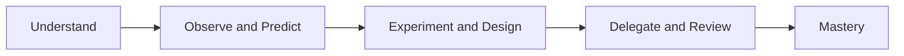
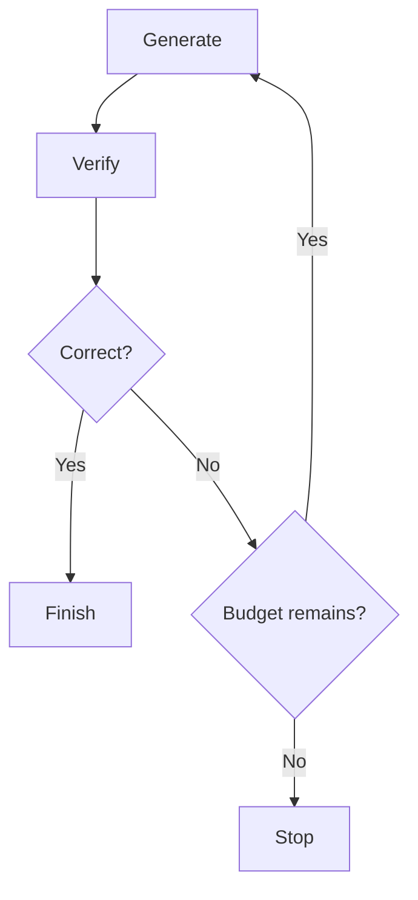

# MATHK — Implementation Roadmap

**Phiên bản:** 0.2

**Trạng thái:** Đang thảo luận

Tham chiếu: [Requirements](01_REQUIREMENTS.md), [System Design](03_SYSTEM_DESIGN.md), [Project Structure v1.1](04_PROJECT_STRUCTURE.md).

## 1. Phương pháp học và triển khai

**Trạng thái: Đã chốt.**

### 1.1. Learning by Building và Scaffolding
System-first, Model & Data-centric, Evaluation-driven, AI-assisted Engineering. Understand → Observe → Predict → Experiment → Design → Delegate → Review → Master. Coding Agent tạo code và lab; người học đọc hiểu, dự đoán, thực nghiệm, đặc tả, kiểm chứng; không bắt buộc tự gõ code. Tăng dần độ phức tạp; kiểm tra nhanh kiến thức đã biết, không ép đủ mọi tầng.

### 1.2. Ví dụ Orchestration
1. Python functions tuần tự, không LLM/framework.
2. Shared State bằng dictionary có cấu trúc.
3. Conditional routing bằng if/else.
4. Generate/Verify correction loop với budget và termination.
5. Chuyển sang LangGraph nodes, edges, conditional edges, state.
6. Thay fake functions bằng agent qua Model Gateway.
7. Tích hợp Orchestrator, Router, State, Guard vào MATHK.

### 1.3. Chuỗi học theo năng lực
- Tool Calling: function → schema → registry → LLM chọn tool → guard → MATHK.
- Agent: API → structured output → tool calling → agent loop → single-agent.
- RAG: text search → BM25 → dense → hybrid → applicability → agentic retrieval.
- Guardrails: validation → permission → budget → tool safety → workflow guard.
- Routing: if/else → rule-based → state-aware → verification-guided → hybrid.
- Multimodal: đọc ảnh → VLM → facts → structured representation → fusion → agent.
- Checkpoint: JSON state → restore → SQLite → LangGraph checkpointer → resume.
Các guard bắt buộc phải có trước khi cho phép thực thi thật.

### 1.4. Mini Lab
Basic: một khái niệm ít dependency; Intermediate: kết hợp, framework; Advanced: lỗi, edge cases, integration. Chỉ tăng mức khi hiểu nền tảng; có thể bỏ qua phần đã thành thạo sau kiểm tra.

### 1.5. Phiên học
Linh hoạt 45/90/120 phút; gợi ý 20% nguyên lý, 25% đọc/phân tích code, 20% thực nghiệm/debug, 25% thiết kế/tích hợp/review, 10% ôn/checkpoint. Lab khó có thể nhiều buổi.

### 1.6. Mentor
H1 câu hỏi gợi mở; H2 thuật toán/hướng giải; H3 pseudocode/skeleton; H4 lời giải đầy đủ kèm giải thích. Mức hỗ trợ linh hoạt; AI cung cấp code minh họa và triển khai module/test theo đặc tả. Mentor giải thích, hướng dẫn thí nghiệm, review; người học quyết định và kiểm chứng. Không bắt buộc tự code.

### 1.7. Ôn tập
Concept, đọc hiểu/dự đoán hành vi, Debugging, Design, phân tích metrics/trade-off; ôn kiến thức liên quan đầu phase. Engineering Gate và Learning Gate theo tài liệu 04.

### 1.8. Tiến độ
docs/progress/ lưu năng lực, phase, mức L0–L4, minh chứng lab/test/integration/commit, phần chưa xong và bước tiếp theo. Checkpoint thường xuyên, GitHub là nguồn chuẩn.

### 1.9. Trọng tâm AI Systems Engineering
Tỷ trọng định hướng: System Design 25%, Model Engineering 20%, Data/Knowledge 15%, Evaluation/Research 15%, Cost/Performance 15%, Software Engineering/Code Review 10%. Không phải lịch cứng.
Mini Lab là technical experiment: câu hỏi, giả thuyết, ví dụ nhỏ do AI tạo, biến kiểm soát, metrics, phân tích kết quả, quyết định tích hợp. Ví dụ model selection (accuracy/schema success/token/latency/cost), context toàn bộ/chọn lọc/RAG, direct/single/multi-agent, static/adaptive routing, LLM verification/SymPy. Đo quality, token, calls, latency, cost từ khi dùng LLM; không đợi Phase 7. So sánh Pareto, không mặc định multi-agent tốt hơn.
P0 môi trường/hệ thống; P1 deterministic vs LLM; P2 model/prompt/tool/loop; P3 architecture/state/reliability; P4 data/retrieval/context; P5 verification/routing/cost; P6 VLM/fusion; P7 benchmark/ablation/research.
L0 chưa biết; L1 giải thích; L2 đọc hiểu/dự đoán/thực nghiệm; L3 thiết kế/đặc tả/delegate/review/test; L4 kiến trúc/trade-off/debug/chuyển giao. Mục tiêu L3 hướng L4. Đọc code và sửa nhỏ khi cần là kỹ năng hỗ trợ.

## 2. Kiến thức tiên quyết

*Chưa chốt.*

## 3. AI Agent Competency Matrix

*Chưa chốt.*

## 4. Phase 0 — Foundation

*Chưa chốt.*

## 5. Phase 1 — Mathematical Tool System

*Chưa chốt.*

## 6. Phase 2 — Single-Agent Solver

*Chưa chốt.*

## 7. Phase 3 — Multi-Agent Orchestration

*Chưa chốt.*

## 8. Phase 4 — Agentic RAG

*Chưa chốt.*

## 9. Phase 5 — Verification & Adaptive Routing

*Chưa chốt.*

## 10. Phase 6 — Multimodal Reasoning

*Chưa chốt.*

## 11. Phase 7 — Research & Evaluation

*Chưa chốt.*

## 12. Quản lý tiến độ và đánh giá năng lực

*Chưa chốt.*
