# MATHK — Implementation Roadmap

**Phiên bản:** 1.1

**Trạng thái:** Đã chốt

Tham chiếu: [Requirements](01_REQUIREMENTS.md), [System Design](03_SYSTEM_DESIGN.md), [Project Structure v1.2](04_PROJECT_STRUCTURE.md).

**Đồng bộ Deployment v1.0:** Laptop mục tiêu 8 GB RAM, Full API Inference (LLM/VLM/embedding/reranker nếu dùng); BM25/FAISS, math tools, orchestration và storage chạy local. Không cần local AI model hoặc GPU; cloud thuê tạm chỉ tùy chọn. Xem [Deployment](07_DEPLOYMENT.md).

## 1. Phương pháp học và triển khai

**Trạng thái: Đã chốt.**

### 1.1. Learning by Building và Scaffolding
System-first, Model & Data-centric, Evaluation-driven, AI-assisted Engineering. Understand → Observe → Predict → Experiment → Design → Delegate → Review → Master. Coding Agent tạo code và lab; người học đọc hiểu, dự đoán, thực nghiệm, đặc tả, kiểm chứng; không bắt buộc tự gõ code. Tăng dần độ phức tạp; kiểm tra nhanh kiến thức đã biết, không ép đủ mọi tầng.
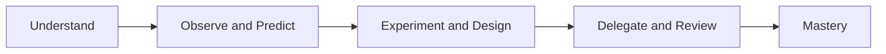

### 1.2. Ví dụ Orchestration
1. Python functions tuần tự, không LLM/framework.
2. Shared State bằng dictionary có cấu trúc.
3. Conditional routing bằng if/else.
4. Generate/Verify correction loop với budget và termination.
5. Chuyển sang LangGraph nodes, edges, conditional edges, state.
6. Thay fake functions bằng agent qua Model Gateway.
7. Tích hợp Orchestrator, Router, State, Guard vào MATHK.
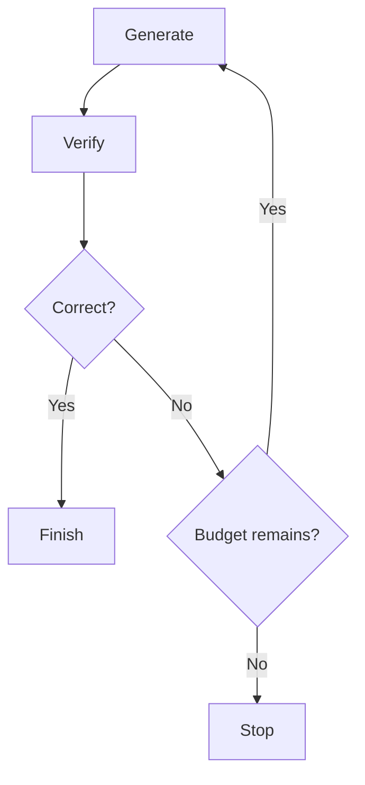

### 1.3. Chuỗi học theo năng lực
- Tool Calling: function → schema → registry → LLM chọn tool → guard → MATHK.
- Agent: API → structured output → tool calling → agent loop → single-agent.
- RAG: text search → BM25 → dense → hybrid → applicability → agentic retrieval.
- Guardrails: validation → permission → budget → tool safety → workflow guard.
- Routing: if/else → rule-based → state-aware → verification-guided → hybrid.
- Multimodal: đọc ảnh → VLM → facts → structured representation → fusion → agent.
- Checkpoint: JSON state → restore → SQLite → LangGraph checkpointer → resume.
Các guard bắt buộc phải có trước khi cho phép thực thi thật.

### 1.4. Mini Lab
Basic: một khái niệm ít dependency; Intermediate: kết hợp, framework; Advanced: lỗi, edge cases, integration. Chỉ tăng mức khi hiểu nền tảng; có thể bỏ qua phần đã thành thạo sau kiểm tra.

### 1.5. Phiên học
Linh hoạt 45/90/120 phút; gợi ý 20% nguyên lý, 25% đọc/phân tích code, 20% thực nghiệm/debug, 25% thiết kế/tích hợp/review, 10% ôn/checkpoint. Lab khó có thể nhiều buổi.

### 1.6. Mentor
H1 câu hỏi gợi mở; H2 thuật toán/hướng giải; H3 pseudocode/skeleton; H4 lời giải đầy đủ kèm giải thích. Mức hỗ trợ linh hoạt; AI cung cấp code minh họa và triển khai module/test theo đặc tả. Mentor giải thích, hướng dẫn thí nghiệm, review; người học quyết định và kiểm chứng. Không bắt buộc tự code.

### 1.7. Ôn tập
Concept, đọc hiểu/dự đoán hành vi, Debugging, Design, phân tích metrics/trade-off; ôn kiến thức liên quan đầu phase. Engineering Gate và Learning Gate theo tài liệu 04.

### 1.8. Tiến độ
docs/progress/ lưu năng lực, phase, mức L0–L4, minh chứng lab/test/integration/commit, phần chưa xong và bước tiếp theo. Checkpoint thường xuyên, GitHub là nguồn chuẩn.

### 1.9. Trọng tâm AI Systems Engineering
Tỷ trọng định hướng: System Design 25%, Model Engineering 20%, Data/Knowledge 15%, Evaluation/Research 15%, Cost/Performance 15%, Software Engineering/Code Review 10%. Không phải lịch cứng.
Mini Lab là technical experiment: câu hỏi, giả thuyết, ví dụ nhỏ do AI tạo, biến kiểm soát, metrics, phân tích kết quả, quyết định tích hợp. Ví dụ model selection (accuracy/schema success/token/latency/cost), context toàn bộ/chọn lọc/RAG, direct/single/multi-agent, static/adaptive routing, LLM verification/SymPy. Đo quality, token, calls, latency, cost từ khi dùng LLM; không đợi Phase 7. So sánh Pareto, không mặc định multi-agent tốt hơn.
P0 môi trường/hệ thống; P1 deterministic vs LLM; P2 model/prompt/tool/loop; P3 architecture/state/reliability; P4 data/retrieval/context; P5 verification/routing/cost; P6 VLM/fusion; P7 benchmark/ablation/research.
L0 chưa biết; L1 giải thích; L2 đọc hiểu/dự đoán/thực nghiệm; L3 thiết kế/đặc tả/delegate/review/test; L4 kiến trúc/trade-off/debug/chuyển giao. Mục tiêu L3 hướng L4. Đọc code và sửa nhỏ khi cần là kỹ năng hỗ trợ.

## 2. Kiến thức tiên quyết

**Trạng thái: Đã chốt.**

Nền tảng Python, ML, NLP/retrieval, API, SQL, Git và thiết kế hệ thống đã có kinh nghiệm ban đầu; chưa đánh giá chính thức. Không học lại từ đầu nếu vượt qua kiểm tra.
- A: kiểm tra nhanh Python/OOP/NumPy/SQL/Git/JSON/ML bằng đọc hiểu, dự đoán, thực nghiệm/debug, quyết định kỹ thuật; không bắt buộc tự viết class/function.
- B: Phase 0 packaging, uv, type hints, Pydantic, pytest, YAML/env, CI; Coding Agent hỗ trợ.
- C: Just-in-time: P1 SymPy/exact arithmetic/parser/Protocol/property tests; P2 API/prompt/structured output/DI/agent loop; P3 graph/state/LangGraph/guard/SQLite/SQLAlchemy/checkpoint; P4 BM25/dense/embedding/FAISS/RRF/agentic retrieval; P5 verification/DAG/correction/uncertainty/routing; P6 image/Pillow/VLM/fusion/Gradio; P7 metrics/experiment/ablation/statistics/reproducibility.
- D: chưa cần Kubernetes, broker, distributed agents, training/fine-tuning LLM, microservices nâng cao, toàn bộ SOLID/patterns hoặc Docker nâng cao.
Lab từ vấn đề nhỏ đến framework rồi MATHK; ví dụ Pydantic: dữ liệu tuổi âm → validation thủ công → BaseModel/Field → Product schema và test → ProblemInput. AI tạo code, người học phân tích kết quả.
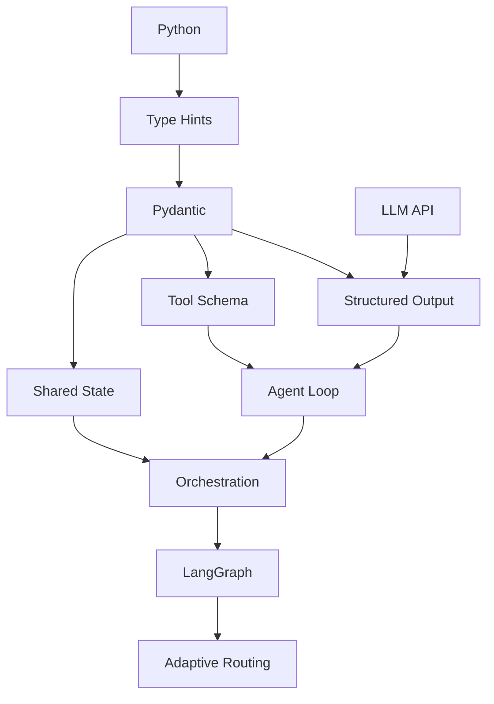

## 3. AI Agent Competency Matrix

**Trạng thái: Đã chốt.**

Mở rộng thành AI Systems Engineering Competency Matrix: 40 năng lực, 8 nhóm. Các mức là mục tiêu, không phải năng lực đã đạt.

### 3.1. System Architecture
| ID | Năng lực | Phase | Mục tiêu | Nội dung |
|---|---|---|---|---|
| SYS01 | System Decomposition | 0–3 | L4 | Phân rã module |
| SYS02 | Architecture Trade-offs | 2–3 | L4 | Direct/single/multi-agent và workflow xác định |
| SYS03 | Interface & Data Contracts | 0–2 | L3 | Hợp đồng dữ liệu |
| SYS04 | Dependency Management | 1–3 | L3 | Coupling, inversion, provider |
| SYS05 | Execution Architecture | 3 | L4 | Control/execution/infrastructure |

### 3.2. Model Engineering
| ID | Năng lực | Phase | Mục tiêu | Nội dung |
|---|---|---|---|---|
| MOD01 | LLM Fundamentals | 2 | L3 | Token, context, inference, giới hạn |
| MOD02 | Model Selection | 2–6 | L4 | Chất lượng theo nhiệm vụ và chi phí |
| MOD03 | Model Gateway | 0–2 | L3 | Chuẩn hóa provider |
| MOD04 | Prompt Engineering | 2–7 | L3 | Prompt tiếng Việt và evaluation |
| MOD05 | Structured Output | 2 | L4 | Schema adherence |

### 3.3. Data Engineering
| ID | Năng lực | Phase | Mục tiêu | Nội dung |
|---|---|---|---|---|
| DAT01 | Data Quality | 4–7 | L3 | Thiếu, sai, trùng, nhất quán |
| DAT02 | Knowledge Representation | 4 | L4 | Tri thức và điều kiện định lý |
| DAT03 | Embedding & Retrieval | 4 | L3 | BM25, dense, FAISS |
| DAT04 | Hybrid Retrieval | 4 | L3 | Kết hợp truy xuất |
| DAT05 | Multimodal Data | 6 | L3 | Ảnh và text |

### 3.4. Context Engineering
| ID | Năng lực | Phase | Mục tiêu | Nội dung |
|---|---|---|---|---|
| CTX01 | Context Construction | 2–4 | L4 | Chọn facts/knowledge/schema |
| CTX02 | Context Budget | 2–5 | L4 | Phân bổ token |
| CTX03 | Shared State & Memory | 3 | L4 | Context/state/memory/persistence |
| CTX04 | Agentic RAG | 4 | L4 | Truy xuất theo nhu cầu |
| CTX05 | Knowledge Applicability | 4–5 | L4 | Relevance vs applicability |

### 3.5. Agent Engineering
| ID | Năng lực | Phase | Mục tiêu | Nội dung |
|---|---|---|---|---|
| AGT01 | Tool Use | 1–2 | L4 | Schema/registry/execution |
| AGT02 | Agent Loop | 2 | L4 | Decision/action/observation |
| AGT03 | Orchestration | 3 | L4 | Multi-agent workflow |
| AGT04 | State Graph & LangGraph | 3 | L3 | Nodes/edges/state/transitions |
| AGT05 | Adaptive Routing | 3–5 | L4 | Difficulty/state/budget/verification |

### 3.6. Cost & Performance
| ID | Năng lực | Phase | Mục tiêu | Nội dung |
|---|---|---|---|---|
| OPT01 | Token Optimization | 2–5 | L4 | Giảm token, đo quality |
| OPT02 | Model Routing | 2–5 | L4 | Model theo nhiệm vụ |
| OPT03 | Execution Budget | 2–5 | L4 | Calls/tokens/retries/time |
| OPT04 | Latency & Resource Optimization | 3–7 | L3 | Bottleneck/RAM/concurrency/cache |
| OPT05 | Pareto Analysis | 5–7 | L4 | Quality/cost/speed |

### 3.7. Reliability & Safety
| ID | Năng lực | Phase | Mục tiêu | Nội dung |
|---|---|---|---|---|
| REL01 | Guardrails | 1–3 | L4 | Permission/input/action |
| REL02 | Failure Handling | 2–3 | L3 | Bounded retry/timeout/fallback/stop |
| REL03 | Checkpointing | 3 | L3 | Resume đúng phiên bản |
| REL04 | Verification & Correction | 5 | L4 | Kiểm chứng và sửa có kiểm soát |
| REL05 | Uncertainty Management | 5–6 | L4 | Thiếu/mâu thuẫn/giới hạn |

### 3.8. Evaluation & Research
| ID | Năng lực | Phase | Mục tiêu | Nội dung |
|---|---|---|---|---|
| EVA01 | Evaluation Metrics | 2–7 | L4 | Quality/resources/reliability |
| EVA02 | Benchmark Design | 2–7 | L4 | Đại diện, tránh leakage |
| EVA03 | Controlled Experiments | 2–7 | L4 | Baseline/ablation công bằng |
| EVA04 | Error Analysis | 3–7 | L4 | Lỗi gốc và lan truyền |
| EVA05 | Reproducibility | 0–7 | L3 | Version/config/results |

### 3.9. Minh chứng và tiêu chí
L0 chưa biết; L1 giải thích nguyên lý; L2 đọc hiểu lab, dự đoán và giải thích thực nghiệm; L3 thiết kế, đặc tả, delegate, review/test; L4 so sánh phương án, trade-off, debug và chuyển giao. Không bắt buộc tự gõ code. Năng lực xuyên suốt: đặc tả Coding Agent, đọc hiểu, review kiến trúc, debugging, testing.
Ví dụ MOD02: hiểu khả năng LLM → cùng tập đề nhỏ → schema success → chất lượng theo nhiệm vụ → token/latency/cost → phân bổ model cho MATHK. Phân tích lỗi phân tuyến, overhead router, retry/fallback, chi phí model và ngưỡng quality; số liệu minh họa không phải kết quả thực tế.
Mỗi lab có vấn đề, nguyên lý, sơ đồ, code AI tạo, thí nghiệm, câu hỏi phân tích, ứng dụng MATHK. Ánh xạ lab/chức năng/minh chứng chi tiết ở từng phase.
Ngoài phạm vi MVP: LLM training/fine-tuning quy mô lớn, distributed inference, MCP/A2A, production MLOps nâng cao.

## 4. Phase 0 — Foundation

**Trạng thái: Đã chốt.**

### 4.1. Mục tiêu
Hiểu runtime, kiến trúc, config, contracts, API, gateway và metrics. Kết nối model thử nghiệm trong lab, gateway chính thức ở Phase 2.
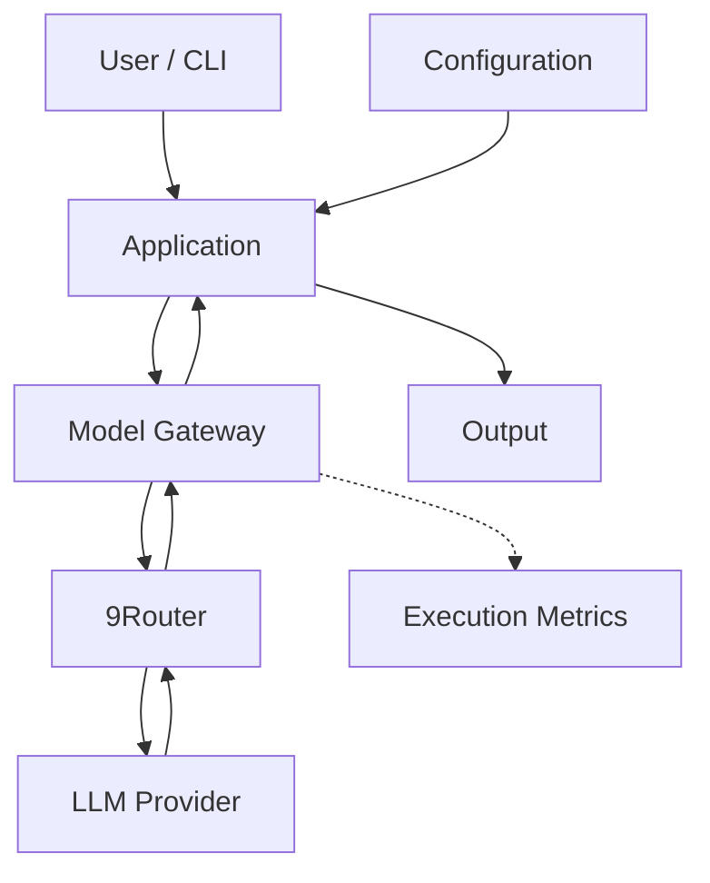
### 4.2. Trọng tâm
Kiến trúc/luồng 30%, API/gateway/9Router 30%, config/contracts 20%, testing/reliability 10%, công cụ phát triển 10%; định hướng linh hoạt.

### 4.3. Mini Labs
| ID | Chủ đề | Phút | Thực nghiệm và minh chứng |
|---|---|---|---|
| P0-L01 | Python Project & Runtime | 30–45 | So sánh môi trường, dependency, lock; hiểu uv và tái lập |
| P0-L02 | Modular Architecture | 45–60 | Một file vs module, theo dõi dependency, thay implementation |
| P0-L03 | Data Contracts & Pydantic | 45–60 | Dữ liệu đúng/sai/thiếu/vượt giới hạn, static vs runtime validation |
| P0-L04 | Configuration-driven System | 30–45 | YAML/env, thay model/timeout/budget, config sai, secrets |
| P0-L05 | LLM API Anatomy | 45–60 | Request/response/model ID/usage/latency |
| P0-L06 | Model Gateway & 9Router | 60–90 | Tuyến model khả dụng, quota, usage, provider independence |
| P0-L07 | Testing & Failure Handling | 45–60 | Fake model, timeout, response/config sai, pytest |
| P0-L08 | Reproducibility & CI | 30–45 | CI pass/fail, code/config/dependency versions |

### 4.4. Lab API và chi phí
Quan sát model ID, messages, temperature/max output (nếu hỗ trợ), generated output, actual model, usage, finish reason. Thực nghiệm độ dài prompt, yêu cầu output, temperature, model, giới hạn output, lỗi API. Chi phí ước tính = tổng (input tokens × đơn giá input + output tokens × đơn giá output)/1 triệu nếu đơn giá theo triệu token; tính trên từng call, lưu ý cache, retry, phí khác và usage thiếu. Model miễn phí vẫn đo token/quota/rate limit/latency. Giá minh họa không phải giá thực.

### 4.5. Cấu trúc lab
labs/phase_00/05_llm_api_anatomy/{README.md,demo.py,experiment.py,test_demo.py,notes.md}. README nguyên lý/sơ đồ/hướng dẫn, demo và experiment do Coding Agent tạo, test khi cần, notes kết luận người học. Không bắt buộc mọi file.

### 4.6. Tích hợp tăng dần
L01–02 project structure; L03–04 contracts/config; L05–06 connectivity trong lab; L07–08 tests/CI. Không đợi hết lab mới tích hợp. Coding Agent triển khai theo thiết kế đã duyệt.

### 4.7. Deliverables
Skeleton theo tài liệu 04 mục 2.1: .github/workflows/ci.yml, configs/default.yaml, docs/, labs/phase_00/, src/mathk/{__init__.py,__main__.py,config.py}, tests/test_config.py, .env.example, .gitignore, .python-version, pyproject.toml, uv.lock, README.md. Chưa agent thật, LangGraph, RAG, SymPy. Kết nối 9Router ở lab.

### 4.8. Năng lực
SYS01, SYS03, MOD03, EVA05 mục tiêu L2 tại phase này; nâng dần ở phase sau.

### 4.9. Definition of Done
- Giải thích repo và luồng thực thi.
- Hiểu contracts/runtime validation.
- Hiểu config/env/secrets.
- Đọc hiểu LLM API request/response.
- Hiểu 9Router và gateway.
- Phân tích token/chi phí.
- Đọc test/CI.
- Foundation chạy, kiểm thử/CI đạt, docs và commit GitHub.

### 4.10. Thời lượng
8 lab, 8–12 giờ gồm lab/review/tích hợp/tổng kết, khoảng 6–8 phiên 90 phút; rút ngắn nếu đã thành thạo.

## 5. Phase 1 — Mathematical Tool System

**Trạng thái: Đã chốt.**

### 5.1. Mục tiêu
Neuro-Symbolic AI: LLM hiểu đề, chọn phương pháp, biểu diễn và giải thích; Calculator/SymPy tính toán xác định trong phạm vi hỗ trợ. Phase 1 dùng request mô phỏng, tích hợp LLM thực ở Phase 2. Trọng tâm: neuro-symbolic 25%, kiến trúc tool 25%, correctness 20%, reliability/security 15%, cost/performance 15%.

### 5.2. Mini Labs
| ID | Lab | Phút | Thực nghiệm/minh chứng |
|---|---|---|---|
| P1-L01 | LLM vs Deterministic | 45–60 | Cùng đầu vào toán học, accuracy/latency/token/cost |
| P1-L02 | Symbolic vs Numerical | 45–60 | Float, Fraction, căn thức, exact-first, sai số |
| P1-L03 | SymPy Capabilities | 60–90 | Simplify/expand/factor/solve/system/inequality, giới hạn và unknown |
| P1-L04 | Mathematical Domain | 60–90 | Điều kiện xác định, nghiệm ngoại lai, kiểm tra nghiệm |
| P1-L05 | Tool Schema | 45–60 | Tên tool, mô tả tiếng Việt, JSON Schema, structured result |
| P1-L06 | Registry & Execution | 45–60 | Direct function vs registry/executor, dispatch/trace |
| P1-L07 | Safe Execution | 60–90 | Input sai, permission, complexity, timeout, safe rejection |
| P1-L08 | Tool Evaluation | 45–60 | Unit/edge/property tests, benchmark nhỏ, latency/resources |

AI tạo demo/experiment/test; người học dự đoán, phân tích, đặc tả, review. Ví dụ (x²−1)/(x−1) rút gọn x+1 nhưng phải giữ x≠1; exact-first với 1/3 và căn 2, gần đúng khi cần.

### 5.3. Kiến trúc
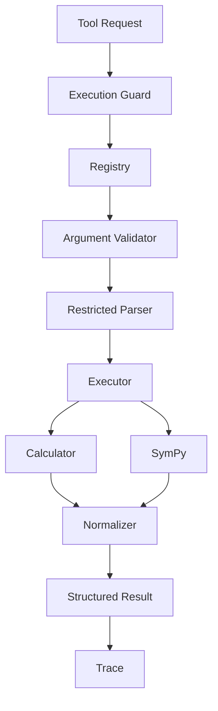
Guard bắt buộc trước thực thi; không eval/exec hoặc parse_expr/sympify trực tiếp đầu vào không tin cậy. Giới hạn độ phức tạp, timeout, phân biệt unsupported/unknown với không có nghiệm. Bảo toàn điều kiện và exact arithmetic. Theo System Design mục 10.

### 5.4. Tool scope
MT01 calculate, MT02 simplify, MT03 expand, MT04 factor, MT05 solve_equation, MT06 solve_system, MT07 solve_inequality, MT08 check_equivalence, MT09 substitute (P0). MT10 compute_statistics, MT11 geometry_compute (P1, bổ sung khi cần).

### 5.5. Thí nghiệm
EXP-P1-01 LLM vs Calculator; 02 LLM vs SymPy; 03 exact vs numerical; 04 domain preservation; 05 normal vs invalid input; 06 runtime theo complexity. Đo accuracy, latency, tokens, cost, error rate, resources. Cùng đầu vào toán học, không đánh đồng hiểu ngôn ngữ với giải biểu thức; tập dev thăm dò, chưa benchmark chính thức.

### 5.6. Deliverables
domain/execution.py; tools/{calculator,symbolic,parser,registry,executor}.py; labs/phase_01/ gồm 8 lab; tests/unit/test_{calculator,symbolic,parser,registry,executor}.py. Tích hợp tăng dần, AI triển khai theo đặc tả.

### 5.7. Năng lực
AGT01 L2, SYS03 L3, SYS04 L2, REL01 L2, EVA01 L1, OPT04 L1.

### 5.8. Definition of Done
Hiểu neural/symbolic, exact/numerical/domain, schema/registry/executor/guard, phân tích quality/latency/cost; 9 tool P0 chạy trong phạm vi hỗ trợ, có test, không arbitrary code execution; Learning Gate, Engineering Gate, docs/CI/commit. 8 lab, 10–15 giờ, 7–10 phiên 90 phút.

## 6. Phase 2 — Single-Agent Solver

**Trạng thái: Đã chốt.**

### 6.1. Mục tiêu
Model Engineering, Prompt Engineering, Tool Calling, Context Engineering và Cost Optimization. Single-Agent giải toán văn bản kết hợp Calculator/SymPy; chưa cần LangGraph, Multi-Agent hoặc RAG.

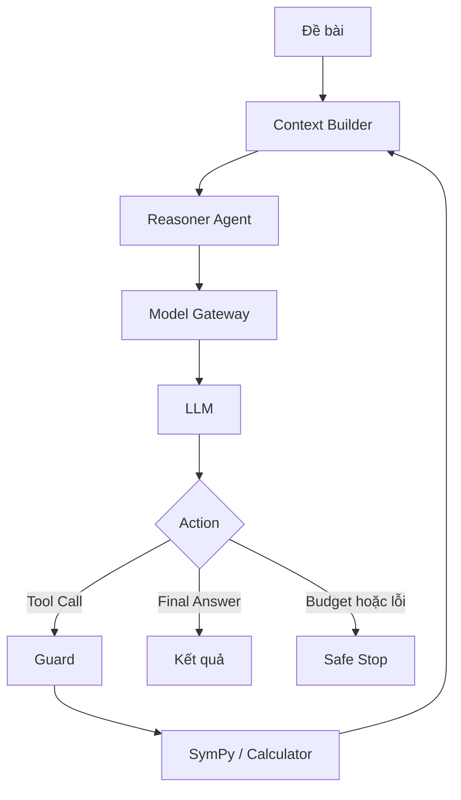

### 6.2. Mini Labs
| ID | Chủ đề | Trọng tâm |
|---|---|---|
| P2-L01 | Model Selection | Chọn model theo nhiệm vụ |
| P2-L02 | Prompt Engineering | Thiết kế và đánh giá prompt tiếng Việt |
| P2-L03 | Structured Output | Schema adherence, validation |
| P2-L04 | Tool Calling | Model lựa chọn và sử dụng tool |
| P2-L05 | Agent Loop | Action, observation, termination |
| P2-L06 | Context Engineering | Chọn lọc dữ kiện, quản lý token |
| P2-L07 | Model Gateway | Provider independence, bounded fallback |
| P2-L08 | Cost & Budget | Token, calls, latency, quota |
| P2-L09 | Single-Agent Evaluation | Baseline, metrics, error analysis |

Coding Agent tạo demo, experiment, test; người học phân tích, thiết kế, đặc tả và review.

### 6.3. Thí nghiệm
So sánh nhiều model trên cùng tập đề; zero-shot vs few-shot; LLM thuần vs LLM + tool; context đầy đủ vs chọn lọc; các mức ngân sách; mô phỏng API/schema/tool failure. Đo Accuracy, Tool Calling Accuracy, Schema Success Rate, Token Usage, Latency, Cost. Dùng tập dev, kiểm soát biến, ghi nhận model thực tế; research baseline cố định model và không fallback tùy ý. Guard bắt buộc không bị bỏ qua.

### 6.4. Deliverables
Reasoner Agent, Model Gateway, bounded Agent Loop, Context Builder, prompt tiếng Việt, tích hợp Mathematical Tool System, Application API và CLI giải toán văn bản, Benchmark Runner cơ bản và Direct LLM baseline. Hoàn thành MVP A — Text Solver.

### 6.5. Completion Gates
Agent giải toán trong phạm vi hỗ trợ, gọi tool có kiểm soát, xử lý lỗi và dừng trong ngân sách. Người học giải thích lựa chọn model/context, tool use và quality-cost trade-off. Kiểm thử, CI, docs và checkpoint GitHub. 9 lab, dự kiến 15–20 giờ.

## 7. Phase 3 — Multi-Agent Orchestration

**Trạng thái: Đã chốt.**

### 7.1. Mục tiêu
Làm chủ kiến trúc multi-agent, orchestration, state, phân chia trách nhiệm và kiểm soát thực thi; đánh giá khi nào multi-agent đáng chi phí hơn single-agent. Retrieval và Perception hoàn thiện ở phase sau.
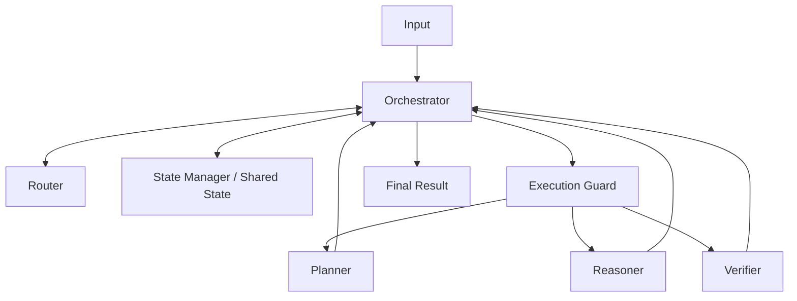
Agent đề xuất update; State Manager kiểm tra và áp dụng, không ghi trực tiếp shared state.

### 7.2. Mini Labs
| ID | Chủ đề | Trọng tâm |
|---|---|---|
| P3-L01 | Multi-Agent Architecture | Phân chia trách nhiệm |
| P3-L02 | Orchestration Patterns | Sequential, conditional, parallel |
| P3-L03 | Shared State | Ownership, versioning |
| P3-L04 | Agent Communication | Structured messages, contracts |
| P3-L05 | LangGraph | Graph, nodes, edges, transitions |
| P3-L06 | Routing | Static và state-aware |
| P3-L07 | Guardrails | Permission, budget, termination |
| P3-L08 | Checkpointing | Persistence, interrupt, resume |
| P3-L09 | Observability | Trace, bottleneck, error analysis |
| P3-L10 | Multi-Agent Evaluation | Quality–cost trade-off |

### 7.3. Thí nghiệm
Single vs multi-agent; sequential vs conditional; full state vs selected state (giữ dữ kiện bắt buộc); model đồng nhất vs chuyên biệt; lỗi agent/timeout/checkpoint resume; sequential vs bounded parallel trên tác vụ độc lập (parallel P1). Đo accuracy, token, calls, latency, cost, failure/recovery rate. Tập dev, kiểm soát model và budget theo mục tiêu so sánh, không bỏ guard.

### 7.4. Deliverables
Orchestrator, Router, State Manager, Execution Guard; Planner, Reasoner, Verifier cơ bản; LangGraph workflow; SQLite persistence/checkpoint; execution trace; model allocation theo config; static multi-agent baseline. Verification nâng cao và adaptive correction thuộc Phase 5.

### 7.5. Completion Gates
Điều phối nhiều agent, shared state nhất quán, kiểm soát budget, xử lý lỗi và resume. Người học giải thích kiến trúc, bottleneck, quality-cost trade-off. Coding Agent triển khai, người học đặc tả/review/thực nghiệm. Test/CI/docs/commit và learning gate. 10 lab, 18–25 giờ.

## 8. Phase 4 — Agentic RAG

**Trạng thái: Đã chốt.**

### 8.1. Mục tiêu
Data/Knowledge Engineering, Retrieval Optimization, Context Engineering. Phân biệt relevance và applicability; kiểm tra nhanh kiến thức BM25/dense đã biết, tập trung agentic retrieval và điều kiện áp dụng.
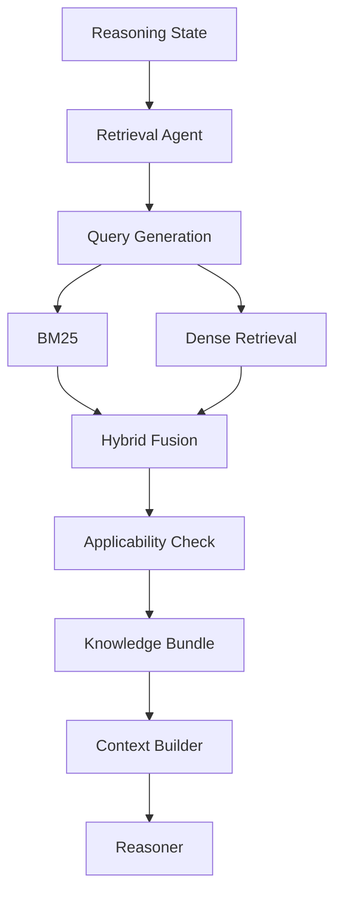
Luồng dữ liệu logic; Orchestrator/Guard điều phối, không gọi trực tiếp agent khác.

### 8.2. Mini Labs
| ID | Chủ đề | Trọng tâm |
|---|---|---|
| P4-L01 | Knowledge Representation | Schema tri thức toán học |
| P4-L02 | Data Processing | Làm sạch, chuẩn hóa, deduplication |
| P4-L03 | Sparse Retrieval | BM25, lexical matching |
| P4-L04 | Dense Retrieval | Embedding API (BGE-M3 ứng viên nếu có API phù hợp), FAISS |
| P4-L05 | Hybrid Retrieval | RRF, metadata filtering |
| P4-L06 | Knowledge Applicability | Điều kiện áp dụng định lý |
| P4-L07 | Context Optimization | Top-k, token budget, noise |
| P4-L08 | Agentic RAG | Skip retrieval, query refinement có giới hạn |
| P4-L09 | RAG Evaluation | Retrieval quality và answer quality |

### 8.3. Thí nghiệm
BM25 vs dense vs hybrid; raw text vs structured knowledge; có/không applicability check; no RAG vs static RAG vs agentic RAG; top-k/token budget; embedding quality/RAM/latency/cost. Đo Recall@k, Precision@k, MRR, nDCG, Applicability Accuracy, Answer Accuracy, tokens, cost. Dùng tập dev, kiểm soát model/budget và tránh leakage; guard bắt buộc duy trì.

### 8.4. Deliverables
Knowledge Base THCS có nguồn hợp lệ, phiên bản; SQLite Knowledge Store; BM25/FAISS/hybrid; applicability checker; Retrieval Agent; Context Builder nâng cao; RAG benchmark và baselines. MVP B — Grounded Multi-Agent.

### 8.5. Completion Gates
Truy xuất kiến thức phù hợp, kiểm tra điều kiện, giữ provenance và giới hạn vòng retrieval. Người học phân tích ảnh hưởng data/retrieval/context tới suy luận; AI triển khai theo đặc tả, người học review và thực nghiệm. Test/CI/docs/checkpoint, learning gate. 9 lab, 15–20 giờ.

## 9. Phase 5 — Verification & Adaptive Routing

**Trạng thái: Đã chốt.**

### 9.1. Mục tiêu
Nâng cao độ tin cậy và tối ưu chi phí qua kiểm chứng, sửa lỗi chọn lọc và điều phối thích ứng. Trọng tâm nghiên cứu MATHK.
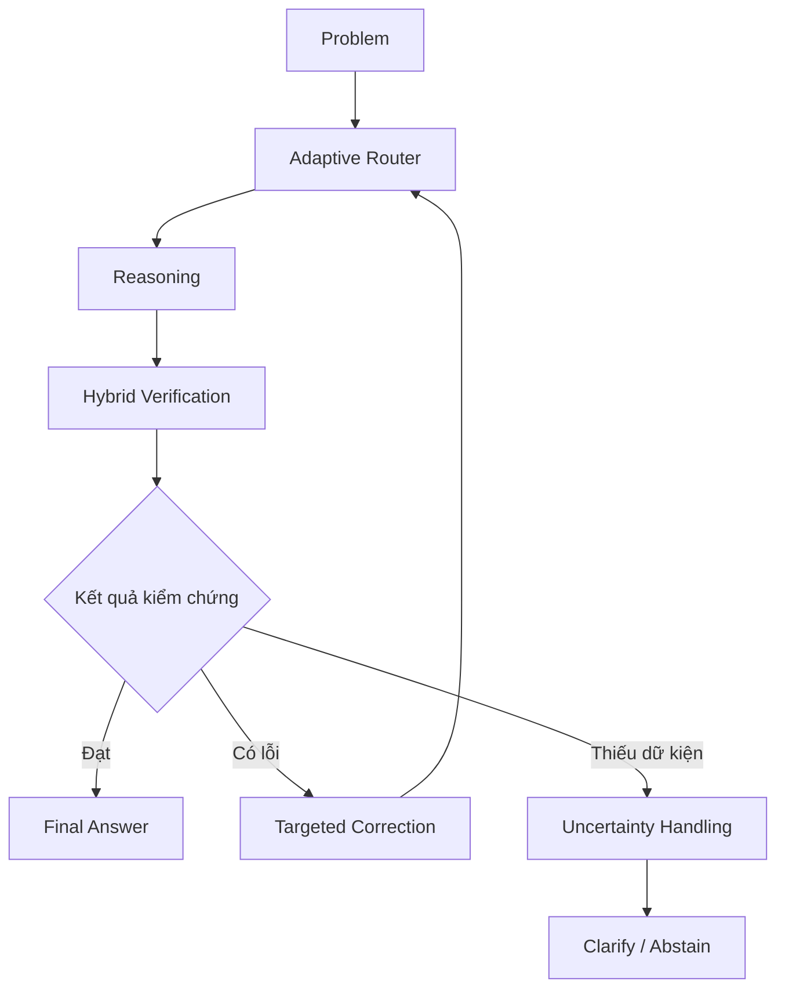
Luồng logic qua Orchestrator, mọi vòng thực thi/sửa lỗi chịu guard và budget. Không đồng nhất hoàn thành với kiểm chứng thành công.

### 9.2. Mini Labs
| ID | Chủ đề | Trọng tâm |
|---|---|---|
| P5-L01 | LLM Verification | Khả năng và giới hạn tự kiểm chứng |
| P5-L02 | Symbolic Verification | Kiểm chứng bằng SymPy |
| P5-L03 | Hybrid Verification | Kết hợp LLM và thuật toán |
| P5-L04 | Dependency Graph | Phụ thuộc giữa các bước |
| P5-L05 | Error Localization | Lỗi gốc và lỗi lan truyền |
| P5-L06 | Targeted Correction | Sửa cục bộ, bảo toàn bước đúng |
| P5-L07 | Uncertainty Management | Thiếu dữ kiện, mâu thuẫn |
| P5-L08 | Adaptive Routing | Điều phối theo trạng thái và độ khó |
| P5-L09 | Cost Optimization | Model, token, calls, budget |
| P5-L10 | Pareto Analysis | Chất lượng và tài nguyên |

### 9.3. Thí nghiệm
No Verification vs LLM-only vs Hybrid; Full Regeneration vs Dependency-based Correction; Static vs Rule-based vs State-aware vs Hybrid routing; LLM-only vs Hybrid uncertainty detection; các mức budget và model routing. Accuracy, Error Localization F1, Correction Success Rate, Introduced Error Rate, LLM Calls, Token Usage, Latency, Cost. Giữ cùng initial solution/model/budget khi phù hợp với giả thuyết; tập dev, không mặc định phương pháp đề xuất vượt baseline; guard bắt buộc duy trì.

### 9.4. Deliverables
Hybrid Verification Engine, Reasoning Dependency Graph, Error Localization/Correction Engine, Uncertainty Manager, Verification-guided Adaptive Router, Execution Budget Management nâng cao, bộ thí nghiệm verification/routing/cost-quality. Tuân thủ System Design mục 7, 11, 12.

### 9.5. Completion Gates
Phát hiện, định vị, sửa lỗi trong phạm vi hỗ trợ; tái kiểm chứng sau sửa, hạn chế tính lại không cần thiết, điều phối theo trạng thái, xử lý bất định, dừng đúng budget. Người học phân tích thực nghiệm, giải thích kiến trúc và trade-off dựa trên dữ liệu; AI triển khai theo đặc tả, người học review. Test/CI/docs/checkpoint và learning gate. 10 lab, 20–30 giờ.

## 10. Phase 6 — Multimodal Reasoning

**Trạng thái: Đã chốt.**

### 10.1. Mục tiêu
Hiểu VLM, biểu diễn ảnh/text, fusion, sai sót nhận thức và tối ưu tài nguyên. Không tự huấn luyện OCR, detection, VLM.
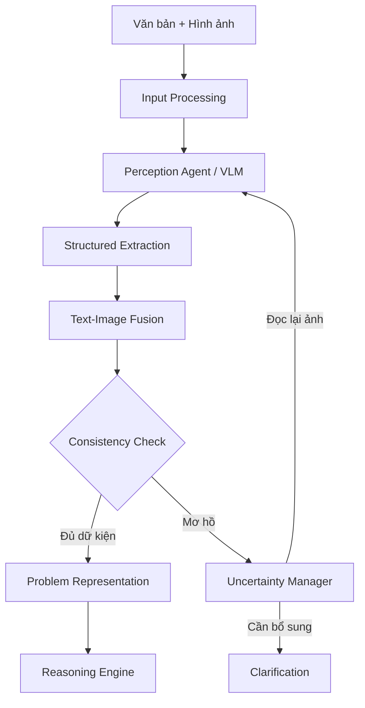
Luồng logic, orchestrator/guard điều phối; giới hạn re-perception, cập nhật phiên bản và invalidate bước phụ thuộc khi dữ kiện thay đổi.

### 10.2. Mini Labs
| ID | Chủ đề | Trọng tâm |
|---|---|---|
| P6-L01 | Multimodal Fundamentals | VLM, biểu diễn ảnh và text |
| P6-L02 | Image Preprocessing | Resolution, crop, chất lượng ảnh |
| P6-L03 | VLM Selection | Khả năng nhận thức, chi phí |
| P6-L04 | Structured Visual Extraction | Công thức, hình học, bảng biểu |
| P6-L05 | Multimodal Fusion | Kết hợp dữ kiện ảnh/text |
| P6-L06 | Visual Grounding | Nguồn gốc dữ kiện, hallucination |
| P6-L07 | Visual Uncertainty | Mơ hồ, mâu thuẫn, đọc lại ảnh |
| P6-L08 | Multimodal Optimization | Image tokens, resolution, latency |
| P6-L09 | Multimodal Evaluation | Perception và reasoning accuracy |

### 10.3. Thí nghiệm
OCR-first vs VLM-only vs hybrid; các VLM trên cùng tập ảnh; ảnh gốc vs xử lý; image-only vs text-image (ghi rõ khác biệt thông tin); có/không consistency check; resolution/token/cost. Đo fact extraction accuracy, formula accuracy, hallucination rate, answer accuracy, tokens, latency, cost. Tập dev, kiểm soát biến, ghi nhận actual model, không bỏ guard bắt buộc.

### 10.4. Deliverables
Perception Agent và hỗ trợ VLM trong Model Gateway; image preprocessing; structured multimodal representation; fusion/consistency checker; targeted re-perception; Gradio UI nhập văn bản và hình ảnh; multimodal benchmark. MVP C — Adaptive Multimodal Multi-Agent. Tuân thủ System Design mục 8 và 14.

### 10.5. Completion Gates
Giải bài có ảnh trong phạm vi hỗ trợ, phân biệt observed/inferred facts, phát hiện mâu thuẫn, không tự bịa dữ kiện thiếu; người học giải thích lựa chọn VLM/pipeline và quality-cost trade-off. AI triển khai theo đặc tả, người học review/thực nghiệm. Test/CI/docs/checkpoint và learning gate. 9 lab, 15–20 giờ.

## 11. Phase 7 — Research & Evaluation

**Trạng thái: Đã chốt.**

### 11.1. Mục tiêu
Tư duy nghiên cứu AI, thực nghiệm có kiểm soát, đánh giá hệ thống và bảo vệ quyết định kỹ thuật bằng số liệu.
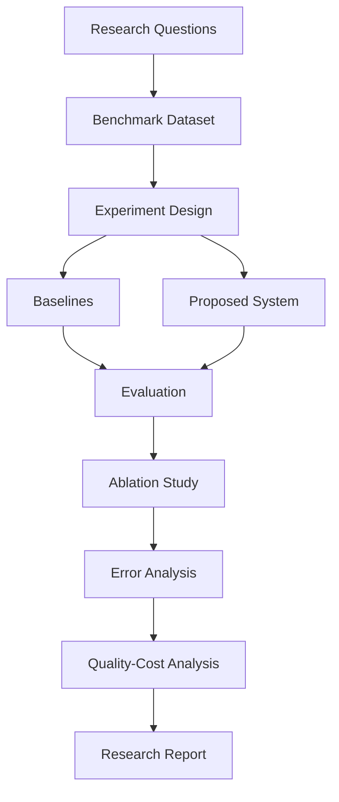

### 11.2. Mini Labs
| ID | Chủ đề | Trọng tâm |
|---|---|---|
| P7-L01 | Research Methodology | Giả thuyết, biến kiểm soát |
| P7-L02 | Benchmark Design | Dataset, sampling, leakage |
| P7-L03 | Evaluation Metrics | Accuracy, reliability |
| P7-L04 | Baseline Design | So sánh công bằng |
| P7-L05 | Ablation Study | Đóng góp từng thành phần |
| P7-L06 | Statistical Analysis | Độ biến thiên, ý nghĩa thống kê |
| P7-L07 | Error Analysis | Phân loại, nguyên nhân |
| P7-L08 | Cost–Quality Optimization | Pareto Frontier |
| P7-L09 | Reproducibility | Dataset/config/model version |
| P7-L10 | Scientific Reporting | Bảng biểu, kết luận, limitations |

### 11.3. Thí nghiệm chính thức
B01 Direct LLM; B02 Single-Agent + Tool; B03 Static Multi-Agent; B04 Adaptive Multi-Agent (MATHK). Ablation tool use, agentic RAG, hybrid verification, dependency-based correction, adaptive routing, multimodal fusion; duy trì guard bắt buộc. Đánh giá quality (accuracy, reasoning correctness), reliability (error/correction/uncertainty), efficiency (tokens/cost/latency/RAM). Chi tiết RQ, benchmark, cấu hình, metrics và thống kê chốt riêng trong 02_RESEARCH.md và 06_EVALUATION.md; không mặc định cải thiện hoặc novelty.

### 11.4. Deliverables
Benchmark dataset/evaluation framework, experiment runner/config, baseline/ablation/error analysis, quality-cost report, reproducibility package, báo cáo nghiên cứu và bản thảo bài báo. MVP D — Research-ready System.

### 11.5. Completion Gates
Tái lập trong điều kiện đã công bố, so sánh công bằng, không tối ưu trên held-out test, không kết luận vượt bằng chứng. Người học thiết kế thí nghiệm, đánh giá kiến trúc và bảo vệ quyết định bằng số liệu; Coding Agent hỗ trợ triển khai. Test/CI/docs/checkpoint và learning gate. 10 lab, 20–30 giờ.

## 12. Quản lý tiến độ và đánh giá năng lực

**Trạng thái: Đã chốt.**

### 12.1. Tổng quan
| Phase | Chủ đề | Labs | Giờ |
|---|---|---:|---:|
| 0 | Foundation | 8 | 8–12 |
| 1 | Mathematical Tools | 8 | 10–15 |
| 2 | Single-Agent | 9 | 15–20 |
| 3 | Multi-Agent | 10 | 18–25 |
| 4 | Agentic RAG | 9 | 15–20 |
| 5 | Verification & Routing | 10 | 20–30 |
| 6 | Multimodal | 9 | 15–20 |
| 7 | Research & Evaluation | 10 | 20–30 |
| Tổng | | 73 | 121–172 |

Ước tính ban đầu, linh hoạt theo năng lực và phát sinh nghiên cứu; 12 giờ/tuần tương đương khoảng 11–15 tuần.

### 12.2. Trách nhiệm
| Công việc | Người học | ChatGPT | Codex |
|---|---|---|---|
| Nguyên lý | Chính | Hướng dẫn | Hỗ trợ |
| Thiết kế | Quyết định | Phân tích/review | Góp ý |
| Mini Lab | Quan sát | Thiết kế | Triển khai |
| Implementation | Đặc tả | Review | Viết code |
| Thực nghiệm | Phân tích | Hướng dẫn | Hỗ trợ chạy |
| Debugging | Hiểu nguyên nhân | Hướng dẫn | Sửa code |
| Evaluation | Kết luận | Phản biện | Hỗ trợ đo |
| Documentation | Phê duyệt | Soạn thảo | Cập nhật |

### 12.3. Quy trình phiên học
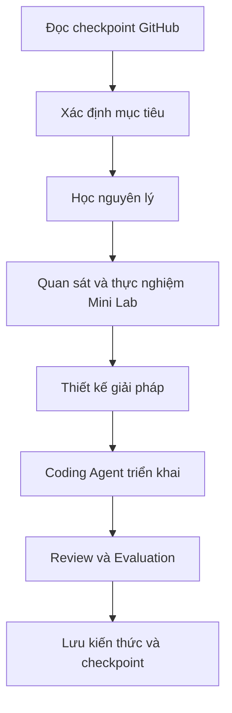
Không bắt buộc hoàn thành toàn bộ trong một phiên.

### 12.4. Quản lý context và tiến độ
GitHub là Single Source of Truth. Tạo docs/progress/CURRENT_STATUS.md và phase_00.md, phase_01.md... khi cần. Lưu phase/lab hiện tại, việc đã hoàn thành, minh chứng năng lực, quyết định kỹ thuật, lỗi chưa xử lý và bước tiếp theo. Đọc checkpoint trước phiên mới; lưu/commit/push thường xuyên, không đợi context đầy; xác minh commit/readback. Không coi đề xuất chưa duyệt là quyết định.

### 12.5. Đánh giá năng lực
Theo 40 năng lực mục 3: L0 chưa học; L1 giải thích nguyên lý; L2 hiểu code/dự đoán/phân tích thực nghiệm; L3 thiết kế/đặc tả/review/test; L4 đánh giá trade-off/debug/vận dụng. Chỉ nâng level khi có minh chứng, không dựa số dòng code hoặc số lab đã học.

### 12.6. Điều kiện chuyển Phase
Learning Gate: hiểu nguyên lý, kiến trúc, lựa chọn công nghệ và kết quả thực nghiệm. Engineering Gate: chức năng hoạt động, test đạt, đáp ứng yêu cầu. Checkpoint Gate: tài liệu, tiến độ, quyết định và code đã lưu GitHub. Cần cả ba gate; có thể bỏ lab đã thành thạo nếu có minh chứng.

