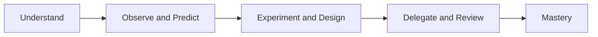
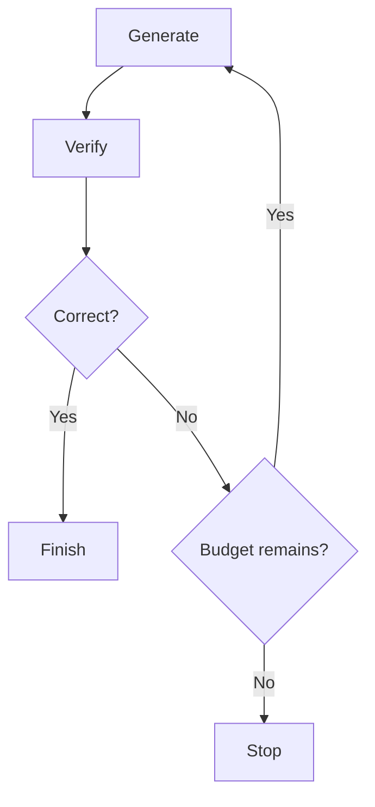
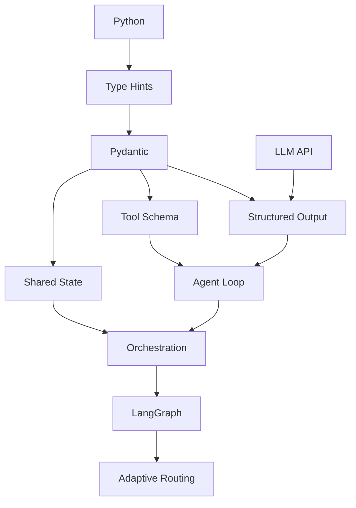
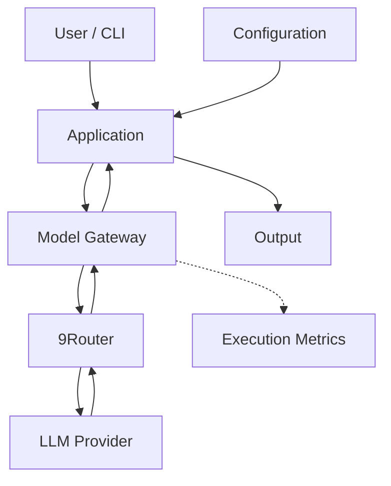

# MATHK — Implementation Roadmap

**Phiên bản:** 0.4

**Trạng thái:** Đang thảo luận

Tham chiếu: [Requirements](01_REQUIREMENTS.md), [System Design](03_SYSTEM_DESIGN.md), [Project Structure v1.1](04_PROJECT_STRUCTURE.md).

## 1. Phương pháp học và triển khai

**Trạng thái: Đã chốt.**

### 1.1. Learning by Building và Scaffolding
System-first, Model & Data-centric, Evaluation-driven, AI-assisted Engineering. Understand → Observe → Predict → Experiment → Design → Delegate → Review → Master. Coding Agent tạo code và lab; người học đọc hiểu, dự đoán, thực nghiệm, đặc tả, kiểm chứng; không bắt buộc tự gõ code. Tăng dần độ phức tạp; kiểm tra nhanh kiến thức đã biết, không ép đủ mọi tầng.

### 1.2. Ví dụ Orchestration
1. Python functions tuần tự, không LLM/framework.
2. Shared State bằng dictionary có cấu trúc.
3. Conditional routing bằng if/else.
4. Generate/Verify correction loop với budget và termination.
5. Chuyển sang LangGraph nodes, edges, conditional edges, state.
6. Thay fake functions bằng agent qua Model Gateway.
7. Tích hợp Orchestrator, Router, State, Guard vào MATHK.

### 1.3. Chuỗi học theo năng lực
- Tool Calling: function → schema → registry → LLM chọn tool → guard → MATHK.
- Agent: API → structured output → tool calling → agent loop → single-agent.
- RAG: text search → BM25 → dense → hybrid → applicability → agentic retrieval.
- Guardrails: validation → permission → budget → tool safety → workflow guard.
- Routing: if/else → rule-based → state-aware → verification-guided → hybrid.
- Multimodal: đọc ảnh → VLM → facts → structured representation → fusion → agent.
- Checkpoint: JSON state → restore → SQLite → LangGraph checkpointer → resume.
Các guard bắt buộc phải có trước khi cho phép thực thi thật.

### 1.4. Mini Lab
Basic: một khái niệm ít dependency; Intermediate: kết hợp, framework; Advanced: lỗi, edge cases, integration. Chỉ tăng mức khi hiểu nền tảng; có thể bỏ qua phần đã thành thạo sau kiểm tra.

### 1.5. Phiên học
Linh hoạt 45/90/120 phút; gợi ý 20% nguyên lý, 25% đọc/phân tích code, 20% thực nghiệm/debug, 25% thiết kế/tích hợp/review, 10% ôn/checkpoint. Lab khó có thể nhiều buổi.

### 1.6. Mentor
H1 câu hỏi gợi mở; H2 thuật toán/hướng giải; H3 pseudocode/skeleton; H4 lời giải đầy đủ kèm giải thích. Mức hỗ trợ linh hoạt; AI cung cấp code minh họa và triển khai module/test theo đặc tả. Mentor giải thích, hướng dẫn thí nghiệm, review; người học quyết định và kiểm chứng. Không bắt buộc tự code.

### 1.7. Ôn tập
Concept, đọc hiểu/dự đoán hành vi, Debugging, Design, phân tích metrics/trade-off; ôn kiến thức liên quan đầu phase. Engineering Gate và Learning Gate theo tài liệu 04.

### 1.8. Tiến độ
docs/progress/ lưu năng lực, phase, mức L0–L4, minh chứng lab/test/integration/commit, phần chưa xong và bước tiếp theo. Checkpoint thường xuyên, GitHub là nguồn chuẩn.

### 1.9. Trọng tâm AI Systems Engineering
Tỷ trọng định hướng: System Design 25%, Model Engineering 20%, Data/Knowledge 15%, Evaluation/Research 15%, Cost/Performance 15%, Software Engineering/Code Review 10%. Không phải lịch cứng.
Mini Lab là technical experiment: câu hỏi, giả thuyết, ví dụ nhỏ do AI tạo, biến kiểm soát, metrics, phân tích kết quả, quyết định tích hợp. Ví dụ model selection (accuracy/schema success/token/latency/cost), context toàn bộ/chọn lọc/RAG, direct/single/multi-agent, static/adaptive routing, LLM verification/SymPy. Đo quality, token, calls, latency, cost từ khi dùng LLM; không đợi Phase 7. So sánh Pareto, không mặc định multi-agent tốt hơn.
P0 môi trường/hệ thống; P1 deterministic vs LLM; P2 model/prompt/tool/loop; P3 architecture/state/reliability; P4 data/retrieval/context; P5 verification/routing/cost; P6 VLM/fusion; P7 benchmark/ablation/research.
L0 chưa biết; L1 giải thích; L2 đọc hiểu/dự đoán/thực nghiệm; L3 thiết kế/đặc tả/delegate/review/test; L4 kiến trúc/trade-off/debug/chuyển giao. Mục tiêu L3 hướng L4. Đọc code và sửa nhỏ khi cần là kỹ năng hỗ trợ.

## 2. Kiến thức tiên quyết

**Trạng thái: Đã chốt.**

Nền tảng Python, ML, NLP/retrieval, API, SQL, Git và thiết kế hệ thống đã có kinh nghiệm ban đầu; chưa đánh giá chính thức. Không học lại từ đầu nếu vượt qua kiểm tra.
- A: kiểm tra nhanh Python/OOP/NumPy/SQL/Git/JSON/ML bằng đọc hiểu, dự đoán, thực nghiệm/debug, quyết định kỹ thuật; không bắt buộc tự viết class/function.
- B: Phase 0 packaging, uv, type hints, Pydantic, pytest, YAML/env, CI; Coding Agent hỗ trợ.
- C: Just-in-time: P1 SymPy/exact arithmetic/parser/Protocol/property tests; P2 API/prompt/structured output/DI/agent loop; P3 graph/state/LangGraph/guard/SQLite/SQLAlchemy/checkpoint; P4 BM25/dense/embedding/FAISS/RRF/agentic retrieval; P5 verification/DAG/correction/uncertainty/routing; P6 image/Pillow/VLM/fusion/Gradio; P7 metrics/experiment/ablation/statistics/reproducibility.
- D: chưa cần Kubernetes, broker, distributed agents, training/fine-tuning LLM, microservices nâng cao, toàn bộ SOLID/patterns hoặc Docker nâng cao.
Lab từ vấn đề nhỏ đến framework rồi MATHK; ví dụ Pydantic: dữ liệu tuổi âm → validation thủ công → BaseModel/Field → Product schema và test → ProblemInput. AI tạo code, người học phân tích kết quả.

## 3. AI Agent Competency Matrix

**Trạng thái: Đã chốt.**

Mở rộng thành AI Systems Engineering Competency Matrix: 40 năng lực, 8 nhóm. Các mức là mục tiêu, không phải năng lực đã đạt.

### 3.1. System Architecture
| ID | Năng lực | Phase | Mục tiêu | Nội dung |
|---|---|---|---|---|
| SYS01 | System Decomposition | 0–3 | L4 | Phân rã module |
| SYS02 | Architecture Trade-offs | 2–3 | L4 | Direct/single/multi-agent và workflow xác định |
| SYS03 | Interface & Data Contracts | 0–2 | L3 | Hợp đồng dữ liệu |
| SYS04 | Dependency Management | 1–3 | L3 | Coupling, inversion, provider |
| SYS05 | Execution Architecture | 3 | L4 | Control/execution/infrastructure |

### 3.2. Model Engineering
| ID | Năng lực | Phase | Mục tiêu | Nội dung |
|---|---|---|---|---|
| MOD01 | LLM Fundamentals | 2 | L3 | Token, context, inference, giới hạn |
| MOD02 | Model Selection | 2–6 | L4 | Chất lượng theo nhiệm vụ và chi phí |
| MOD03 | Model Gateway | 0–2 | L3 | Chuẩn hóa provider |
| MOD04 | Prompt Engineering | 2–7 | L3 | Prompt tiếng Việt và evaluation |
| MOD05 | Structured Output | 2 | L4 | Schema adherence |

### 3.3. Data Engineering
| ID | Năng lực | Phase | Mục tiêu | Nội dung |
|---|---|---|---|---|
| DAT01 | Data Quality | 4–7 | L3 | Thiếu, sai, trùng, nhất quán |
| DAT02 | Knowledge Representation | 4 | L4 | Tri thức và điều kiện định lý |
| DAT03 | Embedding & Retrieval | 4 | L3 | BM25, dense, FAISS |
| DAT04 | Hybrid Retrieval | 4 | L3 | Kết hợp truy xuất |
| DAT05 | Multimodal Data | 6 | L3 | Ảnh và text |

### 3.4. Context Engineering
| ID | Năng lực | Phase | Mục tiêu | Nội dung |
|---|---|---|---|---|
| CTX01 | Context Construction | 2–4 | L4 | Chọn facts/knowledge/schema |
| CTX02 | Context Budget | 2–5 | L4 | Phân bổ token |
| CTX03 | Shared State & Memory | 3 | L4 | Context/state/memory/persistence |
| CTX04 | Agentic RAG | 4 | L4 | Truy xuất theo nhu cầu |
| CTX05 | Knowledge Applicability | 4–5 | L4 | Relevance vs applicability |

### 3.5. Agent Engineering
| ID | Năng lực | Phase | Mục tiêu | Nội dung |
|---|---|---|---|---|
| AGT01 | Tool Use | 1–2 | L4 | Schema/registry/execution |
| AGT02 | Agent Loop | 2 | L4 | Decision/action/observation |
| AGT03 | Orchestration | 3 | L4 | Multi-agent workflow |
| AGT04 | State Graph & LangGraph | 3 | L3 | Nodes/edges/state/transitions |
| AGT05 | Adaptive Routing | 3–5 | L4 | Difficulty/state/budget/verification |

### 3.6. Cost & Performance
| ID | Năng lực | Phase | Mục tiêu | Nội dung |
|---|---|---|---|---|
| OPT01 | Token Optimization | 2–5 | L4 | Giảm token, đo quality |
| OPT02 | Model Routing | 2–5 | L4 | Model theo nhiệm vụ |
| OPT03 | Execution Budget | 2–5 | L4 | Calls/tokens/retries/time |
| OPT04 | Latency & Resource Optimization | 3–7 | L3 | Bottleneck/RAM/concurrency/cache |
| OPT05 | Pareto Analysis | 5–7 | L4 | Quality/cost/speed |

### 3.7. Reliability & Safety
| ID | Năng lực | Phase | Mục tiêu | Nội dung |
|---|---|---|---|---|
| REL01 | Guardrails | 1–3 | L4 | Permission/input/action |
| REL02 | Failure Handling | 2–3 | L3 | Bounded retry/timeout/fallback/stop |
| REL03 | Checkpointing | 3 | L3 | Resume đúng phiên bản |
| REL04 | Verification & Correction | 5 | L4 | Kiểm chứng và sửa có kiểm soát |
| REL05 | Uncertainty Management | 5–6 | L4 | Thiếu/mâu thuẫn/giới hạn |

### 3.8. Evaluation & Research
| ID | Năng lực | Phase | Mục tiêu | Nội dung |
|---|---|---|---|---|
| EVA01 | Evaluation Metrics | 2–7 | L4 | Quality/resources/reliability |
| EVA02 | Benchmark Design | 2–7 | L4 | Đại diện, tránh leakage |
| EVA03 | Controlled Experiments | 2–7 | L4 | Baseline/ablation công bằng |
| EVA04 | Error Analysis | 3–7 | L4 | Lỗi gốc và lan truyền |
| EVA05 | Reproducibility | 0–7 | L3 | Version/config/results |

### 3.9. Minh chứng và tiêu chí
L0 chưa biết; L1 giải thích nguyên lý; L2 đọc hiểu lab, dự đoán và giải thích thực nghiệm; L3 thiết kế, đặc tả, delegate, review/test; L4 so sánh phương án, trade-off, debug và chuyển giao. Không bắt buộc tự gõ code. Năng lực xuyên suốt: đặc tả Coding Agent, đọc hiểu, review kiến trúc, debugging, testing.
Ví dụ MOD02: hiểu khả năng LLM → cùng tập đề nhỏ → schema success → chất lượng theo nhiệm vụ → token/latency/cost → phân bổ model cho MATHK. Phân tích lỗi phân tuyến, overhead router, retry/fallback, chi phí model và ngưỡng quality; số liệu minh họa không phải kết quả thực tế.
Mỗi lab có vấn đề, nguyên lý, sơ đồ, code AI tạo, thí nghiệm, câu hỏi phân tích, ứng dụng MATHK. Ánh xạ lab/chức năng/minh chứng chi tiết ở từng phase.
Ngoài phạm vi MVP: LLM training/fine-tuning quy mô lớn, distributed inference, MCP/A2A, production MLOps nâng cao.

## 4. Phase 0 — Foundation

**Trạng thái: Đã chốt.**

### 4.1. Mục tiêu
Hiểu runtime, kiến trúc, config, contracts, API, gateway và metrics. Kết nối model thử nghiệm trong lab, gateway chính thức ở Phase 2.

### 4.2. Trọng tâm
Kiến trúc/luồng 30%, API/gateway/9Router 30%, config/contracts 20%, testing/reliability 10%, công cụ phát triển 10%; định hướng linh hoạt.

### 4.3. Mini Labs
| ID | Chủ đề | Phút | Thực nghiệm và minh chứng |
|---|---|---|---|
| P0-L01 | Python Project & Runtime | 30–45 | So sánh môi trường, dependency, lock; hiểu uv và tái lập |
| P0-L02 | Modular Architecture | 45–60 | Một file vs module, theo dõi dependency, thay implementation |
| P0-L03 | Data Contracts & Pydantic | 45–60 | Dữ liệu đúng/sai/thiếu/vượt giới hạn, static vs runtime validation |
| P0-L04 | Configuration-driven System | 30–45 | YAML/env, thay model/timeout/budget, config sai, secrets |
| P0-L05 | LLM API Anatomy | 45–60 | Request/response/model ID/usage/latency |
| P0-L06 | Model Gateway & 9Router | 60–90 | Tuyến model khả dụng, quota, usage, provider independence |
| P0-L07 | Testing & Failure Handling | 45–60 | Fake model, timeout, response/config sai, pytest |
| P0-L08 | Reproducibility & CI | 30–45 | CI pass/fail, code/config/dependency versions |

### 4.4. Lab API và chi phí
Quan sát model ID, messages, temperature/max output (nếu hỗ trợ), generated output, actual model, usage, finish reason. Thực nghiệm độ dài prompt, yêu cầu output, temperature, model, giới hạn output, lỗi API. Chi phí ước tính = tổng (input tokens × đơn giá input + output tokens × đơn giá output)/1 triệu nếu đơn giá theo triệu token; tính trên từng call, lưu ý cache, retry, phí khác và usage thiếu. Model miễn phí vẫn đo token/quota/rate limit/latency. Giá minh họa không phải giá thực.

### 4.5. Cấu trúc lab
labs/phase_00/05_llm_api_anatomy/{README.md,demo.py,experiment.py,test_demo.py,notes.md}. README nguyên lý/sơ đồ/hướng dẫn, demo và experiment do Coding Agent tạo, test khi cần, notes kết luận người học. Không bắt buộc mọi file.

### 4.6. Tích hợp tăng dần
L01–02 project structure; L03–04 contracts/config; L05–06 connectivity trong lab; L07–08 tests/CI. Không đợi hết lab mới tích hợp. Coding Agent triển khai theo thiết kế đã duyệt.

### 4.7. Deliverables
Skeleton theo tài liệu 04 mục 2.1: .github/workflows/ci.yml, configs/default.yaml, docs/, labs/phase_00/, src/mathk/{__init__.py,__main__.py,config.py}, tests/test_config.py, .env.example, .gitignore, .python-version, pyproject.toml, uv.lock, README.md. Chưa agent thật, LangGraph, RAG, SymPy. Kết nối 9Router ở lab.

### 4.8. Năng lực
SYS01, SYS03, MOD03, EVA05 mục tiêu L2 tại phase này; nâng dần ở phase sau.

### 4.9. Definition of Done
- Giải thích repo và luồng thực thi.
- Hiểu contracts/runtime validation.
- Hiểu config/env/secrets.
- Đọc hiểu LLM API request/response.
- Hiểu 9Router và gateway.
- Phân tích token/chi phí.
- Đọc test/CI.
- Foundation chạy, kiểm thử/CI đạt, docs và commit GitHub.

### 4.10. Thời lượng
8 lab, 8–12 giờ gồm lab/review/tích hợp/tổng kết, khoảng 6–8 phiên 90 phút; rút ngắn nếu đã thành thạo.

## 5. Phase 1 — Mathematical Tool System

*Chưa chốt.*

## 6. Phase 2 — Single-Agent Solver

*Chưa chốt.*

## 7. Phase 3 — Multi-Agent Orchestration

*Chưa chốt.*

## 8. Phase 4 — Agentic RAG

*Chưa chốt.*

## 9. Phase 5 — Verification & Adaptive Routing

*Chưa chốt.*

## 10. Phase 6 — Multimodal Reasoning

*Chưa chốt.*

## 11. Phase 7 — Research & Evaluation

*Chưa chốt.*

## 12. Quản lý tiến độ và đánh giá năng lực

*Chưa chốt.*
