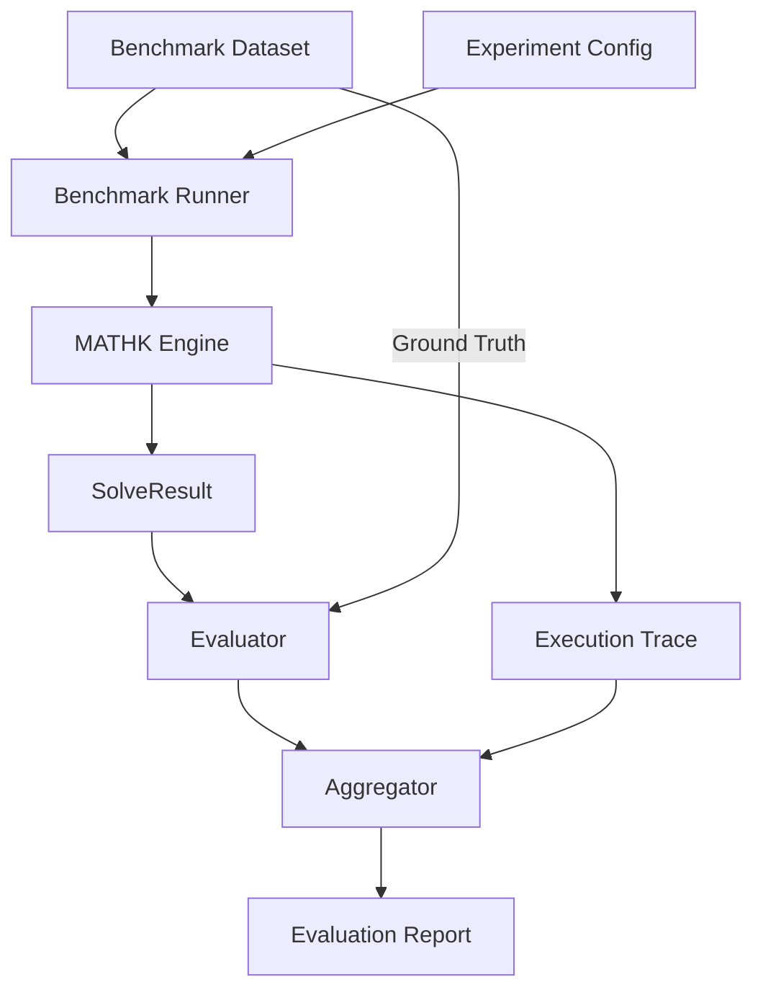
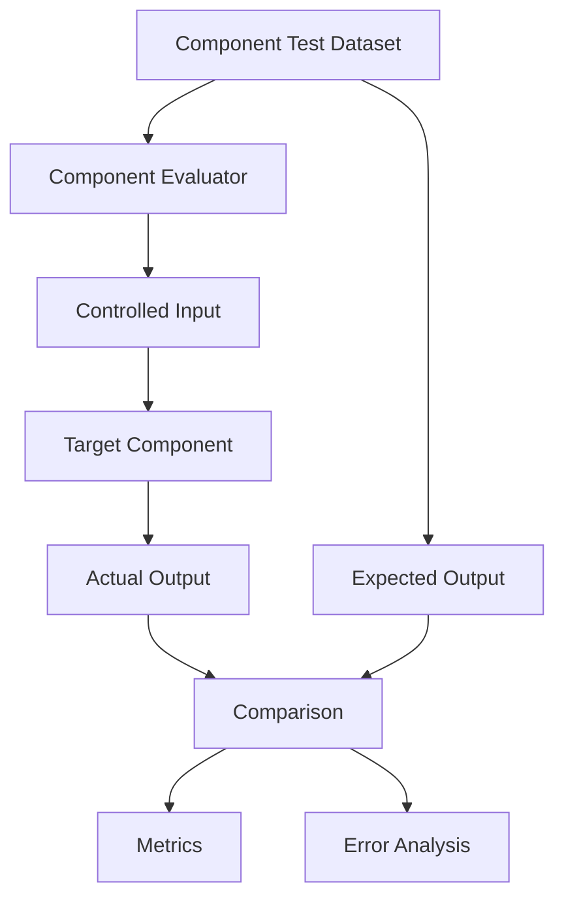
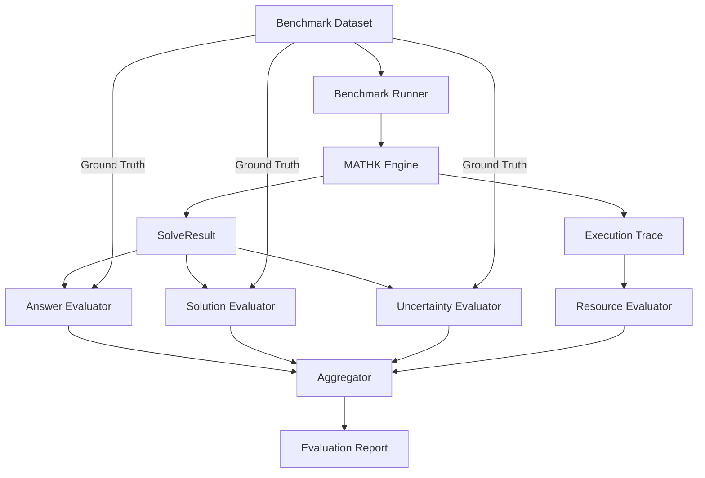
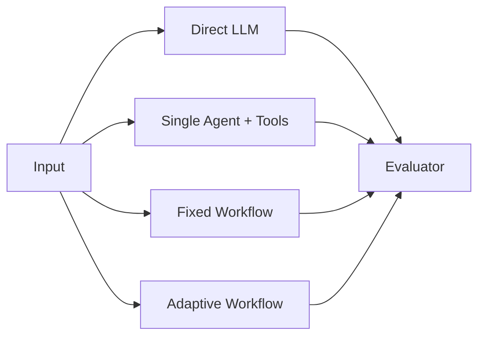
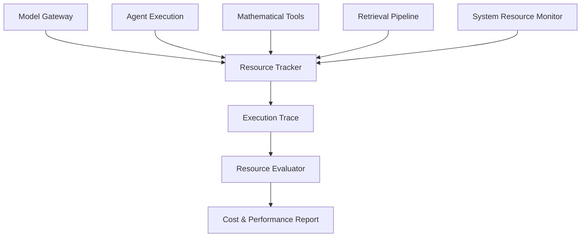
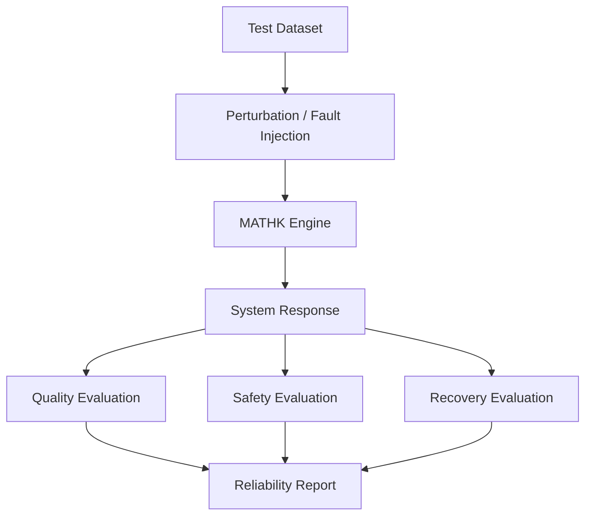

# MATHK — Evaluation

**Phiên bản:** 0.9

**Trạng thái:** Đang thảo luận

**Cấu trúc:** Đã duyệt 10 mục; nội dung từng mục chờ duyệt.

Tham chiếu: [Requirements](01_REQUIREMENTS.md), [System Design — mục 15](03_SYSTEM_DESIGN.md), [Implementation Roadmap](05_IMPLEMENTATION.md), [Research](02_RESEARCH.md).

## 1. Evaluation Objectives & Strategy

**Trạng thái: Đã chốt.**

### 1.1. Mục tiêu
| ID | Mục tiêu | Nội dung |
|---|---|---|
| EO01 | Mathematical Quality | Đáp án và lời giải |
| EO02 | Multimodal Quality | Hiểu hình ảnh |
| EO03 | Knowledge Quality | Truy xuất và áp dụng kiến thức |
| EO04 | Reliability | Kiểm chứng, sửa lỗi, bất định |
| EO05 | Efficiency | Chi phí, token, latency, RAM |
| EO06 | Research Validation | Đóng góp phương pháp |
| EO07 | Reproducibility | Tái lập thực nghiệm |

### 1.2. Cấp độ
EL01 Component: model/agent/tool/retrieval; EL02 Pipeline: RAG/verification/routing/multimodal; EL03 End-to-End: toàn hệ thống; EL04 Research: baseline/ablation/quality-cost.

### 1.3. Phương pháp
Deterministic, symbolic SymPy, human rubric (P0); LLM-as-a-Judge có đối chiếu con người (P1).

### 1.4. Nguyên tắc
Evaluation từ Phase 0; ground truth tách khỏi engine; đánh giá đáp án và lời giải riêng; kiểm soát biến, tránh leakage, không mặc định vượt baseline; đo quality/reliability/efficiency; lưu raw results để đánh giá lại.

### 1.5. Kiến trúc

Evaluation độc lập, không can thiệp quá trình giải toán; theo System Design mục 15.

## 2. Benchmark Dataset Design

**Trạng thái: Đã chốt.**

### 2.1. Phạm vi
THCS lớp 6–9, tiếng Việt; số học, đại số, hình học, thống kê, xác suất; easy/medium/hard; text/image/mixed; số, biểu thức, tập nghiệm, chứng minh, tự luận; dữ kiện đầy đủ/thiếu/mâu thuẫn/mơ hồ.

### 2.2. Nguồn
Dataset công khai có giấy phép phù hợp, bài tập/đề thi THCS được phép sử dụng, tự xây dựng, tổng hợp bằng LLM có kiểm chứng đáp án và rà soát chất lượng. Lưu provenance từng mẫu; không dùng dữ liệu chưa kiểm chứng làm ground truth.

### 2.3. Quy mô dự kiến
| Tập | Số bài |
|---|---:|
| Smoke test | 20–30 |
| Development | 100–200 |
| Held-out benchmark | 300–800 |
| Tổng dev + held-out | 400–1000 |
Smoke test có thể lấy từ dev; quy mô là dự kiến, không phải yêu cầu cứng.

### 2.4. Split
Đề xuất dev 20%, held-out 80%, điều chỉnh theo dữ liệu thực tế. Dev tối ưu prompt/retrieval/routing/budget; freeze cấu hình trước held-out. Group near-duplicates/templates trước split để giảm leakage.

### 2.5. Schema
BenchmarkSample:
- Identity: sample_id, source, dataset_version.
- Input: problem_text, images.
- Metadata: grade, topic, difficulty, modality, reasoning_requirements.
- Ground Truth: answer, solution, required_knowledge, expected_facts, sufficiency_status, expected_action.
Ground truth chỉ cung cấp cho evaluator, không vào agent context. Schema logic, chi tiết kiểu dữ liệu xác định khi triển khai.

### 2.6. Data Quality Pipeline

Ưu tiên chất lượng và tính đại diện; chưa cố định phân bố chủ đề, độ khó, modality trước khảo sát nguồn.

## 3. Evaluation Metrics

**Trạng thái: Đã chốt.**

### 3.1. Nhóm Metrics
| ID | Nhóm | Chỉ số chính |
|---|---|---|
| MG01 | Mathematical | Answer Accuracy, Solution Correctness, Step Correctness |
| MG02 | Multimodal | Fact Accuracy, Entity/Relation F1, Visual Hallucination Rate |
| MG03 | Retrieval | Recall@k, Precision@k, MRR, nDCG, Applicability Accuracy |
| MG04 | Tool Use | Tool Selection Accuracy, Execution Success, Parameter Validity |
| MG05 | Verification | Detection F1, Localization F1, Correction Success, Error Introduction |
| MG06 | Routing | Agent Calls, LLM Calls, Quality–Cost Trade-off |
| MG07 | Uncertainty | Detection F1, Action Accuracy, Coverage, Selective Accuracy |
| MG08 | Efficiency | Tokens, Cost, Latency, RAM, Technical Failure Rate |
Chọn theo thí nghiệm, giữ các metric bổ sung trong System Design mục 15.

### 3.2. Trọng tâm
Answer Accuracy, Correction Success Rate, Error Introduction Rate, Quality–Cost Trade-off.

### 3.3. Đáp án
Số: exact/tolerance phù hợp; biểu thức: symbolic equivalence; phương trình/bất phương trình: tập/miền nghiệm; đại lượng: giá trị và đơn vị; chứng minh: human rubric. Giữ điều kiện xác định; undetermined chuyển human review.

### 3.4. Rubric lời giải
Năm tiêu chí 0–2: dữ kiện, kiến thức, lập luận, phép tính, tính đầy đủ; tổng dự kiến 10. Critical errors ghi riêng, không bù bằng các bước khác. Quy tắc NA và ngưỡng chốt trước test.

### 3.5. Verification & Correction
Correction Success = wrong-to-right / initially wrong; Error Introduction = right-to-wrong / initially right; Accuracy Gain là chênh lệch điểm phần trăm. Ví dụ giả lập 100 bài: 60 đúng ban đầu, sửa 50% số sai, làm sai 10% số đúng thì còn 74 đúng (+14 pp). Mẫu số 0 ghi undefined. So sánh trên cùng initial candidates khi phù hợp.

### 3.6. Tổng hợp
Báo cáo toàn benchmark và theo nhóm; phân biệt sai toán, lỗi kỹ thuật, từ chối phù hợp; công bố mẫu số, số mẫu chưa đánh giá, metadata thiếu. Không gộp thành overall score tùy ý; Pareto analysis. Công thức chi tiết và ngưỡng xác định khi triển khai evaluation framework, freeze trước held-out test.

## 4. Component-level Evaluation

**Trạng thái: Đã chốt.**

### 4.1. Mục tiêu
Cô lập thành phần trước khi tích hợp, xác định nguyên nhân lỗi, chọn công nghệ và tránh chạy toàn pipeline khi thay module.

### 4.2. Đối tượng
| ID | Component | Nội dung |
|---|---|---|
| CE01 | Model Gateway | Structured output, tool calling, latency, cost |
| CE02 | Perception Agent | Dữ kiện, hiểu ảnh |
| CE03 | Planning Agent | Kế hoạch hợp lý, đầy đủ |
| CE04 | Retrieval Agent | Relevance, applicability |
| CE05 | Reasoning Agent | Đáp án, lập luận, tool use |
| CE06 | Verifier Agent | Phát hiện và định vị lỗi |
| CE07 | Mathematical Tools | Tính toán, miền xác định |
| CE08 | Adaptive Router | Quyết định định tuyến |
| CE09 | Context Builder | Chất lượng context, tokens |
| CE10 | Uncertainty Manager | Phát hiện, hành động |
| CE11 | Correction Engine | Sửa lỗi, bảo toàn bước đúng |
| CE12 | Knowledge Store & Retrieval | Chất lượng dữ liệu, truy xuất |

### 4.3. Kiến trúc

Đầu vào chuẩn, fake agent/mock service khi phù hợp để cô lập thành phần; ground truth không đưa vào target component.

### 4.4. Thí nghiệm
LLM/VLM ứng viên; zero-shot vs few-shot; tools exact và edge cases; BM25/dense/hybrid; full vs selected context; LLM-only/symbolic/hybrid verification; full regeneration vs local correction; rule-based/state-aware/hybrid routing. Duy trì guard bắt buộc.

### 4.5. Testing và Evaluation
Software testing kiểm tra hành vi đúng đặc tả (pass/fail, pytest/mock, CI offline); AI evaluation đo chất lượng đầu ra bằng metrics, có thể cần model thật. Ví dụ tool từ chối tham số sai vs agent chọn đúng tool. Hai hoạt động bổ sung, không thay thế nhau.

### 4.6. Lộ trình
P0–1 configuration/tools; P2 model/prompt/reasoner/context; P3 agent/orchestration/router; P4 knowledge/retrieval; P5 verification/correction/uncertainty; P6 perception/VLM; P7 hoàn thiện/tái đánh giá. Xây bộ đánh giá khi triển khai thành phần tương ứng; lưu kết quả cho regression evaluation.

## 5. End-to-End Evaluation

**Trạng thái: Đã chốt.**

### 5.1. Mục tiêu
Đánh giá toàn hệ thống từ đề bài đến kết quả, bổ sung cho component evaluation.

### 5.2. Pipeline

Cùng Application API với CLI/Gradio; runner chỉ gửi input hợp lệ, không ground truth.

### 5.3. Kịch bản
| ID | Kịch bản |
|---|---|
| EE01 | Văn bản đơn giản |
| EE02 | Suy luận nhiều bước |
| EE03 | Cần Mathematical Tools |
| EE04 | Cần truy xuất kiến thức |
| EE05 | Hình học có ảnh |
| EE06 | Text-image mixed |
| EE07 | Candidate ban đầu sai cần sửa |
| EE08 | Thiếu dữ kiện |
| EE09 | Mâu thuẫn hoặc mơ hồ |
| EE10 | Vượt khả năng hoặc ngân sách |
Các nhóm có thể giao nhau.

### 5.4. Phân loại
Correct, Partially Correct, Incorrect, Appropriate Clarification, Appropriate Abstention, Inappropriate Abstention, Technical Failure, Undetermined. Tách đánh giá đáp án, lời giải, trạng thái thực thi và kiểm chứng; đáp án đúng không bảo đảm lập luận đúng.

### 5.5. Báo cáo
Tổng thể và theo lớp/chủ đề/độ khó/modality/reasoning requirements/sufficiency. Công bố mẫu số và trạng thái thiếu. Ví dụ giả lập 400 bài: 302 đúng, 18 đúng một phần, 36 sai, 40 xử lý bất định phù hợp, 4 lỗi kỹ thuật. Giả sử 360 bài giải được, accuracy 302/360 = 83.9%, technical failure 4/400 = 1%; 3.2 calls trung bình chỉ minh họa. Không phải kết quả MATHK.

### 5.6. Milestones
MVP A text solver; B grounded multi-agent; C adaptive multimodal multi-agent; D full research benchmark. Dev trong phát triển; held-out chỉ đánh giá chính thức sau freeze.

## 6. Baseline & Ablation Study

**Trạng thái: Đã chốt.**

### 6.1. Mục tiêu
Baseline đo lợi ích so với kiến trúc đơn giản hơn; ablation xác định đóng góp của từng thành phần.

### 6.2. Cấu hình chính
| ID | Cấu hình |
|---|---|
| B01 | Direct LLM |
| B02 | Single-Agent + Tool |
| B03 | Static Multi-Agent |
| B04 | Adaptive Multi-Agent (MATHK) |
B01–03 đối chứng, B04 hệ thống đề xuất; chung evaluation framework.

### 6.3. Nhóm thực nghiệm
| ID | Nhóm | So sánh |
|---|---|---|
| EG01 | Architecture | Single vs Multi-Agent |
| EG02 | Tool Use | LLM-only vs Calculator vs SymPy vs Both |
| EG03 | RAG | No RAG vs Static vs Agentic |
| EG04 | Verification | LLM-only vs Hybrid; correction strategies |
| EG05 | Routing | Static vs Rule-based vs State-aware vs Hybrid |
| EG06 | Multimodal | OCR-first vs VLM-only vs Hybrid |
| EG07 | Uncertainty | No specialized module vs LLM-only vs Hybrid |
Ưu tiên EG04/05; giữ các biến thể chi tiết trong System Design.

### 6.4. Ablation
| ID | Cấu hình |
|---|---|
| AB00 | MATHK đầy đủ |
| AB01 | Không Mathematical Tools |
| AB02 | Không RAG |
| AB03 | Không Applicability Check |
| AB04 | LLM-only thay Hybrid Verification |
| AB05 | Full Regeneration thay Targeted Correction |
| AB06 | Static thay Adaptive Routing |
| AB07 | VLM-only thay Hybrid Multimodal |
| AB08 | Không Uncertainty Module chuyên biệt |
Mỗi ablation thay đổi một cơ chế chính; guard an toàn bắt buộc vẫn duy trì.

### 6.5. Minh họa phân tích
Số liệu giả lập, không phải kết quả MATHK:
| Config | Accuracy | LLM Calls/bài |
|---|---:|---:|
| Full | 90% | 3.2 |
| AB01 | 72% | 3.0 |
| AB02 | 84% | 2.5 |
| AB04 | 81% | 3.0 |
| AB05 | 88% | 5.1 |
| AB06 | 89% | 6.0 |
Adaptive routing có thể mang lại giá trị giảm chi phí hơn là tăng accuracy; phải kiểm chứng thực nghiệm.

### 6.6. Nguyên tắc
Cùng dataset/model nếu không phải biến nghiên cứu; kiểm soát budget và ghi actual usage, cùng tiêu chuẩn chấm; lưu prompt/model/KB/config versions; không loại tùy ý kết quả bất lợi, không mặc định vượt baseline. YAML tại experiments/configs/. Số lần chạy và danh sách chính thức xác định theo ngân sách và RQ trước held-out test.

## 7. Cost & Performance Evaluation

**Trạng thái: Đã chốt.**

### 7.1. Mục tiêu
Đo hiệu quả tài nguyên, xác định bottleneck, cân bằng chất lượng/tốc độ/chi phí.

### 7.2. Metrics
| ID | Metric | Đơn vị |
|---|---|---|
| CP01 | Input Tokens | token/bài |
| CP02 | Output Tokens | token/bài |
| CP03 | LLM Calls | lần/bài |
| CP04 | Tool Calls | lần/bài |
| CP05 | Estimated Cost | USD/bài |
| CP06 | End-to-End Latency | giây |
| CP07 | Component Latency | ms |
| CP08 | Peak RAM | MB |
| CP09 | CPU Utilization | % |
| CP10 | Retry & Fallback | lần/bài |
| CP11 | Throughput | bài/phút |
| CP12 | Budget Exhaustion Rate | % |
Latency báo cáo mean, median, P95.

### 7.3. Kiến trúc

Resource Tracker là trách nhiệm đo lường logic, dùng gateway/trace/logging/psutil; không thêm monitoring phức tạp. Đồng hồ monotonic, RAM lấy mẫu, ghi phạm vi đo.

### 7.4. Quality–Cost Trade-off
Pareto analysis theo mục tiêu đã chọn. Ví dụ giả lập (accuracy %, calls/bài): Direct 68,1; Single 79,2; Adaptive 88,3; Multi-Agent V1 84,5; Static 90,7. Multi-Agent V1 bị Adaptive dominate; Adaptive và Static có trade-off. Không phải số liệu MATHK.

### 7.5. Thí nghiệm
Model nhẹ/mạnh; context selection/token budget; retrieval top-k/embedding; local/full correction; execution budget; RAM/concurrency/caching. Kiểm soát biến theo mục 6.

### 7.6. Nguyên tắc
Phân biệt gateway requests và upstream calls; free không đồng nghĩa không token/quota. Chi phí ước tính ghi pricing/model version; tính retry/fallback/thất bại; tách evaluator/judge cost; metadata thiếu ghi unknown không gán 0. Áp dụng cho 9Router. Chưa đặt ngưỡng cost/latency cứng; đo baseline trên dev rồi xác định ngân sách trước held-out.

## 8. Reliability & Robustness Evaluation

**Trạng thái: Đã chốt.**

### 8.1. Mục tiêu
Đánh giá dữ liệu không hoàn hảo, lỗi suy luận/kỹ thuật và giới hạn tài nguyên; nhận biết khi không đủ căn cứ trả lời.

### 8.2. Nhóm đánh giá
| ID | Nhóm | Nội dung |
|---|---|---|
| RR01 | Input Robustness | Chính tả, ảnh mờ, thiếu thông tin |
| RR02 | Reasoning Reliability | Lập luận, tính toán, định lý |
| RR03 | Correction Reliability | Sửa lỗi, giữ bước đúng |
| RR04 | Uncertainty Handling | Thiếu, mâu thuẫn, mơ hồ |
| RR05 | Fault Tolerance | API/tool/storage failure |
| RR06 | Resource Safety | Token/thời gian/budget |
| RR07 | Security | Prompt injection, tool permission |
| RR08 | Recoverability | Checkpoint/resume |
ID RR trong phạm vi evaluation, không đồng nhất routing rule IDs của System Design.

### 8.3. Chiến lược

Input perturbation và fault injection có kiểm soát.

### 8.4. Kịch bản
| Kịch bản | Hành vi mong đợi |
|---|---|
| Ảnh mờ/mất ký hiệu | Đọc lại hoặc hỏi bổ sung |
| Thiếu dữ kiện | Hỏi lại hoặc trả lời có điều kiện |
| Lỗi tính toán | Phát hiện, sửa, tái kiểm chứng |
| API 429 | Retry giới hạn |
| JSON không hợp lệ | Validate và xử lý lỗi |
| SymPy timeout | Dừng tool an toàn |
| Vượt budget | Dừng theo giới hạn |
| Prompt injection | Không thực thi trái phép |
| Benchmark gián đoạn | Resume checkpoint |
Giữ nguyên Threat Model và Fault Injection trong System Design mục 16.

### 8.5. Metrics
Robustness Drop, Error Detection F1, Recovery Success Rate, Technical Failure Rate, False Abstention Rate, Unsupported Answer Rate, Budget Violation Rate, Security Violation Rate. Phân biệt perturbation giữ nguyên đáp án với biến đổi làm thay đổi dữ kiện/ground truth.

### 8.6. An toàn
Không chạy tool trái phép, lộ secret, lặp vô hạn, vượt giới hạn kiểm soát, sai lệch state khi resume hoặc khẳng định verified khi thiếu bằng chứng. Tiêu chí an toàn bắt buộc đạt trong phạm vi bộ test, không đánh đổi lấy accuracy/cost. Pass test không bảo đảm an toàn tuyệt đối.

## 9. Experiment Protocol & Reproducibility

*Chưa chốt.*

## 10. Acceptance Criteria & Reporting

*Chưa chốt.*
