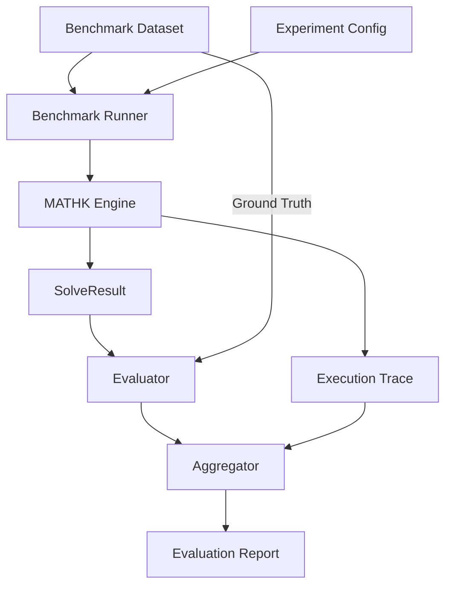
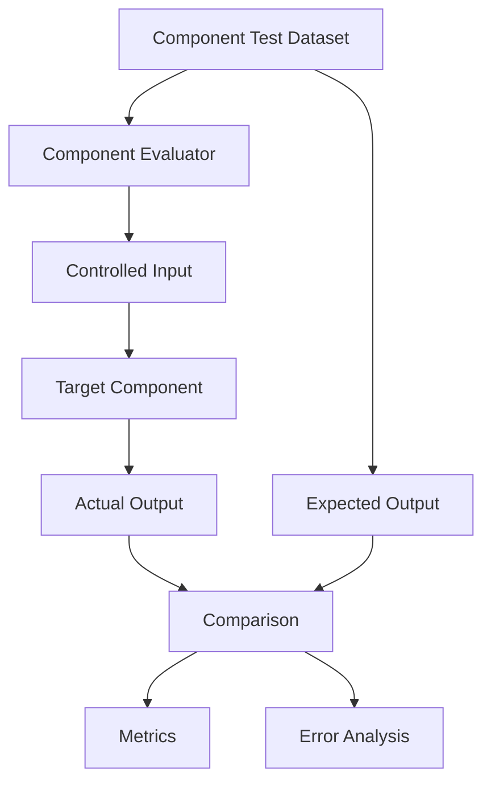
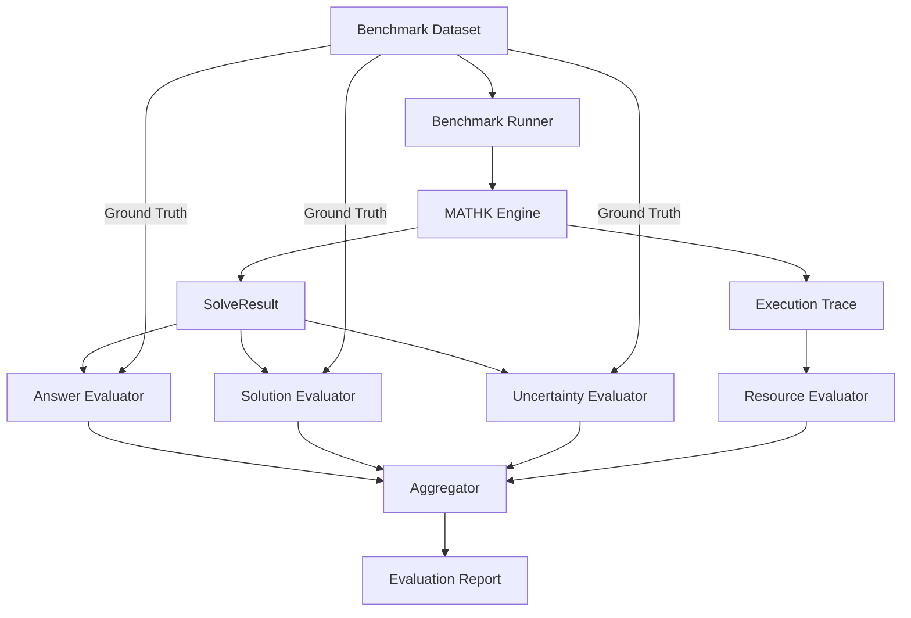

# MATHK — Evaluation

**Phiên bản:** 0.6

**Trạng thái:** Đang thảo luận

**Cấu trúc:** Đã duyệt 10 mục; nội dung từng mục chờ duyệt.

Tham chiếu: [Requirements](01_REQUIREMENTS.md), [System Design — mục 15](03_SYSTEM_DESIGN.md), [Implementation Roadmap](05_IMPLEMENTATION.md), [Research](02_RESEARCH.md).

## 1. Evaluation Objectives & Strategy

**Trạng thái: Đã chốt.**

### 1.1. Mục tiêu
| ID | Mục tiêu | Nội dung |
|---|---|---|
| EO01 | Mathematical Quality | Đáp án và lời giải |
| EO02 | Multimodal Quality | Hiểu hình ảnh |
| EO03 | Knowledge Quality | Truy xuất và áp dụng kiến thức |
| EO04 | Reliability | Kiểm chứng, sửa lỗi, bất định |
| EO05 | Efficiency | Chi phí, token, latency, RAM |
| EO06 | Research Validation | Đóng góp phương pháp |
| EO07 | Reproducibility | Tái lập thực nghiệm |

### 1.2. Cấp độ
EL01 Component: model/agent/tool/retrieval; EL02 Pipeline: RAG/verification/routing/multimodal; EL03 End-to-End: toàn hệ thống; EL04 Research: baseline/ablation/quality-cost.

### 1.3. Phương pháp
Deterministic, symbolic SymPy, human rubric (P0); LLM-as-a-Judge có đối chiếu con người (P1).

### 1.4. Nguyên tắc
Evaluation từ Phase 0; ground truth tách khỏi engine; đánh giá đáp án và lời giải riêng; kiểm soát biến, tránh leakage, không mặc định vượt baseline; đo quality/reliability/efficiency; lưu raw results để đánh giá lại.

### 1.5. Kiến trúc

Evaluation độc lập, không can thiệp quá trình giải toán; theo System Design mục 15.

## 2. Benchmark Dataset Design

**Trạng thái: Đã chốt.**

### 2.1. Phạm vi
THCS lớp 6–9, tiếng Việt; số học, đại số, hình học, thống kê, xác suất; easy/medium/hard; text/image/mixed; số, biểu thức, tập nghiệm, chứng minh, tự luận; dữ kiện đầy đủ/thiếu/mâu thuẫn/mơ hồ.

### 2.2. Nguồn
Dataset công khai có giấy phép phù hợp, bài tập/đề thi THCS được phép sử dụng, tự xây dựng, tổng hợp bằng LLM có kiểm chứng đáp án và rà soát chất lượng. Lưu provenance từng mẫu; không dùng dữ liệu chưa kiểm chứng làm ground truth.

### 2.3. Quy mô dự kiến
| Tập | Số bài |
|---|---:|
| Smoke test | 20–30 |
| Development | 100–200 |
| Held-out benchmark | 300–800 |
| Tổng dev + held-out | 400–1000 |
Smoke test có thể lấy từ dev; quy mô là dự kiến, không phải yêu cầu cứng.

### 2.4. Split
Đề xuất dev 20%, held-out 80%, điều chỉnh theo dữ liệu thực tế. Dev tối ưu prompt/retrieval/routing/budget; freeze cấu hình trước held-out. Group near-duplicates/templates trước split để giảm leakage.

### 2.5. Schema
BenchmarkSample:
- Identity: sample_id, source, dataset_version.
- Input: problem_text, images.
- Metadata: grade, topic, difficulty, modality, reasoning_requirements.
- Ground Truth: answer, solution, required_knowledge, expected_facts, sufficiency_status, expected_action.
Ground truth chỉ cung cấp cho evaluator, không vào agent context. Schema logic, chi tiết kiểu dữ liệu xác định khi triển khai.

### 2.6. Data Quality Pipeline

Ưu tiên chất lượng và tính đại diện; chưa cố định phân bố chủ đề, độ khó, modality trước khảo sát nguồn.

## 3. Evaluation Metrics

**Trạng thái: Đã chốt.**

### 3.1. Nhóm Metrics
| ID | Nhóm | Chỉ số chính |
|---|---|---|
| MG01 | Mathematical | Answer Accuracy, Solution Correctness, Step Correctness |
| MG02 | Multimodal | Fact Accuracy, Entity/Relation F1, Visual Hallucination Rate |
| MG03 | Retrieval | Recall@k, Precision@k, MRR, nDCG, Applicability Accuracy |
| MG04 | Tool Use | Tool Selection Accuracy, Execution Success, Parameter Validity |
| MG05 | Verification | Detection F1, Localization F1, Correction Success, Error Introduction |
| MG06 | Routing | Agent Calls, LLM Calls, Quality–Cost Trade-off |
| MG07 | Uncertainty | Detection F1, Action Accuracy, Coverage, Selective Accuracy |
| MG08 | Efficiency | Tokens, Cost, Latency, RAM, Technical Failure Rate |
Chọn theo thí nghiệm, giữ các metric bổ sung trong System Design mục 15.

### 3.2. Trọng tâm
Answer Accuracy, Correction Success Rate, Error Introduction Rate, Quality–Cost Trade-off.

### 3.3. Đáp án
Số: exact/tolerance phù hợp; biểu thức: symbolic equivalence; phương trình/bất phương trình: tập/miền nghiệm; đại lượng: giá trị và đơn vị; chứng minh: human rubric. Giữ điều kiện xác định; undetermined chuyển human review.

### 3.4. Rubric lời giải
Năm tiêu chí 0–2: dữ kiện, kiến thức, lập luận, phép tính, tính đầy đủ; tổng dự kiến 10. Critical errors ghi riêng, không bù bằng các bước khác. Quy tắc NA và ngưỡng chốt trước test.

### 3.5. Verification & Correction
Correction Success = wrong-to-right / initially wrong; Error Introduction = right-to-wrong / initially right; Accuracy Gain là chênh lệch điểm phần trăm. Ví dụ giả lập 100 bài: 60 đúng ban đầu, sửa 50% số sai, làm sai 10% số đúng thì còn 74 đúng (+14 pp). Mẫu số 0 ghi undefined. So sánh trên cùng initial candidates khi phù hợp.

### 3.6. Tổng hợp
Báo cáo toàn benchmark và theo nhóm; phân biệt sai toán, lỗi kỹ thuật, từ chối phù hợp; công bố mẫu số, số mẫu chưa đánh giá, metadata thiếu. Không gộp thành overall score tùy ý; Pareto analysis. Công thức chi tiết và ngưỡng xác định khi triển khai evaluation framework, freeze trước held-out test.

## 4. Component-level Evaluation

**Trạng thái: Đã chốt.**

### 4.1. Mục tiêu
Cô lập thành phần trước khi tích hợp, xác định nguyên nhân lỗi, chọn công nghệ và tránh chạy toàn pipeline khi thay module.

### 4.2. Đối tượng
| ID | Component | Nội dung |
|---|---|---|
| CE01 | Model Gateway | Structured output, tool calling, latency, cost |
| CE02 | Perception Agent | Dữ kiện, hiểu ảnh |
| CE03 | Planning Agent | Kế hoạch hợp lý, đầy đủ |
| CE04 | Retrieval Agent | Relevance, applicability |
| CE05 | Reasoning Agent | Đáp án, lập luận, tool use |
| CE06 | Verifier Agent | Phát hiện và định vị lỗi |
| CE07 | Mathematical Tools | Tính toán, miền xác định |
| CE08 | Adaptive Router | Quyết định định tuyến |
| CE09 | Context Builder | Chất lượng context, tokens |
| CE10 | Uncertainty Manager | Phát hiện, hành động |
| CE11 | Correction Engine | Sửa lỗi, bảo toàn bước đúng |
| CE12 | Knowledge Store & Retrieval | Chất lượng dữ liệu, truy xuất |

### 4.3. Kiến trúc

Đầu vào chuẩn, fake agent/mock service khi phù hợp để cô lập thành phần; ground truth không đưa vào target component.

### 4.4. Thí nghiệm
LLM/VLM ứng viên; zero-shot vs few-shot; tools exact và edge cases; BM25/dense/hybrid; full vs selected context; LLM-only/symbolic/hybrid verification; full regeneration vs local correction; rule-based/state-aware/hybrid routing. Duy trì guard bắt buộc.

### 4.5. Testing và Evaluation
Software testing kiểm tra hành vi đúng đặc tả (pass/fail, pytest/mock, CI offline); AI evaluation đo chất lượng đầu ra bằng metrics, có thể cần model thật. Ví dụ tool từ chối tham số sai vs agent chọn đúng tool. Hai hoạt động bổ sung, không thay thế nhau.

### 4.6. Lộ trình
P0–1 configuration/tools; P2 model/prompt/reasoner/context; P3 agent/orchestration/router; P4 knowledge/retrieval; P5 verification/correction/uncertainty; P6 perception/VLM; P7 hoàn thiện/tái đánh giá. Xây bộ đánh giá khi triển khai thành phần tương ứng; lưu kết quả cho regression evaluation.

## 5. End-to-End Evaluation

**Trạng thái: Đã chốt.**

### 5.1. Mục tiêu
Đánh giá toàn hệ thống từ đề bài đến kết quả, bổ sung cho component evaluation.

### 5.2. Pipeline

Cùng Application API với CLI/Gradio; runner chỉ gửi input hợp lệ, không ground truth.

### 5.3. Kịch bản
| ID | Kịch bản |
|---|---|
| EE01 | Văn bản đơn giản |
| EE02 | Suy luận nhiều bước |
| EE03 | Cần Mathematical Tools |
| EE04 | Cần truy xuất kiến thức |
| EE05 | Hình học có ảnh |
| EE06 | Text-image mixed |
| EE07 | Candidate ban đầu sai cần sửa |
| EE08 | Thiếu dữ kiện |
| EE09 | Mâu thuẫn hoặc mơ hồ |
| EE10 | Vượt khả năng hoặc ngân sách |
Các nhóm có thể giao nhau.

### 5.4. Phân loại
Correct, Partially Correct, Incorrect, Appropriate Clarification, Appropriate Abstention, Inappropriate Abstention, Technical Failure, Undetermined. Tách đánh giá đáp án, lời giải, trạng thái thực thi và kiểm chứng; đáp án đúng không bảo đảm lập luận đúng.

### 5.5. Báo cáo
Tổng thể và theo lớp/chủ đề/độ khó/modality/reasoning requirements/sufficiency. Công bố mẫu số và trạng thái thiếu. Ví dụ giả lập 400 bài: 302 đúng, 18 đúng một phần, 36 sai, 40 xử lý bất định phù hợp, 4 lỗi kỹ thuật. Giả sử 360 bài giải được, accuracy 302/360 = 83.9%, technical failure 4/400 = 1%; 3.2 calls trung bình chỉ minh họa. Không phải kết quả MATHK.

### 5.6. Milestones
MVP A text solver; B grounded multi-agent; C adaptive multimodal multi-agent; D full research benchmark. Dev trong phát triển; held-out chỉ đánh giá chính thức sau freeze.

## 6. Baseline & Ablation Study

*Chưa chốt.*

## 7. Cost & Performance Evaluation

*Chưa chốt.*

## 8. Reliability & Robustness Evaluation

*Chưa chốt.*

## 9. Experiment Protocol & Reproducibility

*Chưa chốt.*

## 10. Acceptance Criteria & Reporting

*Chưa chốt.*
