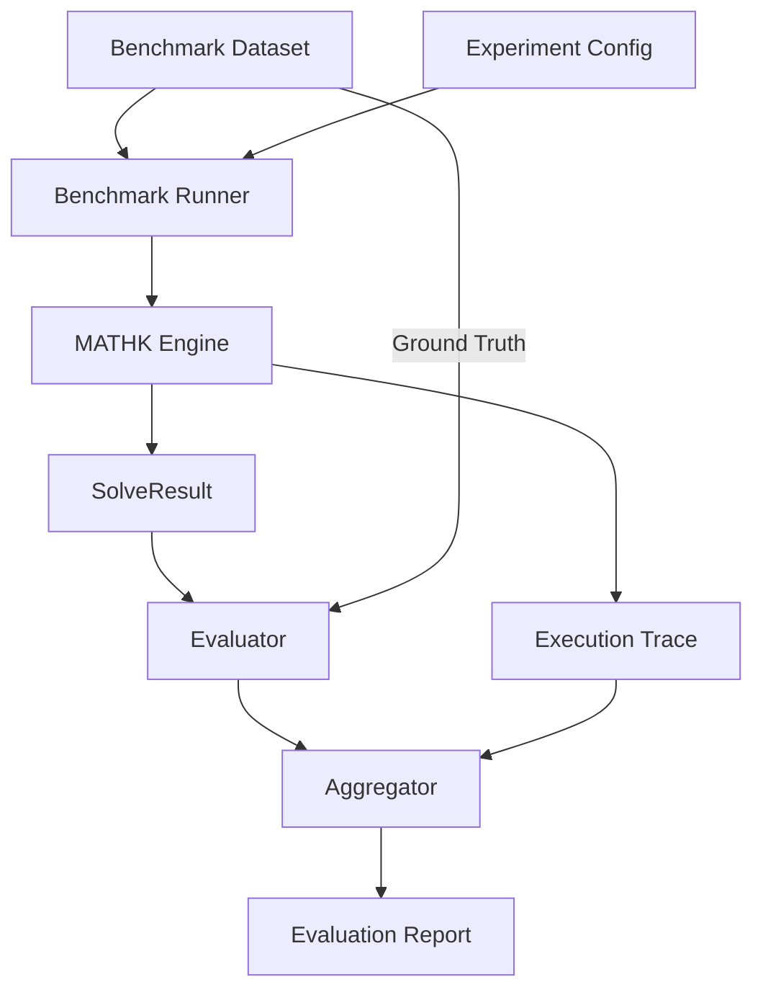

# MATHK — Evaluation

**Phiên bản:** 0.2

**Trạng thái:** Đang thảo luận

**Cấu trúc:** Đã duyệt 10 mục; nội dung từng mục chờ duyệt.

Tham chiếu: [Requirements](01_REQUIREMENTS.md), [System Design — mục 15](03_SYSTEM_DESIGN.md), [Implementation Roadmap](05_IMPLEMENTATION.md), [Research](02_RESEARCH.md).

## 1. Evaluation Objectives & Strategy

**Trạng thái: Đã chốt.**

### 1.1. Mục tiêu
| ID | Mục tiêu | Nội dung |
|---|---|---|
| EO01 | Mathematical Quality | Đáp án và lời giải |
| EO02 | Multimodal Quality | Hiểu hình ảnh |
| EO03 | Knowledge Quality | Truy xuất và áp dụng kiến thức |
| EO04 | Reliability | Kiểm chứng, sửa lỗi, bất định |
| EO05 | Efficiency | Chi phí, token, latency, RAM |
| EO06 | Research Validation | Đóng góp phương pháp |
| EO07 | Reproducibility | Tái lập thực nghiệm |

### 1.2. Cấp độ
EL01 Component: model/agent/tool/retrieval; EL02 Pipeline: RAG/verification/routing/multimodal; EL03 End-to-End: toàn hệ thống; EL04 Research: baseline/ablation/quality-cost.

### 1.3. Phương pháp
Deterministic, symbolic SymPy, human rubric (P0); LLM-as-a-Judge có đối chiếu con người (P1).

### 1.4. Nguyên tắc
Evaluation từ Phase 0; ground truth tách khỏi engine; đánh giá đáp án và lời giải riêng; kiểm soát biến, tránh leakage, không mặc định vượt baseline; đo quality/reliability/efficiency; lưu raw results để đánh giá lại.

### 1.5. Kiến trúc

Evaluation độc lập, không can thiệp quá trình giải toán; theo System Design mục 15.

## 2. Benchmark Dataset Design

*Chưa chốt.*

## 3. Evaluation Metrics

*Chưa chốt.*

## 4. Component-level Evaluation

*Chưa chốt.*

## 5. End-to-End Evaluation

*Chưa chốt.*

## 6. Baseline & Ablation Study

*Chưa chốt.*

## 7. Cost & Performance Evaluation

*Chưa chốt.*

## 8. Reliability & Robustness Evaluation

*Chưa chốt.*

## 9. Experiment Protocol & Reproducibility

*Chưa chốt.*

## 10. Acceptance Criteria & Reporting

*Chưa chốt.*
