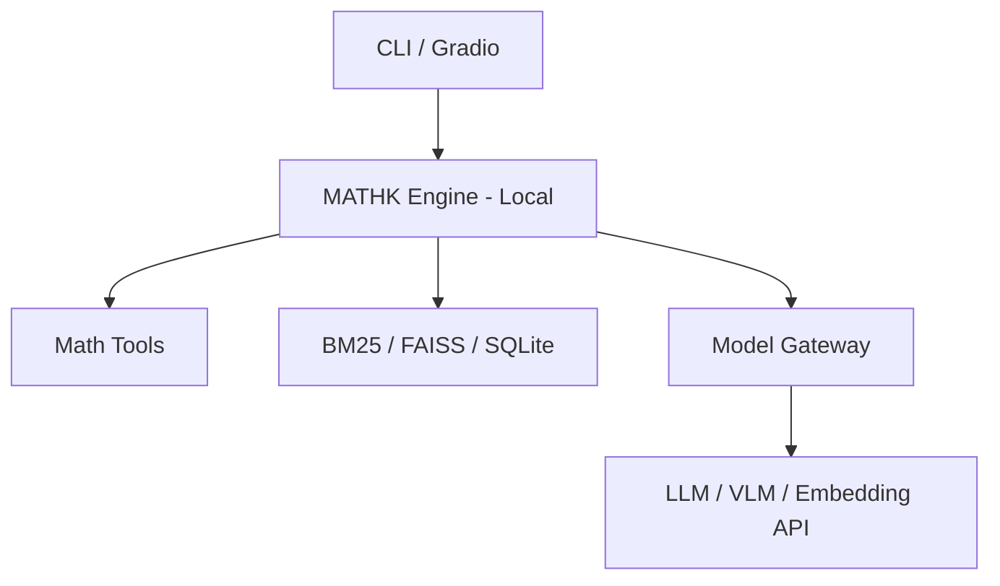

# MATHK — Deployment

**Phiên bản:** 0.2

**Trạng thái:** Đang thảo luận

**Cấu trúc:** Đã duyệt 10 mục; nội dung từng mục chờ duyệt.

**Giả định đã chốt:** Full API Inference + Local-first Deployment. Laptop 8 GB RAM; LLM/VLM/embedding/reranker (nếu dùng) qua API. Cloud thuê tạm thời qua SSH với RAM giả định 16 GB chỉ là phương án tùy chọn khi cần tài nguyên bổ sung, không phụ thuộc GPU hoặc provider cụ thể. Quyết định này thay thế giả định laptop 16 GB và local model inference mặc định trước đây; cần đồng bộ tài liệu liên quan.

## 1. Deployment Strategy

**Trạng thái: Đã chốt.**

Full API Inference + Local-first Deployment. LLM, VLM, embedding và reranker nếu dùng qua API; LangGraph, routing, SymPy/Calculator, BM25/FAISS, SQLite, Gradio và evaluation chạy local. Không load model AI lớn local trong cấu hình chính. GPU cloud không bắt buộc, chỉ tùy chọn thuê tạm qua SSH khi có nhu cầu thực nghiệm riêng. Laptop 8 GB là mục tiêu chạy lightweight cần kiểm chứng bằng đo RAM thực tế. Giữ Modular Monolith và các guard/verification bắt buộc; không đồng nhất full API inference với microservices.

Ưu tiên local development, testing, benchmark và demo; public demo tùy chọn. Free-first trong development, research pin model và cấu hình; chi phí/token/quota được ghi nhận. Docker tùy chọn. Nếu thuê máy tạm, dựng lại môi trường, đồng bộ và xác minh artifacts trước giải phóng tài nguyên. Không Kubernetes, microservices hoặc GPU server thường trực.

## 2. Deployment Architecture

*Chưa chốt.*

## 3. Environment & Dependencies

*Chưa chốt.*

## 4. Model Provider & Gateway

*Chưa chốt.*

## 5. Configuration & Secrets

*Chưa chốt.*

## 6. Data & Persistence

*Chưa chốt.*

## 7. Application Deployment

*Chưa chốt.*

## 8. CI/CD & Release Management

*Chưa chốt.*

## 9. Monitoring & Maintenance

*Chưa chốt.*

## 10. Deployment Checklist

*Chưa chốt.*
