# MATHK — Deployment

**Phiên bản:** 1.0.1

**Trạng thái:** Đã chốt

**Cấu trúc:** Đã duyệt 10/10 mục. Tiêu chí triển khai chưa được kiểm chứng thực tế.

**Giả định đã chốt:** Full API Inference + Local-first Deployment. Laptop 8 GB RAM; LLM/VLM/embedding/reranker (nếu dùng) qua API. Cloud thuê tạm thời qua SSH với RAM giả định 16 GB chỉ là phương án tùy chọn khi cần tài nguyên bổ sung, không phụ thuộc GPU hoặc provider cụ thể. Quyết định này thay thế giả định laptop 16 GB và local model inference mặc định trước đây; đã đồng bộ giả định chính vào tài liệu 03–06; kiểm chứng runtime khi triển khai.

## 1. Deployment Strategy

**Trạng thái: Đã chốt.**

Full API Inference + Local-first Deployment. LLM, VLM, embedding và reranker nếu dùng qua API; LangGraph, routing, SymPy/Calculator, BM25/FAISS, SQLite, Gradio và evaluation chạy local. Không load model AI lớn local trong cấu hình chính. GPU cloud không bắt buộc, chỉ tùy chọn thuê tạm qua SSH khi có nhu cầu thực nghiệm riêng. Laptop 8 GB là mục tiêu chạy lightweight cần kiểm chứng bằng đo RAM thực tế. Giữ Modular Monolith và các guard/verification bắt buộc; không đồng nhất full API inference với microservices.

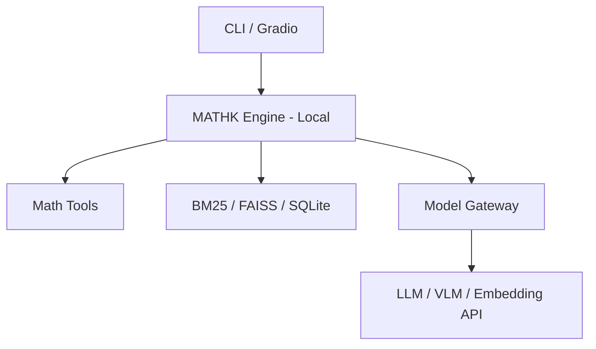

Ưu tiên local development, testing, benchmark và demo; public demo tùy chọn. Free-first trong development, research pin model và cấu hình; chi phí/token/quota được ghi nhận. Docker tùy chọn. Nếu thuê máy tạm, dựng lại môi trường, đồng bộ và xác minh artifacts trước giải phóng tài nguyên. Không Kubernetes, microservices hoặc GPU server thường trực.


## 2. Deployment Architecture

**Trạng thái: Đã chốt.**

### 2.1. Kiến trúc
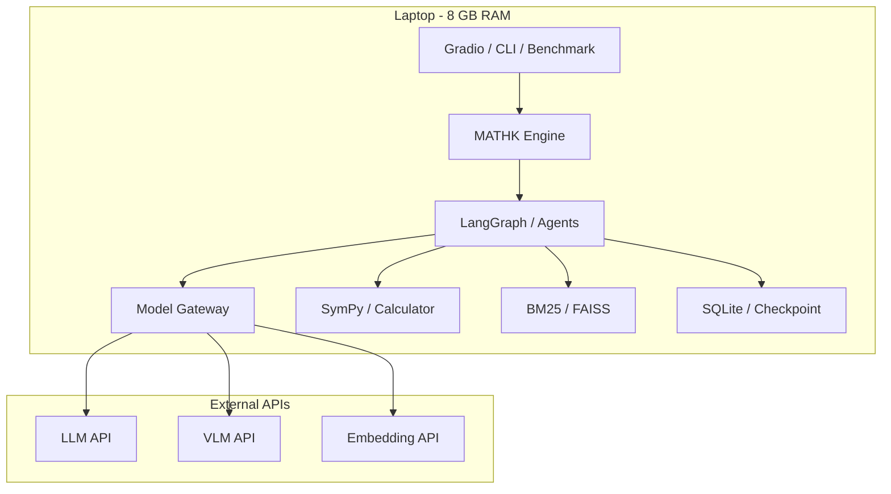

### 2.2. Runtime Profiles
| Thuộc tính | Lightweight | Standard | Research |
|---|---|---|---|
| RAM mục tiêu | 8 GB | 16 GB | 8–16 GB |
| Inference và embedding | API | API | API |
| Concurrency | 1 | Giới hạn | Cố định theo thí nghiệm |
| Retrieval | BM25/Hybrid | Hybrid | Configurable |
| Trace | Cơ bản | Chi tiết | Đầy đủ metadata |
| Fallback | Cho phép | Cho phép | Mặc định tắt |
Không bỏ guard hoặc verification bắt buộc.

### 2.3. Hạ tầng
Modular Monolith; không cần thuê GPU, CUDA, PyTorch/Transformers cho local inference hoặc Docker Desktop trong phát triển. Cloud 16 GB dự phòng khi cần tài nguyên bổ sung.

### 2.4. Rủi ro
Rate limit: bounded retry; outage: configurable fallback; cost: execution budget; mất mạng: checkpoint/resume; model miễn phí thay đổi: gateway; thiếu RAM: sequential execution/lazy loading. Đồng bộ giả định Full API và RAM 8 GB vào tài liệu trước.


## 3. Environment & Dependencies

**Trạng thái: Đã chốt.**

### 3.1. Môi trường
Windows 11, Linux remote khi cần, laptop 8 GB RAM, Python 3.12, uv, VS Code, Codex, Git/GitHub, Full API inference; không yêu cầu CUDA.

### 3.2. Dependencies
| Nhóm | Thư viện |
|---|---|
| Core | Pydantic, PyYAML |
| Model Integration | OpenAI SDK, HTTPX |
| Orchestration | LangGraph |
| Mathematics | SymPy, NumPy |
| Retrieval | rank-bm25, faiss-cpu |
| Persistence | SQLAlchemy, Alembic |
| Multimodal | Pillow |
| Interface | Gradio |
| Evaluation | pandas, NumPy, Matplotlib |
| Monitoring | psutil |
| Testing | pytest, Hypothesis |
| Code Quality | Ruff, mypy |
SciPy, LiteLLM, OpenCV khi cần; không PyTorch, Transformers, Sentence Transformers hoặc GPU inference dependencies mặc định.

### 3.3. Quản lý
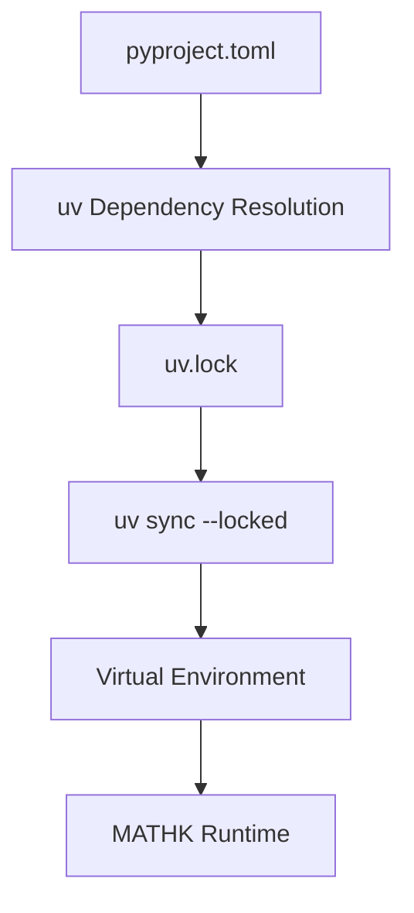
pyproject.toml và uv.lock là nguồn chính; không duy trì requirements.txt song song nếu không cần.

### 3.4. Theo Phase
P0 Pydantic/PyYAML/pytest/Ruff/mypy; OpenAI SDK/HTTPX khi cần cho Mini Lab P0-L05/L06 (kết nối thử nghiệm, chưa gateway production); P1 SymPy/NumPy; P2 tích hợp OpenAI SDK/HTTPX vào Model Gateway chính thức; P3 LangGraph/SQLAlchemy; P4 rank-bm25/faiss-cpu; P5 theo nhu cầu; P6 Pillow/Gradio; P7 pandas/Matplotlib/SciPy tùy chọn. Bổ sung theo nhu cầu, không cài tất cả từ đầu.

### 3.5. Resource Management
Lazy loading, sequential lightweight, không load AI model local, bounded context/state, giải phóng ảnh và dữ liệu trung gian, đo RAM bằng psutil.

### 3.6. Acceptance
Dựng lại từ uv.lock; kiểm chứng chạy trên laptop 8 GB; Windows/Linux trong phạm vi hỗ trợ; không cần GPU/CUDA; dependencies theo nhu cầu.


## 4. Model Provider & Gateway

**Trạng thái: Đã chốt.**

### 4.1. Kiến trúc
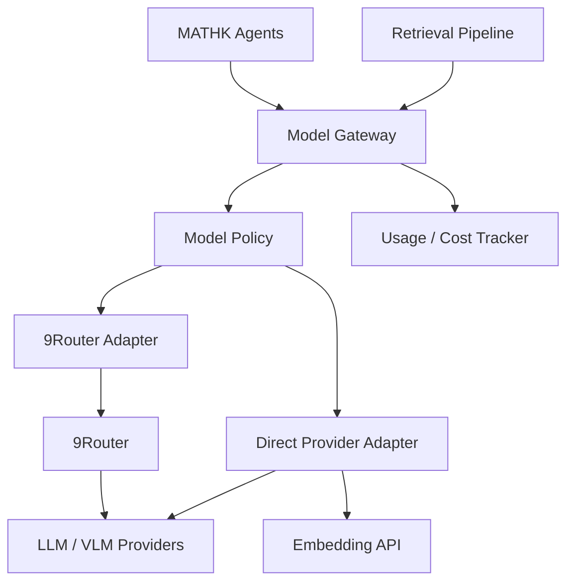
Ưu tiên thử 9Router cho LLM/VLM; embedding trực tiếp nếu proxy không đáp ứng.

### 4.2. Model Profiles
MP01 Lightweight (phân loại/routing/tác vụ đơn giản); MP02 Reasoning (đa bước); MP03 Advanced (khó/correction); MP04 Vision; MP05 Embedding. Vai trò logic, không bắt buộc năm model riêng.

### 4.3. Trách nhiệm
Gateway: model profile, request/response normalization, ngân sách tổng, reasoning escalation, execution trace. 9Router: kết nối provider, provider routing, operational fallback, quota/API monitoring nếu hỗ trợ. Có thể thay proxy không sửa agent logic.

### 4.4. API policy
Development free-first, paid chỉ nếu cho phép, bounded fallback, model linh hoạt. Research theo cấu hình/ngân sách, fallback mặc định tắt, pin model khi có thể, xác minh actual model để so sánh theo model. Usage tracking cả hai; metadata thiếu ghi unknown.

### 4.5. Provider selection
P0 mathematical reasoning, structured output, tool calling, vision cho VLM, embedding quality cho embedding, stability, token cost/quota (theo capability cần thiết). P1 latency/context window. Không chọn chỉ theo parameter count hoặc benchmark công bố.

### 4.6. API failure
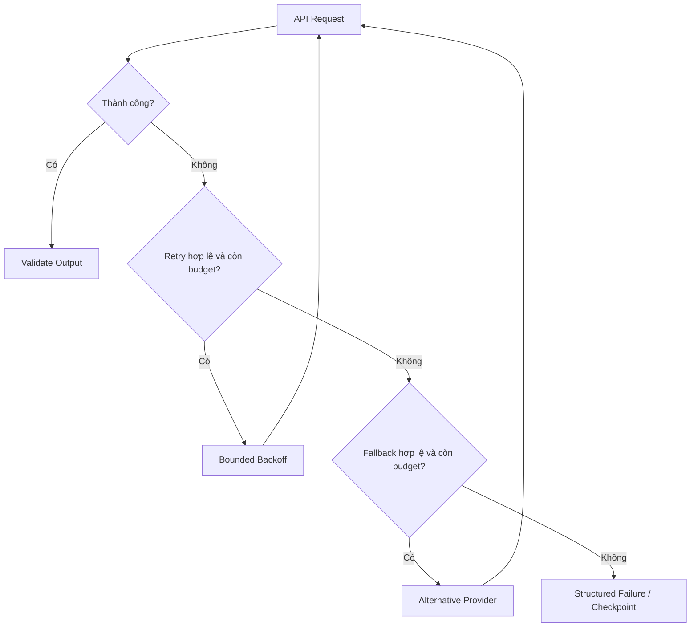
Retry/fallback cùng budget; giới hạn số lần và deadline; tránh retry lồng SDK/proxy/MATHK.

### 4.7. Model selection
Chưa chốt model cụ thể. P0 connectivity; P2 LLM; P4 embedding API; P5 routing; P6 VLM; P7 freeze research config. Custom Model Gateway + OpenAI-compatible SDK + 9Router Adapter + Direct Provider Adapter khi cần.


## 5. Configuration & Secrets

**Trạng thái: Đã chốt.**

### 5.1. Mục tiêu
Thay model/provider/budget/workflow/experiment config không sửa code; bảo vệ secrets.

### 5.2. Tổ chức
configs/default.yaml, configs/profiles/{lightweight,standard,research}.yaml, experiments/configs/, .env, .env.example, .gitignore. Git lưu YAML và mẫu env; không lưu .env thật.

### 5.3. Priority
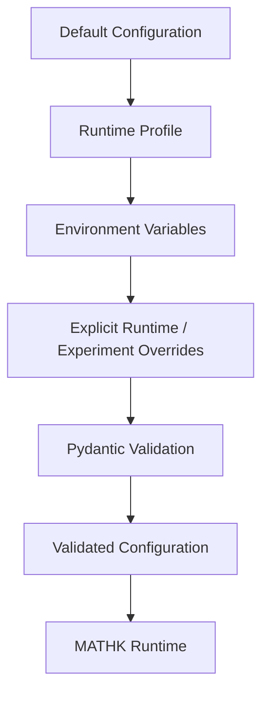
Tầng sau ghi đè tầng trước, ngoại trừ guard bắt buộc.

### 5.4. Nhóm cấu hình
models (ID/provider/params), gateway (endpoint/timeout/retry), agents (profile/capability), routing, retrieval (embedding API/top-k/hybrid), verification, budget, storage, logging, evaluation.

### 5.5. Secrets
Ví dụ .env.example:
```dotenv
MATHK_LLM_API_KEY=
MATHK_VLM_API_KEY=
MATHK_EMBEDDING_API_KEY=
MATHK_9ROUTER_API_KEY=
```
Không hard-code hoặc lưu key trong YAML/prompt/log/trace. GitHub Actions Secrets chỉ khi CI cần API; secrets riêng khi thuê máy; thu hồi và tạo lại key bị lộ. Không Vault/Cloud Secrets Manager MVP.

### 5.6. Validation
Thiếu key cần thiết: báo lỗi rõ; capability không phù hợp: từ chối hoặc fallback hợp lệ; budget sai: không chạy; path sai: báo lỗi hoặc khởi tạo an toàn; fallback trái policy: từ chối; research config thay đổi: phiên bản experiment mới. Kiểm thử capability thực tế ngoài YAML validation.

### 5.7. Reproducibility
Lưu snapshot cấu hình hiệu lực đã loại secrets, config hash, model ID, prompt version và Git commit mỗi benchmark. YAML + Pydantic Settings + .env + GitHub Secrets khi cần.


## 6. Data & Persistence

**Trạng thái: Đã chốt.**

### 6.1. Storage
SQLite cho session/problem/solution/KB; LangGraph SQLite checkpoint; FAISS vector index; JSONL trace; JSON/JSONL dataset; JSONL/JSON/CSV experiment results; local files cho ảnh.

### 6.2. Kiến trúc
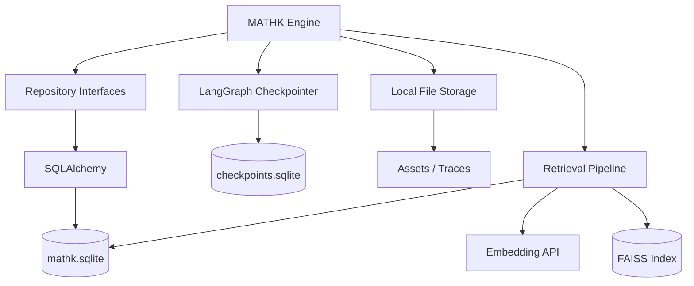

### 6.3. Cấu trúc
```text
data/
  knowledge/
    sources/
    processed/
  datasets/
    raw/
    processed/
  runtime/
    mathk.sqlite
    checkpoints.sqlite
    assets/
    indexes/
    traces/
experiments/
  configs/
  results/
  exports/
```
Theo 04_PROJECT_STRUCTURE.md.

### 6.4. Embedding Index
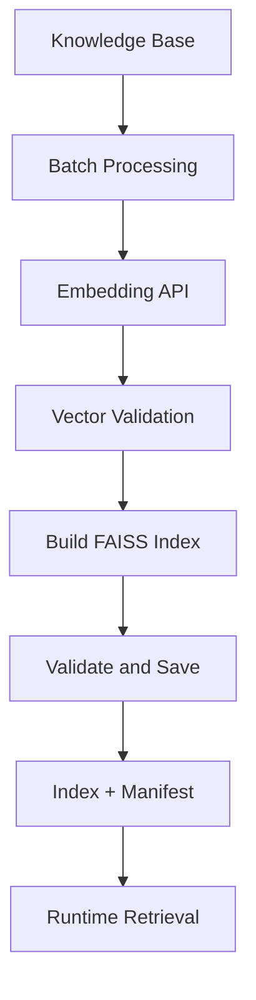
Rebuild khi KB hoặc embedding config thay đổi; không embed toàn KB mỗi lần startup. Manifest gồm model ID, dimension, normalization, KB version, checksum và metadata theo System Design.

### 6.5. Backup
GitHub cho code; versioned KB backup; consistent SQLite backup; FAISS backup/rebuild; experiment backup theo ID; checkpoint theo workflow; dọn temp. Xác minh artifacts đã đồng bộ trước giải phóng cloud thuê.

### 6.6. RAM 8 GB
Không load toàn dataset; bounded embedding batches; load index cần thiết; JSONL tuần tự; lịch sử SQLite, bounded shared state; cách ly ground truth.

### 6.7. Stack
SQLite, SQLAlchemy, Alembic, FAISS CPU, local files, Embedding API. Không vector DB server, Redis, PostgreSQL, MongoDB, cloud storage bắt buộc trong MVP. Giữ hybrid retrieval và agentic RAG, không load embedding model local.


## 7. Application Deployment

**Trạng thái: Đã chốt.**

### 7.1. Phương thức
Python API, CLI, Gradio P0; Docker và public web demo P1.

### 7.2. Entry points
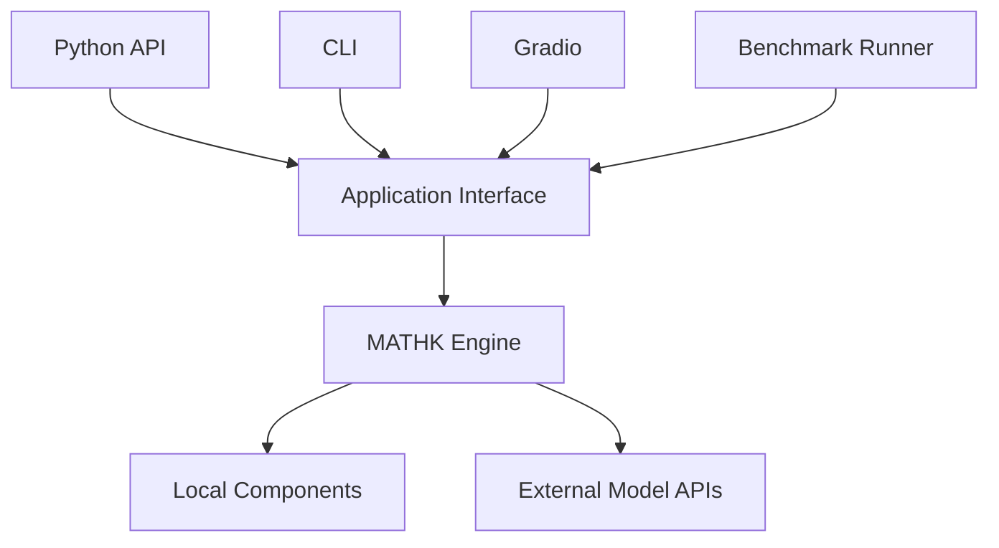
Dùng chung engine, không nhân bản logic.

### 7.3. Cài đặt dự kiến
```bash
git clone https://github.com/kienng221105/MathAgents_MATHK.git
cd MathAgents_MATHK
uv sync --locked
```
Thiết lập .env, runtime profile và kiểm tra API.

### 7.4. CLI dự kiến
uv run mathk solve; demo; resume; kb build; benchmark run; benchmark resume; benchmark export; trace (đều dùng tiền tố uv run mathk). Chưa phải lệnh đã triển khai.

### 7.5. Gradio
Localhost, public share mặc định tắt; Student/Research Mode. Giao diện nhập text/ảnh, hiện lời giải, đáp án, verification, model/tool calls theo chế độ. Không hiển thị Verified khi chưa có report hợp lệ.

### 7.6. Docker/Remote
Docker tùy chọn, không bắt buộc Docker Desktop. SSH và SSH port forwarding để truy cập Gradio remote không công khai cổng ứng dụng. Public demo cần đánh giá lại bảo mật.

### 7.7. Startup validation
Kiểm tra config/key cần thiết, storage writable, index compatibility, profile/budget, API connectivity theo tác vụ. Không bắt buộc mọi provider hoạt động để mở CLI/UI. Native uv là triển khai chính; Docker/remote bổ sung.


## 8. CI/CD & Release Management

**Trạng thái: Đã chốt.**

### 8.1. Chiến lược
GitHub Actions, uv.lock, pytest, Ruff, mypy, Git Tags/GitHub Releases; CD chưa bắt buộc.

### 8.2. CI Pipeline
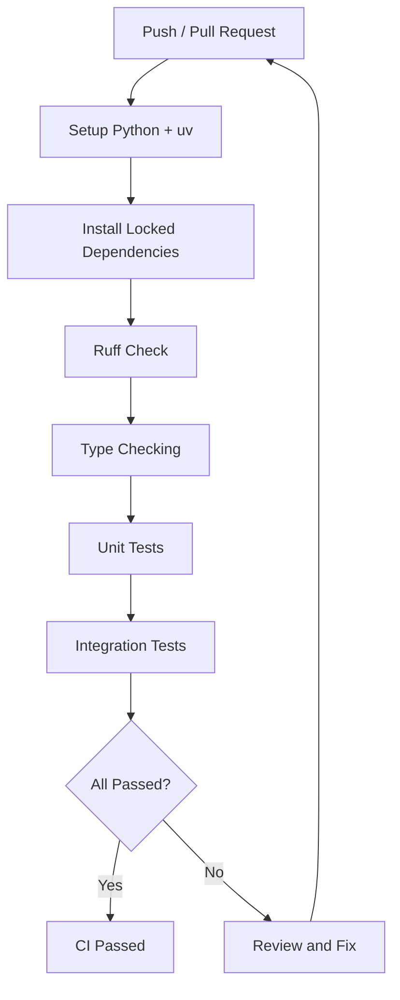
Linux runner chính, Windows compatibility test theo nhu cầu.

### 8.3. Chi phí
Push/PR chạy lint, type check, unit test, mock API integration; không gọi LLM/VLM/embedding API thật hoặc full benchmark mặc định. Real API test chủ động, budget riêng.

### 8.4. Human-in-the-loop
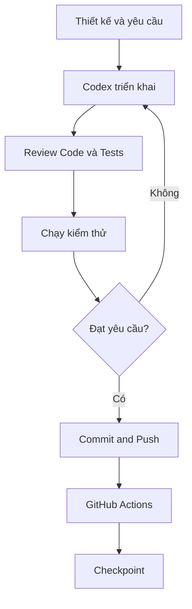
Người học thiết kế, hiểu, đánh giá; Codex triển khai; CI không thay review.

### 8.5. Release
| Version | Milestone | Phase |
|---|---|---|
| v0.1.0 | MVP A — Text Solver | 0–2 |
| v0.2.0 | MVP B — Grounded Multi-Agent | 3–4 |
| v0.3.0 | MVP C — Adaptive Multimodal | 5–6 |
| v1.0.0 | MVP D — Research Prototype | 7 |
Version phần mềm độc lập tài liệu. Release ghi commit, changelog, sample config, test results, limitations.

### 8.6. Release Gate
CI pass, milestone acceptance, versioned dependencies/config, docs và learning checkpoint cập nhật, không secrets/dữ liệu nhạy cảm.

### 8.7. CD
Local-first, phát hành/triển khai chủ động; không Jenkins/Kubernetes/MLflow hoặc MLOps phức tạp trong MVP.


## 9. Monitoring & Maintenance

**Trạng thái: Đã chốt.**

### 9.1. Monitoring Objectives
MO01 Resource (RAM/CPU/disk); MO02 Model (ID/provider/tokens); MO03 Cost (chi phí/quota/budget); MO04 Performance (latency/throughput); MO05 Agent (routing/calls/state); MO06 Reliability (errors/retry/fallback); MO07 Quality (verification/correction/uncertainty); MO08 Storage (DB/index/checkpoint).

### 9.2. Architecture
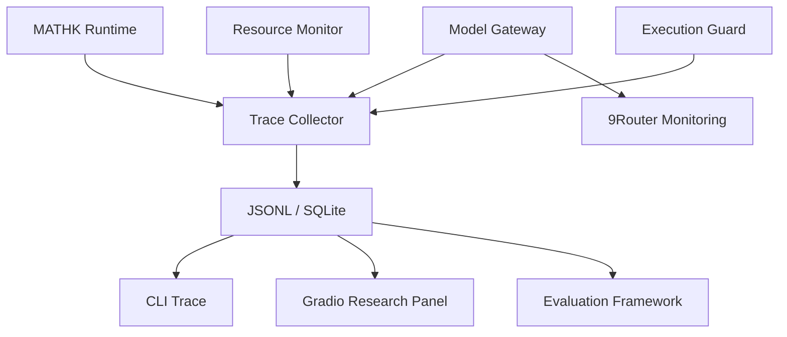
9Router bổ sung giám sát API nếu hỗ trợ; MATHK tự giám sát agent/reasoning/verification/resource.

### 9.3. Stack
Python logging, psutil, JSONL, SQLite, 9Router tùy khả năng, Gradio, pandas/Matplotlib. Không Prometheus/Grafana/LangSmith/Langfuse trong MVP.

### 9.4. Research Dashboard
Hiển thị application RAM, latency, total tokens, estimated API cost, execution trace theo agent và verification status hợp lệ. Không coi số liệu minh họa là benchmark thực tế.

### 9.5. Runtime Protection
Vượt RAM: giảm tải/checkpoint/dừng an toàn; hết quota: fallback hợp lệ hoặc dừng; hết budget: guard chặn tác vụ tiếp theo; agent loop: bounded execution; index không tương thích: từ chối và yêu cầu rebuild; checkpoint lỗi: kiểm tra/phục hồi/báo lỗi. Ngưỡng hiệu năng xác định qua thực nghiệm.

### 9.6. Maintenance
Kiểm tra provider khi model/endpoint đổi; cập nhật dependencies có kiểm soát và regression test; backup DB/kết quả; dọn logs/cache/temp; rebuild index khi cần; cập nhật docs/learning checkpoint.

### 9.7. Principles
Lightweight Local Observability; không ghi secrets, hạn chế overhead và đo ảnh hưởng tới benchmark; chi phí chưa xác định ghi unknown, không mặc định 0. Không phụ thuộc nền tảng monitoring bên ngoài.


## 10. Deployment Checklist

**Trạng thái: Đã chốt.**

### 10.1. Acceptance
| ID | Tiêu chí | Priority |
|---|---|---|
| DA01 | Tái dựng từ uv.lock | P0 |
| DA02 | Lightweight chạy trên laptop 8 GB | P0 |
| DA03 | Full API, không GPU | P0 |
| DA04 | Model Gateway hoạt động đúng | P0 |
| DA05 | Config/secrets an toàn | P0 |
| DA06 | Storage/checkpoint/recovery | P0 |
| DA07 | CLI/Gradio | P0 |
| DA08 | CI pass | P0 |
| DA09 | Monitoring/budget tracking | P0 |
| DA10 | Tái lập cấu hình thực nghiệm | P0 |
| DA11 | Docker | P1 |
| DA12 | Remote/public demo | P1 |

### 10.2. Checklist
- [ ] Python/uv đúng phiên bản
- [ ] Locked dependencies
- [ ] Kiểm thử laptop 8 GB
- [ ] LLM/VLM/embedding API
- [ ] Model capabilities
- [ ] Retry/fallback/budget
- [ ] API key an toàn
- [ ] DB/index tương thích
- [ ] Checkpoint/recovery
- [ ] Ground truth isolation
- [ ] CLI/Gradio
- [ ] E2E tests
- [ ] RAM/token/cost tracking
- [ ] CI pass
- [ ] Docs cập nhật
- [ ] Artifacts lưu trữ
- [ ] Learning checkpoint cập nhật

### 10.3. Workflow
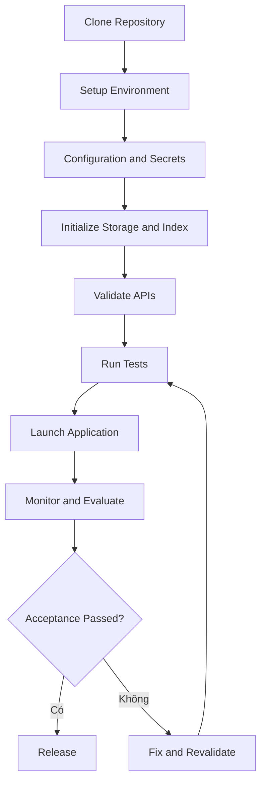

### 10.4. Definition of Done
P0 được kiểm chứng thực tế; không GPU/local model inference; tái dựng môi trường máy khác; phục hồi gián đoạn; hướng dẫn cài đặt/vận hành/xử lý lỗi; bảo toàn artifacts và kết quả nghiên cứu.

### 10.5. Tổng kết
Local-first + Full API; laptop 8 GB; Modular Monolith; Python 3.12/uv; custom gateway; SQLite/FAISS; CLI/Gradio; GitHub Actions; lightweight local observability; cloud/GPU không bắt buộc.

