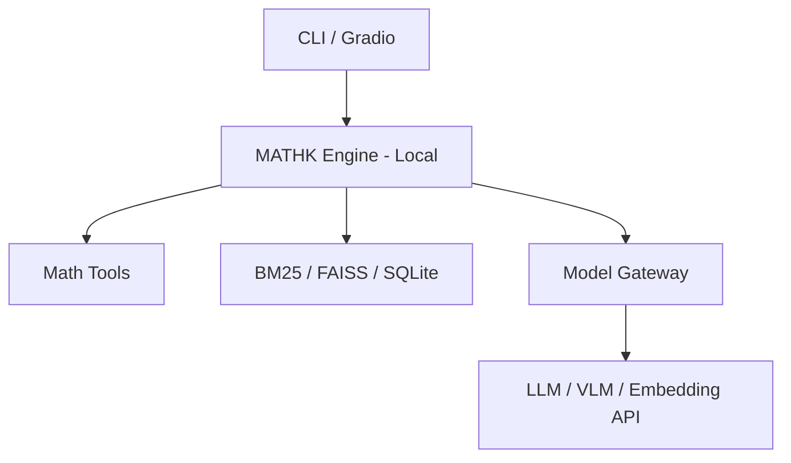
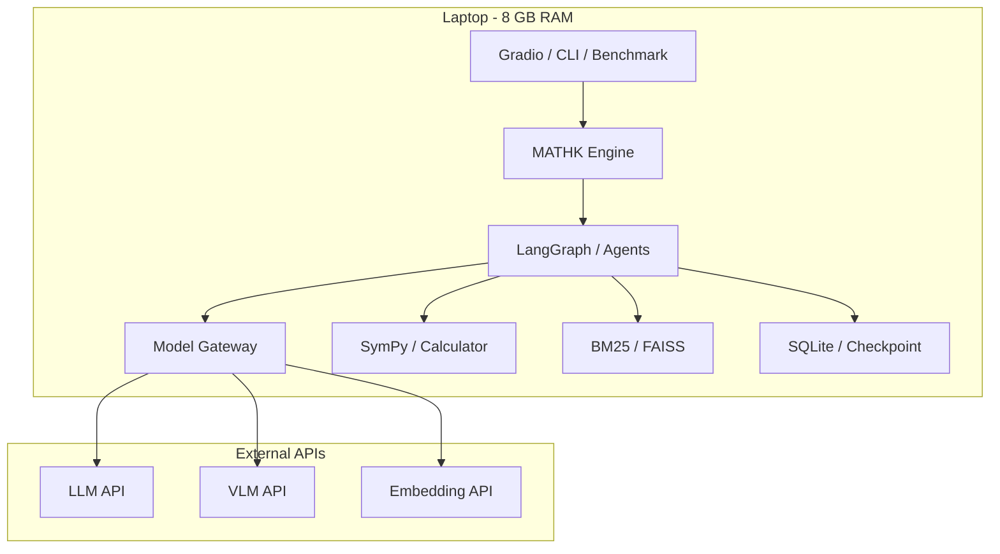
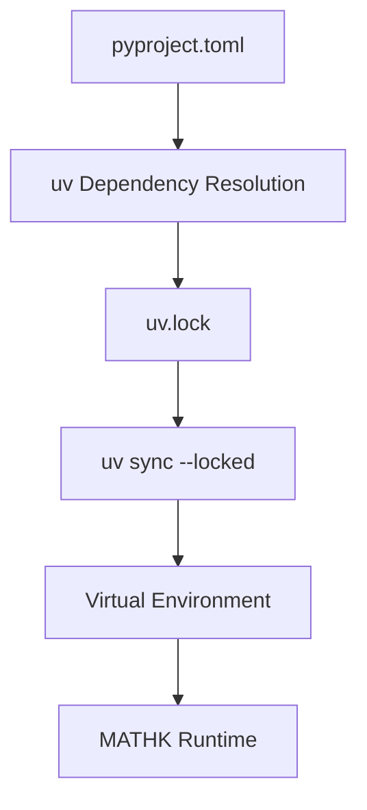

# MATHK — Deployment

**Phiên bản:** 0.4

**Trạng thái:** Đang thảo luận

**Cấu trúc:** Đã duyệt 10 mục; nội dung từng mục chờ duyệt.

**Giả định đã chốt:** Full API Inference + Local-first Deployment. Laptop 8 GB RAM; LLM/VLM/embedding/reranker (nếu dùng) qua API. Cloud thuê tạm thời qua SSH với RAM giả định 16 GB chỉ là phương án tùy chọn khi cần tài nguyên bổ sung, không phụ thuộc GPU hoặc provider cụ thể. Quyết định này thay thế giả định laptop 16 GB và local model inference mặc định trước đây; cần đồng bộ tài liệu liên quan.

## 1. Deployment Strategy

**Trạng thái: Đã chốt.**

Full API Inference + Local-first Deployment. LLM, VLM, embedding và reranker nếu dùng qua API; LangGraph, routing, SymPy/Calculator, BM25/FAISS, SQLite, Gradio và evaluation chạy local. Không load model AI lớn local trong cấu hình chính. GPU cloud không bắt buộc, chỉ tùy chọn thuê tạm qua SSH khi có nhu cầu thực nghiệm riêng. Laptop 8 GB là mục tiêu chạy lightweight cần kiểm chứng bằng đo RAM thực tế. Giữ Modular Monolith và các guard/verification bắt buộc; không đồng nhất full API inference với microservices.

Ưu tiên local development, testing, benchmark và demo; public demo tùy chọn. Free-first trong development, research pin model và cấu hình; chi phí/token/quota được ghi nhận. Docker tùy chọn. Nếu thuê máy tạm, dựng lại môi trường, đồng bộ và xác minh artifacts trước giải phóng tài nguyên. Không Kubernetes, microservices hoặc GPU server thường trực.

## 2. Deployment Architecture

**Trạng thái: Đã chốt.**

### 2.1. Kiến trúc

### 2.2. Runtime Profiles
| Thuộc tính | Lightweight | Standard | Research |
|---|---|---|---|
| RAM mục tiêu | 8 GB | 16 GB | 8–16 GB |
| Inference và embedding | API | API | API |
| Concurrency | 1 | Giới hạn | Cố định theo thí nghiệm |
| Retrieval | BM25/Hybrid | Hybrid | Configurable |
| Trace | Cơ bản | Chi tiết | Đầy đủ metadata |
| Fallback | Cho phép | Cho phép | Mặc định tắt |
Không bỏ guard hoặc verification bắt buộc.

### 2.3. Hạ tầng
Modular Monolith; không cần thuê GPU, CUDA, PyTorch/Transformers cho local inference hoặc Docker Desktop trong phát triển. Cloud 16 GB dự phòng khi cần tài nguyên bổ sung.

### 2.4. Rủi ro
Rate limit: bounded retry; outage: configurable fallback; cost: execution budget; mất mạng: checkpoint/resume; model miễn phí thay đổi: gateway; thiếu RAM: sequential execution/lazy loading. Đồng bộ giả định Full API và RAM 8 GB vào tài liệu trước.

## 3. Environment & Dependencies

**Trạng thái: Đã chốt.**

### 3.1. Môi trường
Windows 11, Linux remote khi cần, laptop 8 GB RAM, Python 3.12, uv, VS Code, Codex, Git/GitHub, Full API inference; không yêu cầu CUDA.

### 3.2. Dependencies
| Nhóm | Thư viện |
|---|---|
| Core | Pydantic, PyYAML |
| Model Integration | OpenAI SDK, HTTPX |
| Orchestration | LangGraph |
| Mathematics | SymPy, NumPy |
| Retrieval | rank-bm25, faiss-cpu |
| Persistence | SQLAlchemy, Alembic |
| Multimodal | Pillow |
| Interface | Gradio |
| Evaluation | pandas, NumPy, Matplotlib |
| Monitoring | psutil |
| Testing | pytest, Hypothesis |
| Code Quality | Ruff, mypy |
SciPy, LiteLLM, OpenCV khi cần; không PyTorch, Transformers, Sentence Transformers hoặc GPU inference dependencies mặc định.

### 3.3. Quản lý

pyproject.toml và uv.lock là nguồn chính; không duy trì requirements.txt song song nếu không cần.

### 3.4. Theo Phase
P0 Pydantic/pytest/Ruff/mypy; P1 SymPy/NumPy; P2 OpenAI SDK/HTTPX; P3 LangGraph/SQLAlchemy; P4 rank-bm25/faiss-cpu; P5 theo nhu cầu; P6 Pillow/Gradio; P7 pandas/Matplotlib/SciPy tùy chọn. Bổ sung theo nhu cầu, không cài tất cả từ đầu.

### 3.5. Resource Management
Lazy loading, sequential lightweight, không load AI model local, bounded context/state, giải phóng ảnh và dữ liệu trung gian, đo RAM bằng psutil.

### 3.6. Acceptance
Dựng lại từ uv.lock; kiểm chứng chạy trên laptop 8 GB; Windows/Linux trong phạm vi hỗ trợ; không cần GPU/CUDA; dependencies theo nhu cầu.

## 4. Model Provider & Gateway

*Chưa chốt.*

## 5. Configuration & Secrets

*Chưa chốt.*

## 6. Data & Persistence

*Chưa chốt.*

## 7. Application Deployment

*Chưa chốt.*

## 8. CI/CD & Release Management

*Chưa chốt.*

## 9. Monitoring & Maintenance

*Chưa chốt.*

## 10. Deployment Checklist

*Chưa chốt.*
