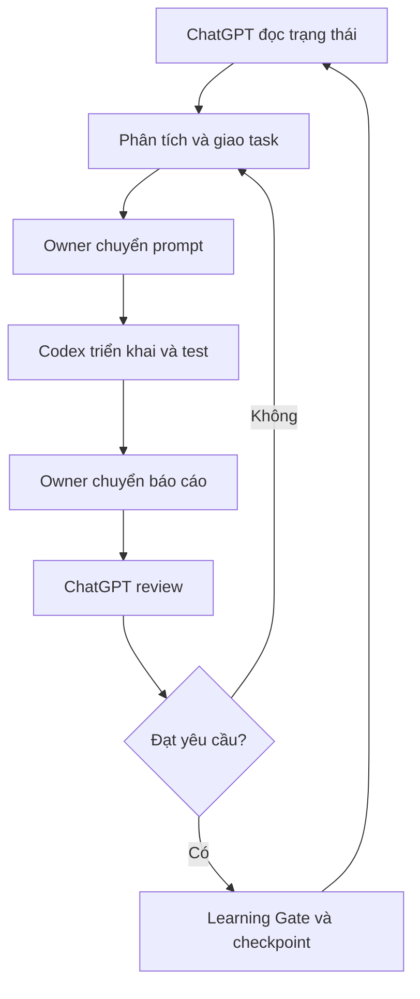
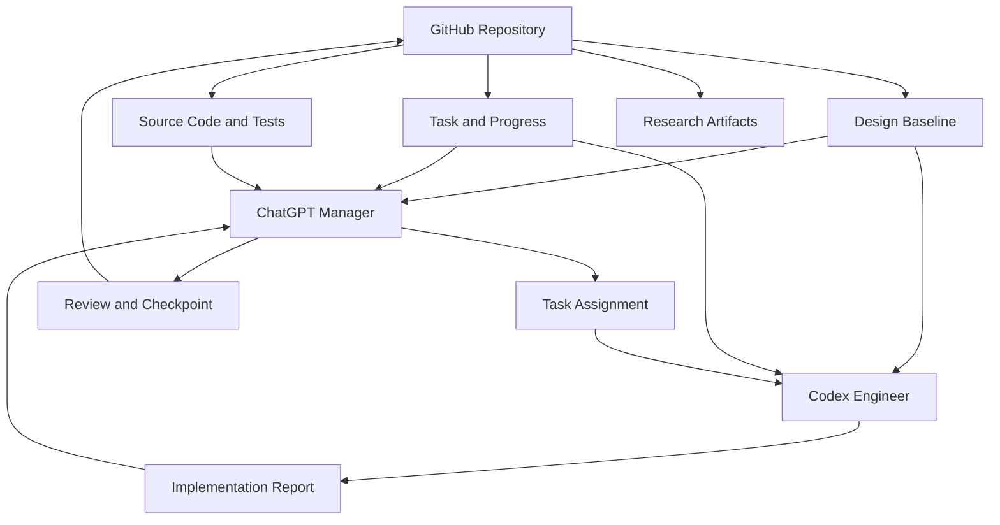
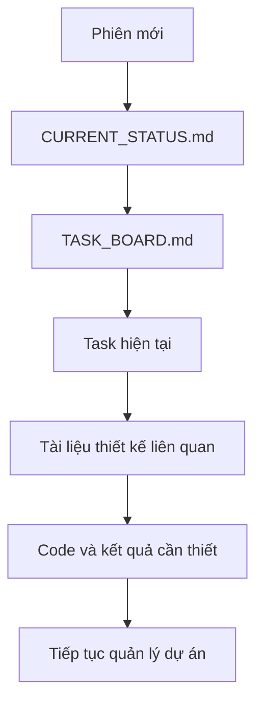
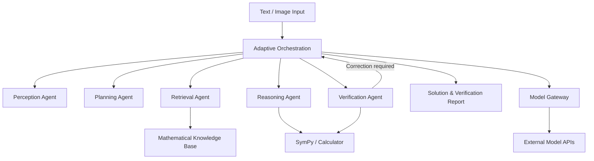
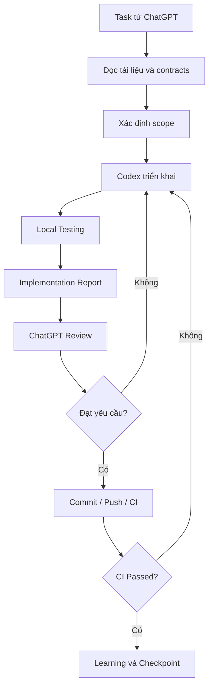

# MATHK — Documentation

**Phiên bản:** 0.5

**Trạng thái:** Đang thảo luận

## 1. Project Management & Agent Collaboration

**Trạng thái: Đã chốt.**

Project Owner (người học) giữ quyền quyết định cuối cùng, thiết kế và học tập; ChatGPT là Project Manager & Technical Lead, quản lý context, chia task, soạn prompt, review và hướng dẫn; Codex là Software Engineer, triển khai code, test, sửa lỗi và báo cáo. Owner chuyển tiếp prompt và báo cáo giữa hai agent. GitHub là Single Source of Truth.



Prompt tiếng Việt: Task ID, Context, Objective, References, Scope, Requirements, Constraints, Acceptance Criteria, Testing, Deliverables, Report Format. Codex không tự đổi kiến trúc, thêm dependency, vượt scope hoặc phase; báo cáo file thay đổi, test results, quyết định, lỗi và vấn đề tồn tại; dừng báo cáo mâu thuẫn. ChatGPT đối chiếu báo cáo với yêu cầu và đọc code/diff khi cần, không mặc định báo cáo đúng.

Task lifecycle: PLANNED → ASSIGNED → IN_PROGRESS → IN_REVIEW → ACCEPTED → COMPLETED; NEEDS_REVISION quay lại triển khai. COMPLETED cần Engineering Gate, Learning Gate và Checkpoint Gate. Owner giữ quyền phê duyệt quyết định quan trọng.

Quản lý dài hạn: AGENTS.md; docs/management/WORKFLOW.md, TASK_BOARD.md, DECISION_LOG.md; docs/progress/CURRENT_STATUS.md và phase_00.md, các phase tiếp theo theo nhu cầu. Checkpoint sau từng task nghiệm thu, không chờ context gần đầy. CURRENT_STATUS ghi phase, task, kết quả, vấn đề mở và bước tiếp theo. Các file bổ sung sẽ được tạo theo nhu cầu, chưa mặc định tồn tại.

Trọng tâm học: system/model/data thinking, cost optimization, research methodology, technical review; Codex đảm nhiệm phần lớn code. ChatGPT giao việc bằng prompt cho Owner chuyển tiếp, không tuyên bố điều khiển trực tiếp Codex.

## 2. Documentation Strategy

**Trạng thái: Đã chốt.**

### 2.1. Mục tiêu
DO01 nhất quán kiến trúc; DO02 khôi phục context; DO03 hướng dẫn coding agent; DO04 tiến độ/năng lực; DO05 quyết định kỹ thuật; DO06 tái lập nghiên cứu; DO07 bàn giao/vận hành.

### 2.2. Phân loại
Design (8 tài liệu), Management (task/workflow/decisions), Agent (AGENTS.md), Learning (labs/competency), Technical (API/schema/interface), Research (benchmark/experiment/paper), Operational (setup/vận hành/lỗi).

### 2.3. Single Source of Truth

Owner chuyển tiếp prompt/report; đọc trạng thái GitHub trước khi giao task trong phiên mới. Artifacts lớn hoặc riêng tư lưu ngoài Git, manifest và tham chiếu version hóa theo tài liệu 04/06.

### 2.4. Principles
Docs-first, Single Source of Truth, Living Documentation, Traceability (Requirement → Design → Task → Code → Test), Incremental Documentation, Context-efficient, Vietnamese-first.

### 2.5. Quyền quản lý
ChatGPT đề xuất thiết kế, Owner phê duyệt; ChatGPT quản lý task và kiểm tra nhất quán; Codex cập nhật tài liệu kỹ thuật theo code trong scope; ChatGPT và Owner cập nhật learning checkpoint. Codex không tự sửa baseline để hợp thức hóa code sai. Documentation-driven Development + AI-assisted Project Management.


## 3. Documentation Structure

**Trạng thái: Đã chốt.**

### 3.1. Cấu trúc
```text
MathAgents_MATHK/
├── README.md
├── AGENTS.md
├── docs/
│   ├── 01_REQUIREMENTS.md
│   ├── 02_RESEARCH.md
│   ├── 03_SYSTEM_DESIGN.md
│   ├── 04_PROJECT_STRUCTURE.md
│   ├── 05_IMPLEMENTATION.md
│   ├── 06_EVALUATION.md
│   ├── 07_DEPLOYMENT.md
│   ├── 08_DOCUMENTATION.md
│   ├── management/
│   │   ├── WORKFLOW.md
│   │   ├── TASK_BOARD.md
│   │   └── DECISION_LOG.md
│   ├── progress/
│   │   ├── CURRENT_STATUS.md
│   │   └── phase_00.md ...
│   ├── guides/
│   │   ├── DEVELOPER_GUIDE.md
│   │   ├── USER_GUIDE.md
│   │   └── TROUBLESHOOTING.md
│   ├── technical/
│   │   ├── API_REFERENCE.md
│   │   └── DATA_CONTRACTS.md
│   └── research/
│       ├── EXPERIMENT_LOG.md
│       ├── RESULTS_ANALYSIS.md
│       └── PAPER_DRAFT.md
└── labs/
    └── phase_00/ ...
```

### 3.2. Ownership
ChatGPT: AGENTS, WORKFLOW, TASK_BOARD, DECISION_LOG, CURRENT_STATUS; ChatGPT + Owner: phase_XX; Codex: API_REFERENCE, DATA_CONTRACTS theo scope và review.

### 3.3. Context


### 3.4. Thời điểm
Trước Phase 0: AGENTS, WORKFLOW, TASK_BOARD, CURRENT_STATUS, DECISION_LOG. Phase 0–1: README, Developer Guide, Mini Labs. Phase 2–3: API Reference, Data Contracts. Phase 4–6: User Guide, Troubleshooting. Phase 7: Experiment Log, Results Analysis, Paper Draft.

### 3.5. Nguyên tắc
Không tạo file rỗng hàng loạt; tránh sao chép, dùng liên kết Markdown; mỗi thông tin một nguồn chính thức; cập nhật sau từng task/quyết định quan trọng. Ưu tiên bộ tài liệu quản lý agent trước Phase 0.


## 4. Project README

**Trạng thái: Đã chốt.**

### 4.1. Mục tiêu
Trang giới thiệu kỹ thuật và nghiên cứu cho giảng viên, nhà tuyển dụng, nhà nghiên cứu và developer; không chỉ giới thiệu ứng dụng giải toán.

### 4.2. Cấu trúc
Project Overview, Problem Statement, Research Objectives, Key Features, System Architecture, Technology Stack, Demo, Quick Start, Project Structure, Evaluation Results, Development Roadmap, Documentation, Limitations, References & License.

### 4.3. Sơ đồ tổng quan

Sơ đồ tổng quan, không quy định thứ tự thực thi cố định; các kết nối logic tuân thủ gateway/guard/interface trong System Design.

### 4.4. Cập nhật theo milestone
Phase 0: giới thiệu, mục tiêu, môi trường, roadmap. MVP A: Quick Start và ví dụ Text Solver. MVP B: Multi-Agent và Retrieval. MVP C: demo, Adaptive Routing, Verification. MVP D: benchmark, ablation, kết quả và giới hạn.

### 4.5. Nguyên tắc
Phân biệt tính năng thực tế/dự kiến; không công bố benchmark giả lập như kết quả thật, không khẳng định novelty chưa kiểm chứng. Liên kết System Design thay sao chép. Tiếng Việt, giữ thuật ngữ tiếng Anh; README_EN.md P1 khi công bố hoặc ứng tuyển.

### 4.6. Ownership
ChatGPT định hướng; Codex cập nhật lệnh/ví dụ thực tế; ChatGPT và Owner xác minh kết quả; Owner phê duyệt công bố.


## 5. Developer Guide

**Trạng thái: Đã chốt.**

### 5.1. Mục tiêu
docs/guides/DEVELOPER_GUIDE.md hướng dẫn Owner, Codex và developer phát triển hệ thống, không dạy Python từ đầu.

### 5.2. Cấu trúc
Development Environment, Getting Started, Architecture Overview, Coding Standards, Dependency Management, Extension Guide, Testing Guide, Debugging Guide, Git Workflow, Contribution Rules.

### 5.3. Extension Guide
| Mở rộng | Thành phần |
|---|---|
| LLM Provider | Model Gateway |
| Agent | Agent Contract, Orchestrator |
| Math Tool | Tool Registry, Execution Guard |
| Retrieval | Retrieval Interface |
| Routing | Adaptive Router |
| Verification | Verification Interface |
| Metric | Evaluation Framework |
| UI | Application Interface |

Mỗi hướng dẫn gồm mục đích, module, data contract, sơ đồ luồng, ví dụ triển khai và kiểm thử.

### 5.4. Workflow

Owner chuyển tiếp prompt/report.

### 5.5. Quy tắc
Tuân thủ Modular Monolith và Dependency Rules; tái sử dụng interface, tránh abstraction thừa; dependency mới cần lý do/phê duyệt; thay đổi hành vi cần test; không bypass Execution Guard, không vượt scope; cập nhật tài liệu kỹ thuật khi interface đổi.

### 5.6. Developer Guide và AGENTS.md
Developer Guide giải thích kiến trúc, ví dụ, hướng dẫn mở rộng cho người và agent, cập nhật theo phase. AGENTS.md ngắn gọn, có tính chỉ thị, quy định hành vi và ràng buộc cho coding agent, cập nhật khi quy trình thay đổi.

### 5.7. Ownership
ChatGPT định hướng/review; Codex bổ sung theo implementation thực tế; Owner dùng tài liệu để học và đánh giá quyết định. Phát triển dần theo phase, ưu tiên Extension Guide và System Thinking.


## 6. AI Agent Instructions

*Chưa chốt.*

## 7. Learning Documentation

*Chưa chốt.*

## 8. Architecture & API Documentation

*Chưa chốt.*

## 9. Research Documentation

*Chưa chốt.*

## 10. User & Deployment Guide

*Chưa chốt.*

## 11. Context & Progress Management

*Chưa chốt.*

## 12. Documentation Maintenance

*Chưa chốt.*
