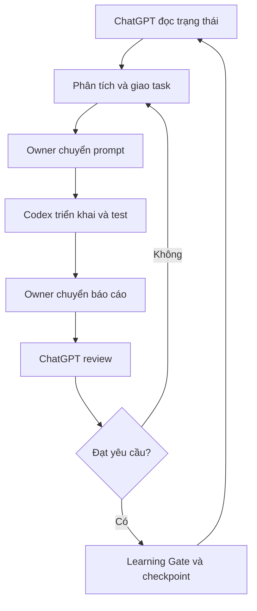
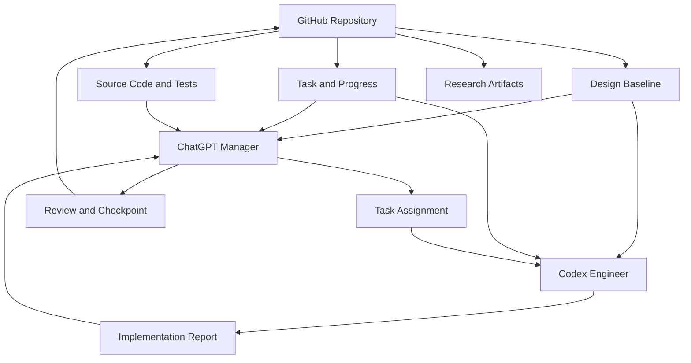

# MATHK — Documentation

**Phiên bản:** 0.2

**Trạng thái:** Đang thảo luận

## 1. Project Management & Agent Collaboration

**Trạng thái: Đã chốt.**

Project Owner (người học) giữ quyền quyết định cuối cùng, thiết kế và học tập; ChatGPT là Project Manager & Technical Lead, quản lý context, chia task, soạn prompt, review và hướng dẫn; Codex là Software Engineer, triển khai code, test, sửa lỗi và báo cáo. Owner chuyển tiếp prompt và báo cáo giữa hai agent. GitHub là Single Source of Truth.

Prompt tiếng Việt: Task ID, Context, Objective, References, Scope, Requirements, Constraints, Acceptance Criteria, Testing, Deliverables, Report Format. Codex không tự đổi kiến trúc, thêm dependency, vượt scope hoặc phase; báo cáo file thay đổi, test results, quyết định, lỗi và vấn đề tồn tại; dừng báo cáo mâu thuẫn. ChatGPT đối chiếu báo cáo với yêu cầu và đọc code/diff khi cần, không mặc định báo cáo đúng.

Task lifecycle: PLANNED → ASSIGNED → IN_PROGRESS → IN_REVIEW → ACCEPTED → COMPLETED; NEEDS_REVISION quay lại triển khai. COMPLETED cần Engineering Gate, Learning Gate và Checkpoint Gate. Owner giữ quyền phê duyệt quyết định quan trọng.

Quản lý dài hạn: AGENTS.md; docs/management/WORKFLOW.md, TASK_BOARD.md, DECISION_LOG.md; docs/progress/CURRENT_STATUS.md và phase_00.md, các phase tiếp theo theo nhu cầu. Checkpoint sau từng task nghiệm thu, không chờ context gần đầy. CURRENT_STATUS ghi phase, task, kết quả, vấn đề mở và bước tiếp theo. Các file bổ sung sẽ được tạo theo nhu cầu, chưa mặc định tồn tại.

Trọng tâm học: system/model/data thinking, cost optimization, research methodology, technical review; Codex đảm nhiệm phần lớn code. ChatGPT giao việc bằng prompt cho Owner chuyển tiếp, không tuyên bố điều khiển trực tiếp Codex.

## 2. Documentation Strategy

**Trạng thái: Đã chốt.**

### 2.1. Mục tiêu
DO01 nhất quán kiến trúc; DO02 khôi phục context; DO03 hướng dẫn coding agent; DO04 tiến độ/năng lực; DO05 quyết định kỹ thuật; DO06 tái lập nghiên cứu; DO07 bàn giao/vận hành.

### 2.2. Phân loại
Design (8 tài liệu), Management (task/workflow/decisions), Agent (AGENTS.md), Learning (labs/competency), Technical (API/schema/interface), Research (benchmark/experiment/paper), Operational (setup/vận hành/lỗi).

### 2.3. Single Source of Truth

Owner chuyển tiếp prompt/report; đọc trạng thái GitHub trước khi giao task trong phiên mới. Artifacts lớn hoặc riêng tư lưu ngoài Git, manifest và tham chiếu version hóa theo tài liệu 04/06.

### 2.4. Principles
Docs-first, Single Source of Truth, Living Documentation, Traceability (Requirement → Design → Task → Code → Test), Incremental Documentation, Context-efficient, Vietnamese-first.

### 2.5. Quyền quản lý
ChatGPT đề xuất thiết kế, Owner phê duyệt; ChatGPT quản lý task và kiểm tra nhất quán; Codex cập nhật tài liệu kỹ thuật theo code trong scope; ChatGPT và Owner cập nhật learning checkpoint. Codex không tự sửa baseline để hợp thức hóa code sai. Documentation-driven Development + AI-assisted Project Management.

## 3. Documentation Structure

*Chưa chốt.*

## 4. Project README

*Chưa chốt.*

## 5. Developer Guide

*Chưa chốt.*

## 6. AI Agent Instructions

*Chưa chốt.*

## 7. Learning Documentation

*Chưa chốt.*

## 8. Architecture & API Documentation

*Chưa chốt.*

## 9. Research Documentation

*Chưa chốt.*

## 10. User & Deployment Guide

*Chưa chốt.*

## 11. Context & Progress Management

*Chưa chốt.*

## 12. Documentation Maintenance

*Chưa chốt.*
