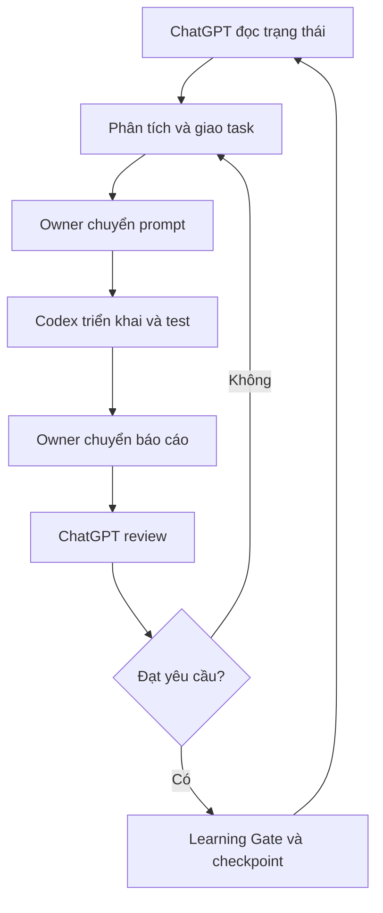
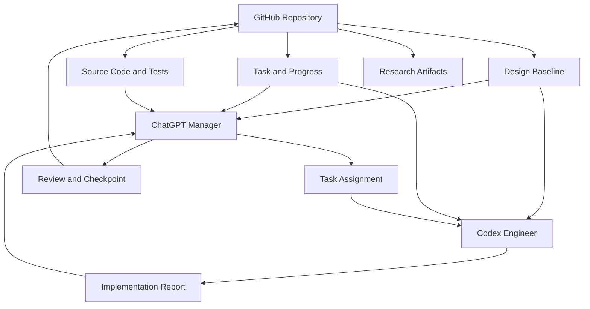
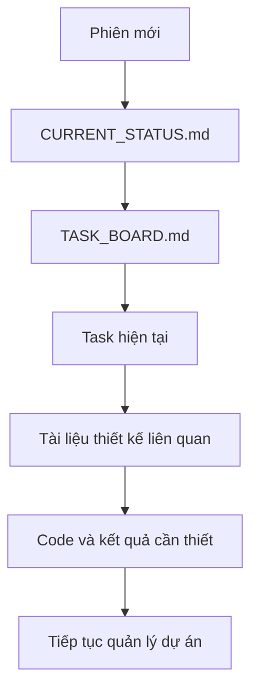
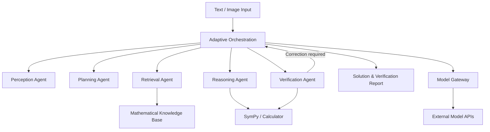
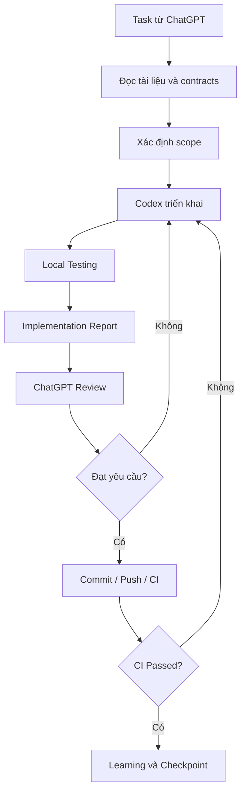
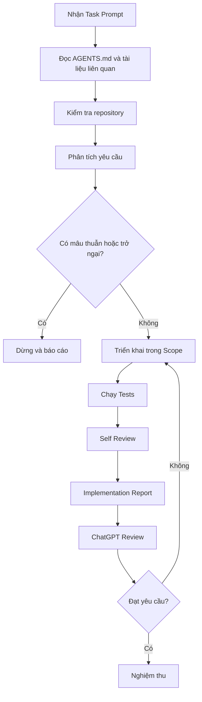
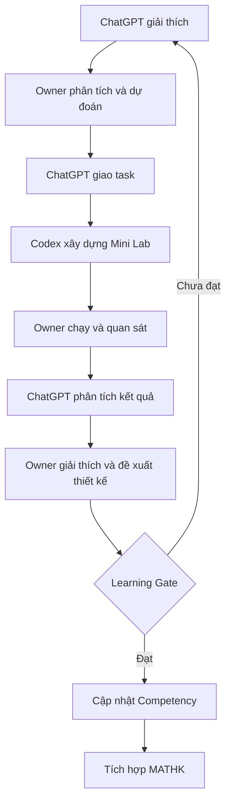
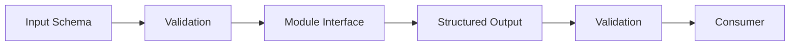
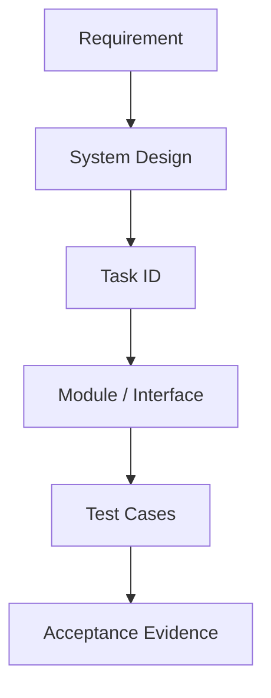
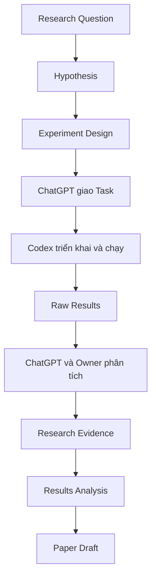

# MATHK — Documentation

**Phiên bản:** 0.9

**Trạng thái:** Đang thảo luận

## 1. Project Management & Agent Collaboration

**Trạng thái: Đã chốt.**

Project Owner (người học) giữ quyền quyết định cuối cùng, thiết kế và học tập; ChatGPT là Project Manager & Technical Lead, quản lý context, chia task, soạn prompt, review và hướng dẫn; Codex là Software Engineer, triển khai code, test, sửa lỗi và báo cáo. Owner chuyển tiếp prompt và báo cáo giữa hai agent. GitHub là Single Source of Truth.



Prompt tiếng Việt: Task ID, Context, Objective, References, Scope, Requirements, Constraints, Acceptance Criteria, Testing, Deliverables, Report Format. Codex không tự đổi kiến trúc, thêm dependency, vượt scope hoặc phase; báo cáo file thay đổi, test results, quyết định, lỗi và vấn đề tồn tại; dừng báo cáo mâu thuẫn. ChatGPT đối chiếu báo cáo với yêu cầu và đọc code/diff khi cần, không mặc định báo cáo đúng.

Task lifecycle: PLANNED → ASSIGNED → IN_PROGRESS → IN_REVIEW → ACCEPTED → COMPLETED; NEEDS_REVISION quay lại triển khai. COMPLETED cần Engineering Gate, Learning Gate và Checkpoint Gate. Owner giữ quyền phê duyệt quyết định quan trọng.

Quản lý dài hạn: AGENTS.md; docs/management/WORKFLOW.md, TASK_BOARD.md, DECISION_LOG.md; docs/progress/CURRENT_STATUS.md và phase_00.md, các phase tiếp theo theo nhu cầu. Checkpoint sau từng task nghiệm thu, không chờ context gần đầy. CURRENT_STATUS ghi phase, task, kết quả, vấn đề mở và bước tiếp theo. Các file bổ sung sẽ được tạo theo nhu cầu, chưa mặc định tồn tại.

Trọng tâm học: system/model/data thinking, cost optimization, research methodology, technical review; Codex đảm nhiệm phần lớn code. ChatGPT giao việc bằng prompt cho Owner chuyển tiếp, không tuyên bố điều khiển trực tiếp Codex.

## 2. Documentation Strategy

**Trạng thái: Đã chốt.**

### 2.1. Mục tiêu
DO01 nhất quán kiến trúc; DO02 khôi phục context; DO03 hướng dẫn coding agent; DO04 tiến độ/năng lực; DO05 quyết định kỹ thuật; DO06 tái lập nghiên cứu; DO07 bàn giao/vận hành.

### 2.2. Phân loại
Design (8 tài liệu), Management (task/workflow/decisions), Agent (AGENTS.md), Learning (labs/competency), Technical (API/schema/interface), Research (benchmark/experiment/paper), Operational (setup/vận hành/lỗi).

### 2.3. Single Source of Truth

Owner chuyển tiếp prompt/report; đọc trạng thái GitHub trước khi giao task trong phiên mới. Artifacts lớn hoặc riêng tư lưu ngoài Git, manifest và tham chiếu version hóa theo tài liệu 04/06.

### 2.4. Principles
Docs-first, Single Source of Truth, Living Documentation, Traceability (Requirement → Design → Task → Code → Test), Incremental Documentation, Context-efficient, Vietnamese-first.

### 2.5. Quyền quản lý
ChatGPT đề xuất thiết kế, Owner phê duyệt; ChatGPT quản lý task và kiểm tra nhất quán; Codex cập nhật tài liệu kỹ thuật theo code trong scope; ChatGPT và Owner cập nhật learning checkpoint. Codex không tự sửa baseline để hợp thức hóa code sai. Documentation-driven Development + AI-assisted Project Management.


## 3. Documentation Structure

**Trạng thái: Đã chốt.**

### 3.1. Cấu trúc
```text
MathAgents_MATHK/
├── README.md
├── AGENTS.md
├── docs/
│   ├── 01_REQUIREMENTS.md
│   ├── 02_RESEARCH.md
│   ├── 03_SYSTEM_DESIGN.md
│   ├── 04_PROJECT_STRUCTURE.md
│   ├── 05_IMPLEMENTATION.md
│   ├── 06_EVALUATION.md
│   ├── 07_DEPLOYMENT.md
│   ├── 08_DOCUMENTATION.md
│   ├── management/
│   │   ├── WORKFLOW.md
│   │   ├── TASK_BOARD.md
│   │   └── DECISION_LOG.md
│   ├── progress/
│   │   ├── CURRENT_STATUS.md
│   │   └── phase_00.md ...
│   ├── guides/
│   │   ├── DEVELOPER_GUIDE.md
│   │   ├── USER_GUIDE.md
│   │   └── TROUBLESHOOTING.md
│   ├── technical/
│   │   ├── API_REFERENCE.md
│   │   └── DATA_CONTRACTS.md
│   └── research/
│       ├── EXPERIMENT_LOG.md
│       ├── RESULTS_ANALYSIS.md
│       └── PAPER_DRAFT.md
└── labs/
    └── phase_00/ ...
```

### 3.2. Ownership
ChatGPT: AGENTS, WORKFLOW, TASK_BOARD, DECISION_LOG, CURRENT_STATUS; ChatGPT + Owner: phase_XX; Codex: API_REFERENCE, DATA_CONTRACTS theo scope và review.

### 3.3. Context


### 3.4. Thời điểm
Trước Phase 0: AGENTS, WORKFLOW, TASK_BOARD, CURRENT_STATUS, DECISION_LOG. Phase 0–1: README, Developer Guide, Mini Labs. Phase 2–3: API Reference, Data Contracts. Phase 4–6: User Guide, Troubleshooting. Phase 7: Experiment Log, Results Analysis, Paper Draft.

### 3.5. Nguyên tắc
Không tạo file rỗng hàng loạt; tránh sao chép, dùng liên kết Markdown; mỗi thông tin một nguồn chính thức; cập nhật sau từng task/quyết định quan trọng. Ưu tiên bộ tài liệu quản lý agent trước Phase 0.


## 4. Project README

**Trạng thái: Đã chốt.**

### 4.1. Mục tiêu
Trang giới thiệu kỹ thuật và nghiên cứu cho giảng viên, nhà tuyển dụng, nhà nghiên cứu và developer; không chỉ giới thiệu ứng dụng giải toán.

### 4.2. Cấu trúc
Project Overview, Problem Statement, Research Objectives, Key Features, System Architecture, Technology Stack, Demo, Quick Start, Project Structure, Evaluation Results, Development Roadmap, Documentation, Limitations, References & License.

### 4.3. Sơ đồ tổng quan

Sơ đồ tổng quan, không quy định thứ tự thực thi cố định; các kết nối logic tuân thủ gateway/guard/interface trong System Design.

### 4.4. Cập nhật theo milestone
Phase 0: giới thiệu, mục tiêu, môi trường, roadmap. MVP A: Quick Start và ví dụ Text Solver. MVP B: Multi-Agent và Retrieval. MVP C: demo, Adaptive Routing, Verification. MVP D: benchmark, ablation, kết quả và giới hạn.

### 4.5. Nguyên tắc
Phân biệt tính năng thực tế/dự kiến; không công bố benchmark giả lập như kết quả thật, không khẳng định novelty chưa kiểm chứng. Liên kết System Design thay sao chép. Tiếng Việt, giữ thuật ngữ tiếng Anh; README_EN.md P1 khi công bố hoặc ứng tuyển.

### 4.6. Ownership
ChatGPT định hướng; Codex cập nhật lệnh/ví dụ thực tế; ChatGPT và Owner xác minh kết quả; Owner phê duyệt công bố.


## 5. Developer Guide

**Trạng thái: Đã chốt.**

### 5.1. Mục tiêu
docs/guides/DEVELOPER_GUIDE.md hướng dẫn Owner, Codex và developer phát triển hệ thống, không dạy Python từ đầu.

### 5.2. Cấu trúc
Development Environment, Getting Started, Architecture Overview, Coding Standards, Dependency Management, Extension Guide, Testing Guide, Debugging Guide, Git Workflow, Contribution Rules.

### 5.3. Extension Guide
| Mở rộng | Thành phần |
|---|---|
| LLM Provider | Model Gateway |
| Agent | Agent Contract, Orchestrator |
| Math Tool | Tool Registry, Execution Guard |
| Retrieval | Retrieval Interface |
| Routing | Adaptive Router |
| Verification | Verification Interface |
| Metric | Evaluation Framework |
| UI | Application Interface |

Mỗi hướng dẫn gồm mục đích, module, data contract, sơ đồ luồng, ví dụ triển khai và kiểm thử.

### 5.4. Workflow

Owner chuyển tiếp prompt/report.

### 5.5. Quy tắc
Tuân thủ Modular Monolith và Dependency Rules; tái sử dụng interface, tránh abstraction thừa; dependency mới cần lý do/phê duyệt; thay đổi hành vi cần test; không bypass Execution Guard, không vượt scope; cập nhật tài liệu kỹ thuật khi interface đổi.

### 5.6. Developer Guide và AGENTS.md
Developer Guide giải thích kiến trúc, ví dụ, hướng dẫn mở rộng cho người và agent, cập nhật theo phase. AGENTS.md ngắn gọn, có tính chỉ thị, quy định hành vi và ràng buộc cho coding agent, cập nhật khi quy trình thay đổi.

### 5.7. Ownership
ChatGPT định hướng/review; Codex bổ sung theo implementation thực tế; Owner dùng tài liệu để học và đánh giá quyết định. Phát triển dần theo phase, ưu tiên Extension Guide và System Thinking.


## 6. AI Agent Instructions — AGENTS.md

**Trạng thái: Đã chốt.**

### 6.1. Phân tầng chỉ thị
AGENTS.md → Approved Design Documents → Task Prompt → Implementation Decisions. Đây là thứ tự quy tắc nội bộ dự án, không thay thế chỉ thị cấp hệ thống hoặc quyền hạn thực tế của agent. Mâu thuẫn phải dừng và báo cáo.

### 6.2. Cấu trúc
Project Context, Agent Role, Source of Truth, Architecture Rules, Coding Standards, Task Execution Protocol, Testing Requirements, Security Rules, Reporting Protocol, Git Rules, Context Management.

### 6.3. Quyền hạn
Tự triển khai code/test/sửa lỗi trong scope, đọc repo, cập nhật tài liệu kỹ thuật liên quan. Cần phê duyệt dependency mới, đổi kiến trúc, public interface ngoài task, chi phí ngoài budget. Commit/push theo task prompt; không tự xóa dữ liệu hoặc force push.

### 6.4. Task Execution Protocol

Owner chuyển tiếp prompt/report.

### 6.5. Implementation Report
Task ID; Status (Completed/Partial/Blocked); Summary; Changed Files và lý do; Technical Decisions; Test Results (lệnh và kết quả thật); Acceptance Criteria (PASS/FAIL/NOT_RUN); Resource Usage (API/token/cost nếu có); Known Issues; Git Status (branch/commit/push); Learning Notes. ChatGPT review trước nghiệm thu.

### 6.6. Learning-aware Coding
Comment tiếng Việt tại logic quan trọng, giải thích lý do lựa chọn; dễ hiểu/test/mở rộng; Mini Lab có tham số thực nghiệm; nêu trade-off model/data/architecture/accuracy/cost; không comment từng dòng hoặc dạy cú pháp cơ bản.

### 6.7. Context Optimization
AGENTS.md mỗi phiên; CURRENT_STATUS khi bắt đầu/khôi phục; Task Prompt mỗi task; design sections liên quan; code module và dependencies; previous reports khi tiếp tục/sửa. AGENTS.md ngắn gọn, dẫn liên kết chi tiết.

### 6.8. Ownership
ChatGPT soạn/quản lý AGENTS.md, Codex không tự sửa nội quy. Codex tự chủ implementation trong scope, không tự quyết mục tiêu/kiến trúc/acceptance. Tạo AGENTS.md chính thức sau tài liệu 08, trước task đầu Phase 0.


## 7. Learning Documentation

**Trạng thái: Đã chốt.**

### 7.1. Mục tiêu
Gắn với 73 Mini Labs và 40 năng lực trong Implementation Roadmap; hiểu, thiết kế và đánh giá hệ thống thay vì viết code từng dòng.

### 7.2. Mini Lab
Ví dụ labs/phase_00/06_model_gateway/ gồm README.md (lý thuyết, sơ đồ, mục tiêu, hướng dẫn), exercise.py (code Codex), test_exercise.py (kiểm chứng), notes.md (kết quả và nhận xét). Chỉ tạo file cần thiết.

### 7.3. Learning Content Template
Problem, Core Concepts, Architecture, Code Walkthrough theo khối logic, Experiment, Trade-offs, Knowledge Check, MATHK Integration.

### 7.4. Learning Workflow

Owner chuyển tiếp prompt/report; không bắt buộc viết lab từ đầu.

### 7.5. Competency Tracking
L0 chưa học; L1 hiểu/giải thích; L2 đọc code/dự đoán/thực nghiệm; L3 thiết kế/giao việc/review; L4 phân tích trade-off/debug/vận dụng. Đánh giá dựa trên bằng chứng, không số dòng code hoặc số lab đã chạy.

### 7.6. Learning Checkpoint
Sau lab/task ghi kiến thức và competency, thực nghiệm, kết quả/nhận xét của Owner, điểm chưa hiểu, quyết định áp dụng, mức đạt và bằng chứng, bước học tiếp. Lưu docs/progress/phase_XX.md và cập nhật CURRENT_STATUS.md.

### 7.7. Ownership
ChatGPT thiết kế bài học, giải thích, đánh giá năng lực và lưu checkpoint; Codex viết code thực nghiệm; Owner + Codex chạy, Owner + ChatGPT phân tích. System-first, AI-assisted, Experiment-driven, Competency-based; quản lý song song tiến độ kỹ thuật và học tập.


## 8. Architecture & API Documentation

**Trạng thái: Đã chốt.**

### 8.1. Phân loại
03_SYSTEM_DESIGN: thiết kế; 04_PROJECT_STRUCTURE: cấu trúc/dependency rules; technical/API_REFERENCE.md: interface thực tế; technical/DATA_CONTRACTS.md: schema thực tế; code: implementation; tests: kiểm chứng.

### 8.2. Sơ đồ
Mermaid component, sequence, state, flowchart, ER, dependency graph; tham chiếu sơ đồ thiết kế hiện có thay vì sao chép.

### 8.3. API Reference
Python Interface chính, không mặc định REST. Mô tả Application API (solve/resume/cancel/trace), Model Gateway, Agent Contract, Math Tools, Retrieval, Verification, Persistence, Evaluation; mỗi interface nêu mục đích, input/output, ví dụ, lỗi và ràng buộc.

### 8.4. Data Contracts

Pydantic schema trong code là nguồn chính thức của hợp đồng thực tế; tài liệu giải thích ý nghĩa, cách dùng, quan hệ, không duy trì định nghĩa trùng lặp. ProblemInput, AgentResult, ToolRequest, VerificationReport, SolveResult theo phase.

### 8.5. Traceability


### 8.6. Công nghệ
Markdown, Mermaid, Pydantic, Python docstrings, JSON Schema export khi cần; documentation website P1; chưa cần MkDocs/Sphinx/Swagger trong MVP.

### 8.7. Ownership
Codex cập nhật kỹ thuật theo code; ChatGPT review nhất quán kiến trúc/contracts/code/tests. Báo cáo sai lệch trước khi sửa baseline. Lightweight Architecture Documentation + Code-first API Contracts + Requirements Traceability.


## 9. Research Documentation

**Trạng thái: Đã chốt.**

### 9.1. Mục tiêu
Quản lý bằng chứng nghiên cứu từ phase đầu, không đợi Phase 7.

### 9.2. Tổ chức
02_RESEARCH.md: literature/gap/RQ; 06_EVALUATION.md: phương pháp; docs/research/EXPERIMENT_LOG.md, RESULTS_ANALYSIS.md, PAPER_DRAFT.md; experiments/configs, results, exports. Artifacts lớn/riêng tư không commit, quản lý manifest theo 04/06.

### 9.3. Experiment Documentation
Experiment ID, Objective, Hypothesis, Configuration, Controlled Variables, Dataset Version, Metrics, Results, Analysis, Limitations, Conclusion, Reproducibility (commit/config/artifact). Tham chiếu manifest thay sao chép metadata.

### 9.4. Workflow


### 9.5. Paper
Abstract, Introduction, Related Work, Methodology, Experimental Setup, Results, Discussion, Limitations, Conclusion, References. Bản thảo tiếng Việt; bản công bố quốc tế tiếng Anh.

### 9.6. Research Integrity
Không giả kết quả/cherry-pick/khẳng định novelty chưa kiểm chứng; phân biệt giả thuyết, quan sát và kết luận; bảo toàn reproducibility và ground truth isolation.

### 9.7. Ownership
ChatGPT + Owner: research design, literature review, error analysis, scientific writing. Codex: experiment implementation/execution. ChatGPT + Codex: statistical analysis. Owner phê duyệt kết luận.

### 9.8. Thời điểm
P0–2 model/prompt/tool; P3–4 multi-agent/retrieval/context; P5–6 adaptive routing/verification/correction/multimodal; P7 benchmark chính thức/baseline/ablation/statistics/paper. Phân biệt dev experiments với held-out; research hypotheses chưa duyệt vẫn chưa được coi là baseline. Evidence-driven, Reproducible, Incremental.


## 10. User & Deployment Guide

*Chưa chốt.*

## 11. Context & Progress Management

*Chưa chốt.*

## 12. Documentation Maintenance

*Chưa chốt.*
